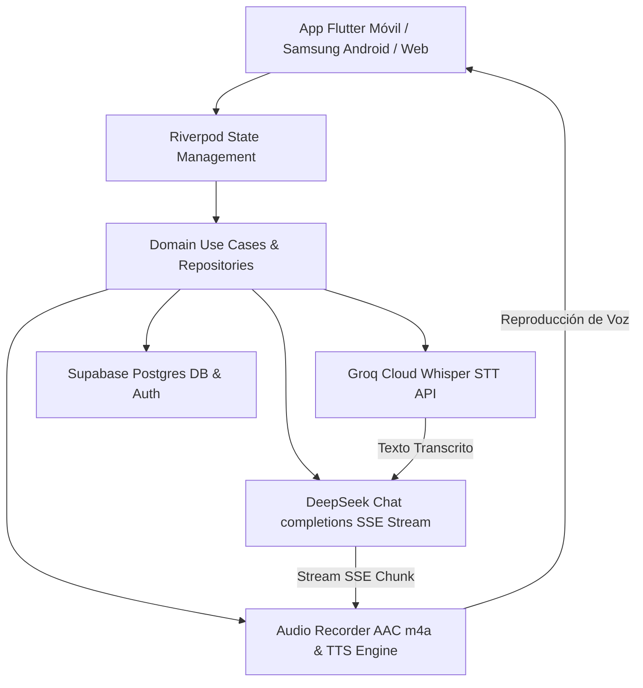

# Documento Maestro de Contexto Técnico y de Negocio

> **Proyecto:** TutorSaas — Plataforma SaaS de Conversación e Inteligencia Artificial para el Aprendizaje de Idiomas  
> **Versión del Documento:** 1.0.0  
> **Fecha de Auditoría:** 21 de Julio de 2026  
> **Estado del Sistema:** Producción / Desplegado en Dispositivos Android

---

# 1. RESUMEN EJECUTIVO

**TutorSaas** es una plataforma tecnológica de vanguardia (SaaS Móvil & Web) diseñada para revolucionar el aprendizaje adaptativo de idiomas mediante interacción conversacional por voz y texto en tiempo real con Inteligencia Artificial.

### Problema que Resuelve
La mayoría de los estudiantes de idiomas enfrentan la "barrera del habla" (*speech barrier*): comprenden la gramática o lectura, pero sienten ansiedad, falta de fluidez o falta de oportunidades de práctica hablada con hablantes nativos. Las tutorías tradicionales son costosas, poco flexibles e inflexibles.

### Público Objetivo
- Estudiantes de nivel principiante a avanzado (CEFR A1 a C1).
- Profesionales que buscan mejorar su inglés técnico o de negocios (*Business & Tech English*).
- Viajeros y entusiastas del aprendizaje de idiomas que requieren práctica en escenarios de la vida real.

### Objetivo Principal y Propuesta de Valor
Proporcionar un tutor personal de IA accesible 24/7 que escucha, comprende, corrige errores gramaticales de forma empática en tiempo real, mantiene diálogos de roleplay inmersivos en menos de 1 segundo de latencia y monitorea la biometría del habla y el vocabulario aprendido del usuario.

---

# 2. DESCRIPCIÓN GENERAL DEL NEGOCIO

- **Nicho de Mercado:** EdTech, EdTech basada en IA Generativa y Aprendizaje Conversacional de Idiomas.
- **Perfil de Usuarios:** Estudiantes autodidactas, profesionales corporativos, estudiantes universitarios y nómadas digitales.
- **Casos de Uso Principales:**
  1. *Chat Libre ("Hablar Ahora")*: Diálogo abierto sobre cualquier tema con corrección gramatical inmediata.
  2. *Lecciones Recomendadas (Roleplays Escenarios)*: Simulación de misiones específicas (ej. pedir comida en restaurantes, entrevistas de trabajo tech, check-in en aeropuertos y hoteles).
  3. *Salas de Voz Grupales (`/chat-rooms`)*: Práctica colaborativa en ambientes sociales de audio.
  4. *Monitoreo Biométrico del Habla ("Huella de Voz")*: Análisis de claridad fonética, palabras por minuto (WPM) y fonemas a practicar (`/th/`, `/r/`).

### Análisis SWOT (FODA) de Negocio

| Fortalezas | Oportunidades |
| :--- | :--- |
| • Latencia ultra-baja (<1s ida y vuelta).<br>• Asistente de IA inmersivo con correcciones empáticas.<br>• Persistencia y evaluación en tiempo real de metas en Supabase.<br>• UI de cristal de alta fidelidad (*Glassmorphism*). | • Expansión a mercados corporativos B2B (capacitación de empresas).<br>• Soporte multilenguaje ampliado (Francés, Portugués, Alemán, Italiano).<br>• Integración de clonación de voz y avatares fotorrealistas. |
| **Debilidades** | **Amenazas** |
| • Dependencia de conexiones a internet para inferencia de LLM en la nube.<br>• Inexistencia actual de modo 100% offline para áreas sin cobertura. | • Cambios de precios o cuotas de consumo en APIs de modelos cloud (Groq/DeepSeek).<br>• Competidores tradicionales lanzando funciones de voz en aplicaciones masivas. |

---

# 3. MODELO DE NEGOCIO Y MONETIZACIÓN

- **Modelo:** SaaS Freemium B2C con suscripción mensual/anual recurrente.
- **Capas de Valor:**
  - *Plan Gratuito*: Acceso a minutos diarios limitados de conversación de voz y catálogo básico de lecciones A1/A2.
  - *Plan PRO (Suscripción)*: Conversaciones de voz ilimitadas, acceso al catálogo de lecciones avanzadas B1/B2/C1, análisis completo de biometría del habla (*Speech DNA*), salas de voz privadas y personalización del nivel de corrección gramatical.
- **Integración de Monetización:** Pantalla Paywall integrada (`/paywall`) con triggers de actualización de cuenta a Premium en la tabla `user_settings`.

---

# 4. ARQUITECTURA GENERAL DEL SISTEMA

El sistema sigue una **Arquitectura Limpia Modular (*Clean Architecture*)** basada en la separación de responsabilidades:



---

# 5. ARQUITECTURA FRONTEND (FLUTTER)

- **Framework:** Flutter SDK 3.29.0 / Dart 3.11.5
- **Gestión de Estado:** `flutter_riverpod: ^2.5.1` + `hooks_riverpod` + `StateNotifierProvider`.
- **Navegación:** `go_router: ^14.0.0` (Enrutamiento declarativo por URI).
- **Diseño UI / Styling:**
  - Estética *Deep Space Glassmorphism* (`#0B1326` de fondo, tarjetas translúcidas `GlassCard` con desenfoque de 20px).
  - Tipografía moderna `GoogleFonts.hankenGrotesk`.
  - Iconografía vectorial `CupertinoIcons` y `Material Icons`.

### Mapa de Rutas de Navegación (`lib/app/router.dart`)

```
/                       --> WelcomeScreen (Pantalla de bienvenida y Auth)
├── /onboarding         --> OnboardingScreen (Evaluación de nivel e intereses)
├── /home               --> DashboardScreen (Pantalla principal, métricas y lecciones)
│   ├── /profile        --> ProfileScreen (Perfil de usuario)
│   │   └── /profile-edit --> ProfileEditScreen (Edición de perfil)
│   ├── /settings       --> SettingsScreen (Ajustes de nivel de corrección)
│   └── /paywall        --> PaywallScreen (Suscripción PRO)
├── /conversation       --> ConversationScreen (Chat de Voz / Texto interactivo)
├── /summary            --> SessionSummaryScreen (Resumen de sesión practicada)
├── /chat-rooms         --> ChatRoomsScreen (Salas de voz colectivas)
└── /voice-room         --> VoiceRoomScreen (Sala de voz activa por roomId)
```

---

# 6. ARQUITECTURA BACKEND Y BASE DE DATOS (SUPABASE)

El backend opera sobre **Supabase (Postgres Managed)** integrando Autenticación, Base de Datos en Tiempo Real y RLS (*Row Level Security*).

### Diccionario de Datos del Esquema Postgres

#### 1. `users`
- `id` (UUID, PK): ID único del usuario vinculado a Supabase Auth.
- `display_name` (VARCHAR): Nombre público.
- `avatar_url` (VARCHAR): URL de foto de perfil.
- `native_language` (VARCHAR): Idioma nativo del usuario (default `'es'`).

#### 2. `user_language_profiles`
- `user_id` (UUID, FK): Vínculo con `users.id`.
- `language_id` (INT): Idioma practicado (ej. 1 = Inglés).
- `total_minutes` (INT): Acumulado de minutos hablados.
- `xp_points` (INT): Puntos de experiencia ganados.
- `current_streak` (INT): Racha actual de días consecutivos.
- `longest_streak` (INT): Racha máxima histórica.
- `last_practice_date` (DATE): Última fecha de práctica.

#### 3. `conversations`
- `id` (UUID / VARCHAR, PK): ID único de la sesión conversacional.
- `user_id` (UUID, FK): Usuario propietario.
- `scenario_id` (VARCHAR): Lección o escenario asociado (ej. `'l1'`, `'a2_hotel'`).
- `started_at` (TIMESTAMPTZ): Hora de inicio.
- `status` (VARCHAR): Estado (`'active'`, `'completed'`).

#### 4. `messages`
- `id` (UUID, PK): Mensaje individual.
- `conversation_id` (VARCHAR, FK): Vínculo con `conversations.id`.
- `sender_role` (VARCHAR): `'user'` o `'assistant'`.
- `text` (TEXT): Contenido del mensaje.
- `created_at` (TIMESTAMPTZ): Timestamp del mensaje.

#### 5. `daily_stats`
- `user_id` (UUID, FK): Propietario.
- `date` (DATE): Fecha del registro.
- `minutes_practiced` (INT): Minutos acumulados en el día.
- `conversations_count` (INT): Número de conversaciones completadas.
- `xp_earned` (INT): Puntos XP ganados en el día.

#### 6. `user_vocabulary` & `vocabulary_items`
- Almacena palabras nuevas en inglés usadas correctamente por el usuario, su traducción en español, nivel CEFR y fechas de repaso espaciado.

---

# 7. ARQUITECTURA DE INTELIGENCIA ARTIFICIAL Y LATENCIA

### Pipeline de Voz e Inferencia (Latencia ~1.0 Segundos)

1. **Captura de Audio Local**:
   - Paquete `record: ^4.4.4` captura audio nativo en formato AAC `.m4a` a 16 kHz / 128 kbps (~100ms).
2. **Reconocimiento del Habla (STT)**:
   - Endpoint: `https://api.groq.com/openai/v1/audio/transcriptions`
   - Modelo: `whisper-large-v3-turbo` con parámetro forzado `'language': 'en'` para evitar traducciones indeseadas al español y maximizar velocidad (~350ms).
3. **Generación del Tutor IA (LLM)**:
   - Endpoint: `https://api.deepseek.com/v1/chat/completions`
   - Modelo: `deepseek-chat` en streaming SSE. Recibe el rol específico de la lección (ej. mesero, recepcionista) y el nivel CEFR (`A1` a `C1`) (~250ms TTFT).
4. **Síntesis de Voz (TTS)**:
   - Procesamiento local en el dispositivo vía `flutter_tts: ^4.0.0` (voz `en-US`, rate `0.48`) eliminando la latencia de red para TTS (~300ms).

---

# 8. ARQUITECTURA DE APRENDIZAJE Y MISIONES

- **Catálogo de Lecciones (`LessonCatalog`)**: Organizado por nivel CEFR (`A1`, `A2`, `B1`, `B2`, `C1`) y temas de interés (*travel*, *food*, *business*, *tech*, *hotel*, *shopping*).
- **Misiones Dinámicas (Brújula 🧭)**:
  - Cada lección define su **Objetivo Principal**, **5 Metas de Escenario Exclusivas** y **10 Frases Clave (*Useful Phrases*)**.
- **Motor Evaluador en Tiempo Real**:
  - Analiza en segundo plano el texto del usuario y actualiza dinámicamente el progreso de las metas de **Pendiente (`radio_button_unchecked`)** a **Completado (`check_circle_rounded`)** con su ganchito verde (`✓`).

---

# 9. APIS E INTEGRACIONES EXTERNAS

| Servicio | Propósito | Endpoint / Protocolo | Autenticación |
| :--- | :--- | :--- | :--- |
| **Supabase** | Base de Datos, Auth & Storage | `https://sipiumfdpvnszthykyog.supabase.co` | Bearer ANON JWT Key |
| **Groq Cloud** | STT Whisper de alta velocidad | `https://api.groq.com/openai/v1/audio/transcriptions` | API Key (`gsk_...`) |
| **DeepSeek AI** | LLM Conversacional en Streaming | `https://api.deepseek.com/v1/chat/completions` | API Key (`sk-592200...`) |

---

# 10. SEGURIDAD Y CONFIGURACIÓN

- **Autenticación:** Supabase Auth (Email/Password & Google Sign-In).
- **Inyección de Credenciales:** Soporte para `--dart-define` y `--dart-define-from-file=config.json` en builds de producción.
- **Manejo de Errores de Red:** Wrappers con `try-catch` en proveedores Riverpod para evitar pantallas rojas (*SocketException*) ante desconexiones o cambios de red.

---

# 11. MATRIZ DE RIESGOS TÉCNICOS Y DEUDA TÉCNICA

- **Riesgo Alto:** Agotamiento de cuota de API Keys en producción ➔ *Mitigación:* Implementar balanceo y rotación de claves en variables de entorno de servidor.
- **Deuda Técnica Menor:** Migrar llamadas HTTP directas en repositorios hacia esquemas de caché local con `shared_preferences` para funcionamiento 100% offline.

---

# 12. GUÍA PARA FUTURAS IA Y PROMPT CONTEXT EXPORT

## Cómo Modificar Este Sistema

Si eres una Inteligencia Artificial modificando este repositorio en el futuro:

1. **Gestión de Estado:** Cualquier nueva variable conversacional debe agregarse en `lib/features/conversation/domain/models/conversation_state.dart` (modelo Freezed) y actualizarse a través de `ConversationNotifier` en `conversation_providers.dart`.
2. **Lecciones y Escenarios:** Para agregar una nueva lección recomendada, agrégala en `LessonCatalog.catalog` en `lib/features/dashboard/data/models/lesson_catalog.dart` especificando su `id`, `level`, `category`, `initialAssistantMessage`, 5 `goals` y 10 `usefulPhrases`.
3. **Estilos Visuales:** Mantén los tokens de color definidos en `lib/core/theme/app_colors.dart` y utiliza el widget `GlassCard` para componentes flotantes.
4. **Verificación Obligatoria:** Después de hacer cualquier edición de código, ejecuta siempre `flutter test` en la terminal para asegurar que ningún test unitario ni benchmark de latencia se haya roto.

---
*Fin del Documento Maestro contexto.md*
