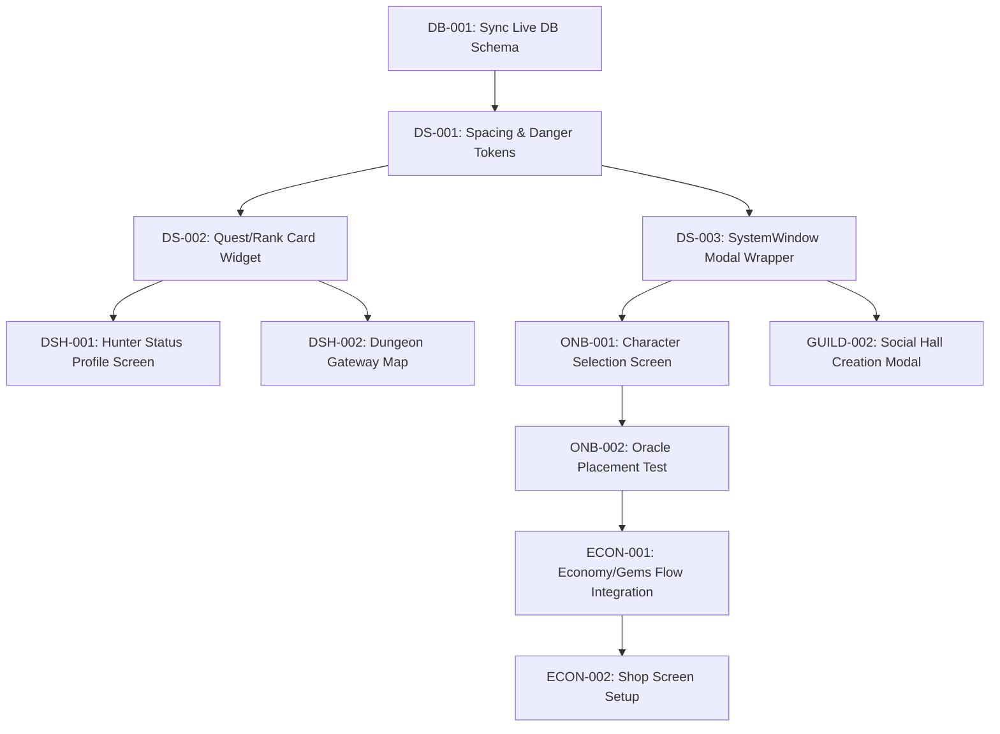

# Implementation Master Plan — TutorSaas / Dungeon of English

## 1. Overview & Objectives
This Master Plan sets a controlled, step-by-step path to elevate the TutorSaas application to meet visual and functional requirements. 
Our primary focus areas:
1. **Design System Consolidation:** Integrate and apply abyssal-themed colors, geometries, and widgets to eliminate visual discrepancies.
2. **Onboarding Integration:** Connect and wire all untracked screens (`character_creation_wizard`, `oracle_test_screen`) to establish a seamless player welcome.
3. **Core Gameplay Loop:** Connect scenarios map -> conversation -> session summaries.
4. **Database & Infrastructure Stability:** Audit DB schemas, deploy migrations, and enforce RLS tables.

---

## 2. Scope & Boundaries
* **In Scope:**
  * Core layout alignment with `PlantillaHtml/` visual design sheets.
  * Router integration for all planned routes.
  * Stability fixes for multi-user chat rooms.
  * Verification of state notifications and economy logic.
* **Out of Scope:**
  * Modifying the core STT/Groq/DeepSeek AI audio parsing pipelines.
  * Introducing new light mode options (System is strictly dark).

---

## 3. Order of Implementation & Critical Path
Our strategy prioritizes structural dependencies first, followed by visual templates, and finishes with premium/feature integrations.

---

## 4. Risks & Mitigations
* **Risk 1: Uncommitted Code Loss (Critical)**
  * *Description:* Running aggressive git commands could clear current uncommitted features.
  * *Mitigation:* Ensure that a full Git commit is run before executing any subsequent tasks, and manually backup the directory if needed.
* **Risk 2: Supabase DDL Execution Limits on Production Project**
  * *Description:* Live project databases might block standard DDL execution.
  * *Mitigation:* Deploy queries incrementally via Supabase dashboard SQL Editor or run locally against test DB first.

---

## 5. Rollback Strategy
* Before making modifications to any file, verify code states.
* Keep edits small and localized to single files where possible.
* If a code change breaks compiling or analysis:
  1. Revert specifically the target code chunks using standard code edits.
  2. Do NOT run broad `git checkout` or `git restore` operations.

---

## 6. Verification and QA Protocol
Every completed backlog task must undergo:
1. **Static Analysis:** Execute `flutter analyze` ensuring 0 new compilation issues.
2. **Visual Inspection:** Verify rendering against template guidelines in `PlantillaHtml/`.
3. **Automated Testing:** Run `flutter test` to ensure unit test suites stay green.
