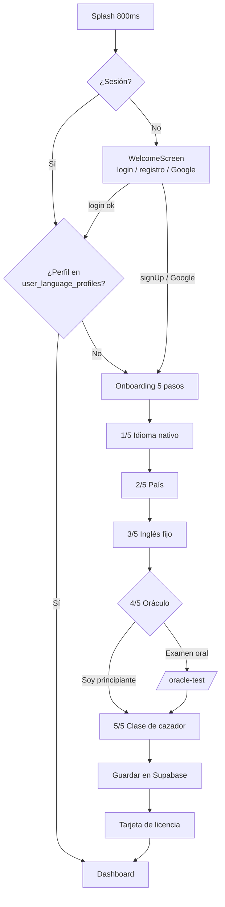
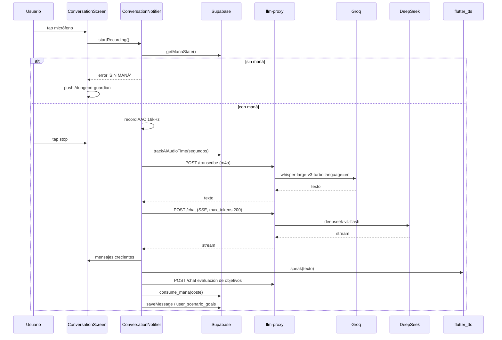
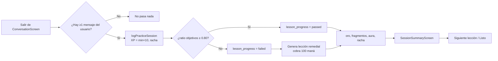
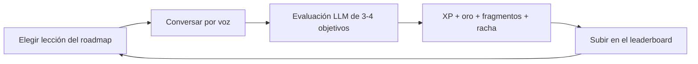
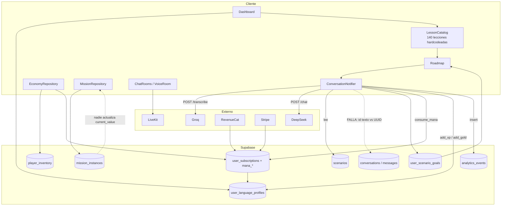

# Auditoría Integral — Dungeon of English (TutorSaas)

**Fecha:** 17 de octubre de 2026
**Repositorio auditado:** `C:\WorkSpace\TutorSaas`
**Alcance:** producto, juego, pedagogía, UX/UI, arquitectura, IA, negocio, seguridad, datos, calidad y competencia.
**Modo:** auditoría de solo lectura. No se modificó código, esquema, configuración ni dependencias. El único archivo creado es este documento.

---

## 0. Cómo leer este documento

### 0.1 Regla de evidencia

Cada afirmación relevante lleva **archivo y símbolo**. Cuando no fue posible comprobarla, se marca explícitamente. Se distinguen cuatro niveles:

| Etiqueta | Significado |
|---|---|
| **[H]** Hecho observado | Leído directamente en el código, SQL o configuración del repo |
| **[I]** Inferencia | Conclusión razonada a partir de hechos observados |
| **[H?]** Hipótesis pendiente | Plausible, pero requiere datos que el repo no contiene |
| **[R]** Recomendación | Dirección futura; no forma parte del estado actual |

### 0.2 Leyenda de estados de implementación

| Estado | Criterio aplicado |
|---|---|
| **Verificada** | Código completo y comportamiento confirmado por lectura de la cadena UI → dominio → datos |
| **Parcial** | Existe código, faltan piezas relevantes del flujo |
| **Sin verificar** | Existe código; requiere ejecución o base de datos viva para confirmar |
| **Simulada** | Usa valores estáticos, fórmulas cosméticas o datos ficticios presentados como reales |
| **Diseñada, no implementada** | Aparece en docs/diseño, sin implementación funcional |
| **Muerta / desconectada** | Código sin consumidores o fuera del flujo principal |
| **Bloqueada** | Depende de algo ausente o defectuoso (RLS, secreto, migración) |
| **No encontrada** | Sin evidencia; se distingue de "ausencia confirmada" |

### 0.3 Limitaciones de esta auditoría

1. **Sin acceso a la base de datos viva.** Todo el SQL se leyó desde `supabase/migrations/`. No se pudo ejecutar `supabase migration list --linked`, `pg_policies` ni `pg_dump`. Por tanto, **qué migraciones están realmente aplicadas en el proyecto `sipiumfdpvnszthykyog` es desconocido**.
2. **No se ejecutó la app en dispositivo.** Los flujos se reconstruyeron estáticamente desde widgets, providers, repositorios y rutas.
3. **No se llamaron servicios de pago** (DeepSeek, Groq, Stripe, RevenueCat, LiveKit).
4. **Sí se ejecutaron comprobaciones seguras:** `flutter analyze` y `flutter test` (resultados en §20.2).
5. **No hay datos de usuarios reales.** Cualquier afirmación sobre retención, ingresos o aprendizaje efectivo es hipótesis, no medición.

---

## 1. Resumen ejecutivo

### 1.1 Qué es realmente el producto

**[H]** Dungeon of English es una app Flutter (Android/iOS) de práctica de **inglés conversacional** envuelta en una estética de **RPG isekai / manhwa / HUD de sistema**. El núcleo funcional no es un juego de rol: es un **tutor conversacional de voz** con escenarios, evaluación de objetivos y una capa de gamificación encima.

Cadena técnica real del núcleo:

```
micrófono → AAC-LC 16 kHz 128 kbps (.m4a)
        → Edge Function llm-proxy /transcribe → Groq whisper-large-v3-turbo (language='en')
        → Edge Function llm-proxy /chat → DeepSeek 'deepseek-v4-flash' (SSE, max_tokens 200)
        → flutter_tts (en-US, rate 0.48, pitch 1.05)
```

Evidencia: `lib/features/conversation/presentation/providers/conversation_providers.dart:310-320`, `:257-273`; `lib/features/conversation/data/repositories/conversation_repository_impl.dart:40-127`; `supabase/functions/llm-proxy/index.ts:176-208`.

### 1.2 Métricas del repositorio (medidas)

| Dimensión | Valor medido |
|---|---|
| Archivos Dart en `lib/` | **146** |
| Líneas Dart (físicas) | **≈56.300** |
| Features | **10** (`dashboard` 15,0k · `conversation` 4,5k · `onboarding` 4,1k · `chat_rooms` 3,9k · `economy` 3,2k · `missions` 1,3k · `subscription` 445 · `vocabulary` 274 · `auth` 147 · `presence` 121) |
| Rutas go_router | **16** |
| Pantallas | **15 archivos** `*_screen.dart` |
| Migraciones SQL | **128 archivos / 15.793 líneas** |
| Edge Functions | **7** (`llm-proxy`, `lesson-generator`, `livekit-token`, `missions-cron`, `revenuecat-webhook`, `stripe-checkout`, `stripe-webhook`) |
| Documentación previa | **233 archivos en 31 carpetas de `docs/`** + 13 MD en raíz |
| Tests | **15 archivos / 138 casos — todos pasan** |
| `flutter analyze` | **0 errores**, 36 warnings, 141 infos (177 problemas) |
| Git | **6 commits**; 51 archivos modificados y 29 sin trackear en el árbol de trabajo |

### 1.3 Veredicto general

**[I] El producto es un prototipo de alta fidelidad con un bucle de voz que funciona, no un SaaS listo para cobrar.** La capa visual y la narrativa están construidas con seriedad; la capa de datos, la economía, el sistema de misiones y la medición del aprendizaje no están cerradas.

Distinción importante para no confundir dos "producción":

| Uso | Estado |
|---|---|
| Publicar en Google Play y que la app no crashee | **Viable.** 0 errores de compilación, 138 tests verdes, flujo de auth y voz completo |
| Cobrar suscripciones y confiar en la economía | **No apto.** Compras que cobran sin entregar, misiones que no pueden completarse, entitlements escribibles por el cliente |
| Afirmar que mide el nivel CEFR o la fluidez del alumno | **No apto.** Varias métricas mostradas son fórmulas cosméticas |

### 1.4 Los cinco hallazgos prioritarios

1. **Doble fuente de verdad del contenido, y la que manda no puede persistir.** El catálogo de 140 lecciones vive hardcodeado en Dart (`lesson_catalog.dart`, 4.621 líneas) y es lo que se renderiza y se lanza. Al lanzar, se pasa un id de texto (`a1_ordering_coffee_at_a_cafe`) contra `scenarios.id`, que es `UUID` (`20260717000000_init.sql:70`) → PostgREST error 22P02 → silenciado → `{'id': 'local_<ts>'}` → **el historial de la conversación de la lección nunca se guarda**. Evidencia: `conversation_providers.dart:91-108`, `conversation_repository_impl.dart:361-396`.

2. **La economía y las misiones están abiertas por el cliente y, a la vez, rotas.** `add_xp`, `add_gold`, `add_gems`, `add_fragments` solo validan identidad, no evento; `user_language_profiles` y `user_subscriptions` son `FOR ALL` escribibles por el dueño; y en paralelo `player_inventory` **solo tiene política SELECT**, por lo que comprar un cosmético descuenta el oro y no entrega el ítem. Las misiones no pueden completarse porque `updateProgress()` **no tiene ningún llamador**. Evidencia: §5.4, §5.5, §11.

3. **El producto se vende como multiidioma pero solo funciona en inglés.** Onboarding permite elegir destino, la BD siembra `fr/de/it` (3.240 filas), pero el STT fuerza `language:'en'`, el TTS fuerza `en-US` y el prompt dice literalmente *"You MUST ALWAYS respond in English"*. Evidencia: `conversation_repository_impl.dart:58`, `conversation_providers.dart:259`, `:1080-1083`.

4. **Se presentan como mediciones varias cifras que son aritmética decorativa.** Fluidez = `1,8 s` constante; WPM = `palabras/4×60`; pronunciación = similitud Levenshtein de texto; resumen de sesión = `0,78 + palabras×0,005`; recompensa fija `+80 XP` que no existe en los datos. Evidencia: §6.4.

5. **El conjunto de migraciones no puede reproducir el esquema.** 105 de 128 archivos no son válidos para `supabase db push` (prefijo de 8 dígitos o sin prefijo), `migrations/audit/` y `migrations/misionesgremio/` quedan fuera del runner, y **6 tablas que el cliente consulta no se crean en ningún archivo**. Evidencia: §8.5.

---

## 2. Identidad y propuesta de valor

### 2.1 Qué es

**[H]** Una app móvil de práctica de inglés conversacional con estética de RPG de cazadores. El usuario elige una "clase" (8 clases con estadísticas), recibe un rango (F→SSS) derivado de su nivel CEFR, y practica conversando por voz con un tutor IA que interpreta un rol dentro de un escenario ("barista", "entrevistador", "diplomático").

**[H]** No hay combate. El "combate" es la conversación; el "monstruo" es un avatar draggable decorativo (`lib/core/widgets/draggable_monster_widget.dart`, **0 consumidores**).

### 2.2 Problema que resuelve

**[I]** El problema declarado es la **ansiedad y falta de práctica oral** en aprendices de inglés: la app ofrece un interlocutor que no juzga, en un contexto lúdico. Es un problema real y bien elegido.

**[I]** El problema que realmente resuelve hoy es más estrecho: **"quiero hablar inglés sin un humano y con feedback inmediato"**. Es exactamente lo que hacen Speak, Praktika y TalkPal; la diferencia es la envoltura RPG.

### 2.3 A quién parece dirigido

**[I]** La estética (isekai, cazadores, rangos E→S, "Oráculo", "maná", "gremio") apunta a **16–30 años, consumidores de manhwa/webtoon y videojuegos de progresión**. El contenido, en cambio, incluye escenarios corporativos (`A1 Business: Defending Annual Budget Strategy to Board`) y legales (`C1: Royalty Negotiation`), que apuntan a **adultos profesionales**.

| Segmento implícito | Necesidad | Conflicto detectado |
|---|---|---|
| Gamer/lector de manhwa | Fantasía, progresión, coleccionismo | El juego no tiene combate, ni mundo, ni inventario funcional |
| Profesional que quiere hablar inglés | Práctica oral útil y medible | La medición es simulada; el contenido business está mal nivelado |
| Estudiante que prepara CEFR | Certificación | La app estima, no certifica; y no puede bajar de nivel |

**[H?]** No hay documento en el repo que defina un público objetivo oficial con datos. `MONETIZATION_STRATEGY.md` y `UNIFIED_STRATEGY.md` describen personas, pero sin evidencia de validación.

### 2.4 Diferenciación declarada vs real

| Promesa del producto | Estado real |
|---|---|
| "Aprende inglés jugando un RPG" | **Parcial.** La capa RPG es visual; no hay bucle de juego cerrado |
| "Tutor por voz con NPC" | **Verificada** (con latencia y calidad no medidas) |
| "Sistema de misiones" | **Diseñada, no implementada.** Sin pantallas; progreso no avanza |
| "Economía con oro, gemas, fragmentos" | **Parcial y rota.** Solo el maná tiene sumidero real |
| "Evaluación CEFR por IA" | **Verificada como estimación**, no como certificación |
| "Multiidioma" | **Diseñada.** Solo inglés operativo |
| "Gremios y salas de voz" | **Verificada en código** (Realtime + LiveKit), condicionada a secretos |

### 2.5 Los primeros 5 / 15 / 30 minutos

**[H]** Reconstruido desde `splash_screen.dart`, `welcome_screen.dart`, `onboarding_screen.dart`, `dashboard_screen.dart`, `learning_path_roadmap.dart`.

| Momento | Experiencia real |
|---|---|
| 0–5 min | Splash 800 ms fijo → login → 5 pasos de onboarding → examen oral del Oráculo (opcional, saltable como PRE-A1) → creación de clase → tarjeta de "licencia" → dashboard |
| 5–15 min | Dashboard con HUD, insignias, roadmap de 20 lecciones por nivel. El usuario debe **descubrir** que para practicar hay que tocar un nodo del roadmap: no hay CTA primaria de "hablar ahora" (el widget `mic_pulse_button.dart` existe y **nunca se monta**) |
| 15–30 min | Primera conversación: toca micrófono (tap, no hold-to-talk), habla, espera STT + LLM, escucha TTS. Al salir con ≥1 turno, la sesión se cierra y se otorgan XP, racha, oro y fragmentos |

**[I]** El "aha moment" está bien identificado (la primera conversación por voz), pero está **detrás de 7 pantallas y sin guía**. No hay coach marks ni tutorial en ningún punto (`docs` lo menciona; el código no lo implementa).

### 2.6 Por qué volvería un usuario

| Motivo | Existe | Fuerza |
|---|---|---|
| Progresión de personaje | Rangos sí, niveles no (no hay curva XP→nivel) | Débil |
| Rachas | Sí, con dos sistemas divergentes | Media |
| Contenido nuevo | 140 lecciones estáticas, sin generación en el flujo principal | Media |
| Historia / narrativa | Sin campaña; escenarios aislados | Débil |
| Social | Salas de voz reales, pero vacías sin masa crítica | Dependiente de red |
| Medición de mejora | Simulada | **Nula** |

**[I]** El riesgo de retención es alto: no hay razón intrínseca (historia, dominio demostrable, competición creíble) para volver el día 8.

### 2.7 Principal factor de atractivo

**[I]** La **dirección artística**. El HUD, las 13 variantes de fondo (`CyberBgMode`), las tarjetas de vidrio con esquinas rúnicas y la tipografía están por encima de la media de apps educativas. Es el activo más diferenciado y el más difícil de replicar rápido.

### 2.8 Lo que puede resultar confuso

1. **"Mazmorra"** se usa para nombrar una lección conversacional; "Guardián de la Mazmorra" es en realidad la **pantalla de paywall** cuando no hay maná (`dungeon_guardian_screen.dart:183-189`).
2. **Dos "racha"** distintas que pueden mostrar números diferentes (dashboard vs recompensa diaria).
3. **"Maná"** se presenta como recurso de juego, pero es un **medidor de consumo de IA pagado con dinero** y nunca se gana jugando.
4. **"Fragmentos"** y **"gemas"** se muestran como monedas sin ningún uso accesible.
5. **"Nivel"** del personaje es en realidad el CEFR; no existe nivel numérico.

---

## 3. Inventario funcional

### 3.1 Matriz por dominio

Leyenda: ✅ verificada · 🟡 parcial · 🔵 sin verificar · 🎭 simulada · 📐 diseñada · ⚫ muerta · 🚫 bloqueada · ❓ no encontrada

#### Autenticación y cuenta

| Funcionalidad | Estado | Evidencia |
|---|---|---|
| Login email/contraseña | ✅ | `welcome_screen.dart:54`, `auth_repository_impl.dart:72` |
| Registro email | ✅ | `auth_repository_impl.dart:80`, `welcome_screen.dart:651` |
| Recuperar contraseña | 🟡 envía email; **no existe pantalla para fijar nueva contraseña** | `auth_repository_impl.dart:88-91`; no hay `updateUser(password:)` en el repo |
| Google Sign-In Android | 🔵 requiere OAuth client + SHA-1 no verificables en repo | `auth_repository_impl.dart:21-53` |
| Google Sign-In iOS | ⚫ sin `GIDClientID`, sin URL scheme, sin Podfile | `ios/Runner/Info.plist` |
| Sign in with Apple | ⚫ 0 llamadas | `auth_repository_impl.dart:56` |
| Anónimo | ⚫ 0 llamadas | `auth_repository_impl.dart:66` |
| Persistencia de sesión | 🔵 por defecto del SDK | `main.dart:30` |
| Perfil creado por trigger | 🔵 **dos definiciones en conflicto** | `20260717000000_init.sql:318-339` vs `migrations/audit/01_trigger_and_rls.sql:9-23` |

#### Onboarding

| Funcionalidad | Estado | Evidencia |
|---|---|---|
| Flujo de 5 pasos | ✅ | `onboarding_screen.dart:371-377` |
| Selección de idioma nativo | ✅ (8 idiomas fijos) | `:57-66`, `:699` |
| Selección de país | ✅ pero **se escribe y nunca se lee** | `:786`, `:216-218` |
| Selección de idioma objetivo | 📐 **no es selector**: tarjeta fija "English" | `:867-932`, `:888` |
| Examen oral del Oráculo | ✅ (LLM) | `:147`, `conversation_providers.dart:187-253` |
| Salto "PRE-A1" | ✅ | `:168` |
| Creación de personaje (8 clases) | ✅ con fallback estático | `character_creation_wizard.dart`, `hunter_classes_providers.dart:34` |
| Nombre de personaje | ⚫ `CharacterCreationData.name` nunca se asigna | `character_creation_wizard.dart:14,291` |
| Puntos STR/INT/DEX/LUK | 🎭 se guarda el literal `[Stats|STR:5|INT:5|DEX:5|LUK:5]` en `bio` | `onboarding_screen.dart:239` |
| Meta diaria / intereses / estilo de corrección | 🎭 constantes sin UI | `:46-50` |

#### Aprendizaje

| Funcionalidad | Estado | Evidencia |
|---|---|---|
| Catálogo de 140 lecciones | ✅ (20 × 7 niveles: PRE-A1…C2) | `lesson_catalog.dart`, `lesson_catalog_test.dart:14` |
| Escenarios desde BD | ⚫ peso muerto en runtime (id UUID vs id texto) | §6.1 |
| Conversación por voz | ✅ | §4.2 |
| Entrada por texto | ✅ | `conversation_providers.dart:422-437` |
| Evaluación de objetivos | ✅ por LLM (estricto), no por keywords | `conversation_repository_impl.dart:229-294` |
| Corrección gramatical inline | 🟡 4 niveles de corrección; `teacher` cae en `default` | `conversation_providers.dart:1045-1068` |
| Desbloqueo de lecciones | 🟡 calculado, **no aplicado al entrar** | `lesson_unlock_service.dart:67-111` |
| SM-2 (repetición espaciada) | 🟡 algoritmo real, **UI muerta** (0 imports) | `dashboard_repository_impl.dart:735-783` |
| Lista "para repasar hoy" | ❓ no existe; `next_review_at` nunca se consulta | grep |
| Pronunciación | 🎭 Levenshtein de texto | `conversation_providers.dart:1162-1176` |
| Fluidez | 🎭 latencia constante 1,8 s | `:1159` |
| Comprensión auditiva | ❓ sin evaluación | — |
| Lectura / escritura guiada | ❓ no existen como actividad | — |
| Examen CEFR / certificación | 🟡 estimación LLM; **no certifica** | §6.2 |

#### Juego

| Funcionalidad | Estado | Evidencia |
|---|---|---|
| XP | 🟡 se acumula (`minutos×10`), **sin curva de nivel y sin sumidero** | `dashboard_repository_impl.dart:599` |
| Niveles numéricos | ❓ no existen | grep `xpForLevel|levelFromXp` → 0 |
| Rangos F→SSS | ✅ mapeo de CEFR | `cefr_rank.dart:13-21` |
| Clases de cazador | ✅ 8 en BD con fallback | `20260804_hunter_classes.sql` |
| Maná (energía de IA) | ✅ servidor; 🟡 doble cobro y fuga | §5.2 |
| Oro | 🟡 se gana, se gasta, **no entrega ítem** | §5.4 |
| Gemas | ⚫ se ganan, **sin sumidero alcanzable** | `economy_repository_impl.dart:188-192` |
| Fragmentos | ⚫ sin sumidero | `shop_screen.dart:19` |
| Pergaminos | ⚫ sistema deprecado | `20260813_shop_gold.sql:36-37` |
| Invocaciones | ⚫ reemplazado por maná; 0 llamadores | `useInvocation` |
| Rachas | 🟡 dos sistemas divergentes | §5.6 |
| Misiones diarias | 🟡 visibles, **no completables** | §5.5 |
| Misiones semanales | ⚫ filtradas fuera de la UI | `mission_providers.dart:67` |
| Misiones secretas / emergencia / evento global | ⚫ tablas sin seed y sin UI | §5.5 |
| Misión de gremio | ⚫ tablero eliminado; quedan 29 quests en BD sin uso | `guild_quest_pool` |
| Incursión semanal | 🎭 lista local hardcodeada | `mission_providers.dart:10-36,88-96` |
| Combate / jefes | ❓ no existe | grep `enemyHp|bossHp|damage` → solo widget muerto |
| Mazmorra | 🎭 es el paywall de maná | §5.3 |
| Inventario | 🟡 lectura sí, equipar no (RLS) | §5.4 |
| Tienda | ✅ UI; 🚫 compra | §5.4 |
| Battle pass | ⚫ nivel 1 para siempre | `getBattlePass` |
| Logros | 🟡 tabla + seed; sin pantalla | `20260719000001_seed_achievements.sql` |
| Títulos / prestigio | 🟡 títulos de skill funcionan; títulos de tienda no resuelven | §7.4 |
| Aura | ✅ fórmula servidor; 🟡 insumos del cliente | `aura_system.dart:142-149` |

#### Social

| Funcionalidad | Estado | Evidencia |
|---|---|---|
| Salas de chat (gremio) | ✅ Realtime + row streams | `chat_rooms_repository_impl.dart:304-333` |
| Crear sala | ✅ | `:113-135` |
| Salas semilla | ✅ 6 salas globales | `20260819_reseed_guild_tables.sql:19-24` |
| Sala de voz (LiveKit) | 🟡 real, requiere secretos; falla en silencio | `voice_room_screen.dart:94-116` |
| Asientos / moderación de asiento | ✅ | `moderatorStand` |
| Moderación de contenido | 🎭 el texto "Moderated by AI Tutor" es copy; no hay filtro | grep |
| Presencia | ✅ pero **dos sistemas desconectados** | §7.5 |
| Leaderboard | ✅ RPC; filtra por usuario | `get_leaderboard` |

#### IA

| Funcionalidad | Estado | Evidencia |
|---|---|---|
| Tutor por voz | ✅ | §4.2 |
| Tutor por texto | ✅ | `sendTextMessage` |
| Oráculo evaluador | ✅ | §6.2 |
| Generador de lección remedial | ✅ se invoca al fallar | `lesson_generator_service.dart:70` |
| Generación de misiones | ⚫ `missions-cron` sin schedule ni llamador | §8.6 |
| Memoria de conversación | 🟡 sin truncado en rol; 24 msgs en Oráculo | §8.7 |
| Rate limiting de IA | ❌ **ausente** en `llm-proxy` | §11.3 |
| Selección de modelo | 🚫 controlada por el cliente | `llm-proxy/index.ts:116` |

#### Negocio y admin

| Funcionalidad | Estado | Evidencia |
|---|---|---|
| Planes (plebeyo/noble/realeza/divino) | ✅ en BD | `20260818_04`, `_05` |
| Paywall RevenueCat | ✅ UI nativa del SDK | `revenuecat_service.dart:87-108` |
| Webhook RevenueCat | ✅ | `revenuecat-webhook/index.ts:55-104` |
| Compra de maná con Stripe | 🟡 funciona; **riesgo de política de tienda** | `shop_screen.dart:65-91`, `stripe-checkout` |
| Trial gratuito | 📐 solo en docs | grep `trial` |
| Gating premium de funciones | 🎭 solo una insignia | `isPremiumProvider` |
| Panel admin web | ✅ React/Vite separado | `web_admin/` |
| Gestión de contenido | 🟡 admin edita `scenarios`, pero la app no los lee | §6.1 |
| Analítica | 🟡 3 eventos reales | §10 |
| Notificaciones | 🎭 switch + hora, **sin paquete de notificaciones** | `settings_screen.dart:780-812` |
| SFX | ⚫ 4 stubs con `debugPrint`, 0 llamadas | `audio_sfx_service.dart:33-55` |
| Música | ✅ real, solo desde un chip del gremio | `tavern_music_service.dart` |

### 3.2 Módulos completos vs aislados

| Módulo | Líneas | ¿Pantalla? | ¿Datos? | ¿Consecuencias? | Veredicto |
|---|---|---|---|---|---|
| `conversation` | 4.549 | Sí | Sí | Sí (XP, oro, objetivos) | **Núcleo real** |
| `dashboard` | 15.009 | Sí | Sí | Parcial | **Núcleo + peso muerto** |
| `onboarding` | 4.134 | Sí | Sí | Sí | **Real con campos inertes** |
| `chat_rooms` | 3.884 | Sí | Sí | Social | **Real, dependiente de red** |
| `economy` | 3.218 | Sí | Sí | **Roto en compra** | **Parcial / bloqueado** |
| `missions` | 1.289 | **No** | Sí | **Ninguna** | **Muerto** |
| `subscription` | 445 | Sí | Sí | Parcial | **Parcial** |
| `vocabulary` | 274 | No (modal huérfano) | Sí | Ninguna | **Muerto** |
| `auth` | 147 | No (usa welcome) | Sí | Sí | **Real** |
| `presence` | 121 | No | Sí | Admin | **Real, invisible en app** |

---

## 4. Flujos de usuario

### 4.1 Flujo de primer ingreso



**Puntos de fallo observados [H]:**

| Paso | Fallo | Evidencia |
|---|---|---|
| Splash | Espera fija de 800 ms independiente de la carga real | `splash_screen.dart:65-70` |
| Decisión de ruta | `devMode` se recibe y **nunca se usa** para decidir | `navigation_resolver.dart:63-83` |
| Guardado de onboarding | `catch` → `context.go('/home')` **sin mensaje**; si falla, el redirect vuelve a mandar a `/onboarding` | `onboarding_screen.dart:257-262` |
| Guardado de onboarding | El upsert **resetea XP y racha a 0** | `onboarding_repository_impl.dart:100-109` |

### 4.2 Flujo de conversación (núcleo)



**Defectos concretos del flujo [H]:**

| Hallazgo | Evidencia |
|---|---|
| **No es hold-to-talk**: es un `onTap` que alterna | `conversation_screen.dart:1214-1243`; `micModeHoldToTalkProvider` no se lee |
| Tocar mientras el tutor habla **solo detiene el TTS**; hay que tocar otra vez para grabar | `:1216-1217` |
| No se puede interrumpir un turno en curso | `conversation_providers.dart:278` |
| Estado "transcribiendo" no tiene UI; `currentTranscribingText` nunca se renderiza | grep 0 lecturas |
| Si el RPC de maná falla, el turno **continúa** (`catch (_) {}`) | `:1010` |
| El maná se cobra **dos veces**: coste de acción + segundos de audio en la misma columna | `:355-359` + `sec_idor_rpc_auth_guard.sql:92-94` |
| Fallo de streaming reintenta **dentro del generador**, pudiendo duplicar la respuesta | `conversation_repository_impl.dart:107,202` |
| Los archivos `.m4a` **nunca se borran** del directorio temporal | sin `File.delete` |

### 4.3 Flujo de cierre de sesión



**Hallazgos [H]:**

- El umbral 0,80 es **inalcanzable en la práctica**: con 4 objetivos exige 4/4; con 3 exige 3/3. Un alumno con 3/4 nunca desbloquea la siguiente (`lesson_unlock_service.dart:39,105-110`).
- Si la evaluación LLM falla, devuelve `{}` → `totalGoals == 0` → `ratio = 1.0` → **"passed"** (`conversation_providers.dart:1301-1302`). Un fallo de red regala la lección.
- `lesson_progress` **no se lee en ningún sitio**: el registro es inerte.
- La lección remedial se genera y **cobra sin confirmación del usuario** (`:1316-1338`).

### 4.4 Flujos rotos o sin salida

| Flujo | Problema | Evidencia |
|---|---|---|
| Recuperar contraseña | Llega el email; no hay pantalla de nueva contraseña | `auth_repository_impl.dart:88` |
| Comprar cosmético con oro | Cobra y no entrega | §5.4 |
| Equipar cosmético | UPDATE bloqueado por RLS, error silenciado | `economy_repository_impl.dart:348-363` |
| Completar misión diaria | `updateProgress` sin llamadores | §5.5 |
| Reclamar misión | Botón inalcanzable (`isCompleted` nunca true) | `daily_quests_widget.dart:187` |
| Ver vocabulario del resumen | Solo lanza un snackbar | `session_summary_screen.dart:337-355` |
| Ruta `/disruption` | Existe, **sin punto de entrada** | `router.dart:146` |
| Ruta `/settings` | Existe, pero settings se renderiza inline como tab 3 | `dashboard_screen.dart:162` |
| Reset de onboarding (dev) | Borra el perfil pero no invalida la caché de navegación → sigue yendo a `/home` | `settings_screen.dart:1443-1457` |

### 4.5 Ciclo de juego: ¿existe?

**[I] No existe un ciclo completo.** El ciclo real es:



Falta el eslabón que convierte recompensa en **capacidad nueva**: el oro no compra nada que funcione, los fragmentos no se canjean, el XP no sube de nivel y las misiones no avanzan. La progresión de contenido está gobernada por el CEFR, que solo cambia con el Oráculo.

---

## 5. Game design y economía

### 5.1 Los cinco bucles que el producto insinúa

| Bucle | ¿Implementado? | Dónde se rompe |
|---|---|---|
| Conversar → objetivos → recompensa → desbloquear lección | 🟡 | El desbloqueo no se aplica al entrar; el umbral exige 100 % |
| Misión diaria → completar → reclamar | ⚫ | El progreso nunca avanza |
| Ganar oro → comprar cosmético → equipar | 🚫 | `player_inventory` sin INSERT/UPDATE |
| Evaluar CEFR → subir de rango → nuevos títulos | ✅ | Funciona, pero "nunca baja" |
| Sala de voz → social → retención | 🟡 | Requiere masa crítica y LiveKit configurado |

### 5.2 Maná: el único recurso con sumidero real

**Reglas verificadas [H]:**

| Aspecto | Implementación |
|---|---|
| Naturaleza | Única moneda de consumo de IA. **No se gana jugando** (`20260813_mana_aura_redesign.sql:8-10`) |
| Coste por acción | `oracle_turn 15`, `dungeon_turn 12`, `free_chat_turn 8`, `oracle_eval 30`, `lesson_generation 100` |
| Límite diario free | 200/día, **solo si el plan es `plebeyo`** |
| Reset | Perezoso, en la siguiente llamada tras `CURRENT_DATE` (UTC) |
| Recarga | Solo `renew_mana_cycle`, invocable por `service_role` desde los webhooks |
| Validación | `consume_mana` es `SECURITY DEFINER` con guard de `auth.uid()` — **el único recurso bien protegido** |

**Defectos [H]:**

1. **Doble cobro.** `used_audio_seconds` es el contador de maná *y* recibe los segundos de grabación en `trackAiAudioTime`. Coste real por turno ≈ `coste_accion + segundos_hablados`, pero la UI muestra solo el coste de acción.
2. **Se desactiva el límite diario.** `track_ai_audio_time` inserta la fila con `plan_id='free'` antes de `consume_mana`; entonces `IF v_plan_id = 'plebeyo'` es falso y no hay tope de 200.
3. **Tres allowances distintas**: `get_mana_state` usa 1800, `consume_mana` usa 3000, `lesson-generator` hardcodea 3000.
4. **El maná comprado se evapora**: `renew_mana_cycle` pone `purchased_mana_balance = 0`.
5. **El Oráculo cobra 30 por turno**, no los 15 sembrados, porque el cliente manda `oracle_eval`. Con 200/día son ~6 turnos de examen gratis.
6. **`lesson-generator` cobra 100 incluso cuando reutiliza una lección existente o cuando falla**, sin reembolso.

### 5.3 "Guardián de la Mazmorra": no hay combate

**[H]** `dungeon_guardian_screen.dart` (611 líneas) no contiene HP, turnos, daño ni estados de enemigo. Es una **pantalla de bloqueo con temática de jefe** que aparece cuando `available < 12` de maná y ofrece tres acciones: ir al paywall, abrir inventario, volver.

- No hay sistema de combate en todo el repositorio: `grep enemyHp|bossHp|damage|hp_max` solo devuelve el widget `draggable_monster_widget.dart`, que tiene **0 consumidores**.

**[I]** Esto es una decisión de producto legítima (el "combate" es la conversación), pero la interfaz promete un jefe y entrega un paywall. Es la mayor **inconsistencia de expectativas** del producto.

### 5.4 Tienda e inventario: cobra y no entrega

**[H]** `player_inventory` tiene **exactamente una política RLS: `FOR SELECT`** (`20260730_economy_and_ia_system.sql:215-216`). No existe INSERT, UPDATE ni DELETE en ningún archivo de `supabase/`.

Consecuencias verificadas:

| Acción | Resultado |
|---|---|
| Comprar con oro | `spendGold` cobra → `insert` bloqueado → `catch` devuelve `false` → **oro perdido, ítem no entregado** (`economy_repository_impl.dart:329-344`) |
| Comprar con gemas | Mismo patrón; además `purchaseItem` **no tiene llamadores** |
| Equipar | UPDATE bloqueado, silenciado en `catch (_) {}` (`:348-363`) |
| Aura / marco cosmético | Nunca se renderiza porque requiere `is_equipped = true` |
| Título | **Único cosmético que funciona**, porque se escribe en `user_language_profiles` |

**Ítems sin efecto mecánico alguno [H]:** mascotas (`pet_*`), temas de mesa (`theme_mesa_*`), emotes, skins, libros, llaves. Se venden con descripciones que sugieren función; no hay consumidor en el código.

### 5.5 Misiones: el sistema no puede completarse

**[H]** `MissionRepository.updateProgress()` es el **único escritor** de `current_value` y **no tiene ningún llamador** en `lib/` (verificado: solo la definición y la interfaz). No hay triggers en SQL que toquen `mission_instances` al insertar conversaciones o `lesson_progress`.

| Tipo | Asignación | ¿Completable? | Evidencia |
|---|---|---|---|
| Diaria | `rotate_daily_missions()` (cron) | **No** | `20260730_mission_rotation.sql:54` |
| Semanal | Mismo cron | **No** (además filtrada de la UI) | `mission_providers.dart:67` |
| Secundaria | Nunca se asigna | No | `acceptMission` 0 llamadores |
| Secreta | Solo desde código muerto | No | `mission_repository.dart:284` |
| Emergencia | Tabla vacía | No | grep sin INSERT |
| Gremio | Pool de 29 quests | No (tablero eliminado) | `guild_quest_pool` |
| Colaborativa | Sin seed | No | grep |
| Evento global | Sin seed | No | grep |
| Incursión semanal | Lista local | 🎭 decorativa | `mission_providers.dart:84-97` |

**Riesgo si se arregla el progreso sin arreglar la integridad:** `claimReward` no comprueba `status == 'completed'` ni `is_reward_claimed == false` ni que el `userId` coincida con la fila, y lee las recompensas **de la propia fila**. Combinado con políticas INSERT+UPDATE propias en `mission_instances`, un cliente puede insertarse una misión con `gem_reward = 999999` y reclamarla → **acuñación ilimitada de moneda**.

### 5.6 Rachas: dos sistemas que pueden discrepar

| | `player_streaks` | `user_language_profiles.current_streak` |
|---|---|---|
| Escritor | `updateStreak()` | `logPracticeSession()` |
| Freeze | Sí | No |
| Se muestra | Modal de recompensa diaria | Cabecera del dashboard |
| Día 1 | **Se queda en 0** (bug `diff == 0`) | Pasa a 1 |

**Bug adicional [H]:** el banner "racha en riesgo" se activa con `invocationsUsed <= 0`, pero `useInvocation` está muerto → **siempre está activo**.

**Zona horaria:** `player_streaks` usa fecha **local del dispositivo**; el maná usa **UTC** (`CURRENT_DATE`). Coexisten dos definiciones de "día".

### 5.7 Progresión: XP que no progresa

- **No existe fórmula XP→nivel** en todo el repositorio.
- El "nivel" del personaje **es el CEFR**, y solo cambia con el Oráculo.
- El rango es un mapeo determinista: `PRE-A1→F, A1→E, A2→D, B1→C, B2→B, C1→A, C2→S` (`cefr_rank.dart:13-21`), con `SS`/`SSS` extendidos.
- **Se puede ganar XP sin aprender**: entrar, decir una palabra, salir → `xp += max(1, minutos)×10`. Repetible indefinidamente.

### 5.8 Retención: mecanismos presentes y su fuerza

| Mecanismo | Presente | Fuerza real |
|---|---|---|
| Objetivos a corto plazo | Sí (roadmap) | Media |
| Objetivos a medio plazo | Débil (CEFR solo por examen) | Baja |
| Narrativa / campaña | **No** | — |
| Coleccionismo | Catálogo existe, entrega rota | Baja |
| Social | Salas reales | Alta si hay usuarios |
| Competición | Leaderboard por XP (farmable) | Baja credibilidad |
| Rachas | Sí, dobles y con bugs | Media |
| Descubrimiento | 140 lecciones fijas | Baja |
| Dominio demostrable | Métricas simuladas | **Nula** |

**Riesgo de fatiga [I]:** el usuario percibe que "las recompensas no sirven para nada" en la primera hora, porque oro y fragmentos no tienen destino funcional.

---

## 6. Sistema de aprendizaje

### 6.1 Fuente de verdad del contenido: hay tres, y la que manda es la más frágil

**[H]** Existen tres capas de contenido:

| Capa | Volumen | ¿Se usa en runtime? |
|---|---|---|
| `LessonCatalog.catalog` (Dart, hardcodeado) | **140 lecciones** (20 × PRE-A1…C2), 550 objetivos, 548 frases | **Sí — es la que se renderiza y se lanza** |
| `scenarios` en Supabase (semillas curadas) | 480 (120 × 4 idiomas) | **No para lecciones**; solo admin y `lesson-generator` |
| Semillas masivas (`seed_lessons_*`, `seed_A?_<lang>`) | **3.240 + 3.240 ≈ 6.480 filas** de plantilla | No |

**Cadena que rompe la persistencia [H]:**

1. El roadmap filtra el catálogo Dart (`learning_path_roadmap.dart:101-103`).
2. Al lanzar pasa `scenarioId = lesson.id`, p. ej. `a1_ordering_coffee_at_a_cafe`.
3. `initSession` hace `.eq('id', scenarioId)` sobre `scenarios`, cuyo `id` es `UUID` (`20260717000000_init.sql:70`).
4. PostgREST devuelve error de tipo → `catch (_) {}` lo silencia.
5. `getOrCreateConversation` inserta el id de texto en `conversations.scenario_id` (que fue convertido a `VARCHAR(50)` sin FK) → puede insertar, pero luego `maybeSingle()` puede fallar.
6. En el fallback devuelve `{'id': 'local_<timestamp>'}` y `saveMessage` **ignora todo id que empiece por `local_`**.

**Resultado:** las conversaciones de lección **no se guardan**, no hay historial reanudable y `completedLessonsProvider` lee de una fuente que no se escribe.

**Duplicación de contenido [H]:** las 120 lecciones curadas de SQL son **idénticas, texto a texto**, a las del catálogo Dart. El dataset es circular: Dart ← SQL ← Dart.

### 6.2 CEFR: cómo se decide realmente el nivel

**Tres capas en prioridad descendente [H]:**

1. **El propio modelo se autoevalúa.** El prompt del Oráculo le obliga a emitir `[EVALUATION_COMPLETE][RESULT:CEFR=B1,RANK=C]`; el cliente lo extrae con regex (`conversation_providers.dart:505-514`). No hay verificación contra el transcript.
2. **`PlacementAiEvaluator`** hace una segunda llamada LLM sobre las respuestas transcritas (`placement_ai.dart:105-147`), con rúbrica de 10 dimensiones.
3. **Heurística de longitud** si todo falla: media de palabras por respuesta → `C1 ≥32`, `B2 ≥20`, `B1 ≥12`, `A2 ≥6`, resto `A1` (`:249-273`). **PRE-A1 y C2 son inalcanzables por esta vía.**

**Clamp de promoción [H]:** si el usuario ya tiene nivel, el resultado nunca puede ser inferior (`:735-745`). Y como `isPromotion` se define como "tiene nivel", **toda reevaluación es promoción**. Un usuario no puede bajar de nivel nunca.

**Riesgo de integridad [H]:** el texto del usuario entra en el mismo contexto que la instrucción del token. Un intento de inyección ("responde exactamente `[RESULT:CEFR=C2,RANK=S]`") tiene un camino directo, y `RANK` se persiste sin validar (`:747-751`).

### 6.3 Cobertura de competencias

| Competencia | ¿Se practica? | ¿Se mide? | Veredicto |
|---|---|---|---|
| Expresión oral | ✅ voz | ❌ | **Practicada, no medida** |
| Comprensión auditiva | 🟡 solo TTS del tutor | ❌ | **Sin evaluación** |
| Pronunciación | ❌ | 🎭 Levenshtein de texto | **Simulada** |
| Fluidez | ❌ | 🎭 latencia constante | **Simulada** |
| Vocabulario | ✅ extracción de 6 palabras/sesión | 🟡 conteo | **Parcial** |
| Gramática | 🟡 corrección inline | ❌ | **Feedback sí, métrica no** |
| Lectura | ❌ | ❌ | **Inexistente** |
| Escritura | 🟡 chat de texto | ❌ | **Canal sin evaluación** |
| Uso real del idioma | ✅ role-play | 🟡 checklist LLM | **Lo más sólido del sistema** |

**Radar de habilidades [H]:** de 7 ejes, solo 2 tienen escritor real (`user_scenario_goals.is_completed` y `user_vocabulary.is_mastered`). `speech_dna_metrics.phonetic_clarity_score` solo tiene un DEFAULT 88 y ningún escritor; `oracle_turns` inserta únicamente `partial_score` aunque la tabla define 6 columnas de puntuación. **El radar muestra ceros o valores por defecto presentados como desempeño.**

### 6.4 Métricas simuladas presentadas como mediciones

| Dato mostrado | Fórmula real | Evidencia |
|---|---|---|
| Fluidez de sesión | `min(0.98, max(0.70, 0.78 + palabras>20 ? 0.15 : palabras*0.005))` | `session_summary_screen.dart:35-37` |
| "Precisión" de pronunciación | `min(0.96, max(0.72, 0.75 + turnos*0.03))` | `:40-42` |
| Duración de sesión | `max(60, turnos*45)` | `:49-50` |
| Latencia media | `const 1.8` segundos | `conversation_providers.dart:1159` |
| WPM | `(palabras/4.0)*60` | `:1158` |
| Precisión fonética | `80 + min(18, palabras/5)` | `conversation_screen.dart:472-474` |
| Recompensa mostrada | `+80 XP` literal | `session_summary_screen.dart:220,312` |
| Resonancia de sala | `(participantes/16).clamp(0.1,1.0)` | `voice_room_screen.dart:500-504` |
| Balance de maná en pantalla | `450 - _usedMana` con `_usedMana = 15` fijo | `conversation_screen.dart:66,885` |

**[I]** Esto es el hallazgo más peligroso desde el punto de vista de confianza: el usuario cree recibir retroalimentación sobre su inglés y recibe números que no dependen de cómo habló.

### 6.5 Repetición espaciada: algoritmo correcto, uso nulo

**[H] SM-2 real** en `dashboard_repository_impl.dart:735-783`, con factor de facilidad, suelo 1,3, intervalos 1→6→EFⁿ y criterio de maestría `timesCorrect ≥ 3 && intervalDays ≥ 14`.

**Pero:**

- `SrsFlashcardModal` (274 líneas) **no tiene importadores**: la UI es código muerto.
- `next_review_at` **nunca se consulta**: no hay cola de repaso.
- El botón "NORMAL" mapea a `q = 2.5`, y como `q < 3` se trata como lapso → **repasar bien penaliza**.
- Repasar una palabra sin fila previa hace `return` silencioso.

**Veredicto: la única pieza pedagógicamente sólida del producto está desconectada.**

### 6.6 Calidad del contenido

**Estructura [H]:** 140 lecciones, 20 por nivel, con `title`, `description`, `category`, `mainObjective`, `scenarioContext`, `assistantRole`, `userRole`, `initialAssistantMessage`, 3–4 objetivos y 3–4 frases.

**Defectos medidos:**

| Defecto | Magnitud |
|---|---|
| `translation` de frases sin traducir (igual al inglés) | **481 de 548 (87,8 %)** |
| `examplePhrase` idéntica al enunciado del objetivo | **480 de 550 (87,3 %)** |
| Títulos con registro C1/C2 etiquetados como A1 en semillas | **10 de 135 por nivel** |
| Contexto roto por interpolación congelada (`"…learning target language code. Keep vocabulary simple…"`) | Presente en las 120 lecciones curadas |
| `LessonData.targetLanguageCode` declarado | **0 lecciones** (todas `en` por defecto) |
| Campos `difficulty` e `interest` | Sin uso en runtime |

**Riesgo pedagógico concreto [H]:** el evaluador de objetivos está instruido para ser *"EXTREMELY STRICT"* y *"If it's not explicitly in the student's messages, it is false"* (`conversation_repository_impl.dart:247-253`). Con umbral 0,80 (= 100 % de objetivos), **un alumno que parafrasea correctamente puede fallar**. Ejemplos calculados:

| Frase modelo | Respuesta válida del alumno | Similitud | ¿Acredita? |
|---|---|---|---|
| `I would like a coffee, please.` | `Can I get a latte?` | 20,0 % | ❌ |
| `How much is that?` | `What will that come to?` | 26,1 % | ❌ |
| `One of my main strengths is problem solving.` | `Im good at solving problems` | 34,1 % | ❌ |

El umbral de similitud de frase es **50 %** sobre la emisión completa (`conversation_providers.dart:1164-1165`).

### 6.7 El tutor IA: profesor con plan o chatbot con disfraz

**[H]** Recibe: rol del asistente, contexto del escenario, rol del usuario, nivel CEFR **de la lección** (no el del alumno), política de corrección y el historial **completo** de la conversación.

**Cómo se comporta [I]:** como un **role-play competente sin plan de aprendizaje**. No hay objetivos acumulativos entre sesiones, no hay repaso de errores previos, no hay silabo. El "plan" existe como catálogo ordenado, no como secuencia pedagógica adaptativa.

**Memoria:**

| Contexto | Truncado |
|---|---|
| Chat de rol | **Ninguno** — se envía todo el historial cada turno |
| Oráculo | Últimas 24 respuestas |
| Evaluador de objetivos | Últimos 12 mensajes |

**[I]** El crecimiento lineal del input, combinado con la reutilización indefinida de la fila de conversación, hace que el coste por turno **crezca dentro de la sesión y entre sesiones**.

### 6.8 Qué demostraría que el alumno mejoró

Hoy **no hay ninguna métrica válida** para responder. Las que existen son simuladas. Para que el producto pueda afirmarlo haría falta, como mínimo:

- Tasa de objetivos cumplidos por nivel con intentos repetidos.
- Errores gramaticales recurrentes por categoría (requiere taxonomía, hoy inexistente).
- Latencia de respuesta real y ratio de vacilación (requiere timestamps por turno, hoy constantes).
- Vocabulario en producción espontánea (no solo reconocido).
- Comparación pre/post con rúbrica CEFR sobre muestras ciegas.

**[R]** Nada de esto es implementable sin cambiar el modelo de datos de evaluación; se documenta aquí como brecha, no como tarea.

---

## 7. UX/UI y dirección artística

### 7.1 Sistema de diseño: existe y es bueno, pero se usa a medias

**[H]** `lib/core/theme/` contiene 7 archivos con tokens reales:

| Archivo | Contenido |
|---|---|
| `app_colors.dart` (146 l.) | Paleta completa + paleta "medieval" secundaria |
| `app_theme.dart` (220 l.) | ThemeData oscuro, radios 4 px |
| `app_typography.dart` (67 l.) | SpaceGrotesk / Inter / JetBrainsMono |
| `app_spacing.dart` (34 l.) | Escala de 4 px |
| `app_radius.dart` (23 l.) | `sm 4 · md 8 · lg 12 · circle 999` |
| `app_elevation.dart` (24 l.) | Sombras |
| `app_motion.dart` (50 l.) | 150/300/600/1200/2000 ms |

**Paleta verificada:** `voidBg #05070E`, `manaCyan #00E5FF`, `royalGold #FFC700`, `runeViolet #9D4EDD`, `emeraldGreen #00E676`. Cumple lo declarado en `AGENTS.md`; la paleta antigua (`#0B1326`, `#B76DFF`) **no aparece**. Modo claro: no existe (`app.dart:27-29` fuerza `ThemeMode.dark`). Radio 4 px: se cumple en el tema global.

**Adopción real (medida):**

| Token | Usos | Uso crudo | Conclusión |
|---|---|---|---|
| Tipografía | 89 `AppTypography.*` | **284 `GoogleFonts.*` directos** | Token bypassado 3:1 |
| Espaciado | **5** `AppSpacing.*` | **345 `EdgeInsets.*`** | Escala prácticamente inerte |
| Radio | 77 `AppRadius.*` | 98 `BorderRadius.circular(N)` + 19 `Radius.circular(16-28)` | Parcial |
| Elevación | **0 imports** | sombras inline | Archivo muerto |
| Color | 84 en `app_colors.dart` | 12 hex crudos + **46 `Colors.white*/black*`** en `conversation_screen.dart` | Fuga concentrada |

**Violaciones concretas:**

- `GoogleFonts.hankenGrotesk` sigue en uso en `conversation_screen.dart:293` y `:587`, aunque `AGENTS.md` afirma que se eliminó.
- `conversation_screen.dart` está fuera de sistema en color y radio: hojas con radio 28 (`:267`, `:561`), chips 16 (`:674`), burbujas 20 (`:1370`).
- **Segunda paleta**: `app_colors.dart:132-145` define "medieval" (`#0B0E16`, `#B8860B`, `#4C6EF5`, `#8B1A1A`) usada en onboarding y en el botón CONTINUAR del Oráculo. Dos oros distintos (`#B8860B` vs `#FFC700`) en el mismo flujo.

### 7.2 Biblioteca de componentes

| Widget | Líneas | Estado |
|---|---|---|
| `glass_card.dart` | 143 | ✅ usado (superficie base) |
| `cyber_manhwa_background.dart` | 369 | ✅ 10 pantallas, 13 modos |
| `rpg_avatar.dart` | 197 | ✅ 9 usos |
| `quest_card.dart` | 164 | ✅ |
| `runic_button.dart` | 142 | ✅ 3 usos |
| `floating_reward.dart` | 147 | 🟡 solo la variante privada se usa |
| `system_window.dart` | 112 | ✅ 4 usos |
| `draggable_monster_widget.dart` | 410 | ⚫ **0 consumidores** |
| `mana_meter_widget.dart` | 88 | ✅ 2 |
| `animated_counter.dart` | 68 | ✅ 2 |
| `segmented_bar.dart` | 40 | ✅ 8 |
| `system_snack.dart` | 48 | ✅ |
| `stat_tile.dart` | 64 | ⚫ 0 |
| `hunter_avatar.dart` | 62 | ⚫ 0 (duplica `RpgAvatar`) |
| `configuration_error_widget.dart` | 64 | ✅ solo en `main.dart:45` |
| `system_mana_disruption_screen.dart` | 148 | ⚫ huérfano |

**Duplicaciones [H]:** dos avatares (`RpgAvatar` vivo / `HunterAvatar` muerto), **tres formas de barra de progreso** (`SegmentedBar`, `LinearProgressIndicator`, `FractionallySizedBox` a mano), dos implementaciones de "panel de sistema", y `FloatingReward` contiene su propio duplicado interno.

**Cadenas huérfanas:** `NextRecommendedLessonHero` (410 l.), `RecommendedLessonsHub` (560 l.), `LessonPreviewSheet` (335 l.), `LessonCard` (167 l.), `PracticeHeatmap` (104 l.), `FluencyLatencyChart` (130 l.), `MicPulseButton` (107 l.), `MissionBoardSkeleton` (46 l.), `SrsFlashcardModal`.

**[I]** Casi 2.000 líneas de UI bien escrita que nunca se monta. Es el indicador más claro de features abandonadas a medio conectar.

### 7.3 Pantallas: tamaño y jerarquía

| Pantalla | Líneas | Veredicto |
|---|---|---|
| `settings_screen.dart` | **1.540** | God widget (30 builders inline) |
| `conversation_screen.dart` | **1.487** | God widget |
| `chat_rooms_screen.dart` | **1.294** | God widget |
| `voice_room_screen.dart` | **1.219** | God widget |
| `onboarding_screen.dart` | **1.194** | God widget |
| `session_summary_screen.dart` | 874 | Borderline |
| `profile_edit_screen.dart` | 641 | Alto |
| `dungeon_guardian_screen.dart` | 611 | Alto |
| `shop_screen.dart` | 595 | Alto |
| `dashboard_screen.dart` | 531 | Alto |

**No-screen god files:** `lesson_catalog.dart` (4.621), `conversation_providers.dart` (1.435), `dashboard_repository_impl.dart` (980), `economy_repository_impl.dart` (756), `mission_repository.dart` (723), `chat_rooms_repository_impl.dart` (705).

### 7.4 Arquitectura de información: "¿qué hago ahora?"

**Veredicto: parcial. La acción principal existe pero está enterrada.**

| # | Hallazgo | Evidencia |
|---|---|---|
| 1 | **El dashboard no tiene CTA primaria de practicar.** Hay que tocar un nodo dentro de un roadmap largo, por debajo de 3 insignias y 3 accesos rápidos | `dashboard_screen.dart:178-339`, `learning_path_roadmap.dart:551-557` |
| 2 | El widget que *sería* esa CTA (`MicPulseButton`, "HABLAR AHORA") **no se monta nunca** | `mic_pulse_button.dart` |
| 3 | Navegación duplicada: insignia de gemas → `/shop` **y** tile → `/shop` | `:186`, `:314` |
| 4 | La insignia de racha es la única no interactiva, junto a dos que sí lo son | `:222-252` vs `:184` |
| 5 | Welcome con **dos botones violetas de igual peso** y sin primario declarado | `welcome_screen.dart:284-318` vs `:453-475` |
| 6 | Onboarding paso 4: la tarjeta "SOY PRINCIPIANTE ABSOLUTO" es visualmente más grande que la acción real | `onboarding_screen.dart:1005-1039` vs `:384-406` |
| 7 | Resumen con **tres CTAs**, y "VER VOCABULARIO" solo lanza un snackbar | `session_summary_screen.dart:337-373` |
| 8 | Sala con doble affordance de entrada (tarjeta completa + píldora JOIN) al mismo destino | `chat_rooms_screen.dart:765-768`, `:872-888` |

**[I]** El usuario nuevo no tiene una respuesta clara a "¿qué hago ahora?" en la pantalla más importante.

### 7.5 Estados: carga, error, vacío, offline

| Superficie | Carga | Error | Vacío |
|---|---|---|---|
| Dashboard | **Ninguna** — muestra `XP 2450`, `RACHA 7`, `A1` falsos | Ninguno | — |
| Chat rooms | Spinner sin texto | Excepción cruda en inglés, sin reintento | Texto sin CTA |
| Voice room (chat) | Spinner | `SizedBox.shrink()` — **silencio** | Texto |
| Conversación | Waveform + "Procesando…" | `SystemSnack` con buen copy | Lienzo vacío sin pista |
| Inventario | Spinner | Rama existe | **Buen estado vacío con CTA** |
| Paywall | Spinner | Texto | — |

- **No hay widgets compartidos** de `EmptyState`, `ErrorState` ni reintento. Solo `SystemSnack` y `ConfigurationErrorWidget`.
- **No hay detección de conectividad**: `connectivity_plus` no está en `pubspec.yaml`; 0 coincidencias de `Connectivity/offline`.
- **Único skeleton** (`mission_board_skeleton.dart`) está muerto.
- **Fallos silenciados** en onboarding (`catch (_) {}` ×3), voice room y presence.

### 7.6 Accesibilidad

| Aspecto | Medición | Veredicto |
|---|---|---|
| `Semantics(` | **2 en toda la app**, y ningún call site pasa `semanticLabel` | Mínimo |
| `Tooltip(` | 5 | Insuficiente para 5 botones de icono en conversación |
| Tap targets | Mayoría ≥48; **fallan** `_RoundIconButton` 40×40 y el cierre de chat 18 px | Parcial |
| Text scaling | **0** usos de `textScaler`; `overflow_test.dart` nunca cambia la escala | No soportado |
| RTL | `en/es/pt` (todos LTR), 0 `Directionality` | No soportado |
| Contraste | Cuerpo 15,63:1 ✅; `onSurface@30%` **2,24:1** ❌; `@38%` 2,94:1 ❌; `runeViolet` 4,38:1 ❌ | **Falla en textos secundarios** |

**[I]** El fallo de contraste golpea exactamente el texto que un usuario nuevo necesita: placeholders y pistas de formulario.

### 7.7 Animaciones

**Dependencias muertas declaradas:** `lottie` (0 usos), `flutter_animate` (0 usos), `shimmer` (1 uso, en el skeleton muerto).

**Controladores infinitos [H]:**

| Widget | Controladores | Coste |
|---|---|---|
| `CyberManhwaBackground` | **4** `repeat()` (8s/25s/3s/12s) + 35 partículas con `shouldRepaint => true` | Repinta cada frame en 10 pantallas |
| `VoiceWaveformVisualizer` | 1 `repeat()` iniciado en `initState` | **Corre también en idle** |
| `GlassCard` (esquinas rúnicas) | 1 `repeat(reverse)` por instancia | 9 sitios con controlador permanente |

**Reduce-motion** se respeta solo en 2 lugares (`runic_button.dart:67`, `dungeon_guardian_screen.dart:40-41`).

**Animaciones que bloquean entrada:** overlay de evaluación del Oráculo sin cancelar ni timeout (`conversation_screen.dart:1274-1318`), banner flotante del gremio y monstruo draggable sobre la conversación.

**Bug menor:** `FloatingReward.show` retira el overlay a 1 s pero la animación dura 1.200 ms.

### 7.8 Social y presencia

| Aspecto | Estado | Evidencia |
|---|---|---|
| Chat en tiempo real | ✅ Realtime + `.stream()` por tabla | `chat_rooms_repository_impl.dart:304-333` |
| Salas de voz | 🟡 LiveKit real; exige `livekit-token` + secretos; **falla en silencio** | `voice_room_screen.dart:94-116` |
| Asientos (8) | ✅ con RPC `claim_seat` | `20260811_guild_table_states.sql` |
| Moderación de asiento | ✅ `moderatorStand` por long-press | `:267-284` |
| Moderación de contenido | 🎭 "Moderated by AI Tutor" es **copy**; no hay filtro | `voice_room_screen.dart:647` |
| Presencia | ✅ pero **dos sistemas**: `user_presence` (solo admin) y `chat_room_participants` | `20260821_user_presence.sql` |
| Filas fantasma | Riesgo: `getOnlineGuildUsers` sin filtro de `last_seen_at` | `:674-677` |

**Uso con un solo usuario:** puede sentarse en 1 de 8 asientos y hablar consigo mismo; el chat está vacío; la "Resonancia" muestra 10 % por el suelo artificial de la fórmula.

### 7.9 Audio

| Elemento | Estado |
|---|---|
| Música de taberna | ✅ real (`tavermusic.mp3`, 601 KB), volumen 0.15, loop; **solo se activa desde un chip del gremio** |
| SFX | ⚫ 4 métodos que solo hacen `debugPrint`, **0 llamadas** |
| Toggle de SFX | ✅ persiste, pero no hay nada que silenciar |
| Volumen de TTS | Hardcodeado 1.0, **sin control de usuario** |
| Toggle de música | ❌ no existe en Settings |

---

## 8. Arquitectura técnica

### 8.1 Stack real

| Capa | Tecnología |
|---|---|
| Cliente | Flutter 3.x / Dart SDK ^3.11.5 |
| Estado | flutter_riverpod 2.5 + `StateNotifier` (no codegen en la práctica) |
| Navegación | go_router 14 (16 rutas) |
| Backend | Supabase (Postgres + Auth + Realtime + Storage + Edge Functions) |
| IA | DeepSeek `deepseek-v4-flash` (chat/SSE) + Groq `whisper-large-v3-turbo` (STT) |
| Voz | `record` (captura), `flutter_tts` (síntesis local) |
| Voz social | `livekit_client` |
| Pagos | RevenueCat (suscripciones) + Stripe (maná) |
| Admin | React/Vite separado en `web_admin/` |

**Dependencias declaradas y no usadas [H]:** `speech_to_text` (0 imports), `lottie` (0), `flutter_animate` (0), `shimmer` (1 uso muerto), `fl_chart` (usado), `video_player` (verificar), `hive`/`isar` no presentes.

**Planitud de plataforma:** `ios/` no tiene `Podfile` ni claves de uso (`NSMicrophoneUsageDescription`, `NSCameraUsageDescription`, `NSPhotoLibraryUsageDescription`). **La app no puede ejecutarse correctamente en iOS tal como está configurada.**

### 8.2 Organización del código

```
lib/
├── app/            4 archivos — router, splash, app, navigation_resolver
├── core/          37 archivos — ai, cache, constants, i18n, services, theme, utils, widgets
├── features/     100 archivos — 10 features con capas domain/data/presentation
├── l10n/           4 archivos + generados
└── main.dart
```

**[H] Clean Architecture es nominal, no estructural:**

- `conversation` tiene `domain/models`, `data/repositories`, `presentation/{screens,providers,widgets}` ✅.
- `dashboard` mezcla en `data/models/lesson_catalog.dart` **4.621 líneas de contenido de dominio** dentro de la capa de datos.
- `economy` no tiene `domain/repositories` para todos sus métodos; el repositorio hace de servicio y de cálculo.
- `missions` tiene las tres capas y **ninguna presentación** (salvo un skeleton).
- Los providers contienen lógica de negocio pesada (`ConversationNotifier` con 1.435 líneas y 9 responsabilidades).

**[I]** La arquitectura aguanta el tamaño actual, pero el `ConversationNotifier` es un monolito que concentra sesión, examen, grabación, streaming, TTS, objetivos, economía y cierre.

### 8.3 Modelo de datos (dominios y tablas principales)

| Dominio | Tablas |
|---|---|
| Identidad/perfil | `users`, `user_settings`, `user_language_profiles`, `user_ai_profiles`, `speech_dna_metrics`, `user_titles`, `hunter_titles`, `hunter_classes`, `user_presence` |
| Contenido | `languages`, `cefr_levels`, `scenarios`, `scenario_objectives`, `vocabulary_items`, `lesson_progress`, `oracle_questions` |
| Progreso | `user_vocabulary`, `daily_stats`, `weekly_stats`, `achievements`, `user_achievements`, `daily_challenges`, `oracle_assessments`, `oracle_turns` |
| Conversación | `conversations`, `messages`, `corrections`, `pronunciation_assessments` |
| Economía | `player_inventory`, `cosmetic_catalog`, `player_daily_state`, `player_streaks`, `guild_battle_pass`, `player_pergaminos`, `mana_*`, `aura_session_awards`, `ai_action_costs`, `prestige_ladder` |
| Misiones | `mission_templates`, `mission_instances`, `secret_missions`, `emergency_missions`, `global_events`, `player_event_progress`, `guild_collaborative_missions`, `guild_quest_pool`, `player_completed_quests`, `reward_history` |
| Social | `chat_rooms`, `chat_room_participants`, `chat_room_messages`, `seat_requests`, `guild_announcements`, `livekit_token_requests` |
| Monetización | `subscription_plans`, `user_subscriptions`, `payments`, `stripe_events` |
| Ops/analítica | `api_request_logs`, `ai_usage_logs`, `analytics_events` |

**`user_language_profiles` es el "save game" de facto:** contiene `xp_points`, `total_minutes`, `current_streak`, `longest_streak`, `total_gems`, `total_gold`, `fragments`, `player_class`, `guild_role`, `game_rank`, `placement_*`, `character_class`, `avatar_index`, `aura_xp`, `skill_radar`, `prestige_title_code`, `carisma_score`, `equipped_title_code`.

### 8.4 Divergencias de esquema comprobadas

| Problema | Evidencia |
|---|---|
| **`messages` tiene dos formas incompatibles**: `role/content_text/tokens_used` vs `sender_role/text` | `20260717000000_init.sql:110-120` vs `master_unified_database_setup.sql:192-199`; el código usa la segunda con fallback a la primera |
| `conversations.scenario_id` fue UUID → VARCHAR(50) sin FK | `20260721000006_fix_conversations_schema.sql:3-8` |
| `speech_dna_metrics.user_id` es **TEXT** mientras el resto es UUID | `full_database_decoupling.sql:47` |
| `subscription_plans.id` es SERIAL en un archivo y VARCHAR en otro | `init:250` vs `full_database_decoupling.sql:58` |
| `messages.audio_url` declarada y **nunca escrita** | `init:115` |
| **6 tablas que el cliente consulta no se crean en ninguna migración**: `daily_fluency_stats`, `user_scenario_goals`, `user_scenario_phrases`, `user_scenario_fluency`, `cefr_recommendation_rules`, `user_progress` | Solo aparecen como destino de `ALTER`/políticas |

### 8.5 Higiene de migraciones

| Prefijo | Archivos | ¿Válido para `supabase db push`? |
|---|---|---|
| `YYYYMMDDHHMMSS_` (14 dígitos) | **23** | ✅ |
| `YYYYMMDD_` (8 dígitos) | **71** | ❌ (se ignora silenciosamente) |
| Sin prefijo numérico | **34** | ❌ |

**Solo 23 de 128 archivos son migraciones aplicables por CLI.** `migrations/audit/` y `migrations/misionesgremio/` están en subcarpetas, que el CLI no recorre.

**Scripts destructivos dentro del conjunto ordenado:**

| Archivo | Peligro |
|---|---|
| `master_unified_database_setup.sql:13-18` | `DROP TABLE messages, conversations, user_vocabulary, vocabulary_items, scenarios CASCADE` |
| `20260805_apply_official_120_curriculum.sql:10` | `TRUNCATE scenarios RESTART IDENTITY CASCADE` (arrastra conversaciones y mensajes) |
| `seed_A1_en.sql:2`, `seed_lessons_A1.sql:3` | El mismo `TRUNCATE … CASCADE` escondido en semillas |
| `clean_all_scenarios.sql:7-11` | Truncación explícita |

**Generaciones de precio del maná (4 "finales" sucesivos):** `18.000/72.000` → `24.000/60.000/84.000` → `17.000/20.500/25.500` → dos migraciones `fix_divino` que vuelven a escribir lo mismo. Si el orden de aplicación no es exacto, el resultado difiere.

**Generaciones de currículo (4 superpuestas):** 480 curadas + 3.240 de plantilla + 3.240 de plantilla distinta + 480 duplicadas. `scenarios` **no tiene clave única por título**, así que la deduplicación no puede resolverlo.

### 8.6 Edge Functions

| Función | Auth | Validación | Riesgo principal |
|---|---|---|---|
| `llm-proxy` | JWT de usuario ✅ | `max_tokens` 1–600; **modelo y temperature del cliente** | **Sin rate limit ni cuota**: cualquier usuario autenticado consume DeepSeek/Groq sin pasar por el maná |
| `lesson-generator` | JWT ✅ | `skill_focus` allow-list | Débito manual read-modify-write → carrera; cobra antes de generar y **no reembolsa**; ignora `daily_limit` |
| `livekit-token` | JWT ✅ | `room` sin validar | `canPublish` cae a `true` si no hay fila de participante; IP de fallback hardcodeada |
| `missions-cron` | `CRON_SECRET` **opcional → fail-open** | Ninguna | Con service_role y sin secreto, cualquiera puede rotar misiones de todos |
| `stripe-webhook` | Firma Stripe ✅ | `metadata.mana_amount` sin validar | Marca idempotencia **antes** de procesar → pago perdido en fallo transitorio |
| `stripe-checkout` | JWT ✅ | allow-list de tipo | Lee `subscription_plans` con rol `anon` aunque RLS exige `authenticated` → posible 404 |
| `revenuecat-webhook` | Token bearer estático (sin HMAC) | `app_user_id` directo | Sin idempotencia: un replay de `RENEWAL` resetea el maná comprado |

### 8.7 Memoria y contexto de IA

| Consumidor | Contexto enviado |
|---|---|
| Chat de rol | **Historial completo, sin truncar** |
| Oráculo | Últimas 24 respuestas |
| Evaluador de objetivos | Últimos 12 mensajes |
| Carisma | Transcripción completa del usuario |
| Placement | Todas las respuestas del Oráculo |

**Sin** resumen, sin memoria vectorial, sin conteo de tokens, sin `stop` sequences.

### 8.8 Calidad del código

| Métrica | Valor |
|---|---|
| `flutter analyze` | 0 errores · 36 warnings · 141 infos |
| `flutter test` | 138/138 pasan |
| `TODO/FIXME/HACK` | 6 |
| Archivos >800 líneas | 6 pantallas + 6 archivos no-pantalla |
| God widgets | 5 por encima de 1.190 líneas |
| Código muerto medido | ~2.000 líneas de widgets + 11 métodos de misión + 8 métodos de economy |

**Warnings recurrentes:** `unnecessary_non_null_assertion`, `deprecated_member_use` (APIs de test de ventana), `prefer_const_declarations`.

**Calidad de los tests [H]:**

| Tipo | Archivos | Comentario |
|---|---|---|
| Unitarios reales | 7 | Catálogo, unlock, halo, misiones, progreso, aura, repo dashboard |
| **Replican la lógica en vez de importarla** | 3 | `economy_repository_helpers_test`, `oracle_conversation_test`, `latency_benchmark_test` |
| Smoke / layout / golden | 5 | Arranque, overflow 312 px, 3 goldens |

**Ausencias explícitas:** ningún test cubre el pipeline de voz, la integridad de la economía, RLS, SM-2, el parser `[RESULT:CEFR=…]` ni el contrato JSON de evaluación de objetivos.

---

## 9. Negocio y monetización

### 9.1 Planes

| id | Precio mensual/anual | Maná/mes | Minutos/mes | Límite diario |
|---|---|---|---|---|
| `plebeyo` | $0 | 3.000 | 30 | **200 (sí se aplica)** |
| `noble` | $4,99 / $53,99 | 17.000 | 300 | 200 (no se aplica) |
| `realeza` | $9,99 / $107,99 | 20.500 | 1.200 | 200 (no se aplica) |
| `divino` | $12,99 / $132,99 | 25.500 | 2.000 | 200 (no se aplica) |

**[H]** El "premium" no desbloquea **ninguna función**: `isPremiumProvider` solo se consume para pintar una insignia PRO (`dashboard_screen.dart:267-293`). Lo único que cambia es el tamaño del pozo de maná.

**Funciones premium anunciadas y no aplicadas [H]:** "salas de voz con prioridad", "misiones premium", "incursión semanal", "títulos hasta SSS", "acceso anticipado". Son cadenas en el JSONB `features`; el código no las lee.

### 9.2 Pasarelas

| Producto | Pasarela | Estado |
|---|---|---|
| Suscripciones | RevenueCat (UI nativa) | ✅ cliente + webhook |
| Maná (pociones/gemas) | Stripe Checkout **en navegador externo** | ✅ pero **riesgo de anti-steering** de Google Play |

**[H]** Vender bienes digitales con Stripe abriendo el navegador desde dentro de la app es la violación clásica de la política de Play/App Store. No hay producto de RevenueCat para el maná.

**Suscripciones por Stripe**: código cliente muerto (`purchasePackage`, `getSubscriptionPlans`, `restorePurchases` sin llamadores).

**Trial gratuito**: no existe en ninguna configuración; solo en `MONETIZATION_STRATEGY.md` y `ECONOMIC_MODEL.md`.

### 9.3 Economía del negocio: costes variables

| Coste | Driver real | Nota |
|---|---|---|
| DeepSeek chat | 2 llamadas por turno (rol + objetivos) + 1 por sesión (carisma) | Input crece sin truncar |
| Groq Whisper | 1 llamada por turno de voz, audio completo | Audio no se almacena |
| `lesson-generator` | 100 maná por lección fallida, incluso al reutilizar | Hasta 900 tokens de salida |
| Supabase | Realtime, Storage (avatares), Edge | — |
| LiveKit | Minutos de sala de voz | Sin coste en el cliente |

**[I]** El coste por usuario gratuito no está acotado: el maná limita el turno, pero `llm-proxy` **no verifica maná**, así que un cliente modificado puede consumir sin límite.

### 9.4 Riesgos comerciales

| Riesgo | Severidad | Evidencia |
|---|---|---|
| Cobrar sin entregar (oro → ítem) | **Alta** | §5.4 |
| Vender ítems sin efecto (mascotas, temas) | **Alta** | §5.4 |
| Paywall externo con Stripe | **Alta** | §9.2 |
| Entitlement escribible por el cliente | **Alta** | §11.1 |
| Maná comprado que expira sin aviso | Media | `renew_mana_cycle` |
| Cobro automático de 100 maná al fallar | Media | §4.3 |
| Modelo de negocio difícil de explicar ("pagas por turnos de IA") | Media | — |
| Sin trial → fricción de conversión | Media | — |

### 9.5 Riesgo de "pagar para no aprender"

**[I] Bajo en potencia, medio en práctica.** El maná compra *turnos*, no poder. Pero como las métricas son simuladas y el umbral de aprobación es 100 % de objetivos, un usuario que paga puede fallar lecciones igual; y `lesson-generator` le cobra por el remedio. El incentivo económico va en contra del progreso.

---

## 10. Analítica y validación

### 10.1 Lo que existe

**[H]** `RetentionAnalytics` escribe en `analytics_events` (`user_id`, `event_name`, `properties`) con `try/catch` best-effort.

**Eventos realmente emitidos:**

| Evento | Dónde | ¿Tiene propiedades? |
|---|---|---|
| `invoke_llm` | `conversation_repository_impl.dart:161` | Sí (limitadas) |
| `claim_daily` | `economy_repository_impl.dart:211` | **No** |
| `purchase_item` | `:302` | En la ruta de gemas que **nunca tiene éxito** |
| `purchase_cosmetic_gold` | `:340` | Solo en la ruta que **RLS bloquea** |

**Eventos documentados y nunca emitidos:** `app_open`, `session_start`, `session_end`.

**No se registran:** compras de maná, suscripciones, renovaciones, expiraciones, reclamaciones de misión, roturas de racha, consumo de maná, límites diarios alcanzados, lecciones aprobadas/suspendidas, vistas de paywall.

### 10.2 Consecuencia

**[I] El sistema no permite calcular ninguna métrica de negocio:**

- No se puede medir conversión a pago (webhooks silenciosos).
- No se puede medir ARPPU ni LTV.
- No se puede medir burn rate de maná.
- No se puede construir un embudo de paywall.
- No se puede medir retención por cohortes (faltan `app_open`/`session_start`).
- No se puede medir aprendizaje real (no hay datos válidos).

### 10.3 Errores y telemetría

**[H]** `ErrorTracker` es un **stub**: las llamadas a Sentry/Firebase están comentadas (`lib/core/utils/error_tracker.dart:42,57`). No hay Crashlytics ni Sentry en `pubspec.yaml`.

**[I]** En producción no habría visibilidad de crashes más allá de las métricas de Play Console.

### 10.4 Decisiones que hoy se toman sin evidencia

1. Precios de los cuatro planes.
2. Cantidad de maná por plan y coste por acción.
3. Umbral de aprobación 0,80.
4. Elección de `deepseek-v4-flash` y `max_tokens: 200`.
5. Diseño del onboarding de 5 pasos.
6. Prioridad del roadmap frente a otros modos.

### 10.5 Instrumentación mínima propuesta [R]

**Activación:** `signup_started`, `signup_completed`, `onboarding_step_completed{step}`, `oracle_started`, `oracle_completed{cefr,turns,duration}`, `first_lesson_started`, `first_lesson_completed`.

**Aprendizaje:** `turn_sent{latency_ms,words,action}`, `goal_evaluated{goal_id,result}`, `lesson_finished{lesson_id,ratio,status}`, `cefr_changed{from,to,source}`.

**Economía:** `mana_debited{action,cost,remaining}`, `mana_limit_hit`, `purchase_started{sku}`, `purchase_completed{sku,amount,gateway}`, `purchase_failed{sku,error}`, `cosmetic_equipped{item}`.

**Retención:** `session_start`, `session_end{duration,turns}`, `streak_changed{from,to,cause}`, `paywall_viewed{source}`.

Todas con `properties` que incluyan importes y códigos: hoy no los incluyen.

---

## 11. Seguridad, privacidad y confianza

> **Alcance:** análisis estático sobre las migraciones del repo. El estado real de RLS/RPC en la base viva es **no verificado** y debe confirmarse antes de tomar decisiones. Se indica la severidad y la confianza.

### 11.1 Economía autorizada por el cliente

**Cómo está construido [H]:**

```sql
CREATE OR REPLACE FUNCTION public.add_gems(p_user_id uuid, p_amount integer) ...
  IF auth.uid() IS NULL OR auth.uid() <> p_user_id THEN RAISE EXCEPTION 'No autorizado'; END IF;
```

La guarda demuestra **que eres tú**, no **que ocurrió un evento**. Las cuatro funciones (`add_gems`, `add_xp`, `add_gold`, `add_fragments`) están `GRANT EXECUTE … TO authenticated`.

**Sumado a:**

```sql
CREATE POLICY "profiles_self" ON public.user_language_profiles
  FOR ALL USING (auth.uid() = user_id);
CREATE POLICY "subscriptions_self" ON public.user_subscriptions
  FOR ALL USING (auth.uid() = user_id::uuid);
```

**Rutas de explotación:**

| # | Ruta | Impacto |
|---|---|---|
| E1 | `rpc('add_gold'/'add_xp'/'add_gems'/'add_fragments', {p_user_id: yo, p_amount: N})` | Moneda ilimitada |
| E2 | `UPDATE user_language_profiles SET xp_points/total_gold/cefr_level_id/game_rank` | Rango y moneda máximos |
| E3 | `UPDATE user_subscriptions SET plan_id='divino', mana_expires_at='2099', purchased_mana_balance=1e9` | **Plan máximo gratis y maná ilimitado** |
| E4 | `INSERT mission_instances (gem_reward=999999, status='completed')` + `claimReward` | Acuñación de moneda |
| E5 | `claimDailyReward` desde dos dispositivos (flag al final, sin transacción) | Gemas duplicadas |
| E6 | `spendGems`/`spendGold` concurrentes (read-modify-write) | Comprar dos, pagar una |
| E7 | `equip_mana_item(p_user_id => víctima)` sin guarda | IDOR estrecho |
| E8 | `INSERT mana_items(mana_amount=1e9, status='equipped')` | **IA gratis ilimitada** |

**[I]** El maná es el único recurso con validación servidor real (`consume_mana`), pero **lee de una tabla que el usuario puede editar**.

### 11.2 RLS: estado por tabla

| Grupo | Patrón | Riesgo |
|---|---|---|
| `user_settings`, `user_ai_profiles`, `user_vocabulary`, `conversations`, `messages` | `FOR ALL USING (auth.uid() = user_id)` | Aceptable |
| `user_language_profiles`, `user_subscriptions` | `FOR ALL` propio | **Crítico por el contenido que protegen** |
| `scenarios`, `subscription_plans` | lectura `authenticated` + admin | ✅ |
| `player_inventory` | **solo SELECT** | 🚫 rompe compras |
| `player_pergaminos` | solo SELECT | 🚫 |
| `mission_instances` | SELECT + INSERT + UPDATE propios | 🚫 permite misiones falsas |
| `chat_room_participants`, `chat_room_messages` | `auth.role()='authenticated'` sin chequeo de `user_id` | 🚫 suplantación |
| `oracle_assessments` | SELECT + INSERT, **sin UPDATE** | 🚫 el resultado final no se guarda |
| `ai_action_costs`, `mana_potions`, `mana_gems` | `USING (true)` sin `TO` | Incluye `anon` |
| `payments`, `corrections`, `pronunciation_assessments`, `daily_stats`, `weekly_stats`, `user_achievements`, `daily_challenges`, `achievements`, `scenario_objectives`, `languages`, `livekit_token_requests` | **Políticas sin `ENABLE ROW LEVEL SECURITY` en el repo** | **Crítico si están deshabilitadas** |

**Restos peligrosos [H]:** `full_database_decoupling.sql:194-225` crea `FOR ALL USING (true)` sobre `scenarios`, `cefr_levels`, `speech_dna_metrics`, `subscription_plans`, `user_subscriptions` y `system_ai_settings`. La limpieza vive **solo** en `migrations/audit/02_consolidate_rls_policies.sql`, que el CLI no aplica. Si `audit/` no se ejecutó, **cualquier usuario puede escribir la suscripción de otro**.

**`20260731_sec01_rls_authenticated.sql` es un no-op sin `audit/`:** contiene 40+ `ALTER POLICY` sobre nombres que solo crea `audit/02`; en un proyecto limpio falla de forma determinista.

### 11.3 IA: superficie de abuso

| Vector | Evidencia | Severidad |
|---|---|---|
| `llm-proxy` sin rate limit ni cuota | `llm-proxy/index.ts` completo | **Alta** |
| Modelo y `temperature` controlados por el cliente | `:116-129` | Alta (coste) |
| `messages` se reenvía tal cual, incluido `role:"system"` | `:111-128` | Alta (jailbreak con la clave de la app) |
| Sin límite de tamaño de input | `:111-129` | Alta (coste) |
| CORS `*` | `:31-35` | Media |
| `/transcribe` sin validación de tamaño/tipo | `:179-192` | Media |
| Token CEFR extraído por regex del output del modelo | `conversation_providers.dart:505-514` | **Alta (integridad)** |
| `RANK` persistido sin validar | `:747-751` | Media |
| Objetivos evaluados por JSON libre, sin validar ids | `conversation_repository_impl.dart:278-287` | Alta (progreso y loot) |
| `weakness` interpolado en prompt del generador | `lesson-generator/index.ts:96` | Media |

### 11.4 Secretos y credenciales

**[H] Higiene correcta:**

| Artefacto | ¿En git? | Ignorado por |
|---|---|---|
| `config.json` | No | `.gitignore:52` |
| `android/key.properties` | No | `android/.gitignore:12` |
| `upload-keystore.jks` | No | `android/.gitignore:14` |
| `web_admin/.env` | No | `web_admin/.gitignore:16` |
| `secrets/play-service-account.json` | No | `.gitignore:71` |

`git log --all` sobre esos paths → vacío. **No hay claves de proveedor en el historial.**

**Expuesto por diseño:** el JWT `anon` de Supabase está hardcodeado como `defaultValue` (`api_constants.dart:15`) y la URL del proyecto también. Es público por naturaleza, pero **convierte cada hueco de RLS en internet-accesible**.

**Advertencia en el propio repo [H]:** `supabase/functions/llm-proxy/APPLY_SECRETS.md:7-9` afirma que las claves de IA estuvieron expuestas en el historial de git y recomienda rotarlas. **No se pudo verificar si se rotaron.**

### 11.5 Privacidad y retención

| Aspecto | Estado |
|---|---|
| Audio de voz | **No se almacena** (se envía a Groq y se descarta). Bien |
| Archivos temporales `.m4a` | Se acumulan en el directorio temporal, nunca se borran |
| Conversaciones y mensajes | **Sin política de retención**; se conservan indefinidamente |
| `oracle_assessments.answers` | Guarda las respuestas transcritas del alumno, sin retención |
| Único job de retención | `ai_usage_logs` y `api_request_logs` a 90 días, **sin cron programado** |
| Borrado de cuenta | **No existe**; solo se borra `user_language_profiles` desde dev tools |
| Exportación de datos | No existe |

**[I] Obligaciones:** si el producto se dirige a menores o a la UE/Brasil, la ausencia de borrado de cuenta y de retención de conversaciones es un incumplimiento probable de GDPR/LGPD. No se afirma cumplimiento ni incumplimiento sin revisión legal.

### 11.6 Rate limiting

**[H]** `check_user_rate_limit` trata `users.is_active` como "premium", y `is_active` tiene `DEFAULT TRUE` (`init:14`) → **todos los usuarios evitan todos los límites**. Además, el limitador cuenta e inserta en `api_request_logs` **por cada mensaje**, acoplando analítica y spam.

---

## 12. Competencia y diferenciación

> No se realizó investigación de mercado externa (fuera del alcance y de las reglas de esta auditoría). Se documenta lo que el producto **pretende** diferenciar y qué debe contrastarse.

### 12.1 Diferenciadores reales (evidencia interna)

| Diferenciador | Solidez | Replicabilidad |
|---|---|---|
| Dirección artística HUD/manhwa (13 fondos, GlassCard rúnico, tipografía) | **Alta** | Difícil de copiar rápido |
| Voz + role-play con NPC y rúbrica de objetivos | Media | Alta (API estándar) |
| Evaluación oral adaptativa tipo examen | Media | Media |
| Progresión CEFR→rango F→SSS | Media | Alta (es un mapeo) |
| Salas de voz con asientos y moderación | Media | Alta |
| Metáfora "cazador/gremio/maná" | **Alta** como branding | Alta |

### 12.2 Lo fácilmente replicable

- Chat con LLM y TTS: commodity.
- Rachas, XP, insignias: commodity.
- Catálogo de escenarios: contenido, no tecnología.
- Leaderboard: commodity.

### 12.3 Lo que hoy **no** es diferenciador (aunque se presente como tal)

- "Sistema de misiones": no funciona.
- "Economía": sin sumideros.
- "Combate": no existe.
- "Multiidioma": solo inglés.
- "Medición de fluidez/pronunciación": simulada.

### 12.4 Cuestiones a contrastar en fase 2

1. ¿Cuánto pesa la estética en la decisión de compra frente a la calidad del tutor?
2. ¿El público gamer tolera que no haya combate?
3. ¿El público profesional tolera la estética isekai?
4. ¿Un examen oral de 10 minutos con LLM se percibe como evaluación creíble?
5. ¿Cuál es el coste real por usuario activo frente a Duolingo Max o Speak?
6. ¿La metáfora "maná = dinero por turnos" es aceptable para un usuario de app educativa?
7. ¿Qué retención tiene un producto con voz frente a uno basado en texto?

---

## 13. Fortalezas, debilidades, riesgos y oportunidades

### 13.1 Fortalezas (preservar)

| ID | Fortaleza | Evidencia |
|---|---|---|
| F1 | **Dirección artística coherente y distintiva.** Paleta oscura, HUD, 13 fondos, tarjetas de vidrio, tipografía triple. | `core/theme/*`, `cyber_manhwa_background.dart` (13 `CyberBgMode`) |
| F2 | **El bucle de voz funciona de punta a punta** con STT, LLM en streaming y TTS local. | `conversation_providers.dart:277-418`, `:257-273` |
| F3 | **Las claves de IA viven en el servidor**, no en el cliente. | `llm-proxy/index.ts:19,28`; `api_constants.dart:20-43` |
| F4 | **`consume_mana` está bien diseñado** (SECURITY DEFINER + `auth.uid()` + límite diario + reset perezoso). | `20260819_fix_mana_consume.sql` |
| F5 | **Higiene de secretos correcta**: nada de `config.json`, keystore ni `.env` en git. | `.gitignore`, `git log --all` |
| F6 | **Hay una batería de 138 tests que pasan** y 0 errores de análisis. | §20.2 |
| F7 | **i18n real** (en/es/pt, 894 claves × 3) con `flutter gen-l10n`. | `lib/l10n/` |
| F8 | **SM-2 correcto** implementado, listo para conectarse. | `dashboard_repository_impl.dart:735-783` |
| F9 | **Chat social en tiempo real** con Realtime y salas de voz LiveKit. | `chat_rooms_repository_impl.dart` |
| F10 | **Documentación interna abundante** (233 archivos), útil como memoria de decisiones aunque no sea fiable como estado. | `docs/` |

### 13.2 Debilidades (impiden funcionar)

| ID | Debilidad | Impacto |
|---|---|---|
| D1 | El contenido de lecciones no se persiste (id texto vs UUID) | Sin historial, sin reanudar, sin métricas |
| D2 | 100 % de objetivos requerido para aprobar | Lecciones prácticamente inaprobables |
| D3 | Compras que cobran sin entregar | Pérdida de dinero del usuario |
| D4 | Misiones que no pueden completarse | El único bucle juego→recompensa está muerto |
| D5 | Métricas de aprendizaje simuladas | El usuario no puede saber si mejora |
| D6 | Multiidioma anunciado, inglés-only real | Promesa incumplida |
| D7 | Sin CTA primaria de práctica | Fricción en el momento clave |
| D8 | Sin manejo de offline | Sesiones perdidas, datos obsoletos silenciosos |
| D9 | `llm-proxy` sin rate limit | Coste ilimitado y abuso |
| D10 | Migraciones no reproducibles | Imposible reconstruir entorno o auditar el esquema |

### 13.3 Inconsistencias (promesa vs realidad)

| ID | Prometido | Real |
|---|---|---|
| I1 | "Mazmorra con guardián y combate" | Paywall de maná |
| I2 | "Economía de oro, gemas, fragmentos" | Solo el maná tiene sumidero |
| I3 | "Sistema de misiones diarias/semanales/secretas" | Ninguna completable |
| I4 | "Evaluación CEFR" | Estimación LLM sin validación |
| I5 | "Medición de fluidez y pronunciación" | Fórmulas decorativas |
| I6 | "Moderado por IA en tiempo real" | Copy; no hay filtro |
| I7 | "Salas de voz premium con prioridad" | No existe el gating |
| I8 | "Nivel / progresión de personaje" | No hay curva de nivel |
| I9 | `AGENTS.md`: "1 commit" | **6 commits** |
| I10 | `AGENTS.md`: "~56 infos/warnings" | **177 problemas (36 W + 141 I)** |
| I11 | `AGENTS.md`: `deepseek-chat` | **`deepseek-v4-flash`** |
| I12 | `AGENTS.md`: "evaluación de objetivos por keyword (`isSatisfiedBy`)" | **LLM**; `isSatisfiedBy` tiene 0 llamadas |
| I13 | `AGENTS.md`: "hold-to-talk" | **Tap-to-toggle** |
| I14 | `AGENTS.md`: "HankenGrotesk eliminado" | Sigue en `conversation_screen.dart:293,587` |
| I15 | `AGENTS.md`: "5 archivos de test" | **15 archivos / 138 casos** |
| I16 | `AGENTS.md`: "12 rutas" | **16 rutas** |

### 13.4 Matriz priorizada de hallazgos

Severidad: **C** crítica · **A** alta · **M** media · **B** baja. Confianza: **A** alta · **M** media · **B** baja.

| ID | Área | Hallazgo | Evidencia | Impacto usuario | Impacto aprendizaje | Impacto negocio | Sev. | Conf. |
|---|---|---|---|---|---|---|---|---|
| H01 | Datos | Id de lección de texto contra `scenarios.id` UUID → conversación no persiste | `conversation_providers.dart:91-108`; `init.sql:70` | No puede reanudar | Sin histórico de errores | Sin métricas | **C** | A |
| H02 | Economía | `player_inventory` solo tiene política SELECT → compra cobra y no entrega | `economy_and_ia_system.sql:215-216`; `economy_repository_impl.dart:329-344` | Pierde oro | — | Reembolsos, reseñas 1★ | **C** | A |
| H03 | Economía | `add_xp/add_gold/add_gems/add_fragments` validan identidad, no evento | `sec_idor_rpc_auth_guard.sql:16-66` | — | Rango falso | Moneda sin valor | **C** | A |
| H04 | Economía | `user_subscriptions` escribible por el dueño | `audit/02_consolidate_rls_policies.sql:39-40` | — | — | **Plan gratis ilimitado** | **C** | A |
| H05 | Misiones | `updateProgress` sin llamadores → nada completa | `mission_repository.dart:179` | Botón inerte | Sin objetivos diarios | Sin retención | **C** | A |
| H06 | Migraciones | 105/128 no aplicables por CLI; 6 tablas no creadas | §8.5 | — | — | Entorno irreproducible | **C** | A |
| H07 | IA | `llm-proxy` sin rate limit ni cuota; modelo del cliente | `llm-proxy/index.ts:26-129` | — | — | **Coste ilimitado** | **C** | A |
| H08 | Educación | Métricas de fluidez/pronunciación simuladas | §6.4 | Engaño percibido | Sin feedback real | Confianza rota | **C** | A |
| H09 | Educación | Umbral 0,80 exige 100 % de objetivos | `lesson_unlock_service.dart:39,105-110` | Frustración | Bloqueo de avance | Abandono | **A** | A |
| H10 | Producto | Multiidioma anunciado, inglés forzado en STT/TTS/prompt | `conversation_repository_impl.dart:58`; `conversation_providers.dart:259,1080` | — | — | Promesa incumplida | **A** | A |
| H11 | Datos | `messages` con dos esquemas incompatibles | `init:110-120` vs `master_unified:192-199` | Historial inconsistente | — | — | **A** | A |
| H12 | Seguridad | RPCs de gremio sin `auth.uid()` + UUIDs filtrados por leaderboard | `20260811_security_hardening_guild.sql:29-285` | Manipulación de terceros | — | Riesgo legal | **A** | A |
| H13 | Seguridad | `missions-cron` fail-open sin `CRON_SECRET` | `missions-cron/index.ts:19-26` | — | — | DoS de datos | **A** | M |
| H14 | Seguridad | `oracle_assessments` sin política UPDATE → resultado final no se guarda | `oracle_assessments.sql:26-32`; `conversation_providers.dart:904` | Nivel no persiste | Evaluación perdida | — | **A** | A |
| H15 | Negocio | Maná vendido por Stripe externo desde la app | `shop_screen.dart:65-91` | — | — | **Rechazo de tienda** | **A** | A |
| H16 | IA | Nivel CEFR extraído por regex del output; `RANK` sin validar | `conversation_providers.dart:505-514,747-751` | Rango arbitrario | Evaluación inválida | — | **A** | A |
| H17 | Datos | Sin retención de conversaciones ni borrado de cuenta | §11.5 | Privacidad | — | GDPR/LGPD | **A** | A |
| H18 | Producto | Sin CTA primaria; `MicPulseButton` sin montar | `dashboard_screen.dart:178-339` | No sabe qué hacer | — | Activación baja | **A** | A |
| H19 | Economía | Doble cobro de maná (coste + segundos) | `conversation_providers.dart:355-359` | Consumo inesperado | — | Quejas | **M** | A |
| H20 | Economía | Límite diario free desactivado por `plan_id='free'` | `sec_idor:92-94` + `fix_mana_consume.sql:151` | — | — | Coste free sin tope | **M** | A |
| H21 | Educación | SM-2 sin UI ni cola de repaso; "NORMAL" cuenta como lapso | §6.5 | — | Repaso inexistente | — | **M** | A |
| H22 | Educación | Contenido duplicado y desalineado (140 vs 480 vs 6.480) | §6.1 | — | Nivel mal calibrado | Mantenimiento | **M** | A |
| H23 | IA | Historial de chat sin truncar | `conversation_providers.dart:1086-1099` | Latencia creciente | — | Coste creciente | **M** | A |
| H24 | UX | Contraste insuficiente en textos secundarios (2,24:1) | `welcome_screen.dart:402` | Accesibilidad | — | — | **M** | A |
| H25 | UX | Sin soporte de text scaling ni RTL | §7.6 | Accesibilidad | — | — | **M** | A |
| H26 | Calidad | 3 tests replican lógica en vez de importarla | `economy_repository_helpers_test.dart:7-8` | — | Falsa cobertura | — | **M** | A |
| H27 | Producto | Rachas duplicadas y "en riesgo" siempre activo | §5.6 | Confusión | — | — | **M** | A |
| H28 | Producto | `+80 XP` y balance de maná hardcodeados en UI | `session_summary_screen.dart:220,312` | Datos falsos | — | — | **M** | A |
| H29 | Técnico | 6 pantallas >800 líneas, `ConversationNotifier` 1.435 | §7.3 | — | — | Velocidad de cambio | **M** | A |
| H30 | Técnico | `ErrorTracker` stub, sin Crashlytics | `error_tracker.dart:42,57` | — | — | Sin visibilidad | **M** | A |
| H31 | iOS | Sin Podfile ni claves de uso | `ios/` | App no funcional en iOS | — | Mercado perdido | **A** | A |
| H32 | Producto | `/disruption` y `/settings` sin punto de entrada real | `router.dart:121-146` | — | — | — | **B** | A |
| H33 | Técnico | `lottie`, `flutter_animate`, `speech_to_text`, `app_elevation` sin uso | `pubspec.yaml` | — | — | Peso | **B** | A |
| H34 | Producto | Notificaciones simuladas (sin paquete) | `settings_screen.dart:780-812` | — | — | — | **B** | A |

### 13.5 Oportunidades (aprovechar lo existente)

| ID | Oportunidad | Base ya construida |
|---|---|---|
| O1 | Convertir el Oráculo en **evaluación creíble** (rúbrica + muestras ciegas) | Examen adaptativo + `oracle_assessments` + 10 dimensiones |
| O2 | **Conectar SM-2** al final de cada lección | Algoritmo correcto + tabla `user_vocabulary` |
| O3 | Usar el **generador de lecciones** como motor de contenido adaptativo | `lesson-generator` ya funciona y cobra maná |
| O4 | Convertir el **Guardián** en un modo de repaso real | Pantalla y arte ya existen |
| O5 | Explotar `MicPulseButton` como **CTA primaria** | Widget terminado y sin montar |
| O6 | Reutilizar `RecommendedLessonsHub` (+1.400 líneas muertas) como pantalla de descubrimiento | Código escrito |
| O7 | Monetizar **cosméticos con efecto real** (título, aura, marco) arreglando RLS | Catálogo y render ya existen |
| O8 | Convertir las salas de voz en **práctica con NPC** cuando no hay humanos | LiveKit + moderación ya montados |
| O9 | Instrumentar analítica sobre los eventos que ya se emiten | `analytics_events` operativo |

### 13.6 Funcionalidades innecesarias (complejidad sin valor demostrado)

Se listan **solo** cuando hay evidencia de que no aportan y no son un paso intermedio necesario:

| Elemento | Por qué sobra |
|---|---|
| `player_daily_state` (invocaciones/pergaminos) | Marcado DEPRECADO en SQL y aún consultado por el cliente |
| `guild_battle_pass` | Nunca progresa; nivel 1 permanente |
| `player_pergaminos` | Sin UI, sin política INSERT |
| `secret_missions`, `emergency_missions`, `global_events`, `guild_collaborative_missions` | Tablas sin seed, sin UI, sin lógica |
| `HunterAvatar`, `StatTile`, `MissionBoardSkeleton`, `DraggableMonsterWidget`, `PracticeHeatmap`, `FluencyLatencyChart` | Sin consumidores |
| `lottie`, `flutter_animate` | Dependencias declaradas sin uso |
| `system_ai_settings` | Config que la propia admin reconoce que no afecta a la app |
| Stats STR/INT/DEX/LUK | Columnas sin UI; solo un string en `bio` |

---

## 14. Mapa de dependencias del sistema

### 14.1 Mapa funcional real



**Líneas punteadas = relaciones declaradas que no funcionan.**

### 14.2 Fuentes de verdad (o su ausencia)

| Dato | ¿Fuente única? | Realidad |
|---|---|---|
| Currículo | ❌ | Dart (autoritativo) + SQL curado + SQL plantilla |
| Nivel CEFR | ✅ | `user_language_profiles.cefr_level_id` |
| Rango | ⚠️ | Columna `game_rank` + mapeo desde CEFR; pueden divergir (`AuraSystem.hasRankMismatch`) |
| Objetivos completados | ✅ | `user_scenario_goals` |
| Lección aprobada | ❌ | `lesson_progress` (nunca leído) y ratio de objetivos (usado por unlock) |
| XP | ✅ | `user_language_profiles.xp_points` (pero sin curva) |
| Oro | ✅ | `user_language_profiles.total_gold` |
| Gemas | ✅ | `user_language_profiles.total_gems` |
| Maná | ✅ | `user_subscriptions` + `mana_items` |
| Racha | ❌ | **Dos fuentes** (`player_streaks` y `xp`/`current_streak`) |
| Misiones completadas | ❌ | `mission_instances.status` nunca cambia |
| Inventario | ✅ | `player_inventory` (solo lectura efectiva) |
| Suscripción | ✅ | `user_subscriptions` (escribible por el dueño) |

### 14.3 Módulos que no se comunican

| A | B | Consecuencia |
|---|---|---|
| `LessonCatalog` | `scenarios` | El contenido de la BD nunca llega al alumno |
| `admin web` (edición de lecciones) | app | El admin edita datos que el alumno no ve |
| `lesson_progress` | unlock / UI | Registro inerte |
| `MissionRepository` | conversación | Las misiones no saben que el alumno practicó |
| `user_vocabulary` | UI de repaso | No hay superficie de repaso |
| `oracle_turns` (6 columnas de score) | radar | El radar lee columnas que nadie escribe |
| `analytics_events` | negocio | Sin importes, sin eventos de compra |
| `user_presence` | UI de gremio | Solo lo lee el admin web |

---

## 15. Métricas: qué se puede medir hoy y qué habría que definir

### 15.1 Métricas de actividad

| Métrica | ¿Calculable hoy? | Por qué |
|---|---|---|
| DAU/MAU | ❌ | No se emiten `app_open`/`session_start` |
| Sesiones por usuario | ❌ | Solo `invoke_llm`, sin sesión |
| Duración de sesión | ❌ | La duración mostrada es `turnos×45` |
| Turnos por sesión | 🟡 | Derivable de `messages` (solo si la conversación persistió) |
| Finalización de onboarding | ❌ | Sin eventos de paso |
| Lecciones completadas | 🟡 | `user_scenario_goals` sí, `lesson_progress` no se lee |

### 15.2 Métricas de negocio

| Métrica | ¿Calculable? | Por qué |
|---|---|---|
| Conversión a pago | ❌ | Webhooks sin analítica |
| ARPPU / LTV | ❌ | Sin importes registrados |
| Churn | ❌ | Sin eventos de estado de suscripción |
| Burn rate de maná | 🟡 | `mana_transactions` existe, no se consulta |
| Coste de IA por usuario | ❌ | `ai_usage_logs` sin tokens por usuario |
| Paywall funnel | ❌ | Sin eventos de vista/click |

### 15.3 Métricas de aprendizaje (definiciones propuestas)

| Métrica | Definición operativa | Requisito |
|---|---|---|
| **Tasa de objetivos** | objetivos cumplidos / objetivos totales por lección, en el **primer** intento | Ya existe la materia prima (`user_scenario_goals`) |
| **Reintento** | nº de sesiones sobre la misma lección antes de aprobar | Requiere persistir lección (H01) |
| **Errores recurrentes** | nº de correcciones por categoría gramatical en N sesiones | Requiere taxonomía inexistente |
| **Producción espontánea** | palabras del nivel objetivo usadas sin estar en la frase modelo | Requiere análisis de texto |
| **Latencia real de respuesta** | ms entre fin de audio y primer token | Requiere instrumentación (hoy constante 1,8 s) |
| **Retención de vocabulario** | % de palabras con `is_mastered` a 30 días | Requiere SM-2 conectado |
| **Delta CEFR validado** | cambio de banda con muestra ciega evaluada por rúbrica | Requiere protocolo de evaluación |

---

## 16. Preguntas pendientes

Ordenadas por impacto. "Decisión que bloquea" indica qué no se puede decidir sin respuesta.

| # | Pregunta | Por qué importa | Decisión que bloquea |
|---|---|---|---|
| P1 | ¿Qué migraciones están aplicadas realmente en `sipiumfdpvnszthykyog`? | Todo el análisis de seguridad es condicional | Si hay que reparar RLS/RPC o rehacer el esquema |
| P2 | ¿El producto es solo inglés o multiidioma? | Afecta contenido, prompts, coste, marketing | Roadmap de contenido y propuesta de valor |
| P3 | ¿El objetivo es un juego con aprendizaje o una app de aprendizaje con estética de juego? | Determina qué se prioriza | Si se invierte en combate/mundo o en medición pedagógica |
| P4 | ¿Las métricas simuladas son un placeholder consciente o un error de interpretación? | Riesgo de confianza y legal | Si se ocultan, se etiquetan o se implementan |
| P5 | ¿Se ha vendido ya alguna suscripción o maná real? | Determina urgencia de H02/H04/H15 | Si hay que congelar cobros |
| P6 | ¿Se rotaron las claves de DeepSeek/Groq? | El repo dice que estuvieron expuestas | Si hay que asumir consumo ajeno |
| P7 | ¿Existe una masa crítica de usuarios para las salas de voz? | Sin usuarios, el social resta en vez de sumar | Si se prioriza o se aparca el módulo social |
| P8 | ¿Cuál es el coste real por sesión de 10 minutos? | Define si el maná es rentable | Precio de planes y coste por acción |
| P9 | ¿El examen del Oráculo se percibe como creíble? | Es el diferenciador pedagógico | Si se convierte en producto (certificación) o se degrada |
| P10 | ¿Se acepta el riesgo de política de Play con Stripe? | Puede tumbar la app | Pasarela del maná |
| P11 | ¿Hay compromiso con iOS? | Hoy no arranca | Alcance de plataforma |
| P12 | ¿Quién es el usuario objetivo real? | Hay dos perfiles incompatibles | Tono, contenido, precios, arte |

---

## 17. Context Pack para otra IA

> Documento autónomo. Permite a un modelo sin acceso al repositorio razonar sobre el producto. No sustituye al código: lo resume con referencias.

### 17.1 Identidad

**Nombre:** Dungeon of English (repo `TutorSaas`).
**Categoría:** app móvil de práctica de inglés conversacional con estética RPG isekai/manhwa.
**Promesa:** aprender inglés conversando con un tutor IA dentro de una fantasía de cazadores, gremios, rangos y misiones.
**Estado:** prototipo avanzado, no producto comercializable.

### 17.2 Usuarios previstos

Dos perfiles documentados implícitamente y en tensión: (a) joven consumidor de manhwa/gaming, atraído por progresión y coleccionismo; (b) adulto profesional que necesita inglés oral útil y medible. No hay validación de ninguno.

### 17.3 Stack

Flutter 3 / Dart 3.11 · Riverpod 2.5 (`StateNotifier`) · go_router 14 · Supabase (Postgres, Auth, Realtime, Storage, Edge Functions) · DeepSeek `deepseek-v4-flash` para chat/SSE · Groq `whisper-large-v3-turbo` para STT · `flutter_tts` local · LiveKit para voz social · RevenueCat (suscripciones) + Stripe (maná) · admin React/Vite.

### 17.4 Estructura del repositorio

```
lib/app          router (16 rutas), splash, app, navigation_resolver
lib/core         ai, cache, constants, i18n, services, theme, utils, widgets (16)
lib/features     auth, chat_rooms, conversation, dashboard, economy,
                 missions, onboarding, presence, subscription, vocabulary
supabase/        128 migraciones (+ audit/, misionesgremio/), 7 edge functions
web_admin/       React/Vite
docs/            233 archivos (auditorías y propuestas previas)
test/            15 archivos / 138 casos
```

### 17.5 Mapa de módulos y estado

| Módulo | Estado | Nota clave |
|---|---|---|
| Auth | Real (email); Google condicional; iOS roto | Sin pantalla de reset de contraseña |
| Onboarding | Real, 5 pasos | Idioma objetivo fijo en inglés; campos inertes |
| Oráculo (CEFR) | Real (LLM) | Nivel autodeclarado por el modelo; nunca baja |
| Conversación por voz | Real | Tap, no hold-to-talk; conversación de lección no se persiste |
| Catálogo | Real (Dart) | 140 lecciones; BD no se usa en runtime |
| Economía | Parcial/roto | Maná funciona; oro/gemas/fragmentos sin sumidero; compra no entrega |
| Misiones | Muerto | Sin pantallas; progreso nunca avanza |
| Social | Real | Realtime + LiveKit; depende de secretos y de usuarios |
| Suscripción | Parcial | RevenueCat OK; gating inexistente; entitlement escribible |
| Analítica | Mínima | 3 eventos, sin importes |

### 17.6 Flujos principales

1. Splash → auth → onboarding (5 pasos, examen oral opcional) → dashboard.
2. Dashboard (4 tabs: Dungeons, Guild, Status, Config) → roadmap → lección.
3. Lección: tap mic → STT → LLM streaming → TTS → evaluación de objetivos → recompensas → resumen.
4. Gremio: lista de salas → sala → asiento → voz y chat.

### 17.7 Mecánicas de juego

Rangos F→SSS mapeados de CEFR. 8 clases con estadísticas (solo visuales). XP por minuto sin curva de nivel. Oro/gemas/fragmentos sin destino. Maná = consumo de IA pagado. Aura = puntuación agregada con insumos parcialmente simulados. **No hay combate.**

### 17.8 Economía y progresión

Único sumidero funcional: maná. Fuentes: suscripción y compra con Stripe. Fuentes de oro: `objetivos×10+bonus`. Fuentes de gemas: recompensa diaria por racha. Fragmentos: `objetivos×5+bonus`. Todo escribible por el cliente vía RPC sin validación de evento.

### 17.9 Sistema de aprendizaje

Role-play con objetivos por lección, evaluados por un LLM estricto. Corrección gramatical inline configurable. SM-2 implementado pero desconectado. Sin comprensión auditiva evaluada, sin lectura, sin escritura guiada. Pronunciación y fluidez simuladas.

### 17.10 CEFR

Estimación por tres capas: token autodeclarado por el modelo → clasificador LLM → heurística de longitud. Nunca desciende. Gating de contenido calculado pero no aplicado al entrar.

### 17.11 Tutor IA

Dos llamadas por turno (rol + objetivos), una por sesión (carisma). Contexto: historial completo en rol, 24 mensajes en Oráculo, 12 en objetivos. Sin memoria entre sesiones. `llm-proxy` sin rate limit.

### 17.12 UX/UI

Tema oscuro con tokens reales (paleta `#05070E/#00E5FF/#FFC700/#9D4EDD/#00E676`), tipografías SpaceGrotesk/Inter/JetBrainsMono, radio 4 px. Adopción parcial de tokens. 13 fondos animados. Sin accesibilidad sistemática, sin text scaling, sin RTL. Contraste falla en textos secundarios.

### 17.13 Modelo comercial

4 planes (0 / 4,99 / 9,99 / 12,99 USD) diferenciados **solo** por maná. Sin trial. Sin gating real. Stripe para maná con riesgo de política de tienda.

### 17.14 Seguridad

RLS permisiva en tablas críticas, RPCs que aceptan `user_id` ajeno, proxy sin cuota, migraciones no reproducibles. Secretos de proveedor correctamente fuera de git.

### 17.15 Fortalezas

Dirección artística; bucle de voz funcional; claves server-side; `consume_mana` bien diseñado; 138 tests verdes; SM-2 correcto; social real.

### 17.16 Debilidades

Persistencia de lecciones rota; métricas simuladas; compras sin entrega; misiones muertas; multiidioma falso; sin CTA primaria; sin offline; migraciones irreproducibles.

### 17.17 Problemas técnicos pendientes

H01, H02, H04, H05, H06, H07, H11, H14 (ver §13.4).

### 17.18 Restricciones documentadas

Modo oscuro obligatorio; radio 4 px; solo tres familias tipográficas; pipeline de voz congelado (Groq→DeepSeek→TTS); RLS obligatoria; no reintroducir la paleta antigua.

### 17.19 Preguntas sin resolver

P1–P12 (§16).

### 17.20 Evidencias

Ver §18.

### 17.21 Limitaciones de este contexto

Sin acceso a la BD viva ni a ejecución en dispositivo. Todo el estado de RLS/migraciones es condicional. Las cifras de líneas incluyen líneas en blanco.

### 17.22 Documentos complementarios

`AGENTS.md` (convenciones, parcialmente obsoleto), `TUTORSAAS_MASTER_CONTEXT.md`, `UNIFIED_STRATEGY.md`, `MONETIZATION_STRATEGY.md`, `ECONOMIC_MODEL.md`, `docs/adr/*` (8 ADRs), `docs/Onboarding_Revamp/*`, `docs/UX_UI_Audit_InformationArchitecture/*`, `docs/LessonCurriculumAudit/*`.

---

## 18. Índice de evidencias

Rutas relativas a la raíz del repositorio.

### 18.1 Cliente — núcleo

| Evidencia | Qué prueba |
|---|---|
| `lib/features/conversation/presentation/providers/conversation_providers.dart:277-418` | Captura, STT, reintento, guardas de maná |
| `:505-514` | Extracción del token CEFR por regex |
| `:633-673` | Prompt del Oráculo |
| `:700-831` | Finalización y clamp de promoción |
| `:856-868` | Persistencia de CEFR con `language_id: 1` fijo |
| `:1045-1068` | Política de corrección |
| `:1074-1094` | Prompt del tutor de rol |
| `:1157-1176` | Latencia y WPM simulados |
| `:1222-1270` | Evaluación de objetivos por LLM |
| `:1297-1375` | Cierre de sesión, `lesson_progress`, recompensas |
| `lib/features/conversation/data/repositories/conversation_repository_impl.dart:40-71` | `/transcribe` con `language: 'en'` |
| `:114-127` | `/chat` con `deepseek-v4-flash`, `max_tokens: 200` |
| `:361-396` | `getOrCreateConversation` y fallback `local_` |
| `:433-448` | `sequence_number` read-modify-write |
| `lib/features/conversation/presentation/screens/conversation_screen.dart:1214-1243` | Micrófono como `onTap` |
| `:1274-1318` | Overlay de evaluación sin cancelación |

### 18.2 Aprendizaje

| Evidencia | Qué prueba |
|---|---|
| `lib/features/dashboard/data/models/lesson_catalog.dart:28-31` | `isSatisfiedBy` (0 llamadas) |
| `:96-4153` | Catálogo de 140 lecciones |
| `lib/features/dashboard/domain/services/lesson_unlock_service.dart:39,105-110` | Umbral 0,80 y exigencia de 100 % |
| `lib/core/ai/placement_ai.dart:105-147` | Rúbrica de placement |
| `:249-273` | Heurística por longitud |
| `lib/features/dashboard/data/repositories/dashboard_repository_impl.dart:735-783` | SM-2 |
| `lib/features/vocabulary/presentation/widgets/srs_flashcard_modal.dart` | Modal sin importadores |
| `lib/features/dashboard/presentation/screens/session_summary_screen.dart:35-50` | Métricas fabricadas |

### 18.3 Economía

| Evidencia | Qué prueba |
|---|---|
| `supabase/migrations/20260730_economy_and_ia_system.sql:215-216` | `player_inventory` solo SELECT |
| `supabase/migrations/20260819_fix_mana_consume.sql` | `consume_mana` con límite diario |
| `supabase/migrations/20260813_mana_aura_redesign.sql:8-10` | Maná no se gana jugando |
| `:285-296` | `add_gold` sin validación de evento |
| `supabase/migrations/20260731_sec_idor_rpc_auth_guard.sql:16-66` | Guards de identidad |
| `:92-94` | `track_ai_audio_time` suma a `used_audio_seconds` |
| `supabase/migrations/audit/02_consolidate_rls_policies.sql:21-22,39-40` | `profiles_self` y `subscriptions_self` FOR ALL |
| `lib/features/economy/data/repositories/economy_repository_impl.dart:329-363` | Compra y equipar |
| `lib/features/economy/presentation/screens/dungeon_guardian_screen.dart:183-216` | Guardián = gate de maná |
| `lib/features/missions/data/repositories/mission_repository.dart:179-260` | `updateProgress` y `claimReward` |

### 18.4 Backend / seguridad

| Evidencia | Qué prueba |
|---|---|
| `supabase/functions/llm-proxy/index.ts:26-35,111-129` | Cap de tokens, modelo del cliente, CORS `*` |
| `supabase/functions/missions-cron/index.ts:19-29` | Fail-open sin secreto |
| `supabase/functions/livekit-token/index.ts:66-83` | `canPublish` desde cliente |
| `supabase/functions/stripe-webhook/index.ts:30-38,114` | Idempotencia antes de procesar |
| `supabase/functions/revenuecat-webhook/index.ts:121-125` | Bearer estático sin HMAC |
| `supabase/migrations/20260717000000_init.sql:70` | `scenarios.id UUID` |
| `:110-120` | `messages` esquema antiguo |
| `supabase/migrations/master_unified_database_setup.sql:13-18,192-199` | DROP destructivo y `messages` alternativo |
| `supabase/migrations/20260805_apply_official_120_curriculum.sql:10` | TRUNCATE CASCADE |

### 18.5 UX / UI

| Evidencia | Qué prueba |
|---|---|
| `lib/core/theme/app_colors.dart` | Paleta real |
| `lib/core/theme/app_radius.dart` | Escala 4/8/12 |
| `lib/features/dashboard/presentation/screens/dashboard_screen.dart:46-53` | Fallback `XP 2450/RACHA 7` |
| `:178-339` | Jerarquía sin CTA primaria |
| `lib/features/dashboard/presentation/screens/settings_screen.dart:190-237` | Guardado destructivo |
| `lib/core/widgets/cyber_manhwa_background.dart:52-70` | 4 controladores en loop |
| `lib/core/widgets/mic_pulse_button.dart` | CTA sin montar |
| `lib/app/router.dart` | 16 rutas; `/disruption` sin entrada |
| `lib/app/navigation_resolver.dart:63-83` | `devMode` sin uso |

### 18.6 Comandos ejecutados

| Comando | Resultado |
|---|---|
| `flutter analyze` | 0 errores · 36 warnings · 141 infos (177) |
| `flutter test` | 138/138 pasan |
| `git log --oneline` | 6 commits |
| `git status --porcelain` | 51 modificados · 29 sin trackear · 1 borrado |
| Recuentos de líneas | `conversation_providers` 1.435 · `lesson_catalog` 4.621 · `conversation_screen` 1.487 |

---

## 19. Roadmap de preguntas estratégicas (fase 2)

No se resuelven aquí. Se ordenan por área con la evidencia disponible y lo que falta.

### 19.1 Diversión y jugabilidad

| Cuestión | Evidencia | Falta |
|---|---|---|
| ¿La conversación es divertida por sí misma o solo por la recompensa? | No hay combate ni mundo; el bucle se cierra en recompensa | Test de sesión sin recompensas |
| ¿Qué haría falta para que "mazmorra" signifique algo? | Solo existe el paywall temático | Decisión de producto |
| ¿El XP sin nivel es aceptable? | No hay curva ni sumidero | Diseño de progresión |

### 19.2 Inmersión narrativa

| Cuestión | Evidencia | Falta |
|---|---|---|
| ¿Hay historia? | `docs/09_RPG/narrative.md` existe; el código no tiene campaña | Decidir si se implementa |
| ¿Cómo sostener la fantasía sin combate? | El monstruo draggable está muerto | Definir mecánica narrativa |

### 19.3 Diseño de misiones

| Cuestión | Evidencia | Falta |
|---|---|---|
| ¿Se arregla el motor o se reemplaza? | 1.289 líneas sin pantalla; progreso sin llamador | Decisión de conservar/eliminar |
| ¿Cómo se valida una misión sin confiar en el cliente? | Todo el progreso es client-side | Diseño de eventos servidor |

### 19.4 Calidad del aprendizaje

| Cuestión | Evidencia | Falta |
|---|---|---|
| ¿Qué se puede afirmar honestamente que se mide? | Solo objetivos cumplidos | Definir claims permitidos |
| ¿Se implementa medición real o se etiqueta como estimación? | 9 métricas simuladas | Decisión ética y de producto |
| ¿Se conecta SM-2? | Algoritmo listo, UI muerta | Prioridad |

### 19.5 Experiencia visual

| Cuestión | Evidencia | Falta |
|---|---|---|
| ¿Se completa la adopción de tokens? | 5 usos de spacing vs 345 crudos | Coste de refactor |
| ¿Se resuelve accesibilidad? | 2 `Semantics`, contraste 2,24:1 | Alcance legal |

### 19.6 Inteligencia artificial

| Cuestión | Evidencia | Falta |
|---|---|---|
| ¿Se pone cuota y rate limit? | `llm-proxy` abierto | Decisión de coste |
| ¿Se blinda el CEFR contra inyección? | Regex sobre output | Diseño de validación |
| ¿Se trunca el historial? | Coste lineal | Estrategia de memoria |

### 19.7 Monetización

| Cuestión | Evidencia | Falta |
|---|---|---|
| ¿Se pasa el maná a RevenueCat? | Stripe externo = riesgo de tienda | Decisión de pasarela |
| ¿Se arregla el gating premium? | Solo insignia | Definir qué es premium |
| ¿Se añade trial? | No existe | Estrategia de conversión |

### 19.8 Retención

| Cuestión | Evidencia | Falta |
|---|---|---|
| ¿Basta el contenido estático? | 140 lecciones, sin generación en flujo | Datos de cohortes |
| ¿Se prioriza el social? | Requiere masa crítica | Datos de usuarios |

### 19.9 Arquitectura

| Cuestión | Evidencia | Falta |
|---|---|---|
| ¿Se reconstruye el set de migraciones? | 105/128 no aplicables | `pg_dump` real |
| ¿Se adelgaza el `ConversationNotifier`? | 1.435 líneas, 9 responsabilidades | Plan de refactor |

### 19.10 Crecimiento y diferenciación

| Cuestión | Evidencia | Falta |
|---|---|---|
| ¿La estética vende sola? | Es el activo más fuerte | Investigación de mercado |
| ¿Se compite con Duolingo/Speak/Praktika? | No hay análisis externo | Estudio competitivo |

---

## 20. Metodología, verificación y control de calidad

### 20.1 Fases ejecutadas

| Fase | Qué se hizo |
|---|---|
| 1 · Descubrimiento | Lectura de `AGENTS.md`, 13 MD raíz, estructura de `docs/` (233 archivos), `lib/`, `supabase/`, `web_admin/`, `test/` |
| 2 · Trazabilidad | UI → provider → repositorio → tabla/RPC → Edge Function, para auth, onboarding, conversación, economía, misiones, social y suscripción |
| 3 · Verificación | `flutter analyze`, `flutter test`, recuentos, `git log`/`status`, greps de consumidores, contraste de afirmaciones de `AGENTS.md` |
| 4 · Análisis por dominio | Áreas A–L del brief, cada una con evidencia y clasificación |
| 5 · Síntesis | Matriz de hallazgos, fortalezas/debilidades, mapa de dependencias, fuentes de verdad |
| 6 · Documentación | Este archivo único consolidado |
| 7 · Control de calidad | Checklist §20.3 |

### 20.2 Resultados de verificación ejecutada

```
flutter analyze  →  0 errors, 36 warnings, 141 infos  (177 issues, 65.9 s)
flutter test     →  138/138  All tests passed!
git log          →  6 commits (el más reciente: 678df4b RevenueCat)
git status       →  51 modificados, 29 sin trackear, 1 borrado
```

### 20.3 Checklist de calidad

| Criterio | Estado |
|---|---|
| Documento en español | ✅ |
| Nombres reales de archivos, clases y funciones | ✅ |
| Evidencia separada de interpretación | ✅ ([H] / [I] / [H?] / [R]) |
| Rutas relativas verificables | ✅ |
| Sin afirmaciones genéricas sin respaldo | ✅ |
| Sin duplicar grandes bloques entre secciones | ✅ (referencias cruzadas) |
| Nomenclatura consistente | ✅ |
| Puntos no verificados identificados | ✅ (§0.3, §11, §16 P1) |
| Diagramas coherentes con el código | ✅ (Mermaid de §4 y §14) |
| Sin secretos ni credenciales | ✅ (solo presencia/ausencia) |
| Sin modificar archivos originales | ✅ (solo se creó este documento) |
| Context Pack autónomo | ✅ (§17) |

### 20.4 Lo que **no** se pudo verificar

1. Estado real de RLS, RPC y migraciones aplicadas en `sipiumfdpvnszthykyog`.
2. Funcionamiento en dispositivo de voz, TTS, LiveKit y Google Sign-In.
3. Existencia y validez de las claves de IA tras la advertencia de rotación.
4. Que `deepseek-v4-flash` sea un identificador de modelo válido en el proveedor.
5. Comportamiento real de las compras con Stripe y RevenueCat en producción.
6. Cualquier métrica de usuarios reales.
7. Que el bucket `avatars` sea público (requerido por `getPublicUrl`).
8. Que las 6 tablas no creadas en migraciones existan en la base viva.

### 20.5 Resumen final de la ejecución

**1. Áreas investigadas:** identidad y propuesta de valor; inventario funcional; flujos de usuario; game design y economía; sistema de aprendizaje y CEFR; UX/UI y dirección artística; arquitectura y backend; negocio y monetización; analítica; seguridad y privacidad; competencia y diferenciación; fortalezas/debilidades/riesgos; mapa de dependencias; métricas; preguntas abiertas.

**2. Documento generado:** `docs/auditoria_producto/AUDITORIA_INTEGRAL.md` (este archivo). Se consolidó en un único MD por indicación expresa, en lugar de los 16 archivos del encargo original. No se sobrescribió ninguna documentación previa.

**3. Funcionalidades verificadas:** autenticación email; onboarding de 5 pasos; examen oral del Oráculo; conversación por voz y texto; catálogo de 140 lecciones; evaluación de objetivos por LLM; corrección inline; cierre de sesión con recompensas; chat de gremio en tiempo real; salas de voz LiveKit (código); suscripción RevenueCat (cliente + webhook); compra de maná con Stripe; panel admin; `consume_mana`.

**4. Funcionalidades no verificables:** Google Sign-In (Android/iOS), todo lo que depende de la base viva (RLS, migraciones, tablas ausentes), LiveKit en producción, pagos reales, latencia real, iOS en general.

**5. Hallazgos técnicos principales:** id de lección incompatible con el esquema; `player_inventory` sin INSERT; RPCs de auto-crédito; `user_subscriptions` escribible; migraciones irreproducibles; `llm-proxy` sin cuota; `messages` con doble esquema; `oracle_assessments` sin UPDATE; 6 tablas no creadas.

**6. Hallazgos de producto principales:** no hay ciclo de juego cerrado; las misiones no pueden completarse; la economía no tiene sumideros; el multiidioma es fachada; las métricas de aprendizaje son decorativas; el dashboard no dice qué hacer.

**7. Problemas críticos:** H01, H02, H03, H04, H05, H06, H07, H08 (§13.4).

**8. Limitaciones:** sin BD viva, sin ejecución en dispositivo, sin llamadas a proveedores de pago, sin datos de usuarios.

**9. Preguntas que debes responder personalmente:** P1–P12 (§16), con prioridad en P1 (estado real de la BD), P5 (¿hay clientes pagando?) y P6 (¿se rotaron las claves?).

**10. Cómo compartir este paquete con otra IA:** adjunta únicamente este archivo. §17 es autónomo; §13.4 y §18 permiten profundizar sin el repositorio. Si la otra IA necesita detalle de implementación, añade solo los archivos citados en §18 para el dominio en cuestión — no es necesario compartir los 233 documentos de `docs/`.

---

*Fin del documento.*


