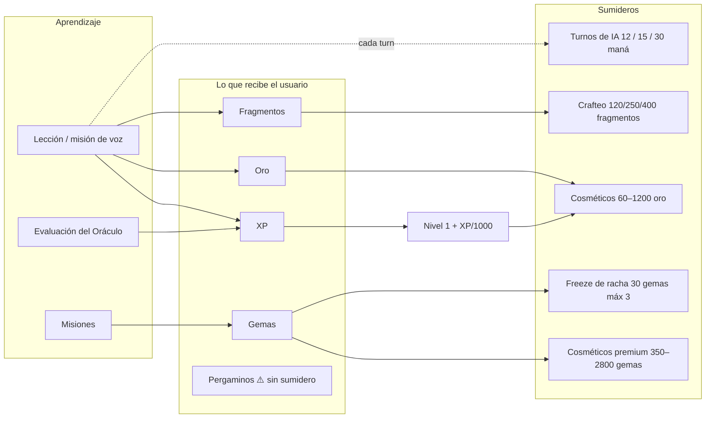

# Auditoría económica: diagnóstico global

_Auditoría económica · Fase 11-A (estado actual). Solo lectura._

> Este documento es el **diagnóstico**. El detalle vive en los documentos
> hermanos y no se repite aquí: monedas → `VIRTUAL_CURRENCY_ANALYSIS.md`,
> items → `ITEMS_AND_INVENTORY_AUDIT.md`, integridad →
> `ECONOMY_TECHNICAL_AUDIT.md`, dinero real → `MONETIZATION_ANALYSIS.md`.

---

## 1. Qué es esta economía (en una frase)

Una economía de **cuatro recursos con funciones disjuntas** —maná (combustible
de IA), oro (progresión), gemas (premium) y fragmentos (fabricación)— donde
**ningún recurso compra ventaja de aprendizaje** y el gasto pasa por RPC de
servidor con libro mayor idempotente.

Eso la coloca por diseño en el lado sano del espectro free-to-play. El problema
**no es el diseño de las reglas**: es que las reglas no siempre se cumplen y que
el sumidero no está medido.

---

## 2. Mapa de flujos

## 3. Sistemas que realmente existen

| Sistema | Implementado | Fuente de verdad |
|---|---|---|
| Monedas y saldos | ✅ | `user_language_profiles` + `currency_ledger` |
| Compras y crafteo | ✅ | `purchase_cosmetic`, `craft_cosmetic` |
| Freeze de racha | ✅ | `purchase_streak_freeze` (30 gemas, máx 3) |
| Recompensas por nivel | ✅ | `level_rewards` (2,3,5,8,12,15 → 100–800 oro) |
| Misiones y su recompensa | ✅ con agujeros | `claim_mission_reward` (ver F-1/F-2) |
| Recompensa diaria | ✅ | gemas 5/50/100/300 + pergaminos |
| Drops de sesión | ✅ | `claim_session_drop` |
| Maná por turno | ✅ | `consume_mana` en servidor + turno de gracia |
| Planes y entitlement | ✅ | Play → RevenueCat → webhook + `sync-entitlement` |
| Medición de flujo | ⚠️ existe, **sin datos posteriores** | vista `v_economy_flow` |
| Invocaciones | ❌ fósil | contador solo-cliente, sin sumidero real |
| Pergaminos | ❌ fósil | se entregan, no se gastan |
| Ligas semanales / cofres | ❌ no existe | reconocido en `ECONOMY_SINKS.md` §6 |

## 4. Diagnóstico: lo bueno

1. **Reglas económicas correctas por diseño.** Ninguna moneda compra aprendizaje; el maná se cobra sin importar el plan.
2. **Integridad por defecto.** Cliente sin escritura de saldos, RPC `SECURITY DEFINER`, ledger idempotente por `(user_id, ref_key)`, `balance_after >= 0` y `delta <> 0` en el esquema.
3. **Trazabilidad desde el inicio.** `reward_history`, `mana_transactions`, `currency_ledger` y una vista de flujo.
4. **Capacidad de diferenciar premium por capacidad, no solo por volumen**: historial del informe semanal y cosméticos con `min_plan`.
5. **Ciclo de feedback rápido ya implementado**: sesión → objetivos → oro+fragmentos → nivel → cosméticos desbloqueados. La cadena existe de punta a punta.

## 5. Diagnóstico: lo roto

| Prioridad | Problema | Naturaleza |
|---|---|---|
| **P0** | `reward_multiplier` inflable desde el cliente → gemas/XP a voluntad | Exploit activo (F-1) |
| **P0** | Misiones auto-completables desde el cliente | Exploit activo (F-2) |
| **P0** | 9 items que se venden sin efecto (invocaciones, pergaminos, llaves, libros) | Cobro sin valor |
| **P0** | Ratio de sumidero sin medir tras P-32 | Ceguera de decisión |
| **P1** | Modificador de misión sin consumo verificable del item | Duplicación |
| **P1** | Cosméticos con doble precio oro/gemas | Canibaliza la moneda premium |
| **P1** | Oro solo compra cosméticos → sumidero estrecho | Economía se agota |
| **P2** | Pergaminos e invocaciones siguen existiendo como recurso | Inflación muerta |
| **P2** | 3 reliquias sin ruta de obtención verificada | Catálogo huérfano |
| **P2** | Categorías del catálogo inconsistentes (`skin` como `consumable`) | Analítica y UI |

## 6. La lectura histórica que hay que conservar

Antes de P-32, la medición en producción decía: **0 cosméticos comprados nunca**,
oro mediano 100 frente a un mínimo de 120, gemas máximas 57 frente a 350, y
`spendGold()` devolviendo `true` sin cobrar. No era un juego con mala economía:
era una economía **que no se podía usar**.

P-32 lo arregló en lo esencial (items de entrada a 60/80/90, libro mayor,
sumideros de gemas y fragmentos). **Lo que no consta es la medición posterior**:
si `sink_ratio` sigue por debajo de 0.2, la economía volvió a nacer muerta
aunque las reglas sean correctas.

## 7. Conclusión de la fase

La economía está **bien diseñada y mal asegurada**. El orden correcto de
trabajo no es «añadir más monedas o más items»: es

1. cerrar los dos exploits de misiones (barato),
2. retirar los nueve items sin efecto (barato),
3. medir el flujo real durante dos semanas,
4. y solo entonces decidir precios, sumideros nuevos y monetización.

Cualquier diseño nuevo (`PROPOSED_ECONOMY_DESIGN.md`) sobre una economía que
puede inflarse a voluntad y que vende items sin efecto repetiría el problema a
mayor escala.

## 8. No verificable en esta sesión

- Estado real de RLS y funciones en producción (repo no reproduce el esquema).
- `sink_ratio` actual por moneda.
- Filas actuales de `player_inventory`, `currency_ledger` y `cosmetic_catalog`.
- Si el equipado de cosméticos está implementado en la UI.
