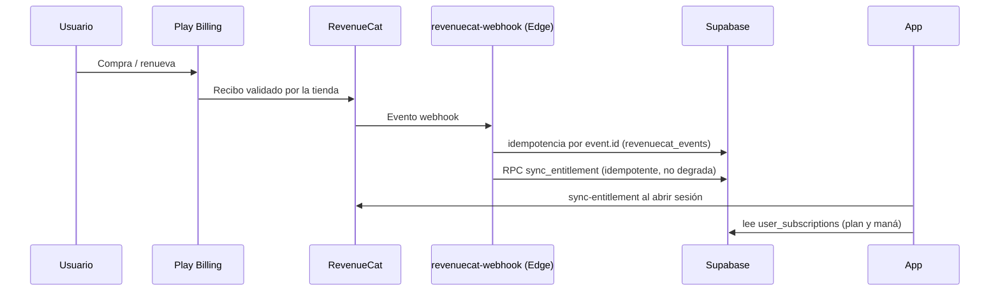

# Monetización: dinero real, suscripciones y viabilidad

_Auditoría económica · Fase 2. Solo lectura._

> **Hallazgo central de este documento:** hoy **la única vía de dinero real es la
> suscripción**. No existe compra de gemas, ni paquetes de moneda, ni productos
> de pago único, ni publicidad, ni venta web. Toda la economía virtual (oro,
> gemas, fragmentos) es **100 % ganada jugando** y no tiene entrada de dinero.

---

## 1. Superficie de ingresos actual

| Producto | Precio | Periodicidad | Qué recibe el usuario |
|---|---|---|---|
| `plebeyo` (por defecto) | $0 | — | 3.000 maná/mes (tope 200/día), historial del informe: 1 semana |
| `noble` | **$4.99/mes** | Mensual | 17.000 maná/mes, 4 semanas de historial, **trial de 7 días** |
| `realeza` | **$9.99/mes** | Mensual | 20.500 maná/mes, 52 semanas de historial, cosméticos exclusivos por `min_plan` |
| `DIVINO` | — | — | **Retirado** (`is_active = false`); la fila se conserva por integridad referencial |

Fuentes: `docs/PRODUCT.md` §2, `subscription_plans` en
`20260717000000_init.sql:250`, precios vigentes vía migraciones posteriores de
precios (`20260728_aggressive_pricing.sql` fijó en su día $0 / $1.99 / $14.99 /
$29.99; el precio actual es el de `PRODUCT.md`, que es la referencia de producto).

**No existe:**
- Compra de **gemas** con dinero real (no hay SKU de paquetes de moneda).
- Compra de **maná** suelta: decisión tomada y documentada («Retirar venta de maná y el tab de MANÁ de la tienda»).
- Productos de pago único (expansiones, cosméticos sueltos por dinero).
- Publicidad, patrocinios o venta web (Stripe eliminado en oct-2026).
- Plan anual activo en la app: los SKU existen (`dungeonsspeak_{noble|realeza}_{monthly|yearly}`) pero la UI pinta lo que devuelve `subscription_plans`.

## 2. Flujo del dinero



Lo implementado, y bien:

1. **Idempotencia del webhook** por `event.id`: un `RENEWAL` repetido no duplica
   (`revenuecat-webhook/index.ts:123-134`).
2. **Reconciliación** `sync-entitlement` que no degrada un entitlement activo.
3. **Precios desde la tienda**, nunca cadenas escritas a mano en la app
   (`PRODUCT.md` §7).
4. **Diferenciación por capacidad**, no solo por volumen: semanas de historial y
   cosméticos con `min_plan` validados en servidor.

**Lo que falta en el flujo:**

| Gap | Evidencia | Impacto |
|---|---|---|
| La tabla `payments` **no la escribe nadie** | Cero referencias en `supabase/functions/**` y en `lib/**` | No hay registro de ingresos en Supabase → ARPU/ARPPU no se pueden calcular desde la base |
| Esquema de pagos heredado | `payments.stripe_payment_id` sigue existiendo aunque Stripe se eliminó | Confusión y columnas muertas |
| Sin identificador de transacción de Play | No hay columna para el `orderId`/`purchaseToken` | Conciliación de reembolsos y disputas se hace a mano en Play Console |
| Reembolsos no modelados | `status` admite `refunded`, pero no se ha encontrado escritura | No hay flujo de revocación de entitlement por reembolso |

**No verificable:** si en producción `payments` tiene filas escritas por procesos
externos o por versiones anteriores. En el repo, no hay escritor.

## 3. Viabilidad comercial

### 3.1 Estructura de ingresos

Con la superficie actual:

```
Ingresos = usuarios_activos × conversión_a_suscripción × precio_medio
```

`precio_medio` hoy es $4.99 o $9.99, sin opción anual visible. No hay ingresos
de moneda ni de cosméticos. Es decir: **el techo de ingresos por usuario es el
precio del plan**, y no hay upsell de un solo uso.

### 3.2 Riesgos

| Riesgo | Por qué |
|---|---|
| **Dependencia total de la suscripción** | Un solo producto, un solo canal (Play) y una sola vía de renovación |
| **Pago único inexistente** | El usuario dispuesto a pagar $5 una vez no tiene dónde hacerlo |
| **Moneda premium sin entrada de dinero** | Las gemas se pueden comprar con Play Store… no: no hay SKU. El usuario que querría pagar por cosmético no puede |
| **Trial de 7 días mal comunicado** | Si la tienda y la app no coinciden, el usuario percibe cobro inesperado (hay runbook propio para eso) |
| **Precio bajo** | $4.99/mes con 17.000 de maná y modelo de IA por turno puede tener margen ajustado; no hay análisis de margen hecho (#132 abierto) |

### 3.3 Hipótesis, no hechos

No existen datos de conversión, churn ni ARPPU en el repo. Toda cifra de negocio
será hipótesis hasta medir. Formato de trabajo propuesto:

```
ARPU = (suscriptores_activos × precio_efectivo) / usuarios_activos
LTV  ≈ ARPPU × vida_media_meses × (1 − churn_mensual)
```

Con `churn_mensual` desconocido, el LTV no es calculable hoy. La primera tarea
de monetización no es poner precio: es **medir conversión y churn**.

## 4. Modelo de negocio recomendado (resumen; detalle en `NEW_MONETIZATION_OPPORTUNITIES.md`)

Mantener la suscripción como producto principal y añadir **dos productos de pago
único** que no rompan la promesa educativa:

1. **Paquetes de gemas** con destino cosmético (no ventaja de aprendizaje): da
   salida monetaria a la moneda premium y convierte la economía en ingresos.
2. **Expansión de contenido** (región/mazmorra temática con escenarios y NPCs):
   pago único, sin bloquear el plan de estudios principal.

Antes de vender nada nuevo, dos requisitos duros:

- Cerrar los exploits de recompensas (`ECONOMY_TECHNICAL_AUDIT.md` F-1/F-2): no
  se puede vender una moneda que se puede inflar gratis.
- Retirar los 9 items sin efecto: vender items muertos junto a productos nuevos
  destruye la confianza en toda la tienda.

## 5. Qué medir para convertir estas hipótesis en datos

Ver `ECONOMY_METRICS_AND_KPIS.md`. Mínimo imprescindible:

- Conversión trial → pago y churn mensual por plan.
- % de usuarios que abren la tienda y % que compra con oro/gemas.
- Ingresos conciliados: hoy viven en Play Console y RevenueCat, **no** en Supabase.
