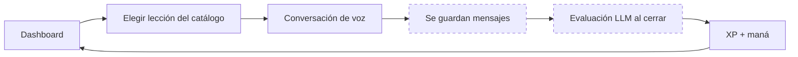
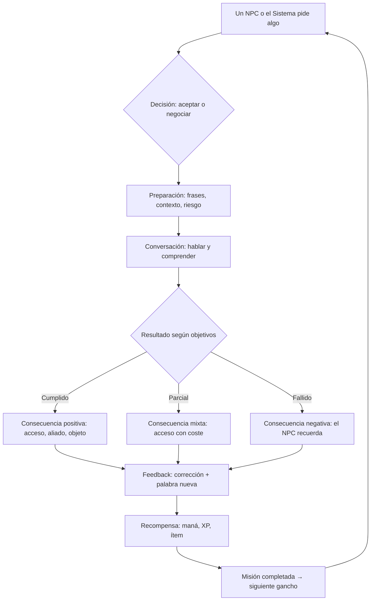

# 02 — Game design propuesto

---

## 1. Bucle actual (verificado)



Lo que falla: **no hay consecuencia**. Se aprende algo, se cobra maná, se
devuelve XP, y el mundo sigue igual. Ninguna misión progresa (533 instancias
`active`, `updateProgress` sin llamadores).

---

## 2. Bucle propuesto



### Qué existe, qué cambia, qué es nuevo

| Etapa | Estado |
|---|---|
| NPC pide algo | **Nuevo** (hoy el jugador elige de un catálogo) |
| Decisión aceptar/negociar | **Nuevo** (una elección previa, sin IA) |
| Preparación | **Parcial** (existen `useful_phrases`) |
| Conversación de voz | **Existe** |
| Resultado por objetivos | **Existe** (`evaluateGoals`), pero no tiene efecto |
| Consecuencia | **Nuevo** |
| Feedback | **Parcial** (corrección al final, sin vocabulario nuevo destacado) |
| Recompensa | **Existe** (`session_rewards`) |
| Misión completada | **Roto** (el motor no avanza) |
| Siguiente gancho | **Nuevo** |

### Regla de diseño

La consecuencia **no** debe depender de una segunda llamada al modelo. Se
deriva del resultado ya evaluado:

```
objetivos cumplidos / totales  →  éxito | parcial | fallo
```

Determinista, barato y explicable.

---

## 3. Mecánicas evaluadas

| Mecánica | Valor educativo | Valor de juego | Coste IA | Veredicto |
|---|---|---|---|---|
| **Diálogo con consecuencia** | Alto (producción oral) | Alto | Bajo (ya se paga) | **Adoptar** |
| **Elección previa con riesgo** | Medio (comprensión lectora) | Alto | Cero | **Adoptar** |
| **Repaso programado (SRS)** | Alto (retención) | Medio | Cero | **Adoptar** (ya existe) |
| **Objetos con descripción en inglés** | Medio | Medio | Cero | **Adoptar** (contenido estático) |
| **Jefes con fases** | Medio | Alto | Medio | **Validar** |
| **Exploración de mapa** | Bajo | Alto | Cero | Posponer |
| **Combate por turnos** | Medio | Alto | Alto | Posponer |
| **PvP** | Bajo | Medio | Alto | Descartar por ahora |
| **Gremios cooperativos** | Medio | Alto | Medio (voz) | **Validar** con masa crítica |
| **Coleccionismo de títulos** | Bajo | Medio | Cero | Conservar |

### Criterio de descarte

Una mecánica entra solo si cumple **dos de tres**: produce inglés
significativo, cambia una decisión del jugador, o reutiliza contenido ya
validado sin coste de IA.

---

## 4. Sistema de misiones

### 4.1 Taxonomía y propósito

| Tipo | Propósito | Duración | Frecuencia | Lenguaje |
|---|---|---|---|---|
| **Principal (arco)** | Avanzar la historia | 5-8 min | 1 por arco | Escenas encadenadas |
| **Diaria** | Hábito, victoria rápida | 1-3 min | 1/día | Una micro-situación |
| **Semanal** | Profundidad | 10-15 min | 1/semana | Escena con 2-3 objetivos |
| **Refuerzo (SRS)** | Retener vocabulario | 2 min | Cuando vence | Palabras vistas |
| **Gremio** | Social opcional | 10 min | Variable | Cooperativa |
| **Examen (Oráculo)** | Evaluación | 5 min | Al subir de rango | Conversación libre |

Regla: **cada tipo debe poder describirse en una frase distinta**. Si dos
categorías son «lo mismo con otro nombre», se fusionan.

### 4.2 Modelo de una misión

```
mission_instance
├── plantilla (tipo, objetivo pedagógico, contexto narrativo)
├── nivel lingüístico  (CEFR objetivo)
├── dificultad de juego (tiempo, opciones, penalización)
├── actividad (conversación / elección / repaso)
├── condiciones de éxito (objetivos con keywords + revisión LLM)
├── intentos permitidos
├── retroalimentación (corrección + palabra)
├── recompensa (maná, XP, ítem)
└── siguiente eslabón (gancho)
```

**Dificultad lingüística y dificultad de juego son ejes independientes.**

| | Juego fácil | Juego difícil |
|---|---|---|
| **Inglés A1** | Pedir agua sin prisa | Pedir agua con 10 s y un NPC enfadado |
| **Inglés B2** | Negociar un precio sin límite | Negociar con 3 condiciones y contrapartida |

### 4.3 Cómo evitar los fallos conocidos

| Riesgo | Control |
|---|---|
| Misión imposible | El CEFR de la misión nunca supera `nivel_actual + 1` |
| Repetición | Máx. 3 misiones del mismo `activity_type` por día |
| Recompensa sin aprendizaje | XP completo solo si se cumplen objetivos |
| Contenido IA incorrecto | El generador (`lesson-generator`) produce borradores; se cachean y revisan |
| Llamadas innecesarias | Elección, consecuencia y recompensa son deterministas |
| Dependencia del modelo | Si el LLM falla, la misión se evalúa por keywords y no se cobra maná |

### 4.4 Tres misiones completas

#### A. Principiante — «La taberna del jabalí»

- **Narrativa:** el tabernero no entiende tu idioma y tienes sed.
- **Lenguaje:** A1. Saludar, pedir, agradecer.
- **Juego:** fácil — sin tiempo, opciones visibles con dibujo.
- **Actividad:** conversación de 3 turnos.
- **Éxito:** objetivos `saluda`, `pide bebida`, `agradece`.
- **Consecuencia:** te sirve; desbloquea la posada como punto de descanso.
- **Recompensa:** 8 maná + 20 XP + «agua» en el vocabulario.

#### B. Intermedio — «El precio de la daga»

- **Narrativa:** el herrero cobra el triple por ser forastero.
- **Lenguaje:** B1. Comparativos, condicionales, cortesía.
- **Juego:** medio — hay que rebajar el precio en 3 turnos.
- **Actividad:** negociación con dos resultados válidos (pagar menos o ganar
  un favor).
- **Éxito:** usar al menos una comparación y una petición cortés.
- **Consecuencia:** si negocias bien, el herrero te recuerda y te ofrece una
  daga mejor en el capítulo 2.
- **Recompensa:** 12 maná + 60 XP + objeto «daga mellada».

#### C. Avanzado — «La entrevista»

- **Narrativa:** el gremio te entrevista para un rango superior.
- **Lenguaje:** C1. Argumentación, matices, preguntas abiertas.
- **Juego:** difícil — 3 preguntas, sin tiempo visible, el entrevistador
  interrumpe.
- **Actividad:** conversación de 6-8 turnos con follow-ups.
- **Éxito:** responder con estructura (opinión + razón + ejemplo) al menos 2
  veces.
- **Consecuencia:** sube el rango y cambia qué NPC te hablan.
- **Recompensa:** 30 maná (examen) + 150 XP + título.

---

## 5. Progresión: tres ejes separados

| Eje | Qué mide | Cómo sube | Qué desbloquea |
|---|---|---|---|
| **Personaje (rango)** | Actividad y constancia | XP de misiones | Misiones, NPC, títulos |
| **Narrativo** | Dónde estás en la historia | Capítulos completados | Escenas y aliados |
| **Lingüístico** | Competencia real | Evidencia por habilidad | Contenido (no poder) |

**Regla dura:** el rango **nunca** sube por saber inglés, y el nivel de inglés
**nunca** sube por jugar mucho. Si ambos suben juntos, el jugador no puede
distinguir qué ha mejorado.

### Lo que hoy no está separado

- `cefr_level` y `game_rank` se asignan en la misma llamada del Oráculo.
- El prestigio se calcula desde XP y desde nivel a la vez.
- El radar mezcla métricas de juego (objetivos cumplidos) con métricas de
  lengua (fluidez).

---

## 6. Economía

### Recursos (máximo tres)

| Recurso | Fuente | Uso | Se compra |
|---|---|---|---|
| **Maná** | Plan + recompensas | Acciones de IA | No (retirado) |
| **Oro** | Misiones | Cosméticos | No |
| **XP** | Misiones | Rango | No |

Gemas y fragmentos no se muestran (siguen en la base sin uso).

### Costes reales (de `ai_action_costs`)

| Acción | Maná |
|---|---|
| Conversación libre | 8 |
| Turno de mazmorra | 12 |
| Turno del Oráculo | 15 |
| Evaluación del Oráculo | 30 |
| Generar lección | 100 |

### Reglas anti-explotación

1. Recompensa decreciente al repetir la misma misión el mismo día (100 % → 30 %
   → 0).
2. XP solo si se cumplen objetivos; maná se cobra igual (la IA ya se gastó).
3. Sin recompensas por tiempo en pantalla.
4. Los cosméticos no dan ventaja.

### Calibración

No se fijan números definitivos. Parámetros de prueba:

- `xp_mision = base(tipo) × factor_dificultad` — calibrar con cohortes.
- `mana_recompensa = 0` para misiones de refuerzo (no gastan IA).
- `ratio_recompensa/mana_gastado` objetivo: que una sesión diaria cubra el 60 %
  del coste de una sesión típica.

Ver `09_METRICAS_Y_EXPERIMENTOS.md` para cómo medirlo.
