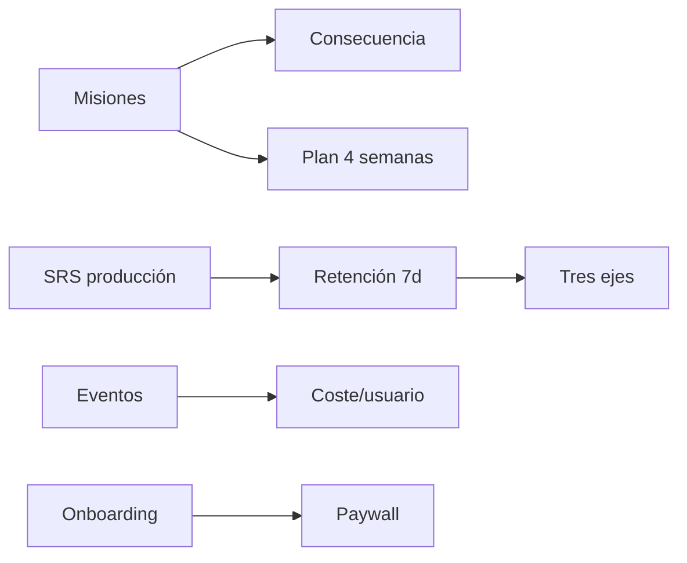

# 12 — Plan de implementación

Orden recomendado para convertir las iniciativas aprobadas en trabajo real.
**No se ha implementado nada de esta fase.**

---

## Fase A — Desbloquear el juego (1-2 semanas)

| # | Entregable | Depende de | Criterio de fin |
|---|---|---|---|
| A1 | Llamada a `advance_missions_for_user` desde fin de escena (R1) | — | Una misión pasa a `completed` y paga recompensa una sola vez |
| A2 | Test de idempotencia del avance de misiones | A1 | Reenviar el evento no duplica recompensa |
| A3 | Instrumentación de sesión y misión (eventos) | — | 5 eventos en `retention_events` |

**Por qué primero:** sin esto, todo lo demás (consecuencias, plan, métricas de
juego) no tiene dónde engancharse.

---

## Fase B — Integridad educativa (1-2 semanas)

| # | Entregable | Depende de | Criterio de fin |
|---|---|---|---|
| B1 | Placement calculado en servidor (R2) | — | El cliente no puede escribir el nivel |
| B2 | Tarjetas de producción SRS + intervalo mínimo (R7) | — | `mastered` exige recuperación a 7 días |
| B3 | Cálculo de retención a 7 días (R3 mínimo) | B2 | Métrica visible en Estado |

---

## Fase C — Valor inmediato y bucle cerrado (2-3 semanas)

| # | Entregable | Depende de | Criterio de fin |
|---|---|---|---|
| C1 | Onboarding invertido (R4) | — | Primera frase en <90 s |
| C2 | Consecuencia en 3 escenas (R5) | A1 | Desbloqueo persistente tras éxito |
| C3 | Estado con tres ejes (R6) | B3 | Rango, arco y lengua separados |
| C4 | Reducción de indicadores (R10) | C3 | Máx. 3 en cabecera |

---

## Fase D — Negocio (2 semanas)

| # | Entregable | Depende de | Criterio de fin |
|---|---|---|---|
| D1 | Paywall propio en RevenueCat (R8) | — | Precio de Play + beneficios |
| D2 | Embudo de compra completo | D1 | 6 eventos medidos |
| D3 | Informe de coste por usuario | A3 | Coste calculado con datos reales |

---

## Fase E — Evolución (después de validar)

R9 (plan de 4 semanas), R11 (refuerzo por errores), R12 (evaluación
multi-competencia). Requieren datos de las fases A-D.

---

## Dependencias globales

---

## Qué se puede hacer en paralelo

- A1 y B2 (no comparten código).
- B1 y C1 (onboarding toca UI; placement toca servidor).
- D1 (dashboard de RevenueCat) no bloquea a nadie.

## Qué no se debe paralelizar

- C2 depende de A1: sin misiones no hay a qué enganchar la consecuencia.
- C3 depende de B3: sin evidencia, los ejes están vacíos.

---

## Definición de terminado (por entregable)

1. Código con test.
2. `flutter analyze` sin errores y `flutter test` en verde.
3. Instrumentado (evento o métrica).
4. Documentado en `docs/` si cambia el comportamiento.
5. Probado en dispositivo físico, no solo emulador.
