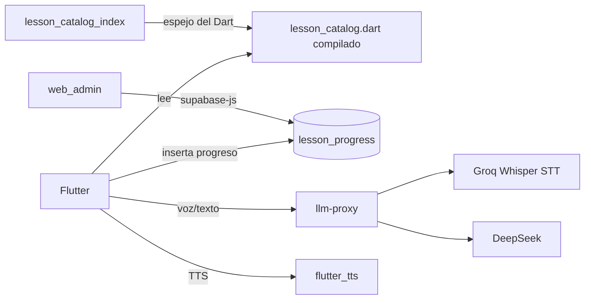
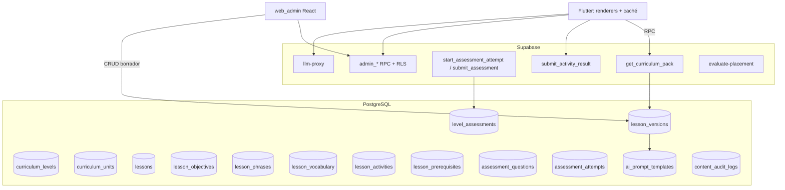
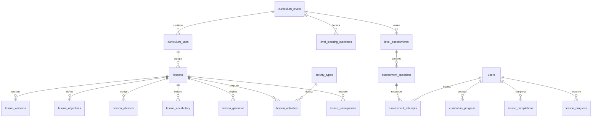

# Plan de implementación: migración del catálogo, currículo evolutivo y administración web

**Estado:** propuesta · **No implementado** · Basado en `AUDITORIA_COMPLETA_INVENTARIO_LECCIONES.md`
y en inspección del código real.

---

## 1 · Resumen ejecutivo

**¿Migrar las 140 lecciones a PostgreSQL? Sí, pero no todo.**

La recomendación es la **Alternativa C (híbrida)**: el **contenido educativo** pasa a
PostgreSQL y se administra desde el portal; los **motores de ejecución** (renderers de
actividad, evaluación, seguridad, caché) se quedan en código. Los **prompts de escena**
son datos versionados y editables; los **prompts de sistema y seguridad** son código y no
son editables desde el portal.

Con eso se consigue el objetivo principal: **cambiar una lección sin publicar una versión
nueva de la app**, sin convertir Flutter en un intérprete genérico ni abrir la puerta a que
un editor altere reglas de seguridad.

Tres hechos del sistema actual condicionan el diseño:

1. El contenido **no está en la base**: está compilado en `lesson_catalog.dart` (4.621 líneas).
2. El progreso **sí está en la base** (`lesson_progress.lesson_id` como texto) y no debe romperse.
3. El portal existe (`web_admin`: React 19 + Vite + `@supabase/supabase-js`) y **puede ampliarse**;
   no hace falta un segundo sistema.

---

## 2 · Diagnóstico del estado actual

| Componente | Estado real |
|---|---|
| Catálogo | 140 lecciones en Dart (7 niveles × 20), 540 objetivos, 539 frases |
| Modelos | `LessonData`, `ScenarioGoalItem`, `UsefulPhraseItem` |
| Tabla de índice | `lesson_catalog_index(lesson_id PK, level, title, category, updated_at)` — espejo del Dart para el servidor, sin RLS de cliente |
| Progreso | `lesson_progress(user_id, lesson_id, skill_focus, status, completed_at)` con índice `(user_id, lesson_id)` |
| Evaluación | Oráculo por turno + validación de objetivos por **palabras clave** (`isSatisfiedBy`) |
| IA | `llm-proxy` (sin prompt de sistema propio: lo recibe del cliente), `lesson-generator`, `evaluate-placement` |
| Prompt de sistema | Construido en `conversation_repository_impl.dart` por concatenación |
| Portal | `web_admin`: React 19, Vite, oxlint, vitest; sin router ni librería de formularios declarada |
| Actualización de contenido | Requiere nuevo binario |

**Problemas estructurales confirmados en la auditoría:** sin orden ni prerrequisitos; sin
resultados de nivel; sin prueba de dominio; validación por palabra suelta; 481 de 539
«traducciones» idénticas al inglés; sin teoría; sin refuerzo; narrativa desconectada de la
progresión; contenido no administrable.

---

## 3 · Arquitectura actual



Limitación central: el servidor solo conoce un **índice** del catálogo; el contenido real
solo existe dentro del binario.

---

## 4 · Arquitectura objetivo



**Regla de oro:** Flutter pide *packs de contenido publicados*; nunca escribe contenido.

---

## 5 · Decisión: base de datos o código

| Elemento | DB | Código | Híbrido | Justificación |
|---|:--:|:--:|:--:|---|
| Contenido de lecciones | ● | | | Es el objetivo del proyecto: editarlo sin publicar app |
| Objetivos educativos | ● | | | Se editan constantemente; deben versionarse con la lección |
| Frases modelo | ● | | | Ídem; además permiten revisión editorial de traducciones |
| Vocabulario | ● | | | Reutilizable entre lecciones y para SRS |
| Reglas gramaticales | ● | | | Texto educativo editable; la *validación* va en código |
| Ejercicios (datos) | ● | | | Enunciado, opciones y respuestas son datos |
| Evaluaciones (definición) | ● | | | Composición configurable por nivel |
| Exámenes finales (contenido) | ● | | | Banco de preguntas en DB |
| Configuración de niveles | ● | | | Umbrales, intentos, requisitos: parametrizables |
| Secuencia de aprendizaje | ● | | | Orden, prerrequisitos, unidades |
| Narrativa | ● | | | Mundos, NPC, misiones: contenido editorial |
| Prompts de escena | | | ● | Datos versionados, con variables validadas |
| Prompts de sistema/seguridad | | ● | | **Nunca editables**: definen contratos y límites |
| Lógica de evaluación | | ● | | Rúbricas y umbrales en DB; el motor que evalúa, en código |
| Motor de actividades (renderers) | | ● | | Cada tipo de actividad es un widget con contrato fijo |
| Interfaces y componentes | | ● | | Diseño de producto, no contenido |

**Por qué los renderers no pueden ser datos:** un tipo de actividad es código que dibuja,
valida y puntúa. Si el portal pudiera inventar tipos, la app tendría que interpretar
UI arbitraria; eso rompe el diseño y abre superficie de ataque. Lo que sí es dato es **qué
actividad** usa **qué tipo** y con **qué contenido**.

**Por qué la seguridad tampoco:** permitir editar el prompt de sistema desde el portal
convierte a un editor de contenidos en administrador del comportamiento del modelo. Se
versiona en git y se despliega con el backend.

---

## 6 · Modelo de datos propuesto

Todas las tablas nuevas van a `public`, con RLS activada y sin políticas de cliente
excepto lectura de contenido publicado (o, preferible, lectura solo por RPC `SECURITY
DEFINER`).

### 6.1 Catálogo curricular

| Tabla | Campos clave | Restricciones | Índices |
|---|---|---|---|
| `curriculum_levels` | `id text PK` (`PRE-A1`…`C2`), `name`, `cefr`, `order_index int unique`, `narrative_world`, `description`, `estimated_hours`, `is_active bool` | `cefr` único | `(order_index)` |
| `curriculum_units` | `id uuid PK`, `level_id FK`, `slug`, `title`, `order_index`, `description` | `unique(level_id, slug)`, `unique(level_id, order_index)` | `(level_id, order_index)` |
| `lessons` | `id text PK` (= id Dart), `unit_id FK`, `title`, `category`, `difficulty smallint`, `order_index`, `estimated_minutes`, `status` (`draft|review|published|archived`), `current_version int` | `check status`, `unique(unit_id, order_index)` | `(unit_id, order_index)`, `(status)` |
| `lesson_versions` | `id uuid PK`, `lesson_id FK`, `version int`, `snapshot jsonb`, `published_at`, `published_by`, `changelog` | `unique(lesson_id, version)` | `(lesson_id, version desc)` |
| `lesson_prerequisites` | `lesson_id FK`, `requires_lesson_id FK`, `kind` (`required|recommended`) | PK compuesta; `check lesson_id <> requires` | `(lesson_id)` |

`lessons` conserva **el id original** (`a2_reporting_a_lost_wallet`) para no romper
`lesson_progress.lesson_id`.

### 6.2 Contenido de la lección (todo por versión)

| Tabla | Campos clave | Restricciones |
|---|---|---|
| `lesson_objectives` | `id uuid PK`, `lesson_id`, `version`, `code`, `description`, `competency` (`speaking|vocabulary|grammar|listening|reading|writing|pronunciation|communication`), `criterion`, `evidence_examples jsonb`, `common_errors jsonb`, `is_required bool`, `order_index` | `unique(lesson_id, version, code)`; `check competency in (...)` |
| `lesson_phrases` | `id uuid PK`, `lesson_id`, `version`, `phrase`, `translation`, `translation_status` (`ok|identical|pending`), `audio_url`, `order_index` | `unique(lesson_id, version, order_index)` |
| `lesson_vocabulary` | `id uuid PK`, `lesson_id`, `version`, `lemma`, `translation`, `pos`, `ipa`, `definition`, `context`, `example`, `priority`, `is_required`, `objective_code` | `unique(lesson_id, version, lemma)` |
| `lesson_grammar` | `id uuid PK`, `lesson_id`, `version`, `topic_code`, `title`, `explanation_md`, `contrastive_example`, `common_mistakes jsonb`, `order_index` | `unique(lesson_id, version, topic_code)` |
| `lesson_activities` | `id uuid PK`, `lesson_id`, `version`, `activity_type FK`, `order_index`, `instructions`, `payload jsonb`, `scoring jsonb`, `feedback_good`, `feedback_bad` | `unique(lesson_id, version, order_index)` |
| `activity_types` | `code text PK`, `renderer_key`, `schema_version`, `payload_schema jsonb`, `is_enabled bool` | El portal solo puede usar tipos **habilitados** |

`payload jsonb` se valida contra `payload_schema` en el RPC de guardado: así se admiten
tipos nuevos sin migrar tablas, pero **no** contenido inválido.

### 6.3 Evaluación

| Tabla | Campos clave | Restricciones |
|---|---|---|
| `level_learning_outcomes` | `id uuid PK`, `level_id`, `code`, `description`, `competency`, `criterion` | `unique(level_id, code)` |
| `level_assessments` | `id uuid PK`, `level_id`, `name`, `boss_narrative jsonb`, `pass_score numeric`, `max_attempts int`, `cooldown_hours int`, `weights jsonb` (por competencia), `status` | `unique(level_id)` con `status='published'` |
| `assessment_questions` | `id uuid PK`, `assessment_id`, `objective_code`, `activity_type`, `payload jsonb`, `weight numeric`, `variant_group` | `(assessment_id, variant_group)` |
| `assessment_attempts` | `id uuid PK`, `user_id`, `assessment_id`, `version`, `started_at`, `submitted_at`, `score`, `competency_scores jsonb`, `result` (`passed|failed|abandoned`), `answers jsonb`, `diagnosis jsonb` | `(user_id, assessment_id, started_at desc)` |

### 6.4 Progreso y currículo

| Tabla | Campos clave | Restricciones |
|---|---|---|
| `curriculum_progress` | `user_id`, `level_id`, `status` (`locked|available|in_progress|completed`), `unlocked_at`, `completed_at` | PK `(user_id, level_id)` |
| `lesson_completions` | `user_id`, `lesson_id`, `version_alcanzada`, `completed_at`, `evidence jsonb` | PK `(user_id, lesson_id)` — **complementa, no sustituye**, `lesson_progress` |
| `level_unlocks` | `user_id`, `from_level`, `to_level`, `assessment_attempt_id`, `granted_at` | `unique(user_id, to_level)` |

### 6.5 Gobernanza

| Tabla | Campos clave |
|---|---|
| `ai_prompt_templates` | `id uuid PK`, `key`, `scope` (`scene|grading|safety`), `version`, `body text`, `variables jsonb`, `status`, `published_at` — **`scope='safety'` no editable por editores** |
| `content_audit_logs` | `id bigserial`, `actor_id`, `entity`, `entity_id`, `action`, `diff jsonb`, `created_at` |

### 6.6 Diagrama entidad-relación



**Relación con lo existente:** `lesson_catalog_index` se mantiene como **vista materializada**
generada desde `lessons` (compatibilidad con el servidor actual) y `lesson_progress` se
conserva intacta como histórico; `lesson_completions` añade versión y evidencia.

---

## 7 · Estrategia de migración de las 140 lecciones

### 7.1 Pipeline (idempotente)

```text
lesson_catalog.dart
  → scripts/export_lessons.py   → build/curriculum/lessons.json  (140 registros + 540 goals + 539 frases)
  → scripts/import_curriculum.py → Supabase (upsert por id)
  → validación de conteos y checksums
```

Pasos:

1. **Extracción** con el parser ya escrito (`scripts/audit_lessons.py`): produce JSON con ids originales.
2. **Transformación**: `LessonData` → `lessons` + `lesson_objectives` (goals) + `lesson_phrases`.
3. **Niveles y unidades**: 7 niveles fijos; 4 unidades por nivel (una por bloque de 5 lecciones),
   asignadas por `order_index` de aparición en el catálogo. Nada inventado: la unidad es
   agrupación editorial, no dato del origen.
4. **Traducciones incompletas**: `translation_status='identical'` cuando `phrase = translation`
   (481 casos). **No se corrigen**: quedan en cola editorial.
5. **Objetivos insuficientes**: los que tienen `keywords` de una sola palabra o
   `examplePhrase = text` se marcan `needs_review=true` (columna en `lesson_objectives`).
6. **Inserción**: `insert ... on conflict (id) do update` con `updated_at` y sin sobrescribir
   `published_at` si la versión ya está publicada.
7. **Verificación**: 140 lecciones, 540 objetivos, 539 frases; checksum por id.
8. **Progreso**: `lesson_progress.lesson_id` no cambia ⇒ **cero pérdida**.

### 7.2 Reversión

- El catálogo Dart **no se borra** hasta la fase 6 completada.
- Migración nueva, no destructiva: tablas `curriculum_*` nuevas; `lesson_catalog_index` solo
  pasa a vista materializada al final.
- Flag `app_config.curriculum_source = 'dart' | 'db'` en `app_config`; la app lee ese flag.
- Rollback = `curriculum_source='dart'` y redeploy de la app anterior; las tablas nuevas se
  dejan o se vacían (`truncate ... cascade`) sin afectar progreso.

### 7.3 Idempotencia

Los scripts calculan un **hash por lección** (`sha256` del JSON canónico). Si el hash no
cambia, no se escribe nada. Si cambia, se crea **versión nueva**, no se pisa la publicada.

---

## 8 · Preservación del progreso

| Dato | Cómo se preserva |
|---|---|
| `lesson_progress` | Sin cambios; `lesson_id` es el mismo texto |
| `lesson_completions` | Se puebla desde `lesson_progress` en la migración (una fila por par) |
| Sesión en curso | Se guarda `lesson_version` al iniciar; completar la sesión acredita la versión iniciada |
| Evaluaciones | Cada intento guarda `assessment.version` |
| Desbloqueos | Se recalculan desde `lesson_progress` + intentos aprobados; no se inventan |

**Regla:** una versión nueva de una lección **no revoca** una completada anterior.

---

## 9 · Nueva estructura curricular

### 9.1 Modelo de nivel

Cada `curriculum_levels` tiene: identidad (id, CEFR, mundo narrativo, capítulo),
objetivo general (texto + `level_learning_outcomes`), 4 unidades, y una **prueba final**
(`level_assessments`) con su jefe.

### 9.2 Unidades propuestas (ejemplo A1, derivado del contenido real)

| Unidad | Título | Lecciones (por categoría real del catálogo) |
|---|---|---|
| A1-U1 | Introductions & Personal Info | presentaciones, datos personales |
| A1-U2 | Everyday Communication | rutinas, peticiones simples |
| A1-U3 | Food, Shopping & Money | compras y restaurante |
| A1-U4 | Travel & Directions | transporte y orientación |
| A1-U5 | Daily Life & Social | planes, invitaciones |

Las unidades se asignan por afinidad temática de la lección, revisables desde el portal.

### 9.3 Jefe de nivel (prueba final)

| Campo | Valor |
|---|---|
| Nombre | `boss_<nivel>` (p. ej. «El Guardián del Umbral») |
| Composición | 40 % conversación, 20 % comprensión, 20 % construcción de frases, 20 % vocabulario |
| Preguntas | banco de `assessment_questions` con `variant_group`; selección aleatoria por intento |
| Aprobación | `pass_score` configurable (propuesta inicial 70 %) |
| Intentos | `max_attempts=3`, `cooldown_hours=24` |
| Refuerzo | `diagnosis` por competencia → lecciones recomendadas del mismo nivel |
| Desbloqueo | `curriculum_progress[to_level]='available'` solo si `result='passed'` |

**Validación en servidor:** el cliente envía respuestas y el servidor puntúa contra la
rúbrica; el cliente nunca envía la nota.

### 9.4 Reglas de progresión (parametrizables)

1. Nivel inicial = resultado de `evaluate-placement` u onboarding.
2. Lección desbloqueada si sus `lesson_prerequisites` están completadas.
3. Prueba final desbloqueada si se completó el `min_lessons` configurado del nivel.
4. Nivel siguiente bloqueado hasta aprobar.
5. Al fallar: diagnóstico, no bloqueo indefinido.

Todo en `curriculum_settings` (una fila por nivel), editables desde el portal.

---

## 10 · Plantilla configurable de lección

| Bloque | Obligatorio | Datos |
|---|---|---|
| Identidad | Sí | id, título, nivel, unidad, orden, dificultad, duración, estado, idioma |
| Objetivo general | Sí | `mainObjective` |
| Objetivos específicos | Sí (≥1) | competencia, criterio, evidencia, errores frecuentes |
| Frases modelo | No | frase, traducción, estado de traducción |
| Vocabulario | No | lemma, traducción, IPA, ejemplo, obligatorio/opcional |
| Gramática | No | tema, explicación, ejemplo contrastivo, errores |
| Actividades | Sí (≥1) | tipo, payload, puntuación, feedback |
| Narrativa | Sí | mundo, NPC, rol del usuario, mensaje inicial, recompensas |

**Secuencia de enseñanza configurable:** `lesson_activities.order_index` define el orden;
bloques opcionales se omiten si no hay filas. No hay secuencia fija en código.

---

## 11 · Modelo de ejercicios y actividades

| Tipo | ¿Existe hoy? | Esfuerzo | Payload mínimo |
|---|---|---|---|
| Conversación con IA | Sí (escena) | — | `scenario_context`, `assistant_role`, `goals` |
| Selección múltiple | No | S | `question`, `options[]`, `correct` |
| Completar espacios | No | S | `text_with_gaps`, `answers[]` |
| Ordenar palabras | No | S | `tokens[]`, `correct_order` |
| Construcción de frase | No | M | `prompt`, `target`, `keywords` |
| Traducción dirigida | No | M | `source`, `expected` |
| Listening (TTS) | No | M | `audio_text`, `questions[]` |
| Reading | No | M | `passage`, `questions[]` |
| Escritura guiada | No | L | `prompt`, `rubric` |
| Pronunciación | No | L | `target_audio`, evaluación acústica |

MVP: **conversación + selección múltiple + completar + ordenar**. El resto por fases.

Contrato: `activity_types.payload_schema` valida en el RPC; el renderer se elige por
`renderer_key` en Flutter, versionado con `schema_version`.

---

## 12 · Sistema de evaluación

**Contrato de resultado** (backend lo valida y persiste):

```json
{
  "objective_code": "g1",
  "competency": "speaking",
  "score": 0.0,
  "evidence": "texto o transcripción",
  "criteria_met": ["..."],
  "flags": { "low_confidence": false, "transcription_error": false }
}
```

Reglas:
- Nunca `score` desde el cliente.
- El modelo devuelve JSON validado contra esquema; si no cumple, `score=0` y `flags.invalid=true`.
- Umbral por objetivo configurable; **no** basta una palabra clave: exige `criteria_met` no vacío.
- Si `low_confidence` (STT), no se penaliza: se pide repetir.
- Rúbricas en `scoring jsonb` de la actividad.

---

## 13 · Portal administrativo

**Base actual:** `web_admin` (React 19 + Vite + supabase-js + lucide). Se **amplía**, no se
rehace. Añadir router y estado global ligero (React Router + TanStack Query) es la única
dependencia nueva propuesta.

Módulos:

1. Dashboard curricular (conteos por estado y nivel).
2. Niveles (identidad, objetivos, requisitos, umbrales).
3. Unidades (ordenar, asignar lecciones).
4. Lecciones (editor por bloques con guardado de borrador y preview).
5. Actividades (constructor por tipo; payload validado).
6. Evaluaciones y jefes (banco de preguntas, pesos, políticas).
7. Narrativa (mundos, NPC, diálogos).
8. Prompts (solo `scope='scene'`; `safety` oculto).
9. Traducciones (cola de las 481 idénticas).
10. Historial y publicación (diff, autor, fecha, restaurar).

Roles: `superadmin`, `content_admin`, `editor`, `reviewer`, `publisher`, `viewer`.
Permisos por RLS + RPC admin (`admin_*`) que registran en `content_audit_logs`.

---

## 14 · Consumo desde Flutter

- `GET get_curriculum_pack(level, since_version)` → niveles, unidades, lecciones publicadas y
  actividades de ese nivel, con `content_version`.
- Caché local: `shared_preferences` (JSON por nivel + `content_version` + `etag`).
- Descarga **por demanda**: al entrar al nivel; la lección se pide si falta en caché.
- Invalidación por `content_version`; si falla la red, se usa la caché (modo offline limitado).
- `lesson_catalog.dart` queda como **fallback** durante la transición (flag).
- Repositorio nuevo: `CurriculumRepository` con `getLevelPack`, `getLesson`, `markCompleted`.
- Modelos: `CurriculumLesson`, `LessonActivityDto`, con `fromJson` y `schema_version`.

---

## 15 · Versionado y publicación

| Concepto | Regla |
|---|---|
| Borrador | `lessons.status='draft'` + filas con `version` en curso |
| Revisión | `status='review'`; `reviewer` aprueba |
| Publicación | transacción: valida schema, congela `lesson_versions.snapshot`, sube `current_version`, pone `status='published'` |
| Sesión en curso | usa la versión iniciada; no cambia a mitad |
| Restauración | nueva versión que clona el snapshot anterior (nunca se reescribe historia) |
| Publicación atómica | una sola transacción; si falla, no hay estado intermedio |

---

## 16 · Seguridad

- Todo el contenido: lectura por RPC `SECURITY DEFINER`; sin `select` directo de cliente.
- Escritura: solo RPC `admin_*` con verificación de rol en servidor.
- `ai_prompt_templates` con `scope='safety'`: sin política de escritura; solo `service_role`.
- Validación de payload contra JSON Schema en el guardado y en la lectura.
- Rate limit en RPC de intentos de examen.
- `content_audit_logs` inmutable (sin UPDATE/DELETE).

---

## 17 · Plan por fases

| Fase | Alcance | Depende de | Salida |
|---|---|---|---|
| **0** | Auditoría técnica complementaria (este doc + verificación de tablas) | — | Decisiones cerradas |
| **1** | Diseño de modelo y contratos JSON | 0 | SQL de diseño + esquemas |
| **2** | Migraciones: tablas, constraints, índices, RLS, roles | 1 | Esquema vacío en staging |
| **3** | Migración de las 140 lecciones (script idempotente) | 2 | 140/540/539 verificados |
| **4** | Backend: RPC de lectura, guardado, publicación, evaluación | 2 | API estable |
| **5** | Portal: niveles, unidades, lecciones, actividades | 4 | Edición end-to-end |
| **6** | Flutter: repositorio dinámico + caché + flag | 4 | App lee de DB |
| **7** | Currículo: prerrequisitos, desbloqueos, progreso por nivel | 3,4,6 | Progresión real |
| **8** | Evaluaciones y jefes | 4,7 | Desbloqueo por examen |
| **9** | Pruebas, activación progresiva, rollback | todas | Producción |

Duración relativa: **0 (S) · 1 (M) · 2 (M) · 3 (M) · 4 (L) · 5 (L) · 6 (L) · 7 (M) · 8 (L) · 9 (M)**.

---

## 18 · Backlog (24 historias)

| ID | Historia | Fase | Prioridad | Criterios de aceptación (resumen) |
|---|---|---|---|---|
| CUR-01 | Esquema curricular base | 2 | P0 | Tablas + FKs + RLS; migración idempotente |
| CUR-02 | Exportar catálogo Dart a JSON | 3 | P0 | 140 lecciones, 540 objetivos, 539 frases, ids intactos |
| CUR-03 | Importar currículo idempotente | 3 | P0 | Reejecutar no duplica; checksum por lección |
| CUR-04 | Marcar traducciones idénticas | 3 | P0 | 481 filas con `translation_status='identical'` |
| CUR-05 | Marcar objetivos débiles | 3 | P1 | `needs_review=true` con motivo |
| CUR-06 | Vista materializada del índice | 3 | P1 | `lesson_catalog_index` servida desde `lessons` |
| CUR-07 | RPC `get_curriculum_pack` | 4 | P0 | Devuelve nivel+unidades+lecciones publicadas+versión |
| CUR-08 | RPC `admin_save_lesson` | 4 | P0 | Valida schema, crea versión, audita |
| CUR-09 | Publicación atómica | 4 | P0 | Falla entera si algo no valida |
| CUR-10 | Roles y permisos admin | 4 | P0 | 6 roles; editor no publica |
| CUR-11 | Dashboard curricular | 5 | P1 | Conteos por estado/nivel |
| CUR-12 | CRUD de unidades | 5 | P1 | Reordenar y asignar lecciones |
| CUR-13 | Editor de lecciones por bloques | 5 | P0 | Guardar borrador, preview, validación |
| CUR-14 | Constructor de actividades | 5 | P1 | 4 tipos MVP con payload validado |
| CUR-15 | Cola de traducciones | 5 | P2 | Editar y marcar `ok` |
| CUR-16 | Repositorio Flutter dinámico | 6 | P0 | Lee pack por nivel; fallback al Dart con flag |
| CUR-17 | Caché y offline | 6 | P1 | Sin red usa caché; invalida por versión |
| CUR-18 | Prerrequisitos y desbloqueo | 7 | P0 | Lección bloqueada si falta requisito |
| CUR-19 | Progreso por nivel | 7 | P0 | `curriculum_progress` coherente con completions |
| CUR-20 | Configuración de umbrales | 7 | P1 | Todo parametrizable desde portal |
| CUR-21 | Banco de preguntas del jefe | 8 | P0 | Variantes por `variant_group` |
| CUR-22 | Intento de examen server-side | 8 | P0 | Cliente no puntúa; guarda diagnóstico |
| CUR-23 | Refuerzo tras fallo | 8 | P1 | Recomienda lecciones del nivel |
| CUR-24 | Activación progresiva y rollback | 9 | P0 | Flag `curriculum_source` conmutable |

Cada historia incluye: componentes afectados, archivos a tocar, DB/backend/frontend, pruebas
y riesgos, según el formato del ejemplo de objetivos.

---

## 19 · Pruebas

| Nivel | Qué |
|---|---|
| Unitarias | Parsers, validadores de payload, cálculo de puntuación |
| Integración | RPC de lectura/publicación contra Postgres de prueba |
| Repositorios | Mapeo JSON→modelo Flutter |
| API | Contratos de `get_curriculum_pack` y `admin_*` |
| Permisos | Editor no puede publicar; `safety` no editable |
| Portal | Vitest en componentes del editor y validación |
| Móvil | Lección desde DB + caché + offline |
| Migración | Conteos 140/540/539 y reejecución sin duplicados |
| Compatibilidad | 100 usuarios con progreso previo conservan sus completadas |
| Evaluaciones | Aprobado/reprobado, reintentos, cooldown |
| Regresión | Las 766 pruebas actuales siguen verdes |

**Escenarios de fallo:** publicación a mitad (rollback), import interrumpido (reanudable por
checksum), RPC caído (app usa caché), examen con modelo inválido (score 0 y flag).

---

## 20 · Despliegue y rollback

1. Backup de `public` antes de migrar.
2. Migraciones en staging; importación completa; validación de conteos.
3. Activar flag `curriculum_source='db'` para usuarios internos.
4. Comparar: lección servida vs lección Dart (hash de contenido).
5. Ampliar a 10 %, 50 %, 100 %.
6. Monitoreo: errores de pack, tasa de fallo de lección, latencia.
7. Rollback: flag a `'dart'` (segundos) + opcional `truncate` de tablas nuevas.

El catálogo Dart se conserva **hasta un release posterior** a la estabilización.

---

## 21 · Matriz de riesgos

| Riesgo | Prob. | Impacto | Mitigación |
|---|---|---|---|
| Romper progreso | Baja | Alto | `lesson_id` inmutable + pruebas de compatibilidad |
| Contenido inválido publicado | Media | Alto | JSON Schema + revisor + publicación atómica |
| Latencia de packs | Media | Medio | Cache por nivel, `content_version`, paginación |
| Divergencia Dart/DB | Media | Alto | Flag + comparación por hash en fase 9 |
| Editor altera seguridad | Baja | Crítico | `scope='safety'` fuera del portal |
| Coste de IA al evaluar | Media | Medio | Rúbricas cortas, caché de evaluación, topes por intento |
| Sobrecarga del portal | Media | Bajo | MVP de módulos; resto por fases |
| Deuda de las 481 traducciones | Alta | Medio | Cola editorial visible, no bloquea |

---

## 22 · Estimación relativa

| Bloque | Esfuerzo |
|---|---|
| Esquema + migraciones | M |
| Migración de contenido + scripts | M |
| RPC backend (lectura/publicación/evaluación) | L |
| Portal (editor + actividades + evaluación) | L |
| Flutter (repositorio + caché + modelos) | L |
| Currículo y desbloqueos | M |
| Jefes y diagnóstico | L |
| Pruebas y despliegue | M |

Total: **grande**, en 4–6 iteraciones de producto.

---

## 23 · Dependencias y decisiones pendientes

1. ¿Se aprueba la composición del jefe (pesos y `pass_score`)?
2. ¿Las 481 traducciones se corrigen en esta iniciativa o en una paralela editorial?
3. ¿Se adopta React Router + TanStack Query en el portal?
4. ¿El nivel inicial lo decide `evaluate-placement` o el onboarding?
5. ¿Se permite repetir lecciones completadas para subir nota?

---

## 24 · Criterios generales de aceptación

- Cambiar el texto de una lección **no requiere** publicar app.
- El progreso histórico se conserva íntegro.
- Una versión nueva no revoca completadas.
- Ningún cliente puede publicar contenido ni puntuarse un examen.
- El portal bloquea tipos de actividad no habilitados y payloads inválidos.
- Las 766 pruebas actuales siguen pasando tras la fase 6.

---

## 25 · Recomendación final

**Adoptar la Alternativa C** con este orden: esquema → migración verificada → backend →
portal mínimo (lecciones) → Flutter dinámico → currículo → jefes.

Lo que **no** haría: mover todo a la base de datos de golpe, dejar que el portal edite
prompts de seguridad, o diseñar tipos de actividad como datos libres. Las tres cosas
prometen flexibilidad y entregan regresiones.

La decisión que más valor aporta y menos riesgo tiene es la primera: **contenido en DB con
renderers en código**. Con eso, el 80 % del objetivo (editar sin publicar app) se logra sin
tocar la lógica de evaluación que hoy funciona.

---

### Respuestas directas

1. **Sí**, migrar el contenido (no los motores).
2. Quedan en código: renderers, evaluación, seguridad, prompts de sistema, UI.
3. Híbrida con RPC de lectura y publicación atómica.
4. Conservando `lesson_progress.lesson_id` y añadiendo `lesson_completions` con versión.
5. Cada nivel: identidad, objetivos, 4–5 unidades, prueba final.
6. Competencias CEFR verificables por nivel, en `level_learning_outcomes`.
7. Por prerrequisitos explícitos y unidades, no por orden de archivo.
8. Con evidencia + rúbrica + umbral, no con palabras clave.
9. Banco de preguntas por competencia con variantes y pesos.
10. `curriculum_progress` solo cambia con `result='passed'` calculado en servidor.
11. Con el portal React existente ampliado y permisos por rol.
12. Con `content_version` + packs por nivel + caché.
13. Fases 0–9 con esfuerzos S/M/L.
14. Riesgos en la matriz; dependencias en la sección 23.
15. Esquema → migración → backend → portal → Flutter → currículo → jefes → despliegue.
