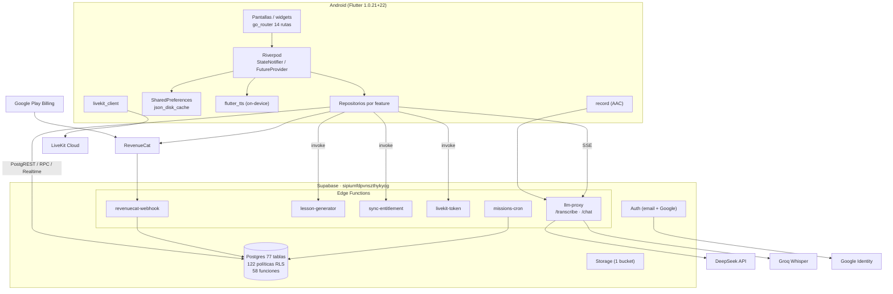
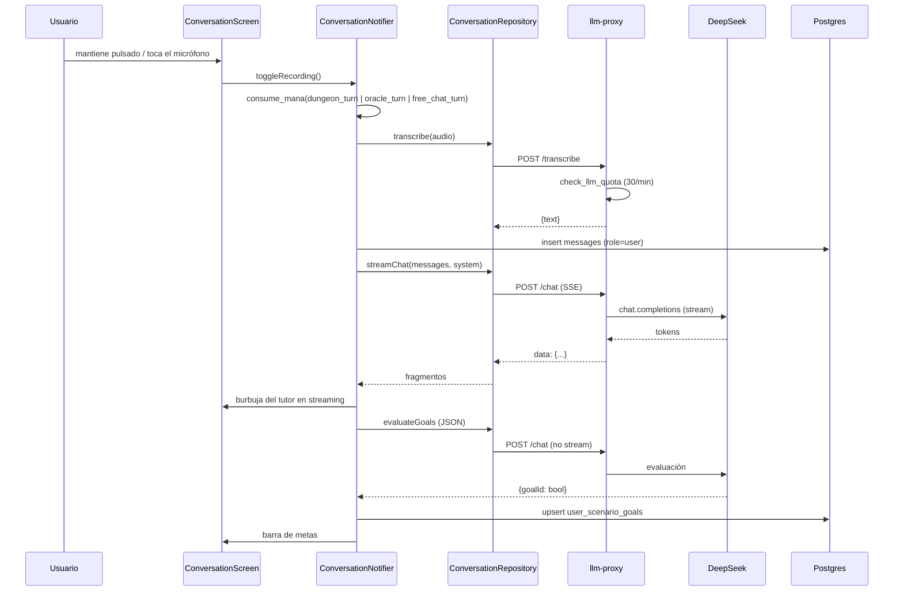

# 02 — Arquitectura técnica

> **Auditoría de solo lectura.** Medición: 25-oct-2026.
> Evidencia: código del repo, `pubspec.yaml`, `android/`, `supabase/`, y consultas
> de solo lectura al proyecto Supabase `sipiumfdpvnszthykyog`.
> Leyenda: **V** = verificado (código + producción), **P** = parcial,
> **D** = diseñado sin conexión, **NV** = no verificable desde este entorno.

---

## 1. Stack real

| Capa | Tecnología | Evidencia |
|---|---|---|
| Cliente | Flutter (Dart) | `pubspec.yaml:8` (`sdk: ^3.11.5`) |
| Versión | `1.0.21+22` | `pubspec.yaml:5` |
| Estado | flutter_riverpod `^2.5.1` | `pubspec.yaml:20` |
| Rutas | go_router `^14.0.0` | `pubspec.yaml:24` |
| Backend | Supabase (Postgres + Auth + Edge Functions) | `main.dart:35-38` |
| Pagos | RevenueCat + Play Billing | `purchases_flutter ^10.9.0`, `core/services/revenuecat_service.dart` |
| Voz | `record` (AAC) → Groq Whisper → `flutter_tts` | `pubspec.yaml:34-35`; `conversation_repository_impl.dart:40` |
| LLM | DeepSeek `deepseek-chat` vía `llm-proxy` | tabla `system_ai_settings` (prod): `llm_model=deepseek-chat`, `stt_model=whisper-large-v3-turbo`, `temperature=0.7` |
| Salas de voz | LiveKit | `livekit_client ^2.9.0`; `voice_room_screen.dart:8` |
| Gráficas | fl_chart `^0.68.0` | radar de habilidades |
| i18n | gen-l10n + ARB | `l10n.yaml`; 951 claves en `app_en.arb` |

**Android únicamente.** No existe `ios/`; el producto lo declara fuera de alcance
(`docs/PRODUCT.md:77`).

---

## 2. Organización del código

Feature-first con capas dentro de cada feature (`domain` / `data` /
`presentation`). No hay capa de casos de uso: los providers llaman directamente a
los repositorios.

```
lib/
├── main.dart              arranque, Supabase, error tracker, fuentes
├── app/                   router, splash, NavigationDecisionEngine
├── core/
│   ├── ai/                placement_ai.dart (evaluación del Oráculo)
│   ├── cache/             CachedFutureController + json_disk_cache
│   ├── constants/         ApiConstants (URLs, dart-define)
│   ├── i18n/              UserLanguageSettings, locale provider
│   ├── services/          RevenueCat, analytics, música de taberna
│   ├── theme/             colores, tipografía, spacing, radius, motion
│   ├── utils/             error_tracker, text_diff_utils
│   └── widgets/           GlassCard, RunicButton, RpgAvatar, QuestCard, …
├── features/              10 features (tabla siguiente)
└── l10n/                  ARB + generados (en/es/pt)
```

| Feature | Responsabilidad | Capas presentes |
|---|---|---|
| `auth` | Sesión Supabase, Google Sign-In, email | data, domain, presentation |
| `onboarding` | Welcome, wizard, placement, clases | data, domain, presentation |
| `conversation` | Pipeline de voz, chat, Oráculo, Maestre | data, domain, presentation |
| `chat_rooms` | Salas de voz (LiveKit), gremio, asientos | data, domain, presentation |
| `dashboard` | Home de 4 pestañas, progreso, ajustes, resumen | data, domain, presentation |
| `economy` | Maná, oro, tienda, inventario, drops | data, domain, presentation |
| `missions` | Motor de misiones (sin pantallas) | data, domain, presentation (solo providers) |
| `presence` | Heartbeat de presencia en salas | data, domain, presentation |
| `subscription` | Paywall, estado premium, sync | data, domain, presentation |
| `vocabulary` | Repaso SM-2 (solo widgets) | domain, presentation |

`lib/features/missions/` **no tiene `screens/`**: las misiones se muestran como
widgets del dashboard. `vocabulary` no tiene repositorio propio: usa
`DashboardRepository`.

---

## 3. Patrones y estado

- `StateNotifierProvider` para estado mutable (conversación, economía, idioma,
  presencia, premium).
- `FutureProvider(.autoDispose)` para lecturas; invalidación explícita con
  `ref.invalidate(...)` tras mutaciones.
- `StateProvider` para valores simples.
- Sin BLoC, Redux, GetX, `provider` clásico, `riverpod_annotation` ni hooks
  (los paquetes están en `pubspec.yaml` pero **0 imports**).
- Persistencia local: `shared_preferences` (idioma, caché de navegación,
  `nav_has_profile_*`) y `lib/core/cache/json_disk_cache.dart`.

**Repositorios por feature** con interfaz en `domain/repositories/` e
implementación en `data/repositories/`. La inyección es manual vía providers
(`supabaseClientProvider` → repositorio).

---

## 4. Arranque y navegación

1. `main()` inicializa `ErrorTracker`, desactiva la descarga de fuentes en runtime
   (`GoogleFonts.config.allowRuntimeFetching = false`, `main.dart:21`), inicializa
   Supabase y, si falla, muestra `ConfigurationErrorWidget` en lugar de la app
   (`main.dart:29-53`).
2. `TutorSaaSApp` monta `MaterialApp.router` con tema oscuro fijo, `locale`
   derivado de `effectiveUiLanguageProvider` y el router (`app/app.dart:30-42`).
3. `GoRouter` arranca en `/splash`; el `redirect` ejecuta
   `NavigationDecisionEngine.resolve(...)` en **cada** navegación
   (`app/router.dart:31-57`).
4. Reglas del motor (`app/navigation_resolver.dart:58-84`):
   - sin sesión → `/` (Welcome);
   - con sesión y sin fila en `user_language_profiles` → `/onboarding`;
   - con sesión y con perfil → `/home`.
5. La consulta de perfil tiene timeout de 6 s y caché en memoria + en
   `SharedPreferences`, para no bloquear el arranque sin red
   (`navigation_resolver.dart:26-31, 86-112`).

**Consecuencia de diseño:** el `redirect` hace una consulta a Supabase en cada
navegación la primera vez por usuario y luego responde desde caché; `/splash`,
`/onboarding`, `/oracle-test` y `/disruption` están excluidas del redirect
(`router.dart:34-40`). `/disruption` **no está registrada** como ruta: es una
excepción heredada.

---

## 5. Servicios transversales

| Servicio | Archivo | Qué hace | Estado |
|---|---|---|---|
| RevenueCat | `core/services/revenuecat_service.dart` | `configure(userId)`, `logIn` al cambiar de cuenta, offerings, compra, restore, paywall nativo, Customer Center | V |
| Analítica | `core/services/retention_analytics.dart` | `insert` en `analytics_events`; `app_open` una vez por proceso | V (tabla real; ver doc 17) |
| Errores | `core/utils/error_tracker.dart` | `init`, `logError`, `logEvent` | P: no envía a backend, solo `debugPrint` |
| Caché | `core/cache/cached_future_controller.dart` | Future cacheado + disco | V |
| Música | `core/services/tavern_music_service.dart` | `just_audio` para música de fondo | V |

---

## 6. Backend desplegado (verificado en producción)

Edge Functions activas (`list_edge_functions`):

| Función | `verify_jwt` | Versión | Rol |
|---|---|---|---|
| `llm-proxy` | ✅ | 11 | STT (`/transcribe`) y chat SSE (`/chat`) con claves de IA en servidor |
| `lesson-generator` | ✅ | 5 | Genera lecciones de refuerzo con IA (cobra 100 de maná) |
| `sync-entitlement` | ✅ | 2 | Reconcilia RevenueCat con `user_subscriptions` |
| `livekit-token` | ✅ | 8 | Emite tokens de sala |
| `revenuecat-webhook` | ❌ | 8 | Webhook de compras; auth por `Authorization: Bearer` propio |
| `missions-cron` | ❌ | 9 | Rotación de misiones; protegida por `CRON_SECRET` |

`export_my_data` y `delete_my_account` son RPC, no funciones edge.

**Secretos por nombre** (nunca en el cliente; `docs/OPERATIONS.md:47-55`):
`DEEPSEEK_API_KEY`, `DEEPSEEK_BASE_URL`, `GROQ_API_KEY`, `GROQ_STT_URL`,
`LIVEKIT_API_KEY`, `LIVEKIT_API_SECRET`, `LIVEKIT_URL`,
`REVENUECAT_AUTH_TOKEN`, `REVENUECAT_SECRET_KEY`, `CRON_SECRET`,
`SUPABASE_URL`, `SUPABASE_SERVICE_ROLE_KEY`.

**Cron en producción** (3 jobs activos): `rotate-daily-missions` (`5 0 * * *`),
`clean-old-logs` (`15 3 * * *`), `purge-stale-participants` (`* * * * *`).

---

## 7. Integraciones externas

| Integración | Dirección | Dónde | Riesgo si cae |
|---|---|---|---|
| DeepSeek (`deepseek-chat`) | app → `llm-proxy` → DeepSeek | `conversation_repository_impl.dart:105,234,304`; `placement_ai.dart:53` | Toda la conversación y el placement se detienen |
| Groq Whisper (`whisper-large-v3-turbo`) | app → `llm-proxy/transcribe` | `conversation_repository_impl.dart:40` | Sin voz; el usuario puede escribir (si la UI lo permite) |
| Supabase Auth/PostgREST/Realtime | app → Supabase | `Supabase.initialize` | App inoperante salvo caché de arranque |
| RevenueCat + Play Billing | app/Play → RevenueCat → webhook | `revenuecat_service.dart` | Sin compras nuevas; el estado previo se conserva |
| Google Sign-In | app → Google → Supabase | `auth_repository_impl.dart:22-54` | Login social no disponible (email sigue) |
| LiveKit | app → `livekit-token` → LiveKit Cloud | `voice_room_screen.dart` | Salas de voz caídas; el resto funciona |

---

## 8. Configuración, secretos y build

- Toda la configuración entra por `--dart-define` (`ApiConstants`).
  `SUPABASE_ANON_KEY` y `REVENUECAT_API_KEY` tienen **default hardcodeado**
  (`api_constants.dart:13-16, 63-66`). Son claves públicas por diseño (anon key y
  SDK key), no secretos; aun así, fijarlas en el repo impide rotarlas sin
  recompilar.
- Las claves de DeepSeek/Groq están marcadas `@Deprecated` y con default vacío
  (`api_constants.dart:20-43`): el cliente ya no las usa.
- `STT_URL` y `TTS_URL` (`api_constants.dart:50-58`) apuntan a
  `api.tutorsaas.ai/*`, un dominio **sin uso** en el código (la voz va por
  `llm-proxy` y `flutter_tts` local). Código muerto de configuración.
- `config.json` y `web_admin/.env` están fuera de git (`.gitignore`); no se
  encontraron credenciales versionadas.
- Android: `minSdk/targetSdk` heredados de Flutter; `applicationId`
  `com.tutorsaas.tutorsaas`; permisos **solo** `RECORD_AUDIO` e `INTERNET`
  (`android/app/src/main/AndroidManifest.xml:2-3`). **No hay permiso de
  notificaciones ni servicio de push.**
- Deep link de auth: `io.supabase.tutorsaas://login-callback`
  (`AndroidManifest.xml:32`).
- CI: `.github/workflows/ci.yml` ejecuta `flutter analyze` + `flutter test` en
  push/PR a `main`. **No hay CD ni firma automatizada.**

---

## 9. Diagrama de arquitectura actual



## 10. Flujo de una petición de conversación (runtime)



## 11. Entornos

| Entorno | Uso | Evidencia |
|---|---|---|
| Producción | Único backend; la app publicada y las builds locales apuntan aquí | `api_constants.dart:8-11`; `docs/OPERATIONS.md:9-16` |
| `web_admin/` | Panel React + Vite contra el mismo proyecto; RLS `admin_all` exige `app_metadata.role='admin'` | `web_admin/src/services/adminService.js`; políticas en producción |
| Local | `flutter run` contra producción | — |

**No hay staging.** Las pruebas se hacen con cuentas de prueba en producción
(`docs/OPERATIONS.md:16`). Esto es un riesgo de integridad de datos, no solo de
operación.

## 12. Componentes acoplados, duplicados o muertos

| Hallazgo | Evidencia | Impacto |
|---|---|---|
| 13 dependencias declaradas sin uso: `speech_to_text`, `video_player`, `lottie`, `shimmer`, `web_socket_channel`, `flutter_secure_storage`, `logger`, `url_launcher`, `cached_network_image`, `flutter_animate`, `riverpod_annotation`, `hooks_riverpod`, `flutter_hooks` | 0 imports en `lib/` | Tamaño de APK/AAB y superficie de dependencias |
| `dio` usado solo para `llm-proxy` (SSE manual) | `conversation_repository_impl.dart:3`; `placement_ai.dart:2` | Convive con `supabase_flutter`; doble stack HTTP |
| `STT_URL`/`TTS_URL` apuntan a `api.tutorsaas.ai` sin uso | `api_constants.dart:50-58` | Configuración engañosa |
| `UserProgress` (Freezed) nunca se instancia | `domain/models/user_progress.dart` | Código muerto |
| `micModeHoldToTalkProvider` **ya tiene consumidor** (P-34f / #198) | `conversation_providers.dart` lo deriva de `user_settings.mic_mode_hold_to_talk`; `ConversationMicButton` decide tap-to-toggle u hold-to-talk | Corregido: ya no es una feature fantasma |
| `api_usage_logs`/`ai_usage_logs` nunca se escriben | 0 filas en producción | Sin control de coste |
| `system_ai_settings` no lo lee ninguna función | `llm-proxy/index.ts:36` fija el modelo en código | Panel admin de IA sin efecto |
| `retention_events` **no existe** en producción | consulta `information_schema` | La documentación previa (`docs/ARCHITECTURE.md:104`, `DATA_MODEL.md:74`) está desactualizada |
| Duplicación de tema/colores (decenas de alias) | `app_colors.dart:109-146` | Mantenimiento |

## 13. Estado de verificación

| Aspecto | Estado |
|---|---|
| Estructura de capas y rutas | V (código) |
| Funciones edge y cron | V (producción) |
| Modelo LLM real | V: `deepseek-v4-flash` en `llm-proxy/index.ts:36`; `system_ai_settings.llm_model` dice `deepseek-chat` y no se usa |
| Cifras de tablas/RLS/funciones | V (producción: 77/122/58) |
| Cobertura de tests del pipeline de voz | NV: no hay pruebas del parser SSE ni del proxy |
| Configuración de `verify_jwt` en repo | NV: no hay `supabase/config.toml`; se verificó en producción |

