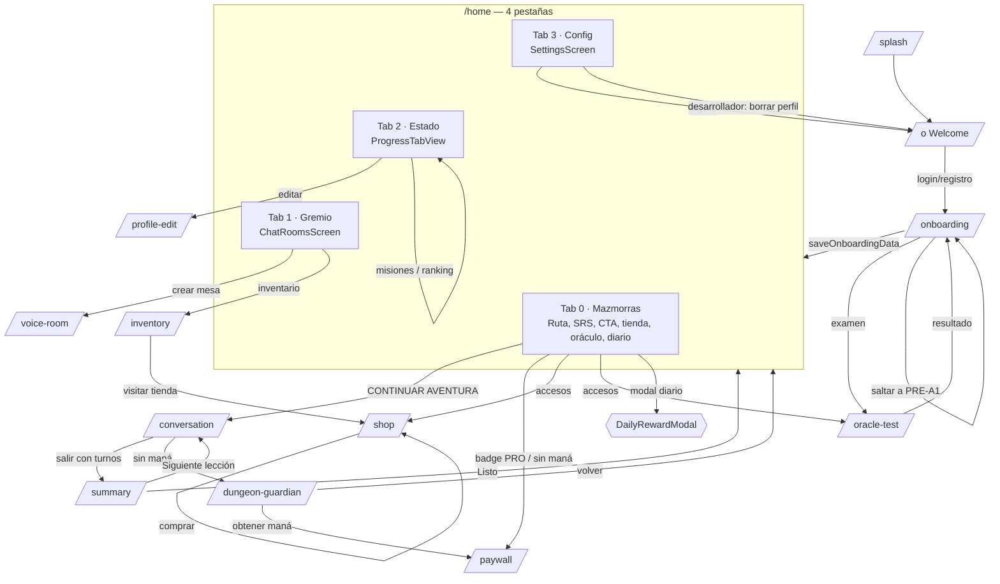

# 03 — Pantallas y navegación

> Medición: 25-oct-2026. Evidencia: `lib/app/router.dart`, cada pantalla, y
> auditoría de widgets. **No se ejecutó la app**: todo lo aquí descrito es
> inspección estática; los estados visuales no se verificaron en dispositivo.
> Leyenda: **V** implementado · **P** parcial · **D** diseñado sin conexión.

---

## 1. Rutas registradas (14)

| Ruta | Pantalla | Archivo | Parámetros |
|---|---|---|---|
| `/splash` | Splash HUD | `app/splash_screen.dart` | — |
| `/` | Welcome (login/registro) | `onboarding/presentation/screens/welcome_screen.dart` | — |
| `/onboarding` | Wizard 4 pasos | `onboarding/presentation/screens/onboarding_screen.dart` | — |
| `/oracle-test` | Conversación del Oráculo | `conversation/presentation/screens/conversation_screen.dart` (`oracleMode`) | `target`, `native` |
| `/home` | Dashboard 4 pestañas | `dashboard/presentation/screens/dashboard_screen.dart` | — |
| `/conversation` | Lección conversacional | `conversation/presentation/screens/conversation_screen.dart` | `scenarioId`, `scenarioTitle` |
| `/summary` | Resumen de sesión | `dashboard/presentation/screens/session_summary_screen.dart` | — |
| `/paywall` | Suscripciones | `subscription/presentation/screens/paywall_screen.dart` | — |
| `/profile-edit` | Editar perfil | `dashboard/presentation/screens/profile_edit_screen.dart` | — |
| `/chat-rooms` | Salón del gremio | `chat_rooms/presentation/screens/chat_rooms_screen.dart` | — |
| `/voice-room` | Sala de voz LiveKit | `chat_rooms/presentation/screens/voice_room_screen.dart` | `roomId` |
| `/shop` | Tienda (oro) | `economy/presentation/screens/shop_screen.dart` | — |
| `/inventory` | Inventario | `economy/presentation/screens/inventory_screen.dart` | — |
| `/dungeon-guardian` | Santuario de Maná | `economy/presentation/screens/dungeon_guardian_screen.dart` | — |

**Pantallas que no son ruta sino pestaña:** `SettingsScreen` (tab 3),
`ProgressTabView` (tab 2), `ChatRoomsScreen(isTab: true)` (tab 1).
**Modales/diálogos:** recompensa diaria, elección de clase, SRS flashcard,
diálogo de reset de contraseña, diálogo de creación de mesa, modal de rango,
bottom sheet de chat de sala.

**Ruta fantasma:** `/disruption` aparece en la lista de exclusiones del redirect
(`router.dart:34-40`) pero **no está registrada**; navegar allí daría error.

---

## 2. Mapa de navegación

---

## 3. Catálogo por pantalla

### 3.1 Splash (`app/splash_screen.dart`) — V
- Emblema animado + barra segmentada cuyo **porcentaje es progreso de animación,
  no de red** (`:194-207`).
- Espera fija 800 ms y `go('/')`; lanza un `select` de calentamiento a
  `user_language_profiles` (`:44-70`).
- Sin estados de error: si Supabase está caído, el redirect cae al fallback de
  caché y puede enviar a onboarding (ver doc 09).

### 3.2 Welcome (`welcome_screen.dart`, 696 líneas) — V
- Marca, formulario email+contraseña, botón Google (registro y login separados),
  "olvidé mi contraseña", toggle login/registro.
- Validaciones y errores: doc 09 §1.
- Overlay de autenticación con spinner; el registro pendiente de confirmación
  ofrece reenviar email (10 s).
- **No hay botón de invitado** pese a que el repositorio lo soporta.

### 3.3 Onboarding (4 pasos) — V
Detalle en doc 09 §3. En esta capa:
- `PageView` no deslizable; indicador "n/4".
- Paso 3 = wizard de personaje con carrusel de 8 clases (desde
  `hunter_classes`, con fallback estático) y radar de stats.
- Al terminar, tarjeta de héroe con "ENTRAR AL REINO" → `/home`.
- Errores: snackbar accionable, sin redirección.

### 3.4 Dashboard (`dashboard_screen.dart`) — V

| Pestaña | Contenido | Datos |
|---|---|---|
| **Mazmorras** | Header (avatar, nombre, CEFR), HUD de cazador, tarjeta SRS, badge PRO→paywall, accesos Tienda/Oráculo/Diario, CTA "CONTINUAR AVENTURA", `LearningPathRoadmap` | `userProfileProvider`, `dailyStateProvider`, `completedLessons`, `recommendedLessons` |
| **Gremio** | `ChatRoomsScreen(isTab: true)` | `chatRoomsListProvider`, realtime |
| **Estado** | `ProgressTabView`: clase/maná, aura, banner de racha, XP/racha/rango, radar, barras semanales, misiones diarias, leaderboard | `progress`, `skillsRadarProvider`, `dailyMissionsProvider`, `get_leaderboard` |
| **Config** | `SettingsScreen` | `userSettingsProvider`, `languageSettings` |

- Logout desde el header (`:501-538`).
- Dock flotante que se oculta con el teclado (`:171,406`).
- Fallback de progreso a ceros si falla la red (`:157-165`): el usuario ve 0 XP y
  racha 0 sin mensaje de error.

### 3.5 Conversation (`conversation_screen.dart`, 1462 líneas) — V
- **Modos reales:** lección y Oráculo. No hay modo "Maestre" en esta pantalla; el
  Maestre es un banner flotante en el gremio
  (`guild_master_floating_banner.dart`).
- Arranque: en lección chequea maná y bloquea a `/dungeon-guardian` si
  `available < 12` (`:142-164`); en Oráculo arranca `initOracleSession`.
- Controles: micrófono **tap-to-toggle**, drawer de teclado (chat de texto),
  replay TTS por burbuja, brújula de objetivos, 20 tópicos sugeridos, huella de
  voz.
- **No hay botón de pausa**; detener al tutor = tocar el micrófono o salir.
- Salida: back nativo o flecha; `dispose` cierra sesión y, si hubo turnos,
  `endSession(...)` + `/summary`.
- Estados: overlay "EL ORÁCULO ESTÁ EVALUANDO", burbuja de 3 puntos, snack de
  error; si el mensaje contiene "SIN MANÁ" abre el Santuario.
- **Cifras falsas:** `_usedMana = 15` fijo y `ManaMeterWidget(currentMana: 435)`
  (`:60,878-881`) conviven con `OracleManaBar` (real).

### 3.6 Session summary (`session_summary_screen.dart`) — P
- Fluidez/pronunciación: fórmulas sobre nº de palabras y turnos, con defaults
  0.85/0.80; duración `max(60, turnos*45)` — **inventada** (`:35-52`).
- Celda de XP **"+80" hardcodeada** (`:216-222,312`); racha "+1" es etiqueta fija.
- Drop: `SessionDropController` sí acredita XP real vía `add_xp` (15 × rareza); el
  objeto es decorativo.
- Correcciones: hasta 3 mensajes con `originalText`; si no hay, tarjeta genérica.
- "Ver vocabulario" solo lanza un snackbar (no navega) (`:337-344`).
- "Siguiente lección" navega si existe la siguiente del nivel.

### 3.7 Paywall (`paywall_screen.dart`) — V (delegado)
- No lista planes: abre el **paywall nativo de RevenueCat**.
- Restore, Customer Center, CTA de compra, legal desde l10n, tracking
  `paywall_viewed`/`purchase_*`.
- Depende por completo de la configuración de RevenueCat (no verificable aquí).

### 3.8 Chat rooms (`chat_rooms_screen.dart`) — V/P
- Header con rango y chip de battle pass (solo `level`/`is_premium`, sin UI de
  pase).
- Presencia, anuncios (rotación 8 s), lista de mesas con ocupación y tipo,
  crear mesa, realtime.
- Atajos: rango, inventario, música de taberna; trofeos = misiones colaborativas
  cumplidas.
- **0 mensajes y 0 participantes en producción**: funcionalidad sin uso.

### 3.9 Voice room (`voice_room_screen.dart`) — V
- Token por `livekit-token` con `publish` según estado de presencia; heartbeat
  30 s; 8 asientos con `claim_seat`, cola FIFO de `request_seat`, `stand_up`,
  moderación por long-press (`moderator_stand`).
- Cambiar de estado **reconecta** LiveKit (los grants son inmutables).
- Micrófono solo si está sentado; chat de texto en bottom sheet.
- Botón ORÁCULO solo hace `push('/conversation')` sin contexto de sala.

### 3.10 Economía — V/P
- **Santuario de Maná:** contador real, CTA a paywall, equipar elixir, volver.
- **Tienda:** solo oro, compra real, estado vacío pide migración.
- **Inventario:** filtros, equipar/quitar; auras bloqueadas sin "Aura despierta";
  consumibles sin botón.

### 3.11 Settings (`settings_screen.dart`, 1361 líneas) — V/P
Secciones reales: idioma objetivo (solo EN), chips CEFR, seguir idioma del
dispositivo, idioma de UI (es/en/pt), corrección IA (5), personalidad del tutor
(3), cadencia (3), meta diaria, cuenta (logout) y **herramientas de desarrollador**.
- La sección "Audio" está vacía (SFX y notificaciones retirados).
- **No hay** exportar datos, borrar cuenta, selección de voz ni notificaciones.
- Las herramientas de desarrollo **no están detrás de `kDebugMode`** y permiten
  borrar el perfil del usuario (`:1257-1346`). Ver riesgos en doc 16.

### 3.12 Profile edit — V
Nombre, bio, idioma nativo, clase (5 chips), avatar con cámara/galería subido a
`storage/avatars`. Guarda en `users` + metadata de auth. `avatar_url` se usa como
identificador de clase.

### 3.13 SRS (`srs_review_card.dart`, `srs_flashcard_modal.dart`) — V
- La tarjeta aparece solo si hay vocabulario vencido; muestra retención 7d si hay
  datos.
- Modal: flip, frente/dorso invertidos según intervalo (≥6 días → producción),
  botones DIFÍCIL/NORMAL/FÁCIL → RPC `record_vocabulary_review` con
  `card_type` recognition/production.
- Sin reintento visible si la RPC falla (`catch` vacío en `:71`).

---

## 4. Problemas de navegación y usabilidad detectados en código

| # | Problema | Evidencia |
|---|---|---|
| 1 | Ruta `/disruption` referenciada pero no registrada | `router.dart:34-40` |
| 2 | Herramienta de desarrollador destructiva accesible en producción | `settings_screen.dart:179,1257-1346` |
| 3 | El resumen de sesión muestra "+80 XP" fijo y un botón de vocabulario que no navega | `session_summary_screen.dart:216-222,337-344` |
| 4 | El CTA "Siguiente lección" puede llevar a la misma lección si no hay siguiente | `session_summary_screen.dart:394-435` |
| 5 | Two "maná" displays contradictorios en la pantalla de conversación (435 fijo vs real) | `conversation_screen.dart:60,875-881` |
| 6 | Logout accesible sin confirmación desde el header del dashboard | `dashboard_screen.dart:501-538` |
| 7 | El onboarding no permite volver atrás (`PageView` no deslizable) | `onboarding_screen.dart:403-412` |
| 8 | Los chips CEFR de ajustes no cambian nada (trigger) pero la UI lo aparenta | `settings_screen.dart:509-530` |
| 9 | Estado vacío de tienda expone un mensaje técnico ("aplica migración price_gold") | `shop_screen.dart:284-289` |
| 10 | El banner "racha en riesgo" está siempre activo por un contador que nunca se incrementa | `progress_tab_view.dart:46-48` |
| 11 | Textos mezclados ES/EN en ajustes y perfil | `settings_screen.dart:403-409`; `profile_edit_screen.dart` |
| 12 | No hay pantalla de misiones: las semanales existen y no se pueden ver | ausencia de `features/missions/screens/` |
