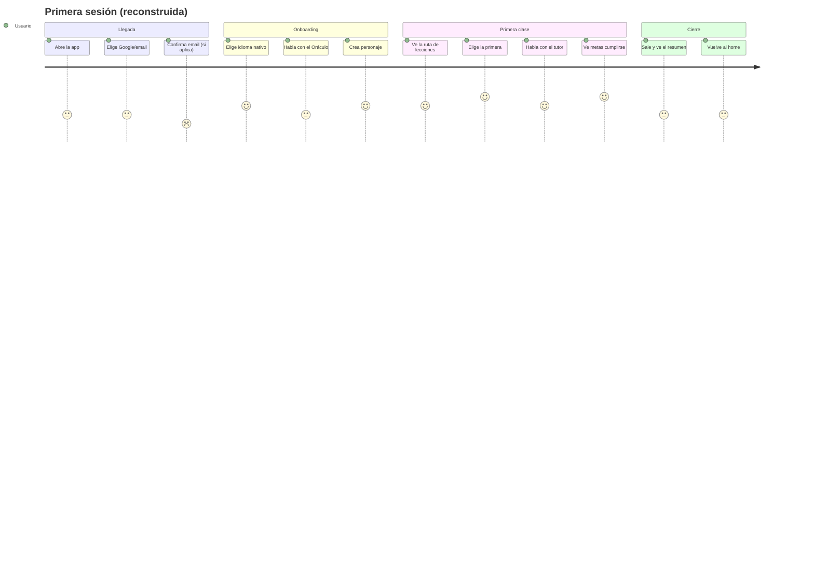
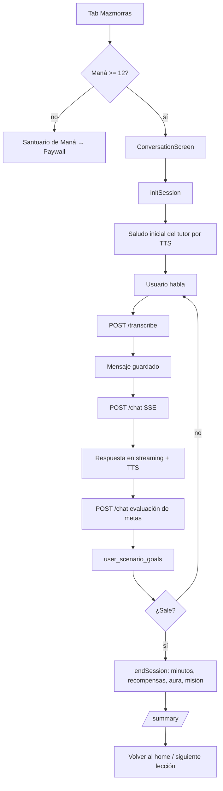

# 04 — Experiencia del usuario

> Medición: 25-oct-2026. Reconstrucción estática desde el código. **No se ejecutó
> la app ni se probó con usuarios**; los tiempos y percepciones son inferencias
> marcadas como tales.
> Leyenda: **V** verificado en código · **P** parcial · **NV** no verificable.

---

## 1. Ciclo de vida reconstruido

| Etapa | Qué ocurre | Estado |
|---|---|---|
| 1. Primera apertura | Splash 800 ms → `/` → Welcome | V |
| 2. Registro / login | Email o Google; errores accionables; confirmación de email con reenvío | V |
| 3. Onboarding | 4 pasos: nativo → inglés → Oráculo o PRE-A1 → personaje | V |
| 4. Determinación del nivel | Conversación oral adaptativa; salida `[RESULT:CEFR=…]` o salto manual | V |
| 5. Configuración inicial | Meta diaria, intereses, clase (motivación/personalidad hardcodeadas) | P |
| 6. Entrada al aprendizaje | `/home` tab 0 con ruta de lecciones | V |
| 7. Selección de actividad | CTA de la siguiente lección, tienda, Oráculo, SRS, gremio | V |
| 8. Inicio de sesión | Chequeo de maná (≥12) y arranque de conversación | V |
| 9. Resolución | Habla; el tutor responde; el LLM evalúa metas por turno | V |
| 10. Evaluación | Metas persistidas; sin puntuación por respuesta | P |
| 11. Finalización | Salir con turnos → `endSession` → `/summary` | V |
| 12. Recompensas | `apply_session_rewards` (XP/oro/fragmentos) + drop (XP) | P (resumen no lo refleja) |
| 13. Progreso | XP, aura, títulos, desbloqueo por umbral | P (racha no se actualiza) |
| 14. Salida / reanudación | Mensajes y metas ya persistidos; se retoma por `user_id+scenario_id` | V |
| 15. Reingreso tras inactividad | Sin push ni recordatorios; solo la UI de racha | ❌ (doc 11) |
| 16. Gratis vs pagado | Todo gratis; el premium solo añade maná | V |
| 17. Recuperación de progreso | En Supabase; tras reinstalar se recupera al iniciar sesión | V |

---

## 2. Viaje del usuario

Los valores son **estimaciones de diseño**, no datos de usuarios.

---

## 3. Flujo principal de aprendizaje

---

## 4. Flujos alternativos y errores

| Situación | Comportamiento real | Evidencia | Valoración |
|---|---|---|---|
| Sin red al abrir | El router usa la decisión persistida; el dashboard cae a ceros | `navigation_resolver.dart:101-111`; `dashboard_repository_impl.dart:59-69` | El usuario ve progreso 0 sin explicación |
| Falla el STT | Se propaga el error; no hay reintento automático | `repo:82-92` | P |
| Falla el LLM | **El texto del error se muestra como mensaje del tutor**, se narra por TTS y se guarda | `repo:207-217` | Grave: rompe la ilusión y contamina el historial |
| Falla la evaluación de metas | Devuelve `{}`; el turno no evalúa | `repo:290-292` | Silencioso |
| Maná insuficiente | Diálogo "SIN MANÁ" → Santuario → Paywall | `conversation_screen.dart:686` | V |
| El LLM no cierra el examen | Sin timeout ni tope de turnos: el examen no termina | doc 07 §3 | Grave |
| Se cierra la app a mitad | Mensajes y metas persistidos; se retoma | `repo:359-400` | V |
| Suscripción caduca | El estado vuelve a `plebeyo` en la siguiente lectura; el maná restante del ciclo se agota | `premium_status.dart` | V |
| Se borra el perfil con dev tools | El router manda a onboarding y el progreso desaparece | `settings_screen.dart:1312-1326` | Grave |

---

## 5. Fricciones observables en el flujo (hechos)

1. **El valor llega después de 3 pantallas y un examen oral.** No hay una lección
   de prueba antes del onboarding.
2. **El resumen no cierra el bucle**: muestra +80 XP fijo aunque el servidor haya
   acreditado otra cifra.
3. **La primera lección no siempre es la del interés del usuario**: la ruta usa el
   catálogo Dart, que no filtra por intereses.
4. **El maná se agota sin aviso previo**: el coste por turno no se muestra antes de
   empezar; solo hay un chequeo de 12 al entrar.
5. **No hay pista de qué hacer al volver** tras varios días: no hay push, correo ni
   estado "te quedaste aquí".
6. **El texto del tutor puede aparecer en español/inglés mezclado** por los
   `catch` que devuelven mensajes de error como contenido.
7. **La app promete métricas que no mide** (pronunciación, fluidez) con precisión
   de porcentaje.

---

## 6. Qué no se pudo verificar

- Tiempo real de arranque, fluidez del streaming y latencia percibida.
- Comportamiento del TTS en dispositivos concretos (voces disponibles).
- Permisos de micrófono denegados y su recuperación (no hay flujo explícito de
  "ir a ajustes").
- Aspecto visual real (no se ejecutó la app). Los tests de overflow y escala de
  texto sí pasan (159 pruebas), lo que sugiere que no hay desbordes obvios en los
  widgets cubiertos.
