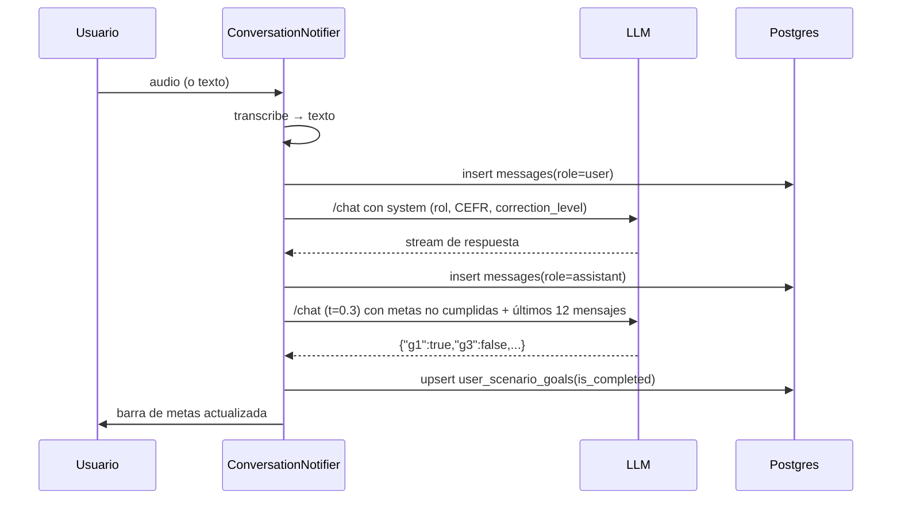

# 05 — Sistema pedagógico

> Medición: 25-oct-2026. Evidencia: `lesson_catalog.dart`, `scenarios` (producción),
> `conversation_providers.dart`, RPC `record_vocabulary_review`, `lesson_unlock_service.dart`.
> Leyenda: **V** verificado · **P** parcial · **D** diseñado sin conexión · **NV** no verificable.

---

## 1. Qué se enseña (y qué no)

El producto declara y practica **conversación oral de inglés**. No hay ejercicios
de lectura, escritura ni gramática explícita. La afirmación está respaldada por el
código:

| Competencia | ¿Se practica? | Cómo | Evidencia |
|---|---|---|---|
| Expresión oral | ✅ V | El usuario habla; el audio se transcribe y el tutor responde | `conversation_providers.dart:522`; `repo:40` |
| Comprensión auditiva | ✅ P | El tutor responde por TTS; no hay preguntas de comprensión ni audio grabado evaluado | `flutter_tts` en `conversation_screen.dart` |
| Conversación / fluidez | ✅ P | Turnos libres con un LLM; la "fluidez" es una estimación del modelo | `daily_fluency_stats`; latencia fija 1.8 s (`repo:669-733`) |
| Vocabulario | ✅ P | Extracción automática de hasta 6 palabras por turno + SRS SM-2 | `repo:489-562`; `record_vocabulary_review` |
| Pronunciación | ⚠️ P | "Claridad fonética" = similitud de texto transcrito, no análisis acústico | `user_scenario_phrases.phonetic_accuracy_score`; `speech_dna_metrics` |
| Gramática | ✅ P | Corrección implícita del tutor según `correction_style`; no hay drills | prompt del tutor (`conversation_providers.dart:1242-1255`) |
| Comprensión lectora | ❌ | — | — |
| Expresión escrita | ❌ | El chat de texto existe, pero no se evalúa como destreza | `conversation_screen.dart` |
| Construcción de oraciones | ⚠️ P | Implícita en la conversación; sin ejercicios dedicados | — |
| Uso práctico / contextos | ✅ V | 500 escenarios por situación (café, aeropuerto, entrevista…) | `scenarios` (prod) |

**Advertencia de honestidad pedagógica:** la app presenta métricas de fluidez y
pronunciación como si fueran mediciones. `docs/PRODUCT.md:45-46` ya reconoce que
son estimaciones, pero la UI las pinta en un radar con precisión de porcentaje.

---

## 2. Currículo: dos fuentes y una sola canónica

| Fuente | Contenido | Uso real |
|---|---|---|
| **Dart** `LessonCatalog` (140 lecciones) | 20 por nivel × 7 niveles (PRE-A1…C2). Campos: id, título, descripción, nivel, categoría/interés, dificultad 1-6, objetivo, contexto, rol del asistente, rol del usuario, mensaje inicial, 3+ metas con keywords, 3+ frases útiles | Fuente de la **Ruta por Etapas** y del fallback cuando la BD no responde (`lesson_catalog.dart:96`; test `lesson_catalog_test.dart:12-23`) |
| **Postgres** `scenarios` (500 filas) | 20 por nivel para PRE-A1 y **80 por nivel** en A1…C2 (4 idiomas: en/fr/de/it). Incluye `goals`, `useful_phrases`, `title_es/pt`, `skill_focus`, `parent_id`, `review_status` | Lo que el dashboard **muestra** si la consulta funciona (`dashboard_repository_impl.dart:103-115`) |

Producción (verificado): `PRE-A1 20`, `A1..C2 80 cada uno`, total **500**, todos
`is_active=true`.

**Consecuencia:** el contenido que el usuario ve puede no ser el del catálogo Dart.
La documentación afirma "catálogo Dart como fuente única" (`docs/PRODUCT.md:57`),
pero el dashboard prioriza `scenarios`. Coexisten dos currículos con los mismos
niveles y distinto origen.

### 2.1 Estructura curricular real

No hay unidades ni módulos. La jerarquía es:

```
Nivel CEFR (PRE-A1 … C2)
└── Lección / escenario (20 por nivel en Dart; hasta 80 en BD por idioma)
    ├── mainObjective (texto)
    ├── goals[]  → 3-5 metas con keywords + frase de ejemplo
    └── usefulPhrases[] → 3-4 frases con traducción
```

- **Prerrequisitos:** el nivel anterior completo (o acreditación del Oráculo).
- **Orden:** el del array `catalog` (índice) para desbloqueo.
- **Criterio de superación:** 75 % de metas (ver §5).
- **Recompensas:** XP/oro al cerrar sesión (doc 06), no por lección.
- **Evaluación:** el modelo evalúa las metas en cada turno (§4).

### 2.2 Distribución temática del catálogo Dart

| Categoría/interés | Lecciones |
|---|---|
| business | 33 |
| daily | 25 |
| science | 16 |
| history | 15 |
| travel | 14 |
| technology | 11 |
| art | 8 |
| cooking | 7 |
| music | 6 |
| sports | 5 |
| general | 1 |

Los intereses del onboarding filtran y reordenan los escenarios de la BD
(`dashboard_repository_impl.dart:117-136`), pero **no** filtran el catálogo Dart de
la Ruta por Etapas.

---

## 3. Niveles de inglés

Escala **CEFR propia**: `PRE-A1, A1, A2, B1, B2, C1, C2`
(`cefr_rank.dart:10`), mapeada a rangos de juego F…SSS (§ doc 06).

| Aspecto | Implementación | Estado |
|---|---|---|
| Cómo se determina | Test del Oráculo (conversación oral); el nivel declarado por el modelo en el token `[RESULT:CEFR=…]` | V (código) |
| Alternativa | Salto manual a PRE-A1 desde el onboarding | V |
| Persistencia | `user_language_profiles.cefr_level_id` + `placement_*` | V |
| Puede bajar | No en modo promoción (`oracle-test` promociona; la BD guarda el nivel) | P |
| Puede subir | Sí, al cerrar un examen del Oráculo | V |
| Escritura del cliente | Bloqueada por trigger `guard_language_profile` para UPDATE | V (migración `20261019043716`) |
| Nivel = dificultad | El dashboard pide escenarios con `difficulty_level = CEFR exacto` | V (`dashboard_repository_impl.dart:106`) |

**Hallazgo:** no hay adaptación de dificultad dentro del nivel. Un usuario A2 solo
recibe escenarios A2; no hay mezcla de niveles ni ajuste por desempeño. La única
gradación es la posición en la lista (`progress`, `stars`).

**Datos de producción:** las 76 evaluaciones registradas tienen `cefr_level='A1'`
— no hay evidencia de que el placement haya asignado otro nivel en cuentas reales
(probablemente cuentas de prueba).

---

## 4. Cómo se evalúa un turno



- La evaluación de metas **no** es determinista: la decide el modelo en cada turno
  (`conversation_providers.dart:1350-1352`).
- El cliente también tiene una heurística local por keywords
  (`ScenarioGoalItem.isSatisfiedBy`, `lesson_catalog.dart:28-31`) que se usa para
  la barra en vivo (`live_goals_tracker_bar.dart`), no para persistir.
- Si la evaluación falla, devuelve `{}` y el turno no evalúa nada
  (`repo:290-292`): el usuario puede completar la lección sin que se registre.
- Los IDs devueltos por el modelo no se filtran contra las metas reales
  (`repo:285-286`), aunque el upsert usa `onConflict user_id,scenario_id,goal_id`.

---

## 5. Superación, desbloqueo y estrellas

**Umbral de superación** (`lesson_unlock_service.dart:39-55`):

```
superada = completadas == total
        o (total <= 4 y completadas >= total - 1)
        o completadas / total >= 0.75
```

**Desbloqueo** (`lesson_unlock_service.dart:86-130`):

| Situación | Estado |
|---|---|
| Metas ≥ umbral | `completedByPlayer` |
| Nivel CEFR anterior al usuario | `unlockedByOracle` |
| Mismo nivel y todas las anteriores superadas | `nextAvailable` |
| Mismo nivel con anteriores pendientes | `locked` |
| Nivel superior | `locked` |

**Estrellas (dashboard)** — cálculo distinto al anterior
(`dashboard_repository_impl.dart:186-195`):

| Condición | Estrellas |
|---|---|
| Metas completas + frases usadas ≥ total | 3 |
| Metas completas + frases ≥ mitad | 2 |
| Metas completas | 1 |
| Sin completar | 0 |

⚠️ Hay **dos nociones de "completada"**: la Ruta por Etapas usa el umbral 75 %;
el dashboard usa `goalsDone >= totalGoals` (100 %) (`:183`). Un usuario con 3/4
metas ve la lección desbloqueada en la ruta pero "no completada" en la lista.

**Halo visual** (`lesson_halo.dart:20-41`): 0 % sin halo, >0 cian, ≥75 % violeta,
100 % dorado. El comentario de la clase dice "70 %" pero el umbral real es 0.75.

---

## 6. Repetición espaciada (vocabulario)

Implementación **SM-2 en servidor** (`record_vocabulary_review`):

- Calidades: `HARD=2.0`, `NORMAL=3.0`, `EASY=5.0` (`srs_grade.dart:8-19`).
- `ease = ease + (0.1 − (5−q)(0.08 + (5−q)·0.02))`, mínimo 1.3.
- Si `q < 3` → intervalo 1 día; si no, 1 → 6 → `round(intervalo × ease)`.
- `is_mastered = aciertos >= 3 y intervalo >= 14`.
- `vocabulary_reviews` es append-only y guarda `delayed_retrieval` (acierto tras
  ≥7 días) — la única señal real de retención del sistema.
- `learning_evidence()` devuelve `retention_7d` = aciertos diferidos / intentos
  elegibles (null si no hay datos).

**Cómo entran las palabras al mazo:** extracción automática del texto del usuario,
regex `\b[a-zA-Z]{4,15}\b`, máximo 6 palabras por turno
(`conversation_repository_impl.dart:489-562`). La traducción es la propia palabra
salvo que esté en un diccionario hardcodeado de 21 entradas; `part_of_speech` se
infiere por sufijo (`-ly`, `-ing`); `difficulty_level` se fija en `'A2'` para todo.

**Consecuencia:** el "vocabulario aprendido" incluye palabras vacías y errores de
transcripción, sin traducción real ni nivel. El SRS es correcto; la entrada de
datos no lo es.

Producción: `vocabulary_reviews` = 7 filas; `retention_7d` no tiene base
estadística todavía.

---

## 7. Mecanismos pedagógicos: qué existe de verdad

| Mecanismo | ¿Existe? | Evidencia | Comentario |
|---|---|---|---|
| Repetición espaciada | ✅ V | SM-2 en RPC | Solo vocabulario |
| Recuperación activa | ⚠️ P | El usuario debe hablar para avanzar | No hay preguntas de recall dirigidas |
| Práctica acumulativa | ⚠️ P | Cada lección reintroduce metas/frases del escenario | No acumula contenidos anteriores por diseño |
| Revisión de errores | ❌ | No hay registro de errores ni repaso de los mismos | `corrections` existe en BD pero el flujo no la escribe |
| Dificultad progresiva | ✅ P | Niveles CEFR + dificultad 1-6 | Sin adaptación dentro del nivel |
| Mezcla nuevo/conocido | ❌ | — | — |
| Evaluación de retención a largo plazo | ⚠️ P | `retention_7d` | Solo vocabulario; sin uso en la UI de progreso |
| Adaptación al nivel | ✅ P | Prompt con CEFR + nivel de corrección | No adapta contenido ni ritmo |
| Enseñanza explícita (explicaciones) | ❌ | El tutor conversa; no explica gramática salvo que se le pregunte | — |
| Plan de estudio / objetivos semanales | ❌ | Solo `daily_goal_minutes` como métrica | Sin plan |
| Test de nivel continuo | ❌ | El Oráculo solo se usa en onboarding/promoción | — |

### Datos que permitirían saber si el usuario aprende

| Disponible | No disponible |
|---|---|
| `retention_7d` (vocabulario, últimos 90 días) | Precisión gramatical medida |
| Metas completadas por escenario | Errores recurrentes por categoría |
| Autoevaluación SM-2 | Transferencia a escenarios nuevos |
| Minutos y racha | Comprensión auditiva medida |
| Scores del Oráculo (6 dimensiones, 1 vez) | Progreso comparable entre sesiones |

---

## 8. Veredicto pedagógico (hechos, no recomendaciones)

1. El sistema **enseña por inmersión conversacional**, no por instrucción
   explícita. Es coherente con su propuesta, pero deja sin cubrir lectura,
   escritura y gramática formal.
2. La **evaluación del aprendizaje depende del LLM turno a turno**; no hay un
   banco de ítems con respuesta conocida, ni pruebas reproducibles.
3. La **única evidencia dura de retención** es `retention_7d` sobre vocabulario
   extraído automáticamente sin control de calidad.
4. El **currículo está duplicado** (Dart vs BD) y las dos versiones no se
   sincronizan.
5. El **desbloqueo y las estrellas usan umbrales distintos** para "completada".
6. Las **métricas de pronunciación y fluidez no son acústicas**; se derivan del
   texto o son constantes.

