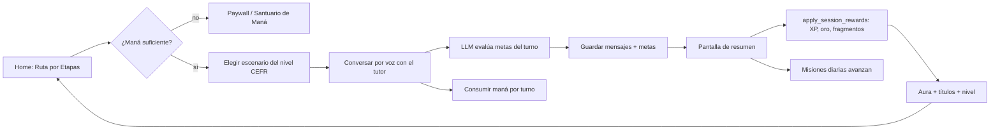

# 06 — Gameplay y gamificación

> Medición: 25-oct-2026. Evidencia: código, migraciones, y agregados de producción
> (solo lectura). Leyenda: **V** verificado · **P** parcial · **D** diseñado sin
> conexión · **NV** no verificable.

---

## 1. La capa RPG, en una frase

No hay combate, enemigos, mapa ni inventario de equipo: la "capa RPG" es un
**sistema de reputación y recursos** (XP, rango, aura, títulos, oro, maná) que
envuelve una conversación con IA. Lo que se llama "mazmorra" es un escenario de
conversación; "Guardián/Santuario de Maná" es la pantalla de recarga.

Evidencia: `dungeon_guardian_screen.dart` solo enlaza al paywall e inventario
(`:183-216`); no hay tabla de enemigos, HP ni combate en producción (77 tablas).

---

## 2. Bucle principal real



El aprendizaje **es** la acción del juego (no hay una actividad separada que dé
puntos): el jugador avanza hablando. Donde el bucle se rompe es en las
**consecuencias**: el resumen muestra cifras fijas y el drop es decorativo (§6.3).

---

## 3. Recursos y economía

### 3.1 Maná — la moneda de la IA

| Acción | Código | Coste | Evidencia |
|---|---|---|---|
| Turno en lección/mazmorra | `dungeon_turn` | **12** | `ai_action_costs` (prod); `conversation_providers.dart:1148-1150` |
| Turno del Oráculo | `oracle_turn` | **15** | idem; `:1149` |
| Chat libre | `free_chat_turn` | **8** | idem; `:1150,1153` |
| Cierre del Oráculo | `oracle_eval` | **30** | `:820` |
| Lección generada por IA | `lesson_generation` | **100** | `lesson-generator/index.ts:193-196` |

- Se cobra **antes** de llamar al modelo y **no se reembolsa** si falla (solo
  `lesson-generator` reembolsa: `:210-214`).
- `consume_mana` descuenta primero del plan y luego de ítems equipados, con
  **límite diario** (`user_subscriptions.daily_limit`, por defecto 200) y registro
  en `mana_transactions` (`20260818_03_mana_rpcs.sql:18-151`).
- Fuentes: `mana_allowance` del plan (3.000/17.000/20.500/25.500), recompensas de
  sesión y pociones (estas **no** son comprables en la app, §8).
- `llm-proxy` **no valida maná**: un cliente modificado puede consumir IA sin pagar
  (doc 07).

### 3.2 Oro, XP, gemas, fragmentos, pergaminos

| Recurso | Se gana | Se gasta | Estado |
|---|---|---|---|
| **Oro** | Recompensas de sesión (`objectives × (10+bonus)`), misiones | Cosméticos en la tienda | V |
| **XP** | `minutos × 10` (sesión), misiones | Nada (es acumulativo) | V |
| **Gemas** | Misiones (`gem_reward`) | `spend_gems` sin flujo activo | **D**: moneda sin sumidero ni UI |
| **Fragmentos** | Recompensas de sesión (`objectives × (5+bonus)`) | Nada | **D**: se acumula invisible |
| **Pergaminos** | Recompensa diaria | Nada | **D**: escritos en tabla deprecada |

Producción: `player_inventory = 0` filas y `payments = 0` → **nadie ha comprado un
cosmético ni una suscripción por la app**.

### 3.3 Límites y ritmo económico

- Plan gratuito: 3.000 de maná/mes y 200/día → a 12 de maná por turno, **16 turnos
  al día** como máximo teórico; una sesión de 10 turnos consume 120.
- El cierre del Oráculo (30) más los turnos del examen (15/turno) hacen que un
  examen de 6 turnos cueste 120 de maná.
- El coste no depende de la longitud de la respuesta ni del modelo: es fijo por
  turno.

---

## 4. Progresión

| Eje | Fórmula / regla | Evidencia |
|---|---|---|
| **Nivel de cazador** | `1 + (xp ~/ 1000)` | `hunter_level.dart:13-19` |
| **Rango** | Derivado del CEFR: PRE-A1→F, A1→E, A2→D, B1→C, B2→B, C1→A, C2→S (SS/SSS existen sin mapeo) | `cefr_rank.dart:13-35` |
| **CEFR** | Solo cambia con el Oráculo; el cliente no puede escribirlo | doc 05 §3 |
| **Aura** | `0.25 fluency + 0.25 vocab + 0.20 phonetics + 0.10 grammar + 0.10 goals + 0.05 streak + 0.05 rank` | `aura_system.dart:126-150` |
| **Desbloqueo del Aura** | CEFR ≥ B1 **o** Etapa Básica (PRE-A1+A1+A2) 100 % completada | `aura_system.dart:78-119` |
| **Tiers de Aura** | latente <0.25 · revelada <0.45 · abierta <0.65 · dominante <0.85 · abisal ≥0.85 | `aura_system.dart:153-159` |
| **Prestigio** | 21 escalones por `aura_xp` (0 → 260.000), con techo de plan (`plebeyo`/`noble`/…) | `prestige_ladder` (prod); migración `20260813_mana_aura_redesign.sql:485-508` |
| **Títulos** | 5 líneas × tiers, otorgados por umbrales de fluidez, fonética, vocabulario, precisión, racha y carisma | `dashboard_repository_impl.dart:914-961`; `hunter_skill_titles.dart` |

**Observación:** el rango no se gana jugando: es una etiqueta del CEFR. El nivel
sí sube con XP (1.000 por nivel), pero no desbloquea contenido ni cambia la
dificultad — es un número visible.

---

## 5. Recompensas al cerrar sesión

RPC `apply_session_rewards` (`20261018000000_session_rewards_rpc.sql:39-126`),
idempotente por `session_id`:

```
bonus     = {A2:1, B1:2, B2:3, C1:4, C2:5, resto:0}
XP        = minutos × 10
oro       = objetivos × (10 + bonus)
fragmentos= objetivos × (5 + bonus)
```

- Valida `auth.uid()` y acota `objetivos 0..12`, `minutos 0..240`.
- Escribe `session_reward_ledger` y actualiza `user_language_profiles`.
- **Producción: 2 filas** en el ledger → el cierre con recompensa casi no se ha
  ejercitado.

Lo que **muestra** la pantalla de resumen es otra cosa: cifras fijas de XP y un
drop generado en el cliente (`session_summary_screen.dart`; drop en
`session_drop_controller.dart:24,32-50`). Reabrir `/summary` vuelve a "tirar" el
drop (15-45 XP visual): no acredita nada, pero confunde.

---

## 6. Misiones

- **33 plantillas activas**: 14 diarias, 6 semanales, 13 secundarias
  (`mission_templates`, prod), con objetivos `speak_minutes`, `conversation_turns`,
  `sessions`, `vocab_words`, `practice_session`; XP 20-400.
- El cron `rotate-daily-missions` (00:05 UTC) crea instancias diarias.
- El progreso lo mueve el **servidor** con `advance_my_missions` y tres triggers
  (mensaje insertado, recompensa de sesión, repaso de vocabulario)
  (`20261018000004_missions_progress.sql:60-124`), y **también el cliente**
  (`conversation_providers.dart:1197-1199,1459-1464`) → doble conteo probable.
- `guard_mission_instance` impide que el cliente cambie `status`, `current_value` o
  `completed_at` (`20261018000004:127-160`); el reclamo sí lo dispara el cliente
  con `claimReward`, que acredita XP y **gemas** vía `add_xp`/`add_gems`
  (`mission_repository.dart:230-276`) — importes elegidos por el cliente.
- **Producción:** 533 instancias, **7 completadas** (6 diarias + 1 semanal). Las
  semanales se crean pero **no hay UI** que las muestre (no existe
  `features/missions/screens/`).

**Tipos no conectados:** secretas, emergencias, eventos globales, misiones de
gremio y colaborativas existen como modelos y tablas; sin pantalla ni flujo.

---

## 7. Retención diaria y rachas

- **Recompensa diaria** (`daily_reward_modal.dart`): escalón por día consecutivo,
  botón deshabilitado tras reclamar; los pergaminos se escriben en
  `player_daily_state` (tabla deprecada). Funciona, pero el fallo es silencioso.
- **Rachas**: hay **dos** fuentes de verdad: `player_streaks` (con
  `streak_freezes`) y `user_language_profiles.current_streak`. El cliente calcula
  la racha en `logPracticeSession` (`dashboard_repository_impl.dart:556-604`), pero
  el trigger `guard_language_profile` **descarta** `current_streak`,
  `total_minutes`, `last_practice_date` y `xp_points` en updates del cliente
  (`20261019043716_guard_language_profile.sql:41-44`). Es decir: la escritura de
  racha desde la app **no surte efecto**; solo las RPC `SECURITY DEFINER` la
  cambian.
- **"Racha en riesgo"**: el banner se basa en `invocations_used`, que nunca se
  incrementa (`progress_tab_view.dart:46-48`) → el aviso está siempre activo si
  hay racha.
- **Freezes de racha**: `purchaseStreakFreeze` existe sin UI
  (`economy_repository_impl.dart:401-428`).

---

## 8. Tienda e inventario

- **Tienda** (`shop_screen.dart`): solo cosméticos con **oro** vía RPC
  `purchase_cosmetic`. Precios de catálogo: títulos 200/350/800, marcos
  250/450/900, auras 300/550/1100, mascotas 600/1000, emotes 120, temas 700/1200
  (`20260813_shop_gold.sql:20-33`).
- La pestaña de maná fue retirada (`shop_screen.dart:27-29`). `mana_potions`,
  `mana_gems`, consumibles y pergaminos **no tienen flujo de compra**.
- **Inventario** (`inventory_screen.dart`): equipar/desequipar cosméticos; las
  auras exigen "Aura despierta" (`:43-54`); los consumibles no se pueden equipar
  (`:316`).
- `purchaseItem` (gemas/consumibles) es código muerto con un `item_type`
  inválido para el CHECK de `player_inventory`
  (`economy_repository_impl.dart:297-302`).

---

## 9. Social

- **Leaderboard** (`get_leaderboard`): XP de todos los perfiles, solo `user_id` y
  XP; sin ligas, temporadas ni desempate. La UI inventa el nombre ("Cazador XXXX"),
  pinta 0 estrellas y una línea de ascenso fija en el puesto 3
  (`league_leaderboard_widget.dart:183-206`; `progress_tab_view.dart:449-454`).
- **Gremio** (`chat_rooms`): 6 salas en producción, **0 mensajes**. Hay asientos,
  solicitudes y moderación implementados por RPC; el battle pass solo se lee
  (`chat_rooms_screen.dart:1011-1014`).
- **Salas de voz** (LiveKit): flujo de token y conexión implementado; sin uso
  registrado.

---

## 10. Dificultad, fracaso y ritmo

| Situación | Qué pasa | Evidencia |
|---|---|---|
| El usuario falla metas | La lección no se desbloquea; puede reintentar sin coste adicional de desbloqueo | `lesson_unlock_service.dart` |
| Se queda sin maná | Diálogo "SIN MANÁ" que abre el Santuario/paywall | `conversation_screen.dart:686` |
| Falla el LLM | El mensaje de error se muestra **como si fuera el tutor**, se narra por TTS y se guarda en `messages` | `conversation_repository_impl.dart:207-217` |
| Cierra la app a mitad | Mensajes y metas ya persistidos; la conversación se recupera por `user_id + scenario_id` | `repo:359-400` |
| Repite una lección | Progreso se acumula (`best_ratio` en `scenario_progress`); recompensa de sesión solo una vez por `session_id` | `record_scenario_outcome` |

**No hay** vidas, energía, salud, clima, mapa persistente, NPCs recurrentes,
enemigos ni jefes. El "jefe" que aparece en textos de planes legacy no existe en
el código actual.

---

## 11. Qué se puede afirmar sobre el diseño del bucle

Hechos (no hipótesis):

1. **La recompensa no depende de aprender, sino de hablar**: XP = minutos, oro =
   objetivos que evalúa el LLM. Un usuario puede completar objetivos con frases
   mínimas si el modelo lo acepta.
2. **El fracaso no tiene coste**: reintentar es gratis salvo el maná ya gastado.
3. **La progresión visible (nivel) no desbloquea nada**; el desbloqueo depende del
   CEFR, que solo cambia en el Oráculo.
4. **Dos de las cinco monedas no tienen uso** (gemas, fragmentos) y una
   (pergaminos) escribe en una tabla deprecada.
5. **El resumen de sesión no refleja la recompensa real**, lo que rompe la
   percepción de causa-efecto del bucle.
6. **El 98,7 % de las misiones creadas en producción no se completó** (7 de 533).

Estas observaciones son verificables en código y datos. Su efecto sobre retención
**no** puede afirmarse sin datos de usuarios reales (doc 17).

---

## 12. Cobertura de mecánicas

| Mecánica | Estado | Nota |
|---|---|---|
| XP / nivel / rango | V | Nivel = XP/1000; rango = CEFR |
| Maná | V | Server-side, límite diario, sin compra |
| Oro | V | Solo cosméticos |
| Gemas / fragmentos / pergaminos | D | Sin sumidero/UI |
| Misiones diarias | V | Motor server + doble avance |
| Misiones semanales | P | Se crean; sin UI |
| Misiones secretas/eventos/gremio | D | Modelos y tablas sin flujo |
| Rachas | P | Doble fuente; escritura cliente bloqueada |
| Recompensa diaria | V | Pergaminos a tabla deprecada |
| Logros | P | 6 en catálogo; auto-desbloqueo desde el cliente |
| Títulos | V | Por umbrales de radar |
| Aura / prestigio | V | Fórmula completa, techo por plan |
| Tienda | P | Solo oro → cosméticos |
| Inventario | P | Equipar cosméticos; resto bloqueado |
| Leaderboard | P | XP crudo, sin ligas |
| Salas de voz / gremio | P | Implementado, sin actividad |
| Combate / jefes / mapa | ❌ | No existe |

