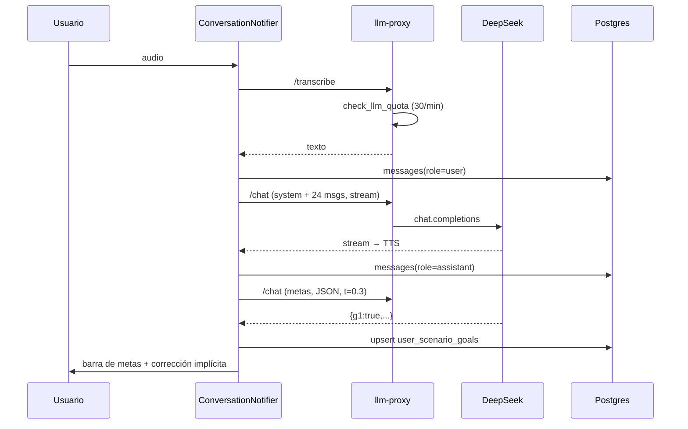

# 07 — Inteligencia artificial

> Medición: 25-oct-2026. Evidencia: `llm-proxy`, `lesson-generator`,
> `conversation_providers.dart`, `placement_ai.dart`, `lesson_generator_service.dart`
> y consultas de solo lectura a producción.
> Leyenda: **V** verificado · **P** parcial · **D** diseñado sin conexión · **NV** no verificable.

---

## 1. Inventario

| Elemento | Valor real | Evidencia |
|---|---|---|
| Proveedor LLM | DeepSeek | `llm-proxy/index.ts:36` |
| Modelo | **`deepseek-v4-flash`** (allow-list) | `llm-proxy/index.ts:36-37` |
| Proveedor STT | Groq | `llm-proxy/index.ts:144` |
| Modelo STT | `whisper-large-v3-turbo`, `language=en` | `repo:57-59`; `system_ai_settings` (prod) |
| Proxy | Edge Function `llm-proxy` (`verify_jwt=true`, v11) | producción |
| Rutas | `POST /chat`, `POST /transcribe`, `GET /health` | `index.ts:121,141-144` |
| Cliente HTTP | `dio` con SSE manual | `conversation_repository_impl.dart:105-159` |
| Generador de lecciones | Edge Function `lesson-generator` (DeepSeek directo) | `lesson-generator/index.ts:130-136` |
| Config en BD | `system_ai_settings`: `llm_model=deepseek-chat`, `temperature=0.7` | **No se usa**: el proxy fija el modelo en código |
| Trazabilidad de coste | `ai_usage_logs` (existe) — **0 filas** | producción |
| Cuota | 30 req/min por usuario, ventana 60 s | `llm-quota` |
| Log de cuota | `llm_quota_events` (45 filas) | producción |

**Deriva de configuración:** el panel admin (`system_ai_settings`) sugiere que el
modelo se puede cambiar; el proxy lo ignora. La temperatura real es la del
proveedor (no se envía) para el chat; 0.3 para evaluación de metas y placement;
0.7 para generación de lecciones.

---

## 2. Casos de uso

### 2.1 Chat de lección / turno del Oráculo
- **Disparador:** el usuario habla (o escribe).
- **Componente:** `ConversationNotifier` → `ConversationRepository.streamChat`.
- **Contexto enviado:** system (rol + CEFR + nivel de corrección) + últimos
  **24 mensajes** (`conversation_providers.dart:1057,1257`).
- **Instrucciones:** `"You MUST ALWAYS respond in English…"` + pregunta de
  seguimiento (`:1242-1255`).
- **Modelo:** `deepseek-v4-flash`, `stream:true`, `max_tokens:200`.
- **Respuesta esperada:** texto libre.
- **Validación:** **ninguna**.
- **Persistencia:** `messages` (usuario y asistente).
- **Si falla:** el mensaje de error se emite como contenido del tutor, se narra por
  TTS y se guarda (`repo:207-217`). Sin reintento de UI más allá de 2 intentos del
  repositorio.
- **Coste:** 8/12/15 de maná según modo (doc 06 §3.1).

### 2.2 Evaluación de metas por turno
- **Disparador:** cada turno del usuario (`conversation_providers.dart:1350-1352`).
- **Entrada:** últimos 12 mensajes + metas no completadas.
- **Prompt:** `"You are a strict and objective evaluator… Return ONLY a valid JSON
  object where keys are goal IDs and values are true/false."`
- **Modelo:** `deepseek-v4-flash`, `stream:false`, `t=0.3`, `max_tokens:400`.
- **Validación:** `jsonDecode` estricto; **no se filtran IDs** contra las metas
  reales.
- **Persistencia:** upsert en `user_scenario_goals`.
- **Si falla:** `{}` silencioso → no se evalúa el turno.
- **Coste:** sin cargo propio (va incluido en el turno).

### 2.3 Cierre / placement del Oráculo
- **Disparador:** el modelo emite `[EVALUATION_COMPLETE][RESULT:CEFR=…,RANK=…]`.
- **Evaluación de puntuaciones:** segunda llamada `PlacementAiEvaluator`
  (`placement_ai.dart:52-72`): `t=0.3`, `max_tokens=600`, JSON de 7 claves.
- **Validación:** `_parseJsonDefensive` + `_normalizeCefr` (si es inválido → `A1`);
  el **nivel lo fija el texto declarado por el modelo**, no la evaluación.
- **Persistencia:** `oracle_assessments`, `oracle_turns`, `user_language_profiles`,
  `speech_dna_metrics`.
- **Si falla:** heurística por número de palabras (`placement_ai.dart:272-287`).
- **Coste:** 15/turno + 30 de cierre.
- **Riesgo:** sin tope de turnos ni timeout de cierre: si el modelo no emite el
  token, el examen no termina.

### 2.4 Generación de lección de refuerzo
- **Disparador:** el dashboard pide una sub-misión para el "skill más débil".
- **Componente:** `lesson-generator` (DeepSeek directo), `t=0.7`,
  `max_tokens=900`.
- **Entrada:** `skill_focus`, `level`, `weakness` (recortada a 200 chars).
- **Salida:** JSON de escenario; se inserta en `scenarios` con
  `review_status='draft'`.
- **Coste:** 100 de maná; **reembolsa** si falla (`:210-214`).
- **Estado:** **D roto**. `weakestSkill` puede devolver `comprehension` o
  `naturalness`, que el generador rechaza con 400; sin datos del Oráculo ambas
  valen 0 y siempre ganan → la sub-misión **nunca se genera**, y el `catch (_) {}`
  lo oculta (`lesson_generator_service.dart:18-24`;
  `dashboard_providers.dart:295-303`; `lesson-generator/index.ts:178-180`).

---

## 3. Flujo de evaluación y retroalimentación

**Retroalimentación al usuario:** la corrección es implícita (el tutor reformula).
No hay tarjeta de "tu error fue X" durante la conversación; el resumen muestra
hasta 3 correcciones si el mensaje trae `originalText` (rara vez).

---

## 4. Calidad pedagógica de la IA

| Criterio | ¿Lo garantiza el código? | Evidencia |
|---|---|---|
| Usa el nivel real del estudiante | ✅ en el prompt (CEFR) | `:1257` |
| Respeta el contenido del curso | ⚠️ solo rol/contexto; no inyecta `mainObjective` ni frases | prompt |
| Adapta explicaciones a errores previos | ❌ | no se envía historial de errores |
| Retroalimentación clara | ⚠️ depende del modelo | — |
| Preguntas con respuesta válida | ✅ para metas (JSON booleano) | `repo:285` |
| Coherencia pregunta/respuesta/explicación | ❌ sin validación | — |
| Control de dificultad | ⚠️ solo por CEFR fijo | — |
| Evita contradicciones | ❌ | — |
| Distingue error gramatical de typo | ❌ | — |
| Acepta respuestas alternativas | ✅ implícito (LLM) | — |
| Mantiene contexto conversacional | ✅ 24 mensajes | `:1057` |
| Evita revelar respuestas | ⚠️ el tutor puede decirlas | — |
| Evalúa con criterios consistentes | ❌ temperatura 0.3 sin rubric fija | — |

**Conclusión:** la calidad pedagógica descansa en el prompt y en el modelo; el
código no valida ni corrige el contenido educativo. No hay banco de ítems ni
rúbricas.

---

## 5. Seguridad, privacidad y control

| # | Hallazgo | Severidad | Evidencia |
|---|---|---|---|
| 1 | **El maná no se valida en el servidor de IA**: `llm-proxy` no consulta maná; el cobro es 100 % cliente | **Crítica** | `llm-proxy/index.ts:101-268` (sin `consume_mana`) |
| 2 | Cuota de 30 req/min por usuario, **fail-open** si el RPC falla | Media | `index.ts:90-98` |
| 3 | Sin `SUPABASE_SERVICE_ROLE_KEY` el proxy cae a anon → 429 global (fail-closed accidental) | Media | `index.ts:23` |
| 4 | `/health` sin auth revela si hay claves de DeepSeek/Groq | Baja | `index.ts:112-119` |
| 5 | CORS `*` en el proxy | Baja | `index.ts:48-52` |
| 6 | Sin tope de tokens de entrada (solo salida 1-600) | Media | `index.ts:32-33,172-175` |
| 7 | Audio máximo 10 MB | Baja | `index.ts:43,240-242` |
| 8 | Claves de IA solo en secretos del servidor; el cliente no las tiene | ✅ | `api_constants.dart:18-43` |
| 9 | Prompt injection: el texto del usuario entra en el mensaje de evaluación de metas sin delimitadores | Media | `repo:237-255` |
| 10 | `ai_usage_logs` vacía: no se audita modelo, tokens, coste ni latencia | Alta | producción |
| 11 | `ErrorTracker` no envía errores a ningún backend | Media | `error_tracker.dart:31-56` |
| 12 | El error del proveedor se guarda como mensaje del asistente (contamina historial y puede filtrar detalles) | Media | `repo:207-217` |

**Datos personales enviados al LLM:** transcripciones de voz, nivel, idioma nativo
y últimos 24 mensajes. No se envían email ni nombre. No hay aviso de privacidad
in-app sobre el uso de IA (solo la política del repo).

---

## 6. Costes

**No hay medición.** `ai_usage_logs` tiene 0 filas; el proxy solo hace
`console.error` de fallos. `analytics_events` registra `invoke_llm` (416 eventos
en producción) sin tokens.

Variables necesarias para estimar (no estimación):

| Variable | Fuente posible | Estado |
|---|---|---|
| nº de turnos por usuario/día | `messages` role=user | Disponible |
| tokens de entrada/salida | respuesta del proveedor | **No capturado** |
| precio por 1K tokens de `deepseek-v4-flash` | tarifa del proveedor | Externa |
| minutos de audio STT | `user_subscriptions.audio_seconds_logged` | Parcial |
| llamadas de evaluación por turno | 1 por turno (≈ duplica llamadas) | Disponible en código |
| generaciones de lección | `mana_transactions` `lesson_generation` = 8 | Disponible |

**Estructura de coste observada:** por cada turno del usuario hay **dos** llamadas
al LLM (respuesta + evaluación) y una al STT. El coste crece linealmente con los
turnos, no con la duración de la sesión.

Oportunidades de reducción **sin cambiar el producto** (identificadas, no
implementadas):

1. Medir tokens y coste real (`ai_usage_logs`) antes de optimizar.
2. Evaluar metas solo cuando el mensaje del usuario contiene señal (evitar la
   segunda llamada en turnos de una palabra).
3. Cachear la apertura de lección (hoy es texto fijo del catálogo o del modelo).
4. Limitar el historial enviado según longitud real, no fijo a 24.
5. Usar un modelo más pequeño para la evaluación booleana de metas.

---

## 7. Qué no puede verificarse

- Si DeepSeek acepta el payload con un solo rol `system` en algunos caminos.
- Si el modelo respeta `max_tokens` al emitir el token de cierre del Oráculo.
- La latencia real y la tasa de error del proveedor.
- El coste facturado (no hay datos).
- La calidad real de las correcciones (requiere evaluación con hablantes).
