# 08 — Modelo de datos

> Medición: 25-oct-2026. Dos fuentes: (a) **producción** vía consultas de solo
> lectura al proyecto `sipiumfdpvnszthykyog`; (b) archivos en `supabase/migrations/`.
> Donde divergen, manda producción y se indica.
> Leyenda: **V** verificado en producción · **P** parcial · **S** solo en el repo
> (no aplicado) · **MUERTA** sin uso.

---

## 1. Cifras reales (producción)

| Objeto | Cantidad |
|---|---|
| Tablas en `public` | **77** |
| Políticas RLS | **122** sobre **74** tablas |
| Funciones en `public` | **58** (55 `SECURITY DEFINER`) |
| Jobs `pg_cron` activos | **3** |
| Buckets de Storage | 1 |
| Vistas | 0 |
| Tablas sin RLS | **0** |

La documentación previa dice 75 tablas / 120 políticas / 52 funciones
(`docs/DATA_MODEL.md:5-11`). El esquema real tiene dos tablas y seis funciones más
(`scenario_progress`, `vocabulary_reviews`, `session_reward_ledger`, etc.).

**Deriva repo ↔ producción:** 164 archivos `.sql` (124 en la raíz, 40 en
subcarpetas); solo **49** en la raíz tienen prefijo de 14 dígitos. Producción tiene
migraciones aplicadas que el repo no reproduce (documentado en
`docs/runbooks/MIGRATION_STATUS.md`). Consecuencia: **el repo no es la fuente de
verdad del esquema**; este documento se apoya en producción.

---

## 2. Inventario de tablas por dominio (77)

### Identidad y perfil (11)
`users`, `user_settings`, `user_language_profiles`, `user_ai_profiles`,
`languages`, `cefr_levels`, `cefr_recommendation_rules`, `hunter_classes`,
`hunter_titles`, `user_titles`, `prestige_ladder`

### Aprendizaje y contenido (23)
`scenarios`, `scenario_goals`, `scenario_objectives`, `scenario_phrases`,
`scenario_progress`, `conversations`, `messages`, `corrections`,
`oracle_assessments`, `oracle_turns`, `oracle_questions`,
`pronunciation_assessments`, `lesson_progress`, `vocabulary_items`,
`user_vocabulary`, `vocabulary_reviews`, `daily_stats`, `weekly_stats`,
`daily_fluency_stats`, `speech_dna_metrics`, `user_scenario_fluency`,
`user_scenario_goals`, `user_scenario_phrases`

### Economía, progresión y compras (19)
`subscription_plans`, `user_subscriptions`, `payments`, `mana_transactions`,
`mana_potions`, `mana_gems`, `mana_items`, `player_inventory`,
`cosmetic_catalog`, `ai_action_costs`, `session_reward_ledger`, `reward_history`,
`player_streaks`, `aura_session_awards`, `achievements`, `user_achievements`,
`hunter_collection_catalog`, `hunter_collections`, `player_pergaminos`

### Gremio, salas y misiones (17)
`chat_rooms`, `chat_room_messages`, `chat_room_participants`, `seat_requests`,
`livekit_token_requests`, `guild_quest_pool`, `guild_announcements`,
`guild_battle_pass`, `guild_collaborative_missions`, `mission_templates`,
`mission_instances`, `player_completed_quests`, `secret_missions`,
`emergency_missions`, `global_events`, `player_event_progress`,
`daily_challenges`

### Operación y observabilidad (7)
`analytics_events`, `api_request_logs`, `ai_usage_logs`, `llm_quota_events`,
`revenuecat_events`, `system_ai_settings`, `player_daily_state`

---

## 3. Tablas clave: columnas reales

### `user_language_profiles` — el centro del progreso
`id, user_id, language_id, cefr_level_id, xp_points, current_streak,
longest_streak, last_practice_date, total_minutes, equipped_title_code,
player_class, guild_role, total_gems, total_gold, last_active_date, fragments,
character_class, avatar_index, game_rank, placement_scores, placement_strengths,
placement_weaknesses, placement_explanation, placement_recommended_focus,
placement_assessed_at, carisma_score, aura_xp, skill_radar,
prestige_title_code, updated_by, updated_at`

Notas: `skill_radar` es un JSON con las 5-7 dimensiones del radar; `aura_xp` es
`bigint`; `xp_points` se actualiza **solo** por RPC (trigger de guarda).

### `user_settings`
`id, user_id, correction_style, tutor_personality, tutor_voice_id,
daily_goal_minutes, notifications_enabled, notification_time, interests,
motivation, correction_level, ui_language, learning_language,
ai_explanations_native, follow_device_language`

**`notifications_enabled`/`notification_time` existen en la tabla y no se usan en
ningún flujo** (no hay push: doc 11).

### `scenarios` — contenido
`id (uuid), language_id, title, description, context, difficulty_level,
category, estimated_minutes, main_objective, assistant_role, user_role,
initial_assistant_message, goals (jsonb), useful_phrases (jsonb), is_custom,
created_by_user_id, is_active, deleted_at, title_es, title_pt, description_es,
description_pt, context_es, context_pt, skill_focus, parent_id, review_status`

Producción: 500 filas = PRE-A1 20 + 80 por nivel A1…C2 × 4 idiomas.

### `conversations` / `messages`
`conversations`: `id, user_id, language_id, scenario_id (varchar), started_at,
ended_at, duration_seconds, status, progress, deleted_at`.
`messages`: `id, conversation_id, sender_role, text, created_at, sequence_number,
content_text, role`.

`scenario_id` es **texto**: guarda UUIDs de escenario, claves del catálogo Dart
(`a1_ordering_coffee_at_a_cafe`) o el literal `oracle-evaluation`.

### `user_scenario_goals`
`id, user_id, scenario_id (varchar), conversation_id, goal_id, goal_text,
is_completed, completed_at` — una fila por meta y escenario (upsert por
`user_id, scenario_id, goal_id`).

### `user_vocabulary` / `vocabulary_reviews`
`user_vocabulary`: `id, user_id, vocabulary_id, word, translation,
phonetic_accuracy_score, is_mastered, last_reviewed_at, times_seen,
times_correct, ease_factor, interval_days, next_review_at, last_seen_at,
production_correct, deleted_at`.
`vocabulary_reviews` (append-only): `id, user_id, vocabulary_id, quality,
interval_before, interval_after, days_since_last, delayed_retrieval,
reviewed_at`.

### `daily_stats`
`id, user_id, language_id, date, minutes_practiced, conversations_count,
words_learned, xp_earned, avg_fluency_score` — única por
`(user_id, language_id, date)`.

### `user_subscriptions`
`id, user_id, plan_id, status, period_start, period_end, used_audio_seconds,
purchased_mana_balance, mana_expires_at, billing_cycle, daily_limit, daily_used,
daily_reset_date, audio_seconds_logged, store, rc_product_id, rc_expires_at,
last_event_id, cancel_at_period_end`.

### `mission_instances`
`id, user_id, template_id, mission_type, title, description, objective_type,
target_value, current_value, xp_reward, gem_reward, item_reward, status,
is_reward_claimed, expires_at, started_at, completed_at, reward_multiplier,
applied_modifier_code, quest_id`

### `player_inventory`
`id, user_id, item_code, item_type, is_equipped, acquired_at, item_effect,
item_meta, source`

### `oracle_assessments` / `oracle_turns`
`oracle_assessments`: `id, user_id, cefr_level, game_rank, target_language,
native_language, scores, strengths, weaknesses, explanation, recommended_focus,
answers, duration_seconds, ai_model, prompt_version, stopped_at_cefr,
scores_pronunciation, scores_fluency, scores_grammar, scores_vocabulary,
scores_comprehension, scores_naturalness`.
`oracle_turns`: 17 columnas con `cefr_level`, pregunta, transcripción, tiempos y
6 puntuaciones (pronunciation, fluency, grammar, vocabulary, comprehension,
naturalness) + `partial_score`.

### `analytics_events`
`id, user_id, event_name, properties (jsonb), created_at`.

---

## 4. Relaciones principales (ER)

```mermaid
erDiagram
  users ||--|| user_settings : tiene
  users ||--o{ user_language_profiles : progreso_por_idioma
  cefr_levels ||--o{ user_language_profiles : nivel
  languages ||--o{ user_language_profiles : idioma
  users ||--o{ conversations : inicia
  scenarios ||--o{ conversations : escenario
  conversations ||--o{ messages : contiene
  conversations ||--o{ user_scenario_goals : evalua
  scenarios ||--o{ scenario_progress : resultado
  users ||--o{ user_vocabulary : aprende
  vocabulary_items ||--o{ user_vocabulary : palabra
  user_vocabulary ||--o{ vocabulary_reviews : repasos
  users ||--|| user_subscriptions : plan
  subscription_plans ||--o{ user_subscriptions : catalogo
  users ||--o{ mana_transactions : consume
  users ||--o{ mission_instances : recibe
  mission_templates ||--o{ mission_instances : origen
  users ||--o{ player_inventory : posee
  cosmetic_catalog ||--o{ player_inventory : item
  users ||--o{ oracle_assessments : examenes
  oracle_assessments ||--o{ oracle_turns : turnos
  users ||--o{ user_achievements : logros
  achievements ||--o{ user_achievements : catalogo
  users ||--o{ session_reward_ledger : cierres
  users ||--o{ analytics_events : eventos
  chat_rooms ||--o{ chat_room_participants : presencia
  chat_rooms ||--o{ chat_room_messages : mensajes
```

---

## 5. RLS y seguridad de datos

Patrón general: **el dueño solo accede a lo suyo**, con `USING (auth.uid() =
user_id/id)`; escrituras sensibles solo por RPC `SECURITY DEFINER`; catálogos por
política `admin_all` que exige `auth.jwt() -> 'app_metadata' ->> 'role' = 'admin'`.

| Tabla | Acceso del cliente | Nota |
|---|---|---|
| `user_subscriptions` | SELECT del dueño | Correcto tras el endurecimiento; antes era `FOR ALL` |
| `payments` | SELECT del dueño | Sin escrituras de app (webhook usa service role) |
| `mana_transactions` | SELECT | Escritura solo por RPC |
| `scenario_progress` | SELECT | INSERT/UPDATE/DELETE revocados; solo RPC |
| `vocabulary_reviews` | SELECT | Append-only por RPC |
| `analytics_events` | INSERT y SELECT del dueño | El cliente puede insertar eventos propios (esperado) |
| `ai_usage_logs` | **FOR ALL del dueño** | El cliente podría insertar/borrar sus propios logs de uso: si se usaran para facturar, sería manipulable. Hoy está vacía |
| `user_language_profiles` | SELECT/INSERT/UPDATE del dueño + `admin_all` | UPDATE filtrado por `guard_language_profile` |
| `users` | SELECT/UPDATE/INSERT del dueño + `admin_all` | Edita `display_name`, avatar, stats |

### Función de guarda `guard_language_profile` (V, producción)
Preserva en cada UPDATE del cliente: `cefr_level_id`, `game_rank`, `xp_points`,
`total_gold`, `total_gems`, `fragments`, `aura_xp`, `prestige_title_code`,
`skill_radar`, `current_streak`, `longest_streak`, `total_minutes`,
`last_practice_date` y todo el bloque `placement_*`
(`20261019043716_guard_language_profile.sql:31-52`).

**Efecto colateral verificado en código:** `DashboardRepositoryImpl.logPracticeSession`
intenta escribir `total_minutes`, `current_streak`, `longest_streak` y
`last_practice_date` desde el cliente (`dashboard_repository_impl.dart:594-603`).
Esas escrituras **se descartan silenciosamente**. Las rachas y minutos solo
cambian por RPC (p. ej. `apply_session_rewards` no los toca tampoco: solo XP, oro y
fragmentos). Es decir, `current_streak` **no se actualiza en el flujo normal**.

---

## 6. Persistencia local y sincronización

| Dato local | Almacén | Sincronización |
|---|---|---|
| Idioma de UI/aprendizaje | `SharedPreferences` (`language_settings.dart:44-52`) | Se sube a `user_settings` al cambiar; se baja solo si no hay preferencia local (`:82-103`) |
| "Tiene perfil" para el router | `SharedPreferences` `nav_has_profile_<uid>` | Se invalida al completar onboarding (`navigation_resolver.dart:36-56`) |
| Caché de respuestas | `json_disk_cache` + `CachedFutureController` | TTL; sin invalidación por evento |
| Token de sesión | `supabase_flutter` (almacenamiento del SDK) | Refresco automático |

**No hay modo offline real**: sin red, el dashboard cae a placeholders
(`getUserProgress` devuelve ceros, `getWeeklyPractice` devuelve días a 0).

---

## 7. Integridad: hallazgos verificables

| # | Hallazgo | Evidencia | Severidad |
|---|---|---|---|
| 1 | `xp_points`, oro, gemas y fragmentos se pueden acreditar con `add_xp`/`add_gold`/`add_gems`/`add_fragments` indicando el importe desde el cliente (solo valida identidad) | `add_gold`/`add_xp` (prod, `checks_auth_uid=true`, sin rango); `mission_repository.dart:252-258` | Alta |
| 2 | `add_mana_item` (SECURITY DEFINER) **no valida `auth.uid()`** y es ejecutable por `anon` | `pg_proc` (prod) | Alta |
| 3 | `grant_next_seat` no valida `auth.uid()` ni rol de moderador | `pg_proc` (prod) | Media |
| 4 | `ai_usage_logs` vacía: no hay trazabilidad de tokens ni coste | `count(*)=0` | Alta (negocio) |
| 5 | `retention_events` **no existe**; la analítica va a `analytics_events` | `information_schema` | Baja (docs) |
| 6 | Dos fuentes de racha (`player_streaks` y `user_language_profiles`) sin reconciliación | tablas + código | Media |
| 7 | `scenario_id` heterogéneo (uuid / clave Dart / literal) impide FK | `conversations` (prod) | Media |
| 8 | `subscription_plans` contiene 4 planes legacy (`free`, `monthly`, `annual`, `lifetime`) con features inexistentes (Battle Pass, Blind Listening) | `subscription_plans` (prod) | Media (marketing engañoso si se muestran) |
| 9 | 19 tablas sin una sola fila (gremio, misiones especiales, eventos, colecciones) | conteos exactos | Baja (código muerto) |
| 10 | Migraciones del repo no reproducen el esquema; `db push` está prohibido | `docs/runbooks/MIGRATION_STATUS.md` | Alta (operación) |

---

## 8. Retención y borrado de datos

- `delete_my_account()` borra `auth.users` y, por `ON DELETE CASCADE`, los datos
  hijos (`pg_proc`, prod). La app lo expone en ajustes (doc 09).
- `export_my_data()` devuelve un JSON con perfil y datos del usuario.
- `clean-old-logs` (03:15 UTC) poda logs antiguos.
- **No hay tabla de auditoría de accesos** ni política de retención documentada por
  tabla.
- `analytics_events` no se purga por cron (solo `api_request_logs`/`llm_quota_events`
  según la migración `20261018000009_account_deletion_retention.sql`).

---

## 9. Estado de verificación

| Aspecto | Estado |
|---|---|
| Conteo de tablas/políticas/funciones | V (producción) |
| Columnas de las 12 tablas clave | V (producción) |
| RLS por tabla | V (producción) |
| Contenido de catálogos (planes, costes, plantillas) | V (producción) |
| Cardinalidades reales | P: conteos exactos de tablas clave; el resto se estimó |
| Migraciones ↔ producción | V: hay deriva; el repo no reproduce el esquema |

