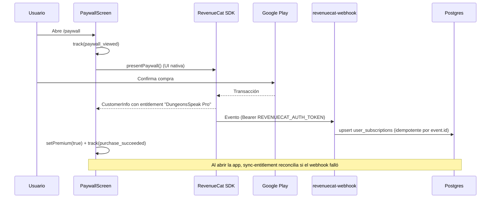

# 10 — Monetización, pagos y suscripciones

> Medición: 25-oct-2026. Evidencia: `revenuecat_service.dart`,
> `paywall_screen.dart`, `subscription_repository_impl.dart`, tablas
> `subscription_plans` / `user_subscriptions` / `payments` (producción) y
> `docs/OPERATIONS.md` §5.

---

## 1. Modelo de negocio vigente

```
Google Play Billing → RevenueCat → webhook (Edge Function) → Supabase → app
                                        ↑
                          sync-entitlement al abrir sesión
```

- **No hay Stripe ni venta web.** Se eliminó en oct-2026 (`docs/PRODUCT.md:85`).
- Todo el cobro pasa por la tienda de Android.
- Precio y disponibilidad los fija Play/RevenueCat; la app **no pinta ofertas
  propias**: presenta el paywall nativo de RevenueCat
  (`paywall_screen.dart:122`).

---

## 2. Planes en producción (`subscription_plans`)

| id | Activo | Maná/mes | Min. audio/mes | Precio mensual (BD) | Precio anual (BD) |
|---|---|---|---|---|---|
| `plebeyo` | ✅ | 3.000 | 30 | $0.00 | — |
| `noble` | ✅ | 17.000 | 300 | $4.99 | $53.99 |
| `realeza` | ✅ | 20.500 | 1.200 | $9.99 | $107.99 |
| `divino` | ✅ | 25.500 | 2.000 | $12.99 | $132.99 |
| `free` | ❌ | 1.800 | 30 | $0.00 | — |
| `monthly` | ❌ | 18.000 | 300 | $1.99 | — |
| `annual` | ❌ | 72.000 | 1.200 | $14.99 | — |
| `lifetime` | ❌ | 72.000 | 1.200 | $29.99 | — |

Observaciones:

1. Los cuatro planes legacy están **inactivos** (`is_active=false`) pero siguen en
   la tabla y sus `features` prometen cosas que no existen ("Battle Pass",
   "Blind Listening ilimitado", "Speech DNA completo"). Si el panel admin los
   reactivara, la promesa sería falsa.
2. La documentación dice que la tabla "no tiene precios"
   (`docs/PRODUCT.md:25-27`); en producción **sí hay** `price`, `price_annual` y
   `monthly_audio_minutes_limit`. La app no los usa para cobrar.
3. `monthly_audio_minutes_limit` sí se usa: `getPlanManaBonus` deriva un bono de
   maná (+20 si ≥300 min, +40 si ≥1200) (`economy_repository_impl.dart:575-598`).
   No se encontró consumidor de ese bono en el flujo de UI.

---

## 3. Qué desbloquea el premium (verificado)

**Solo maná.** No hay ninguna funcionalidad bloqueada por `isPremiumProvider`
salvo el badge del dashboard y el estado del paywall
(`dashboard_screen.dart:306-339`; `paywall_screen.dart:188-385`).

| Elemento | ¿Gate premium? |
|---|---|
| Conversaciones | ❌ (se pagan con maná) |
| Lecciones / niveles | ❌ |
| Oráculo | ❌ (30 de maná) |
| Misiones, ranking, tienda | ❌ |
| Cosméticos | ❌ (oro) |
| Badge "PRO" en dashboard | ✅ (solo visual) |

Esto coincide con la decisión de producto documentada: "el premium solo añade maná
y features de texto; no vende ventajas de juego" (`docs/PRODUCT.md:29-31`).
**Consecuencia económica:** el valor de pagar es *más cantidad de la misma
actividad*, no acceso a algo distinto.

---

## 4. Flujo de compra (implementado)



- **Entitlement:** `DungeonsSpeak Pro` (`api_constants.dart:69`).
- **Productos Play:** `dungeonsspeak_{noble|realeza|divino}_{monthly|yearly}`
  (`docs/PRODUCT.md:27`).
- **Restaurar compras:** botón en cabecera y en estado premium; llama
  `Purchases.restorePurchases()` y evalúa `resultGrantsPro`
  (`paywall_screen.dart:72-95`).
- **Gestión de suscripción:** `RevenueCatUI.presentCustomerCenter()`
  (cancelar, reembolso, cambiar plan) (`paywall_screen.dart:170-183`).
- **Verificación de entitlement:** `EntitlementVerificationMode.informational`
  (`revenuecat_service.dart:38`) — informativa, no bloqueante.

---

## 5. Control de acceso y estados

`isPremiumSubscription()` (`premium_status.dart:11-28`) exige:

1. `plan_id` distinto de `plebeyo`;
2. `status` ∈ {`active`, `in_grace`} (si viene);
3. `period_end` futuro (si viene).

- La app lee `user_subscriptions` con **SELECT del dueño** (RLS). Antes era
  `FOR ALL` y permitía auto-asignarse premium
  (`docs/DATA_MODEL.md:88-95`).
- Las escrituras van por `sync_entitlement` (service role) y por el webhook.
- Si el usuario cancela: el webhook actualiza `cancel_at_period_end` y, al expirar,
  `status`/`period_end`; la app vuelve a `plebeyo` en la siguiente lectura.
- Si el pago falla: Play reintenta y RevenueCat emite `billing_issue`; el estado
  pasa a gracia o expira según el evento (lógica en el webhook, no en la app).
- **Reconciliación:** `PremiumStatusNotifier._checkStatus` invoca
  `sync-entitlement` **cada vez que se crea el provider** (autoDispose), es decir,
  con frecuencia (`subscription_providers.dart:43-63`).

---

## 6. Compras dentro de la app (más allá de suscripciones)

| Producto | Estado | Evidencia |
|---|---|---|
| Pociones de maná (25/50/100) | ❌ Sin flujo de compra | `mana_potions` con precios en BD; `manaPotionsProvider` sin consumidor |
| Packs de gemas (40/200/500/1200) | ❌ Sin flujo | `mana_gems`; ídem |
| Cosméticos con oro | ✅ | `purchase_cosmetic` (RPC) |
| Cosméticos con gemas | ❌ | `purchaseItem` muerto y con `item_type` inválido |
| Freeze de racha | ❌ | `purchaseStreakFreeze` sin UI |
| Battle Pass | ❌ | Solo lectura de `guild_battle_pass.level` |

**Producción:** `payments` = 0 filas; `player_inventory` = 0; 1 suscripción `noble`
activa sobre 11 filas de `user_subscriptions` (10 `plebeyo`). No hay evidencia de
ingresos reales.

---

## 7. Riesgos de monetización (verificables)

| # | Riesgo | Evidencia | Confianza |
|---|---|---|---|
| 1 | El premium no ofrece nada distinto salvo cantidad de maná; el usuario puede agotar 3.000 de maná en ~20 turnos y no hay una razón funcional para pagar más allá de seguir hablando | §3; costes `ai_action_costs` | Alta (código) |
| 2 | El pago no se valida en el servidor de IA: `llm-proxy` no comprueba maná; un cliente modificado consume gratis | `llm-proxy/index.ts` (sin consulta de maná) | Alta |
| 3 | `sync-entitlement` se invoca en cada creación del provider → coste/latencia y dependencia del edge function en cada apertura | `subscription_providers.dart:43-63` | Media |
| 4 | Planes legacy con promesas falsas en BD | `subscription_plans` (prod) | Media |
| 5 | No hay trial gratuito gestionado por la app; solo license testers de Play | `docs/OPERATIONS.md:98-99`; `docs/runbooks/PURCHASE_TESTING.md` | Alta |
| 6 | El coste de IA es por turno y no por token: el margen depende del uso real, que no se mide (`ai_usage_logs` vacía) | doc 07; prod | Alta |
| 7 | Cancelación/reembolso dependen del Customer Center de RevenueCat, no de flujos propios | `paywall_screen.dart:170-183` | Baja |

**No medido:** ingresos, conversión, churn, ARPU, coste real de IA por usuario. No
hay datos de usuarios reales (doc 17).
