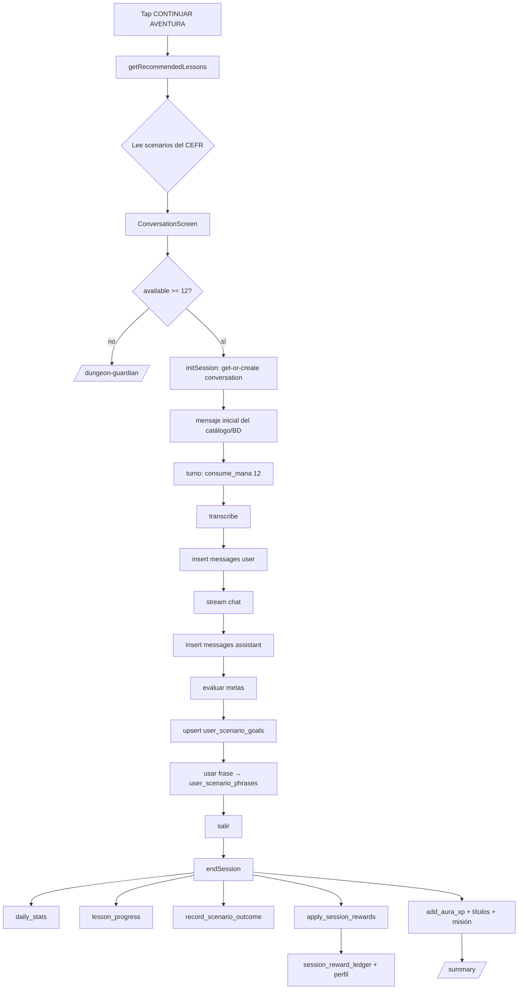
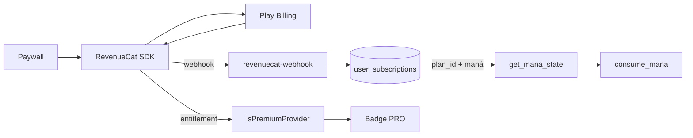

# 14 — Flujos de datos

> Medición: 25-oct-2026. Todos los flujos se reconstruyeron desde el código y se
> contrastaron con las tablas/RPC existentes en producción.

---

## 1. Mapa de escrituras por acción

| Acción del usuario | Escribe en | Vía | Efecto posterior |
|---|---|---|---|
| Registrarse | `auth.users` (+ trigger `handle_new_user`) | Supabase Auth | Sesión |
| Completar onboarding | `users`, `languages`, `cefr_levels`, `user_language_profiles`, `user_settings`, `user_ai_profiles` | PostgREST (cliente) | Router → `/home` |
| Iniciar sesión de lección | `conversations` (get-or-create), `analytics_events` (`session_start`) | PostgREST | — |
| Hablar | `messages` (user), `mana_transactions`, `analytics_events` (`invoke_llm`) | PostgREST + RPC | — |
| Recibir respuesta | `messages` (assistant) | PostgREST | — |
| Evaluación del turno | `user_scenario_goals` | PostgREST (upsert) | Barra de metas |
| Usar frase útil | `user_scenario_phrases` | PostgREST | Estrellas |
| Repasar vocabulario | `user_vocabulary`, `vocabulary_reviews`; misión `vocab_words` | RPC + trigger | SRS, retención |
| Cerrar sesión | `daily_stats`, `lesson_progress`, `scenario_progress`, `session_reward_ledger`, `user_language_profiles` (XP/oro/fragmentos), `aura_session_awards`, `user_titles`, `analytics_events` (`session_end`) | RPC + repo | Resumen |
| Reabrir `/summary` | — (drop: `add_xp`) | RPC | XP extra (bug) |
| Reclamar misión | `mission_instances.is_reward_claimed`, `reward_history`, `xp_points`, `total_gems` | Cliente + RPC `add_*` | XP/gemas |
| Reclamar diario | `player_daily_state` (+pergaminos) | RPC/tabla | Recompensa |
| Comprar cosmético | `player_inventory`, `user_language_profiles.total_gold` | RPC `purchase_cosmetic` | Inventario |
| Equipar cosmético | `player_inventory.is_equipped`, `equipped_title_code` | RPC | Avatar/HUD |
| Comprar suscripción | Play → RC → `revenuecat_events`, `user_subscriptions` | Webhook EF | Maná del ciclo |
| Abrir paywall | `analytics_events` (`paywall_viewed`) | PostgREST | — |
| Unirse a sala | `chat_room_participants`, `livekit_token_requests` | RPC/EF | Presencia |
| Cambiar ajustes | `user_settings` | PostgREST | Recomendaciones |
| Borrar perfil (dev) | DELETE `user_language_profiles` | PostgREST | Progreso perdido |

---

## 2. Flujo de una lección de extremo a extremo



---

## 3. Flujo de evaluación y retroalimentación

Ver doc 07 §3. En datos:

```
messages (texto del usuario)
   └─> LLM evaluación (JSON {goalId: bool})
         └─> user_scenario_goals (is_completed)
               ├─> barra en vivo (local, keywords)
               ├─> escenario "superado" al 75 %
               └─> estrellas (100 %) en la lista
```

---

## 4. Flujo de compra y control de acceso



**No hay gate funcional**: el entitlement no bloquea pantallas; solo cambia el
badge y el saldo de maná del plan.

---

## 5. Flujo de sincronización

| Dato | Fuente de verdad | Sincronización |
|---|---|---|
| Nivel CEFR | `user_language_profiles` (solo RPC/onboarding) | Cliente lee; no escribe |
| Plan/maná | `user_subscriptions` | RevenueCat → webhook → BD; `sync-entitlement` al abrir |
| Progreso de lección | `user_scenario_goals` + `scenario_progress` | Se escribe desde el cliente (goals) y por RPC (progress) |
| Vocabulario/SRS | `user_vocabulary` + `vocabulary_reviews` | RPC server-side |
| Racha | Dos tablas | **Sin reconciliación**; el cliente no puede escribirlas |
| Preferencias | `user_settings` + `shared_preferences` | Local gana si existe |
| Analítica | `analytics_events` | Fire-and-forget |

---

## 6. Respuestas a las preguntas transversales

| Pregunta | Respuesta verificada |
|---|---|
| ¿Cómo afecta el progreso pedagógico a la progresión del juego? | El XP se deriva de minutos y objetivos; el nivel es XP/1000; el **desbloqueo** depende del CEFR y de metas (75 %). Aprender no da rango: el rango es el CEFR. |
| ¿Cómo se relaciona el nivel con la dificultad? | Se filtra por `difficulty_level = CEFR` exacto; sin adaptación posterior. |
| ¿Qué pasa si falla repetidamente? | Nada especial: puede reintentar; no hay pistas ni bajada de nivel. |
| ¿Las recompensas dependen de aprender? | De completar objetivos evaluados por el LLM y de los minutos hablados, no de una prueba de dominio. |
| ¿Cómo se elige la siguiente lección? | Primero no completadas, luego menos estrellas; dentro del mismo CEFR. |
| ¿Qué desbloquea una unidad? | El 75 % de metas de la lección anterior del mismo nivel. |
| ¿Cómo se sincronizan progreso, perfil, recompensas y compras? | Progreso y metas por PostgREST; recompensas por RPC; compras por webhook + reconciliación. |
| ¿Qué pasa si la IA falla a mitad de lección? | El error se muestra como mensaje del tutor y se guarda; el maná ya se cobró. |
| ¿Qué depende exclusivamente de la IA? | La respuesta del tutor, la evaluación de metas, el resultado del Oráculo y la generación de refuerzo. |
| ¿Qué se pierde al cerrar la app? | Nada del historial ya guardado; se pierde la sesión de conversación en curso no cerrada (sin recompensa). |
| ¿Cómo se sabe que se completó un curso? | No hay "curso": hay lecciones superadas por nivel; no existe un estado de curso completado. |
| ¿Qué impide continuar? | Maná, nivel CEFR no alcanzado, metas no cumplidas, fallo de red/IA. |
| ¿Qué recupera al usuario tras días? | Solo la UI (racha, recompensa diaria); no hay notificación ni mensaje. |
| ¿Qué pasa con el progreso al cancelar la suscripción? | Se conserva; solo cae el saldo de maná del ciclo. |
| ¿Cómo interactúan pagos y límites de uso? | El plan define `mana_allowance` y `daily_limit`; el consumo lo aplica `consume_mana`. |
| ¿Qué datos permiten saber si aprende? | `retention_7d` (vocabulario) y metas completadas; nada mide gramática, comprensión ni transferencia. |
