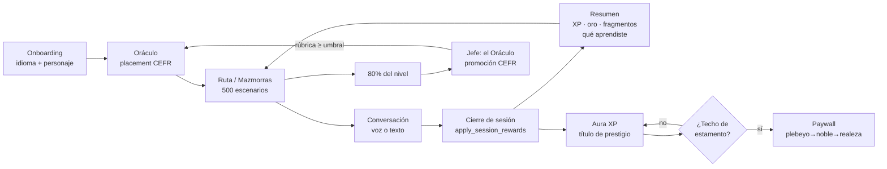

# 00 — Visión general del producto

> **Qué es este documento.** Radiografía del producto `hiulett/TutorSaas`
> (app Android "Dungeon of English") hecha por ingeniería inversa del código y
> de la base de datos en producción. No es una auditoría de UX ni un plan: es
> el mapa de **qué existe, qué se usa y qué solo se promete**.
>
> **Medido:** 31-oct-2026, worktree `p14-ai-usage` sobre `origin/master`.
> Cifras base en [`_baseline.md`](_baseline.md) (no se repiten aquí).
> **Autor de las mediciones:** lectura del repo + consultas de solo lectura al
> MCP `supabase` (proyecto `sipiumfdpvnszthykyog`). Sin acceso a Play Console,
> RevenueCat ni a un dispositivo.

---

## 0. Cómo leer este documento

Cada afirmación lleva etiqueta:

| Etiqueta | Significado |
|---|---|
| `[IMPLEMENTADO]` | Existe en el código y, cuando aplica, tiene datos/RPC/tests que lo respaldan |
| `[PARCIAL]` | Existe pero le falta una parte del recorrido (UI sin datos, texto sin lógica, lógica sin pantalla, promesa mayor que el hecho) |
| `[CONCEPTUAL]` | Solo existe como texto, nombre de tabla o idea; no hay flujo jugable |
| `[PROPUESTA]` | Recomendación mía, no algo que el producto haga |
| `[PENDIENTE DE VALIDAR]` | No se puede comprobar con lo que hay en este entorno; se indica qué falta |

Sin evidencia no hay afirmación: cada bloque relevante cita `archivo:línea`,
tabla, RPC o test.

---

## 1. Ficha técnica

| Campo | Valor | Evidencia |
|---|---|---|
| Nombre en la interfaz | **Dungeon of English** | `lib/l10n/app_es.arb:5` (`app_name`) |
| Nombre en Android (lanzador) | **DungeonSpeak** | `android/app/src/main/AndroidManifest.xml:11` |
| Nombre técnico | **tutorsaas** · `com.tutorsaas.tutorsaas` | `pubspec.yaml:1`, `android/app/build.gradle.kts:19,37` |
| Versión | `1.0.21+22` | `pubspec.yaml:5` |
| Plataforma | Android únicamente (Flutter) | `docs/PRODUCT.md:95`; sin carpeta `ios/` |
| Backend | Supabase (`sipiumfdpvnszthykyog`) | `docs/OPERATIONS.md`, MCP `supabase` |
| Motores de IA | Groq Whisper (STT) + DeepSeek (chat/evaluación) | `docs/ARCHITECTURE.md:92-110`, `supabase/functions/llm-proxy/index.ts` |
| Compras | Play Billing → RevenueCat → webhook | `docs/PRODUCT.md:109-119` |
| Idiomas de UI | es · en · pt | `lib/l10n/app_{en,es,pt}.arb` |
| Idioma que se enseña | Inglés (único) | `app_es.arb:1009` (`onboarding_english_only`) |
| Superficie | 20 pantallas · 20 rutas · 16 features | `_baseline.md`, `lib/app/router.dart:33-140` |
| Base de datos | 90 tablas · 99 funciones · 135 políticas RLS · 14 vistas · 108 migraciones | `_baseline.md` (medido 31-oct-2026 por `information_schema`/`pg_proc`/`pg_policies` en producción) |
| Pruebas | 733 | `_baseline.md` (`flutter test`) |

**Tres identidades conviviendo** `[PARCIAL]`: la app dice *Dungeon of English*,
la tienda/Android dice *DungeonSpeak* y el código dice *tutorsaas*. Confirmado
también en la auditoría previa (`docs/product-audit/01-VISION-DEL-PRODUCTO.md`
§11) — sigue siendo cierto hoy.

---

## 2. Qué es, en una frase

> Una app Android que entrena **inglés hablado** en conversaciones con NPCs de
> IA y presenta el progreso como un **RPG isekai/LitRPG**: el usuario es un
> "Cazador" que sube de rango F→SSS, gasta "maná" por cada turno de IA y escala
> una jerarquía nobiliaria (plebeyo → noble → realeza) medida en "Aura".

`[IMPLEMENTADO]` en sus piezas; el "RPG isekai" es una **capa de vocabulario y
presentación**, no una historia narrada (§4 y doc
[01](01-product-identity-and-universe.md)).

### 2.1 Qué hace el usuario, literalmente

1. Se registra (correo o Google) → `welcome_screen.dart`. `[IMPLEMENTADO]`
2. Onboarding: idioma nativo, idioma objetivo, **evaluación oral con el
   Oráculo** (o salto manual a PRE-A1), creación de personaje con clase.
   `[IMPLEMENTADO]` — `onboarding_screen.dart`, `apply_self_declared_level`
   (`onboarding_repository_impl.dart:80`).
3. Prueba de valor de 60 s con **Mira, la posadera**: 2 respuestas, sin maná.
   `[IMPLEMENTADO]` — `mini_conversation_screen.dart`, guion en
   `mini_conversation_script.dart:11-101`.
4. Dashboard con 4 pestañas: **Mazmorras · Gremio · Estado · Config**
   (`dashboard_screen.dart:371-378`, dock en `:572-598`).
5. Entra a una "mazmorra" = un escenario de rol realista (café, aeropuerto,
   entrevista) y conversa por voz o texto. `[IMPLEMENTADO]`
6. Al cerrar: resumen con recompensa del servidor y "qué aprendiste".
   `[IMPLEMENTADO]` — `session_summary_screen.dart:20-30`.
7. Cada 100 % de un nivel (80 % en la práctica) puede **retar al Oráculo como
   jefe** para subir de banda CEFR. `[IMPLEMENTADO]` (código + migraciones del
   29-oct), sin uso todavía (§8.2).

---

## 3. El problema que ataca

**Observado:** todos los escenarios del catálogo son diálogos con rol
(`assistantRole`, `userRole`, `initialAssistantMessage`) y **ninguno** es un
ejercicio de gramática, lectura o escritura: `lib/features/dashboard/data/models/lesson_catalog.dart`
(p. ej. `:659` barista A1, `:1829` entrevistador de trabajo). `[IMPLEMENTADO]`

**Inferido (coincide con `docs/product-audit/01-VISION-DEL-PRODUCTO.md` §1):**
el problema es *"sé algo de inglés pero no me atrevo a hablar / no tengo con
quién practicar"*. La app no enseña desde cero: pone a hablar.

**Lo que NO cubre** (verificado en código, no en docs): escribir, leer,
preparar exámenes oficiales, plan de estudio, panel para docentes, control
parental. `docs/product-audit/01-VISION-DEL-PRODUCTO.md` §6 sigue vigente.

---

## 4. Propuesta de valor: promesa vs. realidad

| # | Promesa del producto | Estado | Evidencia |
|---|---|---|---|
| 1 | "Habla inglés sin agenda, con un tutor que se adapta" | `[IMPLEMENTADO]` | Pipeline `record → llm-proxy/stt → llm-proxy/chat → flutter_tts` (`docs/ARCHITECTURE.md:92-98`); prompt adaptativo con perfil en `conversation_repository_impl.dart` y tests `tutor_prompt_builder_test.dart` |
| 2 | "500 escenarios reales con metas y frases clave" | `[IMPLEMENTADO]` | `public.scenarios` = **500 filas**; `lesson_catalog_index` = 140; catálogo Dart en `lesson_catalog.dart`; metas en `scenario_goals`/`scenario_objectives` |
| 3 | "El Oráculo te clasifica en una conversación" | `[IMPLEMENTADO]` | Prompt examinador `conversation_providers.dart:1261-1300`; `evaluate-placement/index.ts:492` (`apply_placement_as`); 79 filas en `oracle_assessments` |
| 4 | "Progreso medible" | `[PARCIAL]` | Metas + retención de vocabulario sí; fluidez/pronunciación son **estimaciones del modelo** (`docs/PRODUCT.md:63-64`); el informe semanal se calcula en servidor (`weekly_report_service.dart:26`) |
| 5 | "Es un RPG: rangos, aura, títulos, nobleza" | `[PARCIAL]` | Rango F–SSS y Aura sí (`cefr_rank.dart:13-21`, `aura_system.dart:126-159`); el **techo de prestigio se compra** (`compute_prestige_title`, migración `20260813_mana_aura_redesign.sql:342-378`) — la "nobleza" es el paywall |
| 6 | "Practica en grupo en el Gremio (salas de voz)" | `[PARCIAL]` | 6 salas sembradas y código de mesas/sillas completo (`chat_rooms_repository_impl.dart:446-535`), pero **0 mensajes y 0 participantes** en toda la historia de la BD |
| 7 | "Comprensión auditiva jugable" | `[IMPLEMENTADO]` desde 29-oct | `listening_quiz_screen.dart`, `submit_listening_attempt` (`listening_repository.dart:128`), 3 ejercicios en BD; **0 intentos** registrados |
| 8 | "Jefe de mazmorra que decide tu ascenso" | `[IMPLEMENTADO]` desde 29-oct | `boss_exam_status` (`boss_exam_service.dart:25`), rúbrica de 6 dimensiones (`boss_exam_result_screen.dart`), `boss_exam_attempts` (0 filas) |

Lo que la propuesta **no** incluye (y sigue siendo cierto en código):
corrección explícita de errores en pantalla, ejercicios dirigidos al error,
plan de estudio, evaluación de escritura/lectura.
`docs/product-audit/01-VISION-DEL-PRODUCTO.md` §3 lo decía en octubre; hoy hay
dos matices nuevos: "Mis errores" ya existe (`my_errors_screen.dart`) y el
refuerzo por lección generada (`lesson_generator_service.dart`).

---

## 5. Público

| Perfil | ¿Contemplado? | Evidencia |
|---|---|---|
| Adulto con inglés previo que quiere hablarlo | **Sí (principal)** | Examen oral de entrada; niveles A1–C2 en `lesson_catalog.dart` |
| Principiante absoluto | **Sí, con techo** | `onboarding_beginner` → PRE-A1 sin examen (`app_es.arb:1080-1081`); 20 escenarios PRE-A1 |
| Profesional / negocios | Sí (segundo interés) | Escenarios `business`, `entrevista`, `negociación` en `lesson_catalog.dart` |
| Jugador de RPG / LitRPG | Sí, como capa de motivación | Aura, rangos, `prestige_ladder` (21 escalones) |
| Usuario social | **No en la práctica** | Gremio y salas de voz: 0 uso (0 mensajes, 0 participantes) |
| Niños, docentes, empresas | No | Sin control parental, panel de clase ni gestión de equipos |

`[PENDIENTE DE VALIDAR]` la edad y el país reales del público: la app pide
idioma nativo e intereses, pero el país se retiró (`docs/PRODUCT.md:86-87`) y
los 68 registros de `public.users` no se pueden clasificar como "reales" vs
"de prueba" sin acceso a analítica de adquisición.

---

## 6. El bucle de producto

Cada arista con evidencia:

| Arista | Implementación |
|---|---|
| Onboarding → Oráculo | `conversation_screen.dart` con `oracleMode: true` (`router.dart:48-61`) |
| Oráculo → CEFR | `evaluate-placement` → `apply_placement_as` (`supabase/functions/evaluate-placement/index.ts:492`) |
| Ruta → conversación | `learning_path_roadmap.dart:721,774` → `/conversation?scenarioId=` |
| Conversación → cierre | `close_session` (`economy_repository_impl.dart:798`) |
| Cierre → recompensas | `apply_session_rewards` (RPC; el cliente lee el resultado en `session_summary_screen.dart:22-24`) |
| Aura | `add_aura_xp` (`economy_repository_impl.dart:842`), 21 escalones en `prestige_ladder` |
| Techo comprado | `compute_prestige_title` exige `ceiling_class ≤ clase del plan` (migración `20260813_mana_aura_redesign.sql:372`) |
| Jefe → promoción | `boss_exam_rules.dart`, `boss_exam_status`, cooldown y umbral de 80 % (`app_es.arb:1319`) |

**Punto crítico `[PARCIAL]`:** el bucle se cierra en recompensas, pero **la
rama "gremio/social" no se cierra nunca** (nadie entra a las salas) y **la rama
"nobleza" solo avanza pagando**: es diseño declarado
(`paywall_upgrade_subtitle`, `app_es.arb:968`: *"Tu estamento define tu maná
mensual y tu techo de prestigio. El esfuerzo (Aura) decide tu título"*), pero
con 0 pagos registrados (`public.payments` = 0 filas) el eje nobleza **no está
validado con usuarios**.

---

## 7. Modelo económico

### 7.1 Planes (los que se pintan: `is_active = true`)

| Plan | Precio | Maná/mes | Semanas de informe | Trial | Devengo por defecto |
|---|---|---|---|---|---|
| `plebeyo` | $0 | 3.000 | 1 | 0 d | sí (fallback) |
| `noble` | $4.99 ($53.99/año) | 17.000 | 4 | 7 d | no |
| `realeza` | $9.99 ($107.99/año) | 20.500 | 52 | 0 d | no |

`[IMPLEMENTADO]` — `public.subscription_plans`. Hay **8 filas** pero solo 3
activas; las otras 5 (`free`, `monthly`, `divino`, `annual`, `lifetime`) están
`is_active = false`. `DIVINO` está retirado y se conserva por integridad
referencial, tal como documenta `docs/PRODUCT.md:27-29`. `[IMPLEMENTADO]`

### 7.2 Coste real de la IA

Medido en `public.ai_action_costs` (7 acciones) `[IMPLEMENTADO]`:

| Acción | Maná (tabla) |
|---|---|
| `lesson_generation` (lección de refuerzo) | 100 |
| `oracle_eval` (cierre del examen del Oráculo) | 30 |
| `oracle_turn` (turno del Oráculo) | 15 |
| `dungeon_turn` (turno de mazmorra) | 12 |
| `free_chat_turn` | 8 |
| `correction_turn` | 3 en tabla, **pero gratis** (ver abajo) |
| `vocabulary_curation` | 2 |

Coincide con `docs/PRODUCT.md:50` y explica el tope diario de 200
(≈16 turnos de mazmorra). El turno de gracia (`claim_mana_grace`) es
`[IMPLEMENTADO]` en servidor y no reclamable por el cliente
(`docs/PRODUCT.md:123-137`).

**Acciones exentas** `[IMPLEMENTADO]`: `supabase/functions/llm-proxy/validation.ts:23-29`
declara `FREE_ACTIONS = { goal_eval, carisma_eval, guild_chat, stt_transcribe, correction_turn }`.
Dos consecuencias:

- `stt_transcribe`, `goal_eval` y `carisma_eval` se registran en
  `ai_usage_logs` pero no están en `ai_action_costs` (no cuestan maná).
- **`correction_turn` está exenta en el proxy aunque `ai_action_costs` le pone 3.**
  La tabla y el código no coinciden; manda el código. `[PARCIAL]` (deuda de
  coherencia entre BD y función).

### 7.3 Monedas

Maná (acción IA), Oro (cosméticos), Gemas (cosméticos premium + freeze de
racha), Fragmentos (crafteo), XP (nivel de cazador), **Aura XP** (título de
prestigio, sin tope). `[IMPLEMENTADO]` — `docs/PRODUCT.md:46-61` +
`economy_repository_impl.dart` (`add_gold`, `add_gems`, `add_fragments`,
`add_aura_xp`, `purchase_cosmetic`, `craft_cosmetic`).

**Ninguna moneda compra ventaja de aprendizaje evaluado.** `[IMPLEMENTADO]` por
diseño: lo que se compra es maná (más turnos) y cosmética/techo de prestigio.

---

## 8. Estado real vs. visión

### 8.1 Superficie construida

- 20 pantallas, 20 rutas, 16 features (`_baseline.md`).
- 90 tablas, 99 funciones, 135 políticas RLS, 14 vistas, 8 Edge Functions.
- 733 pruebas, 0 errores y 0 warnings de `analyze` (`_baseline.md`).
- Feature más profunda: `conversation` (pipeline de voz + Oráculo + evaluación
  + correcciones + vocabulario + resumen). God file de 2.956 líneas en
  `conversation_providers.dart` (`_baseline.md` §"God files").

**Lectura:** la *ingeniería* va por delante del *producto*. Hay mucha más
máquina que usuarios.

### 8.2 Uso medido en la base de datos

Fecha de la medición: 30-oct-2026. Son volúmenes absolutos de toda la vida del
proyecto. **Los datos son compatibles con un entorno de desarrollo/pruebas más
que con un producto lanzado** (68 usuarios, 0 pagos, 70 conversaciones);
confirmarlo exige acceso a Play Console y RevenueCat
([`17`](17-evidence-and-traceability.md) §5).

| Señal | Valor | Interpretación |
|---|---|---|
| `users` | 68 | Suficiente para probar, insuficiente para inferir mercado |
| `conversations` / `messages` | 70 / 771 | ~11 mensajes por conversación |
| `oracle_assessments` / `oracle_turns` | 79 / 85 | La función con **más** actividad real |
| `user_vocabulary` | 79 | La curación de vocabulario funciona |
| `ai_usage_logs` | 54 | P-14 en marcha; acciones: `stt_transcribe` 16, `dungeon_turn` 13, `oracle_turn` 8… |
| `mission_instances` | 637 | El motor de misiones genera en masa (cron 00:05 UTC) |
| `practice_sessions` | 2 | La tabla "oficial" de práctica está prácticamente vacía |
| `aura_session_awards` | 12 | El Aura sí se acredita |
| `user_subscriptions` / `payments` | 15 / **0** | **Cero ingresos registrados** |
| `boss_exam_attempts` | **0** | Jefe de mazmorra: sin uso (existe desde 29-oct) |
| `listening_attempts` | **0** | Comprensión auditiva: sin uso (existe desde 29-oct) |
| `corrections` | **0** | "Mis errores" nunca ha tenido datos |
| `chat_room_messages` / `chat_room_participants` | **0 / 0** | Gremio y salas de voz: **nunca** usados (salas desde 19-ago) |
| `weekly_stats` | **0** | El informe **no** la usa: `get_weekly_report` agrega al vuelo desde `user_vocabulary`, `vocabulary_reviews` y `corrections` |

### 8.3 Interpretación honesta (la parte que importa)

1. **Los ceros no significan lo mismo entre sí.** `boss_exam_attempts`,
   `listening_attempts` y `corrections` nacieron el **29-oct** (migraciones
   `20261029190641_boss_exam_p31.sql`, `20261029215600_listening_quiz_p30.sql`,
   `20261029064406_corrections_p29.sql`): 0 filas = **"aún no probado"**.
   `chat_room_messages` = 0 desde el **19-ago**: eso sí es una función
   **dormida**.
2. **La visión se expandió más rápido que la adopción.** Cinco funciones
   mayores se entregaron el 29-oct (P-29 errores, P-30 escucha, P-31 jefe,
   P-32 economía, P-43 informe). El producto tiene hoy más superficies
   *nuevas* que usuarios que las recorran.
3. **El producto real de hoy son dos pantallas:** Oráculo/onboarding y
   conversación. Todo lo demás es superficie no validada.
4. **La monetización es una hipótesis no probada:** 0 pagos. El diseño
   (membresía por planes con techo de títulos de prestigio) es coherente y está
   bien ejecutado en servidor, pero no ha generado ni un ingreso. El copy usa
   todavía "estamento", término retirado por **D-01** (ver
   [`19` §2.1](19-canon-and-decisions.md#21-d-01--una-institución-un-nombre-una-escala)).
5. **La promesa de "RPG social" es la más débil:** 6 mesas sembradas, sistema
   de sillas/presencia implementado y cero conversaciones. El Maestre de Mesa
   recomienda mesas que **no existen** en la BD (§ doc 01 §6.3).

### 8.4 Brechas estructurales (con evidencia)

| Brecha | Evidencia | Etiqueta |
|---|---|---|
| Tres nombres de producto | `app_es.arb:5` vs `AndroidManifest.xml:11` vs `pubspec.yaml:1` | `[PARCIAL]` |
| Narrativa como piel, no como trama | `isekai` solo aparece en 2 comentarios (`app_colors.dart:131`, `splash_screen.dart:12`); los escenarios son realistas | `[CONCEPTUAL]` |
| Claves de traducción duplicadas | `guild_master` en `app_es.arb:258` ("MAESTRO DEL GREMIO") y `:712` ("MAESTRE DE MESA"); `radar_title` `:113` vs `:445`; 5–8 duplicados por idioma | `[PARCIAL]` |
| Vocabulario huérfano | `league_level_title`, `hunter_points_pool`, `hunter_distribute_points`, `chat_guild_pass`, `fragments_exchange_title`: 0 usos fuera de `l10n` | `[CONCEPTUAL]` |
| Títulos de prestigio solo en español | `get_prestige_title` hace `SELECT name_es` (migración `20260813_mana_aura_redesign.sql:391`) | `[PARCIAL]` |
| Promesa de "63 títulos" | `app_es.arb:976` vs 24 filas en `hunter_titles` y 25 constantes en `hunter_skill_titles.dart` | `[PARCIAL]` |

---

## 9. Lo que este documento NO puede afirmar

**No hay revisión visual.** En este entorno no hay visión de imágenes y no hay
dispositivo conectado (`adb` no responde). Además, el repo **no contiene ni una
sola captura válida**: `docs/ui-ux-audit/screenshots/README.md:7` lo dice
explícitamente (*"Sin capturas válidas todavía"*) y explica cómo tomarlas.

Por tanto:

- No se describe un solo píxel, color en pantalla, espaciado real ni jerarquía
  visual. Lo visual se cita de `docs/ui-ux-audit/` (que ya lo midió) y no se
  re-audita aquí.
- Toda afirmación de UI en estos documentos se refiere al **árbol de widgets y
  a las cadenas de texto**, no a cómo se ve.
- `[PENDIENTE DE VALIDAR]`: legibilidad real, overflow en dispositivos
  concretos, contraste percibido, tiempos de TTS en dispositivo físico.

---

## 10. Documentos hermanos

| Documento | Para qué |
|---|---|
| [`01-product-identity-and-universe.md`](01-product-identity-and-universe.md) | Universo isekai, jerarquías, personajes, lugares: qué es narrativa real |
| [`16-product-glossary.md`](16-product-glossary.md) | Glosario término → significado → dónde vive |
| [`17-evidence-and-traceability.md`](17-evidence-and-traceability.md) | Matriz funcionalidad → pantalla → RPC/tabla → test |

Fuentes que **se citan y no se duplican**: `docs/PRODUCT.md`,
`docs/ARCHITECTURE.md`, `docs/DATA_MODEL.md`, `docs/OPERATIONS.md`,
`docs/HISTORY.md`, `docs/product-audit/` (25 docs, oct-2026, algunas cifras ya
desfasadas — ver `docs/HISTORY.md:27-46`), `docs/ui-ux-audit/` (7 docs +
backlog UX-01…UX-37).
