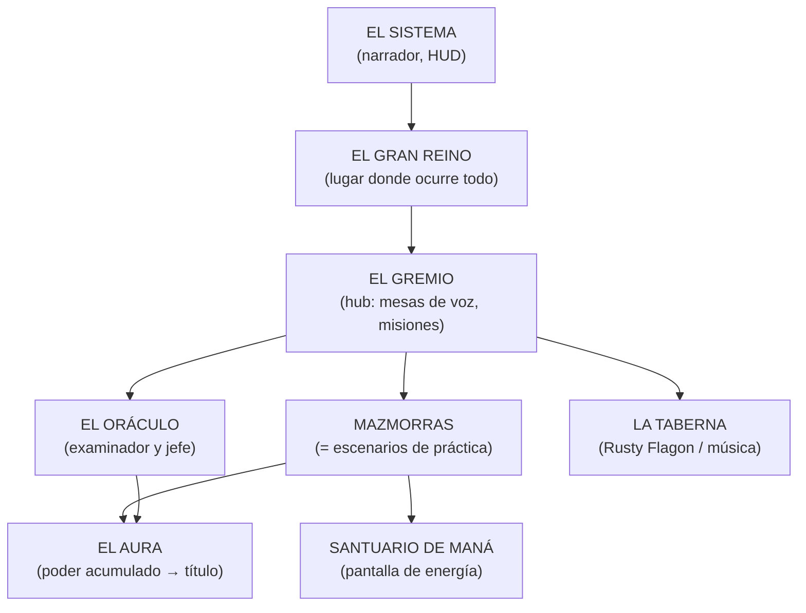
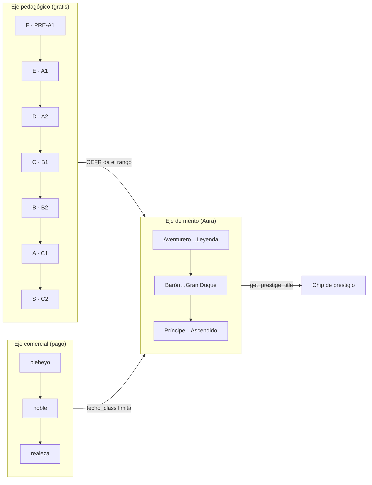

# 01 — Identidad y universo

> **Alcance.** Qué parte del "universo Isekai/LitRPG" es **narrativa real**
> (existe en prompts, datos, assets o textos que el usuario ve) y qué parte es
> **concepto o residuo**. Todo lo visual se juzga por **nombres de assets y
> cadenas**, no por píxeles: en este entorno no hay revisión de imagen (ver
> [`00`](00-product-overview.md) §9).
>
> **Medido:** 30-oct-2026. Ver [`_baseline.md`](_baseline.md).

---

## 1. Veredicto en una línea

> **El universo no es una historia: es un vocabulario.** No hay trama de
> isekai (nadie es transportado a otro mundo), ni arco argumental, ni mapa
> narrativo. Hay una **capa de presentación** coherente y bastante trabajada
> (rangos, Aura, nobleza, gremio, mazmorras por bioma) aplicada sobre un
> producto que, en el fondo, es un entrenador de conversación con escenarios
> realistas.

Evidencia dura:

| Hecho | Evidencia |
|---|---|
| La palabra "isekai" aparece **solo en 2 comentarios de código** | `lib/core/theme/app_colors.dart:131` (*"Tema Isekai / Medieval Fantasy"*), `lib/app/splash_screen.dart:12` (*"Splash moderno — Sistema HUD (Isekai/Webtoon)"*) |
| Ningún texto de usuario menciona otro mundo, reencarnación ni portal como trama | El portal es un **fondo** (`cyber_manhwa_portal_bg.jpg`), no un evento |
| Los escenarios de práctica son del mundo real | `lesson_catalog.dart`: barista (`:659`), recepcionista de hotel (`:688`), entrevista (`:1829`), casero (`:1887`)… |
| Las misiones también | `public.mission_templates`: "Pedir un Café", "Preguntar Direcciones", "La Entrevista Relámpago", "La Negociación" |
| El Oráculo se presenta como maestro de gremio, no como dios de otro mundo | `conversation_providers.dart:1263`: *"You are the Oracle of the Guild, an ancient and wise being…"* |

`[IMPLEMENTADO]` como **estética y terminología**; `[CONCEPTUAL]` como
**relato**.

---

## 2. De dónde sale el tono: LitRPG coreano, no isekai clásico

El registro real es **"System" / LitRPG manhwa**: el usuario es un *Cazador*
(Hunter) que "despierta", el mundo le habla por mensajes de sistema entre
corchetes, y su vida se cuantifica en un HUD.

| Marca del género | Dónde vive | Etiqueta |
|---|---|---|
| "Mensaje del Sistema" entre corchetes | `welcome_title`: *"[MENSAJE DEL SISTEMA: DESPERTANDO NÚCLEO DE CAZADOR...]"* (`app_es.arb:10`) | `[IMPLEMENTADO]` |
| El Sistema como narrador que acredita logros | `aura_awakening_banner_title` = *"EL SISTEMA HA HABLADO"* (`app_es.arb:494`, usado en `hunter_hud_header.dart:70`) | `[IMPLEMENTADO]` |
| Conexión del sistema al arrancar | `system_hunter_connected`: *"SISTEMA DE CAZADOR — CONECTADO"* (`hunter_hud_header.dart:306`) | `[IMPLEMENTADO]` |
| Análisis automático | `system_analysis`: *"[ANÁLISIS DEL SISTEMA COMPLETADO]"* (`app_es.arb:129`) | `[IMPLEMENTADO]` |
| Estética manhwa/cyber | 12 fondos `cyber_manhwa_*` / `dungeon_*` / `guild_*` en `assets/images/` | `[IMPLEMENTADO]` |
| "Cazador" como identidad del usuario | `welcome_hunter_prefix/suffix`, `chat_hunter_details`, `profile_edit_hunter_name` | `[IMPLEMENTADO]` |

---

## 3. Cosmología mínima



| Elemento | Qué es realmente en la app | Dónde | Etiqueta |
|---|---|---|---|
| **El Sistema** | Metáfora de la interfaz: todo se anuncia como mensaje del sistema (HUD, "análisis completado", "el sistema ha hablado") | `app_es.arb:10,129,494,509-513` | `[IMPLEMENTADO]` (como tono) |
| **El Gran Reino** | Nombre del "servidor" al que la app se conecta: `splash_connecting` = *"{pct}% · CONECTANDO AL GRAN REINO"* (`splash_screen.dart:224`) | `app_es.arb:510` | `[IMPLEMENTADO]` (decorativo) |
| **El Gremio** | El hub social: 4.ª pestaña del dashboard = `ChatRoomsScreen` (`dashboard_screen.dart:373-374`) + misiones + anuncios | `chat_rooms_screen.dart` | `[PARCIAL]` (sin uso real) |
| **Las Mazmorras** | **Son los escenarios de práctica.** Cada nodo de la ruta es una "mazmorra" y se entra a `/conversation?scenarioId=…` | `learning_path_roadmap.dart:721,774`; título *"MAPA DE MAZMORRAS"* (`app_es.arb:1004`) | `[IMPLEMENTADO]` |
| **El Santuario de Maná** | Pantalla de energía agotada y compra de maná (antes "Guardián") | `dungeon_guardian_screen.dart:156` (`guardian_title`); renombrado en `docs/PRODUCT.md:101` | `[IMPLEMENTADO]` |
| **La Taberna** | Sala del gremio con música de taberna en loop y anuncios con emoji | `core/services/tavern_music_service.dart:8,67` (`assets/music/tavermusic.mp3`); `chat_rooms_screen.dart:113-128` | `[IMPLEMENTADO]` |
| **El Aura** | Poder 0–1 calculado con radar + racha + CEFR; desbloquea el título de prestigio | `aura_system.dart:126-159` | `[IMPLEMENTADO]` |
| **El Núcleo Arcano** | Energía antigua del Oráculo: **texto muerto**. `nucleo_title`, `nucleo_desc`, `nucleo_recharge`, `error_nucleo` tienen **0 usos** fuera de `l10n`; el maná los sustituyó | `app_es.arb:219-221,288,428-430` | `[CONCEPTUAL]` |

### 3.1 El mundo como mapa de progresión (lo mejor construido)

Las mazmorras tienen **bioma por banda CEFR**, y el fondo cambia con el nivel:

```
PRE-A1 / A1 → bosque     dungeon_forest_a1_bg.jpg
A2          → ruinas     dungeon_ruins_a2_bg.jpg
B1          → viento     dungeon_wind_b1_bg.jpg
B2          → portal     cyber_manhwa_portal_bg.jpg
C1 / C2     → arena      dungeon_boss_arena_bg.jpg
```

`[IMPLEMENTADO]` — `lib/core/widgets/cyber_manhwa_background.dart:145-156`. Es la
única "geografía" real del universo: **cinco lugares y una progresión**.

---

## 4. Jerarquías: tres ejes que no son el mismo

El producto tiene **tres escalas simultáneas**, y confundirlas es el error más
fácil de cometer al leer la app.

### 4.1 Eje 1 — Rango de cazador (F → SSS): **pedagógico**

| Rango | CEFR | Lema (texto real) |
|---|---|---|
| F | PRE-A1 | "Iniciado — el viaje empieza con una sola palabra." |
| E | A1 | "Novato — cada aventura empieza con un primer paso." |
| D | A2 | "Aprendiz — los básicos ya no te frenan." |
| C | B1 | "Aventurero — te desenvuelves en mazmorras cotidianas." |
| B | B2 | "Guerrero — conversaciones firmes y con recursos." |
| A | C1 | "Campeón — lideras la conversación con soltura." |
| S | C2 | "Leyenda — casi imposible de igualar." |
| SS | (C2) | "Leyenda Suprema — dominio casi perfecto." |
| SSS | (C2) | "Deidad del Idioma — maestría absoluta." |

`[IMPLEMENTADO]` — `lib/features/onboarding/domain/models/cefr_rank.dart:13-48`.
El Oráculo asigna el rango con la misma tabla (`conversation_providers.dart:1295`).

> **Nota `[PARCIAL]`:** `SS` y `SSS` **no son alcanzables por CEFR** (C2 mapea a
> `S`). Existen como texto y como umbral de títulos
> (`hunter_title_monarca_sintaxis_ss`, `hunter_title_creador_abismo_sss`), pero
> ningún flujo asigna esos rangos. `[PENDIENTE DE VALIDAR]` si el diseño
> pretendía que SS/SSS se ganaran por precisión gramatical y nunca se cableó.

### 4.2 Eje 2 — Estamento (plebeyo → noble → realeza): **comercial**

| Estamento | Plan | Maná/mes | Techo de prestigio |
|---|---|---|---|
| `plebeyo` | gratis | 3.000 | hasta *Leyenda* (7.º escalón) |
| `noble` | $4.99 | 17.000 | hasta *Gran Duque* (13.º) |
| `realeza` | $9.99 | 20.500 | hasta *Ascendido* (21.º) |

`[IMPLEMENTADO]` — `public.subscription_plans` (`class_name`) y
`public.prestige_ladder` (`ceiling_class`). El tope **se aplica en servidor**:
`compute_prestige_title` solo considera escalones cuyo `ceiling_class` no supere
la clase del plan del usuario (migración
`20260813_mana_aura_redesign.sql:365-374`).

La frase que define el diseño está en el paywall:
> *"Tu estamento define tu maná mensual y tu techo de prestigio. El esfuerzo
> (Aura) decide tu título."* — `app_es.arb:968`

Es la mejor formulación de la identidad del producto que existe en el código:
**la nobleza se compra, el título se gana.**

### 4.3 Eje 3 — Título de prestigio (21 escalones): **mérito**

| Segmento | Escalones | Aura XP | Radar mín. |
|---|---|---|---|
| `comun` | Aventurero, Explorador, Veterano, Caballero, Campeón, Héroe, Leyenda | 0 → 12.000 | 0 → 65 |
| `noble` | Barón, Vizconde, Conde, Marqués, Duque, Gran Duque | 16.000 → 53.000 | 70 → 82 |
| `real` | Príncipe, Archiduque, Rey, Gran Rey, Emperador, Legendario, Señor de los Reinos, Ascendido | 66.000 → 260.000 | 84 → 98 |

`[IMPLEMENTADO]` — `public.prestige_ladder`, 21 filas, `is_active = true`; leído
por `dashboard_providers.dart:714-720` (con caché en disco).

**Aquí está la "nobleza" real del universo**: no es un reino con casas
nobiliarias, es un **degradado de títulos** que exige tres condiciones a la vez
(Aura, media del radar, clase de plan).

### 4.4 Cómo se relacionan



**Consecuencia de producto `[PARCIAL]`:** un usuario gratuito puede llegar a
*Leyenda* y a C2, pero **nunca** verá "Barón" aunque su Aura sea enorme. La
jerarquía nobiliaria es, literalmente, de pago. Está documentado y es
deliberado, pero **no está validado con usuarios** (0 pagos registrados).

---

## 5. Personajes

Solo hay **tres personajes con voz propia** y todos son funcionales: no
aparecen en una historia, aparecen en un flujo.

| Personaje | Rol en el producto | Voz real (texto en código) | Evidencia | Etiqueta |
|---|---|---|---|---|
| **El Oráculo** | Examinador de nivel (placement) y **jefe de mazmorra** en la promoción | *"Hello! Welcome to the Adventurer's Guild. My name is Oracle. Before assigning your first missions I'd like to know you a little better. Don't worry — this isn't an exam, just speak naturally. Are you ready?"* | `conversation_providers.dart:1263-1300` | `[IMPLEMENTADO]` |
| **Mira, la posadera** | Prueba de valor de 60 s tras crear el personaje | *"Welcome to the Rusty Flagon! I'm Mira, the innkeeper. What can I get you?"* | `mini_conversation_script.dart:28,53-70` | `[IMPLEMENTADO]` |
| **El Maestre de Mesa** | Consejero del gremio por chat de texto: recomienda mesa, misión y mejora de rango | *"You are the Guild Master of a medieval adventurer guild. You guide an English learner (CEFR $cefr)…"* | `guild_master_floating_banner.dart:130-137` | `[IMPLEMENTADO]` |
| **Bibliotecaria del Gremio · Escriba Real · Cónsul del Debate** | Aparecen como "NPC" de misión | Solo etiquetas `mission_npc_vocabulary/writing/argumentation` | `app_es.arb:743-745` | `[CONCEPTUAL]` (texto sin agente) |
| **El Sistema** | Narrador que felicita, avisa y acredita | Ver §2 | `app_es.arb:10,494` | `[IMPLEMENTADO]` (tono) |

### 5.1 Lo que el Oráculo *es* funcionalmente

Es el activo narrativo más sólido: un **examinador adaptativo** con
instrucciones de ficción y de medición mezcladas en el mismo prompt.

`[IMPLEMENTADO]` — `conversation_providers.dart:1261-1300`:

- Identidad: *"an ancient and wise being that examines young adventurers"* (`:1263`).
- Regla de experiencia: *"The exam must feel like a pleasant chat with a guild
  mentor, never like a form or a test"* (`:1263`).
- Progresión por banda CEFR con 5 preguntas por banda (`:1276-1288`).
- Cierre con **token de máquina** para que el cliente sepa que terminó:
  `[EVALUATION_COMPLETE][RESULT:CEFR=B1,RANK=C]` (`:1297-1299`).
- En modo promoción cambia el contrato: nunca baja de nivel, rúbrica de 6
  dimensiones, máximo de turnos (`:1249-1251`).

### 5.2 Mira: el único personaje con **lugar** propio

*Rusty Flagon* (la jarra oxidada) es el único topónimo inventado con escena,
bebida y frase-regalo (`mini_conversation_script.dart:32-33`: *"Could I get a
flat white to go, please?"*). `[IMPLEMENTADO]`

> **Contraste `[PARCIAL]`:** la app tiene un personaje con taberna y **no
> reutiliza esa taberna en ningún otro sitio**; el Gremio, que sí es una
> pantalla, no tiene personajes con nombre en su propia sala.

---

## 6. Lugares

| Lugar | Existe como | Qué es en la práctica | Etiqueta |
|---|---|---|---|
| **El Gran Reino** | Texto de splash | Metáfora del backend | `[CONCEPTUAL]` |
| **El Salón del Gremio** | Pantalla (`ChatRoomsScreen`, 4.ª pestaña del dashboard) | Lista de 6 mesas de voz reales | `[IMPLEMENTADO]` |
| **Las mesas del Gremio** | Filas en `public.chat_rooms` (6) | *Sala General*, *Viajeros del Mundo*, *Entrevistas y Trabajo*, *Tech & Gamers*, *Arte y Creatividad*, *Cocina Internacional* | `[IMPLEMENTADO]` |
| **La Taberna del Aprendiz · Mesa Redonda de Tácticas · Consejo Supremo de Altos Cazadores** | **Solo texto** que el Maestre recomienda | **No existen** en `chat_rooms` ni en ninguna tabla | `[CONCEPTUAL]` |
| **Las Mazmorras** | Escenarios de práctica | 500 en `public.scenarios` | `[IMPLEMENTADO]` |
| **La arena del jefe** | Fondo `dungeon_boss_arena_bg.jpg` + HUD de jefe | El examen de promoción con el Oráculo | `[IMPLEMENTADO]` |
| **El Santuario de Maná** | Pantalla `dungeon_guardian_screen.dart` | Estado de energía y compra | `[IMPLEMENTADO]` |
| **El Rusty Flagon** | Prompt de Mira | Una escena de 2 turnos | `[IMPLEMENTADO]` (acotado) |
| **La Biblioteca Imperial / el Coliseo / el Abismo** | Nombres dentro de títulos | Sabor en `hunter_titles` | `[CONCEPTUAL]` (texto) |

### 6.1 La inconsistencia más visible del universo

El Maestre de Mesa recomienda mesas con nombres de fantasía que **no existen**:

```dart
// chat_rooms_screen.dart:70-78 (vía l10n app_es.arb:705-707)
'Recomiendo la Taberna del Aprendiz: es la mesa perfecta para cazadores novatos.'
'La Mesa Redonda de Tácticas te espera: debates y fluidez intermedia.'
'El Consejo Supremo de Altos Cazadores es tu lugar: elocuencia de nivel maestro.'
```

Pero las mesas reales son `Sala General`, `Viajeros del Mundo`, `Entrevistas y
Trabajo`, `Tech & Gamers`, `Arte y Creatividad`, `Cocina Internacional`
(`public.chat_rooms`, 6 filas, sembradas 19-ago-2026).

**Efecto:** el NPC miente. El usuario que sigue la sugerencia busca una mesa que
no está. `[PARCIAL]` — la ficción y los datos divergen.

---

## 7. Contenido in-world que sí existe (inventario)

| Activo | Detalle | Etiqueta |
|---|---|---|
| 8 clases de cazador | Berserker, Mago Arcano, Asesino, Caballero, Arquero, Invocador, Paladín, Nigromante; cada una con elemento, aura, arquetipo y una **justificación pedagógica** ("Ideal para perder el miedo a hablar", "…perfeccionar la gramática") | `[IMPLEMENTADO]` — `hunter_class.dart:32-121`, `app_es.arb:345-368`, tabla `hunter_classes` (8 filas) |
| 25 títulos de habilidad | 6 líneas (fluidez, fonética, léxico, precisión, constancia, carisma) × 4 tiers + 1 título de 5.ª estrella | `[IMPLEMENTADO]` — `hunter_skill_titles.dart` (25), `hunter_titles` (24 filas) |
| 21 títulos de prestigio | Los de §4.3 | `[IMPLEMENTADO]` |
| 4 anuncios del gremio | *"El Gremio caza en equipo: únete a una mesa y practica en voz."* · *"Raid de vocabulario esta semana: gana doble XP."* · *"El Oráculo recomienda: 15 min de práctica diaria."* · *"Nuevos cazadores han despertado hoy. ¡Bienvenidos!"* | `[IMPLEMENTADO]` — `guild_announcements` (4), rotan en `chat_rooms_screen.dart:113-128` |
| Música de taberna | `assets/music/tavermusic.mp3` en loop, con toggle | `[IMPLEMENTADO]` — `tavern_music_service.dart:8,67` |
| 9 avatares + fondo de misión | 8 clases + `oracle_01.png` + `Mision.png` (10 PNG en total) | `[IMPLEMENTADO]` — `assets/images/avatars/` |
| 12 fondos diegéticos | taberna/gremio/estado/portal/bosque/ruinas/viento/arena | `[IMPLEMENTADO]` — `assets/images/` |

**Conclusión del inventario:** el universo tiene **mucho arte y mucho
adjetivo**, y **cero trama**. No hay ningún texto que cuente qué le pasó al
Cazador para llegar al Gran Reino.

---

## 8. Terminología en conflicto (deuda de identidad)

| Colisión | Qué pasa | Evidencia |
|---|---|---|
| **`guild_master`** | La misma clave significa dos personajes distintos: `"★ MAESTRO DEL GREMIO"` (línea 258) y `"MAESTRE DE MESA"` (línea 712). En JSON gana la última: la UI dice siempre *Maestre de Mesa* | `app_es.arb:258` vs `:712` |
| **`radar_title`** | `"Radar de Habilidades 5-D"` vs `"Radar Holográfico de Habilidades"` | `app_es.arb:113` vs `:445` |
| **`rank`** | `"Rango"` vs `"RANGO"` (mayúsculas distintas) | `app_es.arb:176` vs `:372` |
| **`profile_vocab_empty`** | Dos mensajes distintos para el mismo vacío | `app_es.arb:475` vs `:845` |
| **`room_live`** | Duplicado idéntico | `app_es.arb:237` vs `:383` |
| **"GreMio"** | Typo en el NPC de misión colaborativa | `app_es.arb:742` |
| **Guardián → Santuario** | La ruta sigue siendo `/dungeon-guardian` y la clase `DungeonGuardianScreen`, pero el título es *"SANTUARIO DE MANÁ"* | `router.dart:100-103`, `dungeon_guardian_screen.dart:156` |
| **Battle Pass vs Pase del Gremio** | `chat_guild_pass` (*"PASE DEL GREMIO"*) tiene **0 usos**; la UI real habla de `battle_pass` en otros sitios y solo lee `guild_battle_pass.level` | `app_es.arb:653`, `chat_rooms_screen.dart:1012-1015` |
| **Cuarto nombre: "TutorSaaS"** | Mapa de traducciones legado con `app_name: 'TutorSaaS'`; `AppTranslations` **no se lee** en ningún sitio y `t()` devuelve la clave | `core/i18n/app_translations.dart:4`, `core/i18n/locale_provider.dart:46-50` |
| **Títulos de prestigio en español fijo** | `get_prestige_title` devuelve `name_es` siempre | migración `20260813_mana_aura_redesign.sql:391` |

Total de claves duplicadas por idioma (medido sobre los `.arb`): **5 en `es`,
5 en `pt`, 8 en `en`**. `[PARCIAL]`

---

## 9. Lo que es **solo concepto** (no buscar en la app)

| Concepto | Estado | Evidencia |
|---|---|---|
| Matriz de 11 atributos (FUE/DEX/INT/SUE…) | `status_attributes` = *"ATRIBUTOS DEL MONARCA (11)"* y `hunter_str/luk/distribute_points` **sin uso** en widgets; el atributo real es un radar de 5–6 dimensiones | `app_es.arb:269,1073-1079` |
| "Liga de Nivel" con clasificación por ligas | `league_level_title`, `league_you`, `league_ranking`, `league_top5`: **0 usos**; el leaderboard real dice "Rango de XP" | `app_es.arb:884-887`, `progress_tab_view.dart:535-541` |
| Battle pass completo (tiers, recompensas premium) | Existe la tabla `guild_battle_pass` (23 filas), el repositorio y 4 claves de UI, pero **no hay pantalla de pase** | `economy_repository_impl.dart:508-536` |
| Moderación de mesas (IA / creador / asignada) | `mod_*` y `mod_table_new` (0 usos); las 6 salas son `moderator_type = 'ai'` | `app_es.arb:223-236` |
| Resonancia / mentoría | `voice_resonance`, `room_type_mentorship` (1 uso) | `app_es.arb:386-389` |
| Eventos especiales y misiones secretas | Tablas `global_events`, `secret_missions`, `emergency_missions` sin pantalla | esquema `public` |
| "63 títulos de rango" del paywall | La BD tiene **24**, el código **25** | `app_es.arb:976` vs `hunter_titles` (24) |
| Núcleo Arcano | 8 claves de texto, 0 usos | §3 |
| Guardián del Maná como personaje | El "guardián" es una pantalla, no un NPC | `dungeon_guardian_screen.dart:25` |

---

## 10. Propuestas para cerrar el universo

Todas `[PROPUESTA]`, ordenadas por coste/beneficio:

1. **Unificar la voz del gremio con sus datos.** Que el Maestre de Mesa lea
   `chat_rooms` y recomiende las mesas que existen (§6.1). Coste: una consulta;
   beneficio: elimina la única mentira visible del universo.
2. **Dar al Cazador un origen.** Un texto de 3 frases en el onboarding ("cómo
   llegaste al Gran Reino") convierte la estética en relato sin tocar el
   pipeline de voz.
3. **Resolver `guild_master` y las 5–8 claves duplicadas.** Cada duplicado es
   hoy una decisión de naming tomada al azar por el orden del archivo.
4. **Hacer que SS/SSS existan o eliminarlos.** Un rango que ningún flujo asigna
   es deuda narrativa.
5. **Localizar `prestige_ladder`** (`name_es` → `name_en`/`name_pt`) para que un
   usuario inglés no vea "Duque" en un HUD en inglés.
6. **Bajar el tono en el contenido, no en el chrome.** Los escenarios son
   realistas y funcionan; el error sería "fantasizar" las lecciones. La capa RPG
   debe seguir siendo *presentación del progreso*, no contenido de práctica.
