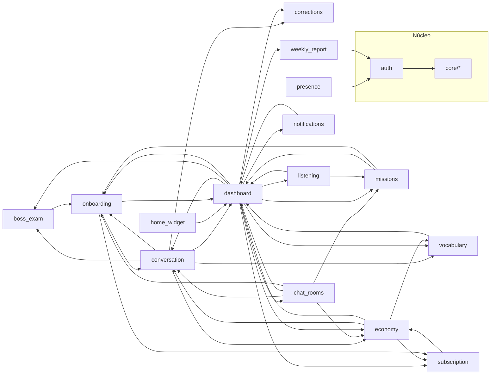

# 02 — Arquitectura de la aplicación

> **Producto:** Dungeon of English (`tutorsaas`, Android, Flutter `1.0.21+22`).
> **Base medida:** worktree `p14-ai-usage` sobre `origin/master`, octubre 2026.
> **Método:** lectura estática de `lib/`, `supabase/functions/` y `pubspec.yaml`;
> consultas **de solo lectura** al proyecto Supabase `sipiumfdpvnszthykyog`;
> cruce con `docs/product-discovery/_baseline.md`.
> **No se ejecutó la app ni se inspeccionó ningún dispositivo**: todo lo que
> sigue se deriva de código, no de comportamiento observado.
>
> Documentos que **no** se duplican aquí: `docs/ARCHITECTURE.md` (resumen
> operativo), `docs/DATA_MODEL.md` (detalle de tablas/RLS),
> `docs/OPERATIONS.md` (entornos y secretos), `docs/ui-ux-audit/` (diseño).
> Donde este documento contradice a esos, la contradicción está marcada y
> justificada con evidencia de código.

---

## 1. Resumen ejecutivo

| Dimensión | Valor medido | Fuente |
|---|---|---|
| Pantallas (`*_screen.dart`) | **20** | `Get-ChildItem lib -Recurse -Filter *_screen.dart` |
| Rutas go_router | **20** | `lib/app/router.dart:33-140` |
| Features | **16** | `lib/features/*` |
| Declaraciones de provider | **147** | conteo `^final …Provider` |
| `StateNotifier` | **12** clases | `extends StateNotifier<` |
| `FutureProvider` | **59** apariciones | grep |
| Repositorios de dominio / implementaciones | **10 / 9** | `features/*/domain/repositories`, `*_impl.dart` |
| Llamadas RPC desde el cliente | **55** llamadas, **51** funciones distintas | grep de `.rpc(` |
| Tablas `public` | **84** (baseline) / **90** (producción hoy) | §5.1 |
| Funciones `public` | **82** (baseline) / **99** (producción hoy) | §5.1 |
| Políticas RLS | **130** (baseline) / **135** (producción hoy) | §5.1 |
| Vistas | **13** (baseline) / **14** (producción hoy) | §5.1 |
| Edge Functions | **8** | `supabase/functions/` |
| Claves i18n | **1 292** × 3 idiomas, 0 faltantes | `lib/l10n/app_{en,es,pt}.arb` |

**Forma de la arquitectura:** monorepo Flutter con *feature-first* + capas
`presentation / domain / data` dentro de cada feature, estado global con
`flutter_riverpod`, navegación declarativa con `go_router` y **toda la lógica
sensible en el servidor** (Postgres + RLS + RPC `SECURITY DEFINER` + 8 Edge
Functions). El cliente es, en la práctica, un renderizador de estado de
servidor con dos excepciones de cómputo local: el catálogo de lecciones
(`lesson_catalog.dart`, 4 621 líneas) y la presentación del chat en streaming.

---

## 2. Capas

### 2.1 Estructura real

```
lib/
├── app/                 router.dart (20 rutas), splash_screen, navigation_resolver, app.dart
├── core/
│   ├── ai/              sse_chat_decoder.dart        ← ÚNICO archivo del directorio
│   ├── analytics/       analytics_taxonomy.dart (eventos + saneado PII)
│   ├── cache/           cached_future_controller.dart, json_disk_cache.dart
│   ├── constants/       api_constants.dart (URLs, anon key, RevenueCat key)
│   ├── i18n/            language_settings, locale_provider, app_translations
│   ├── platform/        app_settings_launcher.dart
│   ├── services/        revenuecat, retention_analytics, crash_reporter,
│   │                    sensory_feedback, tavern_music
│   ├── telemetry/       startup_probe.dart
│   ├── theme/           app_colors, app_typography, app_spacing, app_radius,
│   │                    app_elevation, app_motion, app_contrast, app_theme
│   ├── utils/           error_tracker, player_identity, retry, text_diff_utils
│   └── widgets/         13 widgets compartidos (GlassCard, RunicButton, …)
├── features/            16 features (tabla §3)
└── l10n/                ARB + 3 clases generadas (+ app_localizations.dart 7 890 líneas)
```

### 2.2 Regla de dependencia (declarada vs real)

**Declarada** (`docs/ARCHITECTURE.md:9`): feature-first con capas
`presentation → domain → data`, y `core` como base transversal.

**Real** — se cumple dentro de cada feature (los `presentation` leen providers,
los providers leen repositorios de `domain`, los `data` implementan esas
interfaces), con **dos violaciones sistemáticas**:

| Violación | Evidencia | Consecuencia |
|---|---|---|
| **D1. Features que importan `presentation` de otras features.** No hay frontera entre capas de distintas features. | `lib/features/dashboard/presentation/screens/dashboard_screen.dart:374` instancia `ChatRoomsScreen`; `:378` instancia `SettingsScreen`; `lib/features/conversation/…/conversation_screen.dart:32` importa widgets de `vocabulary` | El grafo de features es casi completo (§3.3): no se puede compilar/eliminar una feature de forma aislada |
| **D2. `core/` no contiene el dominio compartido.** El "dominio" de lecciones vive en `features/dashboard/domain/models/lesson_catalog.dart` y lo consumen `conversation`, `listening`, `missions`. | `lesson_catalog.dart` 4 621 líneas; importado desde `conversation_screen.dart:36`, `session_summary_screen.dart:17` | `dashboard` es de facto el módulo de dominio del producto |

Ambas son deuda estructural, no errores de compilación: `flutter analyze` está
en 0 errores/0 warnings.

### 2.3 Patrón interno de cada feature

| Capa | Contenido típico | Ejemplo |
|---|---|---|
| `domain/models` | `freezed` + `json_serializable` cuando hay serialización | `conversation_message.freezed.dart`, `achievement.g.dart` |
| `domain/repositories` | Interfaz abstracta | `lib/features/economy/domain/repositories/economy_repository.dart` |
| `domain/services` | Reglas puras y testeables | `tutor_prompt_builder.dart`, `boss_exam_rules.dart`, `listening_grading.dart`, `path_order.dart` |
| `data/repositories` | Implementación con `SupabaseClient` / `Dio` | `conversation_repository_impl.dart` (1 142 líneas) |
| `presentation/providers` | `StateNotifier`, `FutureProvider`, `Provider` | `conversation_providers.dart` (2 956 líneas) |
| `presentation/screens` | 1 pantalla por archivo (`*_screen.dart`) | tabla §3 |
| `presentation/widgets` | Widgets de feature (38 en total) | `mission_card.dart`, `boss_exam_health_bar.dart` |

---

## 3. Features

### 3.1 Inventario

| Feature | Responsabilidad | Capas presentes | Pantallas | Providers clave |
|---|---|---|---|---|
| `auth` | Sesión Supabase, Google Sign-In, perfil de usuario, `signOut` | data/domain/presentation | — (0; provee a todas) | `authStateProvider`, `currentUserProvider`, `supabaseClientProvider`, `userProfileProvider` |
| `onboarding` | Wizard de 4 pasos, Oráculo, placement, mini-conversación | data/domain/presentation | SCR-02, SCR-03, SCR-04 | `onboardingProvider`, `miniConversationProvider`, `hunterClassesProvider` |
| `conversation` | Pipeline de voz, chat con tutor, evaluación de metas/correcciones, TTS | data/domain/presentation | SCR-05 | `conversationStateProvider`, `conversationRepositoryProvider`, `sessionResultProvider` |
| `dashboard` | Centro de mando, progreso, perfil, ajustes, resumen de sesión | data/domain/presentation | SCR-06, SCR-13, SCR-14, SCR-15 | `userProgressProvider`, `dashboardRepositoryProvider`, `dailyGoal*` |
| `economy` | Maná, oro, gemas, fragmentos, inventario, tienda, guardián | data/domain/presentation | SCR-10, SCR-11, SCR-12 | `economyWalletProvider`, `manaStateProvider`, `shopCatalogProvider` |
| `missions` | Motor de misiones diarias/semanales, secretas, de gremio | data/domain/presentation | SCR-09 | `dailyMissionsProvider`, `weeklyMissionsProvider`, `activeMissionsProvider` |
| `boss_exam` | Examen de promoción, rúbrica, cooldown de 12 h | data/domain/presentation | SCR-17 | `bossExamStatusProvider` |
| `corrections` | Correcciones por turno y «Mis errores» | data/domain/presentation | SCR-18 | `myCorrectionsProvider` |
| `listening` | Comprensión auditiva (TTS local + corrección en servidor) | data/domain/presentation | SCR-20 | `listeningAudioProvider`, `listeningRepositoryProvider` |
| `vocabulary` | Repaso SRS (SM-2) con tarjetas | domain/presentation | — (widgets dentro de dashboard/summary) | — (`srs` se invoca como modal) |
| `weekly_report` | Informe semanal calculado en servidor | data/domain/presentation | SCR-19 | `weeklyReportProvider` |
| `subscription` | Paywall RevenueCat, entitlement Pro, planes | data/domain/presentation | SCR-16 | `isPremiumProvider`, `revenueCat*Provider` |
| `chat_rooms` | Gremio, mesas y salas de voz LiveKit | data/domain/presentation | SCR-07, SCR-08 | `chatRooms*Provider` |
| `presence` | Heartbeat de sección cada 30 s | data/domain/presentation | — (side-effect) | `presenceControllerProvider` |
| `notifications` | Recordatorio diario local | data/domain/presentation | — (card en ajustes) | `reminderStartupSyncProvider` |
| `home_widget` | Widget de pantalla de inicio Android | data/domain/presentation | — (side-effect) | `homeWidgetSyncProvider` |

### 3.2 Pantallas que no son de una feature

`splash_screen.dart` vive en `lib/app/` (no en `features/`), es la única
pantalla fuera del esquema feature-first.

### 3.3 Grafo de dependencias real (medido)

Aristas = un archivo de la feature A importa algo de la feature B (conteo de
archivos). Fuente: análisis de `import` sobre `lib/features/**`.



Lectura: **`dashboard` es el hub** (12 dependencias salientes), seguido de
`conversation` (7). `presence`, `auth` y `weekly_report` son hojas.
`chat_rooms` importa `dashboard` **y** `dashboard` importa `chat_rooms`: ciclo
real, sostenido por las pestañas del dashboard (`dashboard_screen.dart:374`).

---

## 4. Riverpod

### 4.1 Tipos en uso

| Tipo | Uso | Ejemplo |
|---|---|---|
| `Provider<T>` | Dependencias puras (cliente Supabase, repositorios, `Dio`) | `conversationRepositoryProvider` (`conversation_providers.dart:53`) |
| `StateNotifierProvider` | Lógica con estado mutable | `conversationStateProvider` (`:2924`), `PresenceController` |
| `StateNotifierProvider.autoDispose` | Estado ligado a sesión | `presenceControllerProvider` |
| `FutureProvider` / `.autoDispose` | Lecturas asíncronas | `scenarioProgressProvider` (`:72`), `weeklyReportProvider(offset)` (family) |
| `StateProvider` | UI efímera | `dashboardTabProvider` (`dashboard_screen.dart:31`), `activeConversationIdProvider` (`:66`) |
| `StreamProvider` | 4 usos | realtime de salas |
| `Provider.family` | Parámetros (p. ej. `weekOffset`) | `weeklyReportProvider` |

Sin BLoC, sin Redux, sin GetX, sin `provider` clásico (verificado en
`pubspec.yaml:19-47`).

### 4.2 Patrón de caché (arranque sin red)

`CachedFutureController<T>` (`lib/core/cache/cached_future_controller.dart:20`)
implementa **TTL + stale-while-revalidate + persistencia en disco**:

- refresco por `Timer.periodic` (defecto 60 s) y por lectura;
- descarte automático al cambiar de `userId` (`:53-59`) para no mezclar cuentas;
- `diskLoader`/`diskWriter` → cold start sin queries;
- expone `AsyncValue` para que la UI distinga `loading`/`data`/`error`.

Es la base de `userProgressProvider`, `dailyStateProvider`, maná y wallet. El
dashboard consume el flag offline (`progressOfflineProvider`,
`progressCachedAtProvider`) y pinta un banner ámbar con la antigüedad de la
caché (`dashboard_screen.dart:270-298`, `:759-768`).

### 4.3 Dónde vive el estado de conversación

`ConversationNotifier` (2 956 líneas, `conversation_providers.dart:95`) es el
`StateNotifier` más grande del producto: mantiene mensajes, fase de grabación,
TTS (`FlutterTts`), personalización del tutor, adaptación de dificultad, número
de turno, correcciones del turno, evaluación de metas y cierre de sesión. Es un
**god object** reconocido: la propia pantalla tiene 2 362 líneas.

---

## 5. Persistencia y datos

### 5.1 Supabase (Postgres + RLS)

**Cifras.** El baseline fija 84 tablas / 82 funciones / 130 políticas / 13
vistas. La consulta de solo lectura a producción el mismo día devuelve:

| Objeto | Baseline | Producción (hoy) | Diferencia |
|---|---|---|---|
| Tablas base (`public`) | 84 | **90** | +6 |
| Vistas | 13 | **14** | +1 |
| Funciones | 82 | **99** | +17 |
| Políticas RLS | 130 | **135** | +5 |
| Migraciones registradas | 104+ | **108** | +4 |

Las **6 tablas que no aparecen en `docs/DATA_MODEL.md`** (verificado por
diferencia de nombres):

| Tabla | Uso en código |
|---|---|
| `boss_exam_attempts` | intentos del jefe y cooldown (`evaluate-placement/index.ts:352`) |
| `daily_goal_celebrations` | celebración de meta diaria (`claim_daily_goal_celebration`) |
| `device_tokens` | notificaciones push (no hay emisor push en el cliente; solo recordatorios locales) |
| `scenario_progress` | memoria del intento anterior (`conversation_providers.dart:77`) |
| `user_presence` | presencia y heartbeat (`report_presence`) |
| `vocabulary_curation_runs` | auditoría de curación de vocabulario por sesión |

> ⚠️ **Divergencia abierta.** Las cifras del baseline ya no describen
> producción. Cualquier documento que cite "84/82/130/13" está citando el
> estado de un día anterior. Este documento usa el baseline como referencia
> histórica y producción como fuente de verdad, y lo dice explícitamente.

**Las 14 vistas** (producción): `ai_cost_by_session`, `ai_usage_by_session`,
`ai_usage_daily`, `analytics_activation`, `analytics_onboarding_funnel`,
`analytics_retention`, `analytics_sessions_per_week`,
`curriculum_alignment_summary`, `curriculum_progress_keys`,
`lesson_completion_state`, `mission_template_completion_rates`,
`mission_templates_reachability`, `user_recurring_errors`, `v_economy_flow`.

### 5.2 RPC: las 51 funciones que el cliente invoca

55 llamadas, 51 nombres. Agrupadas por dominio:

| Dominio | RPC | Evidencia |
|---|---|---|
| **Economía (19)** | `add_aura_xp`, `add_fragments`, `add_gems`, `add_gold`, `add_xp`, `spend_currency`, `spend_gems`, `consume_mana`, `refund_failed_turn`, `get_economy_wallet`, `get_mana_state`, `get_prestige_title`, `purchase_cosmetic`, `purchase_streak_freeze`, `craft_cosmetic`, `equip_cosmetic`, `claim_level_rewards`, `level_reward_status`, `claim_session_drop`, `register_practice`, `increment_pergaminos_max`, `equip_mana_item`, `desequip_mana_item` | `economy_repository_impl.dart:221-1001` |
| **Dashboard/progreso (7)** | `get_dashboard_state`, `get_daily_goal_progress`, `claim_daily_goal_celebration`, `learning_evidence`, `get_leaderboard`, `refresh_recommended_path`, `record_vocabulary_review` | `dashboard_repository_impl.dart:31,298,682`; `dashboard_providers.dart:45,71,183,652` |
| **Sesión/conversación (5)** | `curate_session_vocabulary`, `get_session_learned_summary`, `record_scenario_outcome`, `check_ai_audio_quota`, `track_ai_audio_time` | `conversation_repository_impl.dart:702,829,1094,1111`; `conversation_providers.dart:2493,2906` |
| **Sesión/cierre (1)** | `close_session` | `economy_repository_impl.dart:798` |
| **Misiones (1)** | `claim_mission_reward` | `mission_repository.dart:189` |
| **Salas (7)** | `join_table`, `leave_table`, `claim_seat`, `request_seat`, `stand_up`, `moderator_stand`, `touch_presence` | `chat_rooms_repository_impl.dart:205-535` |
| **Presencia (1)** | `report_presence` | `presence_repository_impl.dart:13` |
| **Onboarding (1)** | `apply_self_declared_level` | `onboarding_repository_impl.dart:80` |
| **Examen (1)** | `boss_exam_status` | `boss_exam_service.dart:25` |
| **Listening (1)** | `submit_listening_attempt` | `listening_repository.dart:128` |
| **Informe (1)** | `get_weekly_report` | `weekly_report_service.dart:26` |
| **Cuenta (2)** | `export_my_data`, `delete_my_account` | `settings_screen.dart:470,522` |

**Consecuencia de diseño:** el cliente **no escribe saldos**. `add_gold`,
`add_xp`, `add_gems`, etc. se invocan desde el repositorio, pero el cobro y el
otorgamiento reales se hacen dentro de RPC `SECURITY DEFINER` y/o del proxy;
`docs/CONTEXT_MAP.md` recuerda que la escritura directa de XP/racha se descarta
en `guard_language_profile`.

### 5.3 Cómo se cierra una sesión (importante y documentado a medias)

`ConversationNotifier.endSession()` llama a `close_session(p_session_id uuid)`
(`economy_repository_impl.dart:798`). Esa función, **en servidor**:

- valida que la conversación sea del usuario y no esté borrada;
- es **idempotente** vía `session_reward_ledger` (si ya existe, devuelve el
  mismo resultado con `duplicated: true`);
- calcula `xp = minutos × 10`, `gold = objetivos × (10 + bonus)`,
  `fragments = objetivos × (5 + bonus)`, con `bonus` por CEFR
  (`A2=1, B1=2, B2=3, C1=4, C2=5`, resto 0);
- inserta el asiento en `session_reward_ledger` y el movimiento de moneda.

> 📌 `apply_session_rewards` **no se invoca desde el cliente**. El comentario de
> cabecera de `session_summary_screen.dart:23` dice que la recompensa viene de
> `apply_session_rewards`; la llamada real del cliente es `close_session`, que
> es la que aplica la misma regla. Se documenta la discrepancia, no se asume.

### 5.4 Persistencia local

| Mecanismo | Uso | Evidencia |
|---|---|---|
| `SharedPreferences` | flags de navegación (`nav_has_profile_<id>`), preferencias TTS, marca de mini-conversación vista, prompts de notificación | `navigation_resolver.dart:48-65`, `conversation_providers.dart:652`, `notification_prompt_store.dart` |
| Caché JSON en disco | cold start sin red | `core/cache/json_disk_cache.dart` |
| `home_widget` | snapshot del widget Android | `home_widget_bridge.dart` |
| Archivos temporales | audio AAC de `record` | `mini_conversation_screen.dart:126-133` |
| Supabase Storage | bucket `avatars` (foto de perfil) | `profile_edit_screen.dart:119-132` |

---

## 6. Navegación (`go_router`)

### 6.1 Las 20 rutas

| # | Ruta | Pantalla | Parámetros | Evidencia |
|---|---|---|---|---|
| 1 | `/splash` | `SplashScreen` | — | `router.dart:34` |
| 2 | `/` | `WelcomeScreen` | — | `:35` |
| 3 | `/onboarding` | `OnboardingScreen` | — | `:36-39` |
| 4 | `/mini-conversation` | `MiniConversationScreen` | — | `:42-45` |
| 5 | `/oracle-test` | `ConversationScreen(oracleMode: true)` | `target`, `native`, `mode=promotion` | `:46-62` |
| 6 | `/home` | `DashboardScreen` | — | `:63` |
| 7 | `/voice-room` | `VoiceRoomScreen` | `roomId` | `:64-70` |
| 8 | `/conversation` | `ConversationScreen` | `scenarioId`, `scenarioTitle` | `:71-81` |
| 9 | `/summary` | `SessionSummaryScreen` | — (lee providers) | `:82-85` |
| 10 | `/paywall` | `PaywallScreen` | — | `:86` |
| 11 | `/profile-edit` | `ProfileEditScreen` | — | `:87-90` |
| 12 | `/chat-rooms` | `ChatRoomsScreen` | — | `:91-94` |
| 13 | `/shop` | `ShopScreen` | — | `:95` |
| 14 | `/inventory` | `InventoryScreen` | — | `:96-99` |
| 15 | `/dungeon-guardian` | `DungeonGuardianScreen` | — | `:100-103` |
| 16 | `/boss-result` | `BossExamResultScreen` | `extra: BossExamOutcome` | `:106-114` |
| 17 | `/my-errors` | `MyErrorsScreen` | — | `:117-120` |
| 18 | `/weekly-report` | `WeeklyReportScreen` | — | `:123-126` |
| 19 | `/listening` | `ListeningQuizScreen` | `exerciseId` | `:129-135` |
| 20 | `/missions` | `MissionsScreen` | — | `:136-139` |

**Pantalla sin ruta:** `SettingsScreen` no está registrada; se muestra como
**pestaña 3** del dashboard (`dashboard_screen.dart:378`). Es deuda reconocida
(backlog `UX-28`, issue #260).

### 6.2 Redirección centralizada

`redirect` (`router.dart:149-173`) delega en `NavigationDecisionEngine.resolve`
(`lib/app/navigation_resolver.dart:22-93`), con tres reglas en orden:

1. sin sesión → `/` (Welcome). **El modo dev no la salta**: sin JWT el pipeline
   de voz no funciona.
2. con sesión y sin perfil → `/onboarding`.
3. con sesión y con perfil → `/home`.

Detalles de robustez que importan para la UX:

- `_profileCache` en memoria + flag persistido → el redirect **no consulta la
  DB en cada navegación** (`:27, :34`).
- timeout de 6 s: si Supabase no responde, decide con la última decisión
  persistida en vez de colgar el arranque (`:32, :97-110`).
- `refreshListenable` re-evalúa en cambios de sesión y de modo dev
  (`router.dart:179-200`).

### 6.3 Deep links y `extra`

- `/oracle-test` transporta el idioma objetivo/nativo por query string; el
  resultado se devuelve por **valor de retorno del `push`**
  (`onboarding_screen.dart:209-219`).
- `/boss-result` transporta un objeto `BossExamOutcome` por `state.extra`; si el
  usuario entra por enlace sin `extra`, la pantalla muestra
  `boss_result_missing` con un botón a `/home` (`boss_exam_result_screen.dart:30-51`). **Buen
  patrón defensivo**; no todas las pantallas lo tienen (ver `UX-26`).

---

## 7. Edge Functions

| Función | Rol | Autenticación | Evidencia |
|---|---|---|---|
| `llm-proxy` | **Gateway único de IA**: `POST /chat` (DeepSeek SSE) y `POST /transcribe` (Groq Whisper) | JWT del usuario; cobra maná server-side | `supabase/functions/llm-proxy/index.ts:9-18, 333` |
| `evaluate-placement` | Decide CEFR + `game_rank` desde la transcripción; handles `mode=placement` y `mode=boss` | JWT | `evaluate-placement/index.ts:296-301` |
| `lesson-generator` | Genera un escenario con DeepSeek y lo inserta como borrador privado; cobra `lesson_generation` | JWT + coste de maná | `lesson-generator/index.ts:12-14, 240, 329-368` |
| `livekit-token` | Emite token de sala con `canPublish` según `presence_state` | JWT | `voice_room_screen.dart:98-100` |
| `missions-cron` | Rota misiones diarias; protegido por secreto de cron | `verify_cron_secret` | `missions-cron/index.ts:33-43` |
| `revenuecat-webhook` | Espeja eventos de RevenueCat a `revenuecat_events` | firma del proveedor | `supabase/functions/revenuecat-webhook/index.ts` |
| `sync-entitlement` | Reconcilia entitlement Pro con `user_subscriptions` | JWT / service | `docs/OPERATIONS.md` |
| `reactivation-email` | Emails de reactivación vía **Resend** | service role | `reactivation-email/index.ts:13-22` |

Tamaños: `llm-proxy/index.ts` 25 406 B (+ `usage.ts`, `validation.ts` con tests
Deno), `evaluate-placement` 21 317 B, `lesson-generator` 17 069 B,
`reactivation-email` 13 509 B.

---

## 8. Inteligencia artificial

### 8.1 Pipeline de voz (real, no el del README)

```
record (AAC-LC, 128 kbps, 16 kHz)          conversation_audio_recorder / mini_conv
        │
        ├─► POST {supabase}/functions/v1/llm-proxy/transcribe   (multipart)
        │      model=whisper-large-v3-turbo, language=en, response_format=json
        │      → { text }
        │
        ├─► POST {supabase}/functions/v1/llm-proxy/chat         (SSE)
        │      model=deepseek-v4-flash, stream=true, max_tokens=200
        │      action_code ∈ {free_chat_turn, dungeon_turn, oracle_turn, goal_eval, …}
        │      client_capabilities=["server_mana"]
        │      → data: {choices[0].delta.content} … data: [DONE]
        │
        └─► flutter_tts (on-device, rate 0.48, velocidad ajustable 0.75×/1×/1.25×)
```

Evidencia: `conversation_repository_impl.dart:58-119` (STT),
`:124-236` (chat SSE), `sse_chat_decoder.dart:18-47` (parser),
`conversation_providers.dart:600-652` (preferencias TTS), `:2029` (`_speakTts`).

**Notas que corrige la documentación antigua:**

- El endpoint de STT es `/transcribe`, no `/stt`
  (`docs/ARCHITECTURE.md:95` dice `/stt`; el código dice
  `'${ApiConstants.llmProxyBaseUrl}/transcribe'`).
- `generateTtsAudio` existe pero **devuelve cadena vacía**
  (`conversation_repository_impl.dart:239`): no hay TTS de servidor; el audio
  del tutor es siempre local.
- Reintentos: 3 intentos con backoff `500 ms · 2^(n-1)` solo en
  429/500/502/503/timeout/connectionError (`:132-200`).

### 8.2 Cobro de maná (server-side, por acción)

`ai_action_costs` en producción:

| `action_code` | Coste | Activa | Quién la usa |
|---|---|---|---|
| `dungeon_turn` | 12 | ✅ | turno con escenario (`conversation_screen` muestra 12) |
| `free_chat_turn` | 8 | ✅ | chat libre (barra muestra 8) |
| `oracle_turn` | 15 | ✅ | turno del Oráculo |
| `oracle_eval` | 30 | ✅ | evaluación final del Oráculo |
| `lesson_generation` | 100 | ✅ | `lesson-generator` |
| `vocabulary_curation` | 2 | ✅ | `curate_session_vocabulary` |
| `correction_turn` | 3 | ❌ | **desactivada**: es gratuita vía `FREE_ACTIONS` |

**Acciones gratuitas** (`llm-proxy/validation.ts:23-29`): `goal_eval`,
`carisma_eval`, `guild_chat`, `stt_transcribe`, `correction_turn`.

**Modo de cobro** (`validation.ts:31-49`): `MANA_CHARGE_MODE` =
`capability` (defecto de transición: cobra solo si el cliente declara
`server_mana`) | `all` | `off`. El cliente ya declara `server_mana`
(`conversation_repository_impl.dart:151`), por lo que en producción **cobra**.

**Errores mapeados en cliente** (`:205-231`): 402 → `quota` con mensaje
accionable («Te quedaste sin maná…»), 401/403 → `auth`, timeout → `timeout`,
connectionError → `network`, resto → `provider`. Un fallo **nunca** se pinta
como mensaje del tutor (`conversation_providers.dart:1867-1912`).

### 8.3 Evaluación del Oráculo y del jefe (`evaluate-placement`)

- Escala CEFR: `PRE-A1, A1, A2, B1, B2, C1, C2` (`index.ts:32`).
- Reglas de jefe: mínimo **5 respuestas** y **25 palabras**
  (`MIN_BOSS_ANSWERS`, `MIN_BOSS_WORDS`, `:62-63`); **cooldown 12 h**
  (`BOSS_COOLDOWN_HOURS`, `:64`) comprobado **antes** de llamar al modelo
  (no se cobra un intento bloqueado, `:347-374`).
- El nivel **lo decide el servidor** y se persiste; el cliente solo lee
  (`placement_service.dart:23`, `boss_exam_status.dart:102`).
- Hay respaldo determinista (`heuristicCefr`) si el modelo no devuelve JSON
  válido (`:187-188`).

### 8.4 Personalización del prompt del tutor

`TutorPromptBuilder.build(TutorPromptInput(...))` recibe, en **la misma
llamada** de chat (sin coste extra): CEFR efectivo, nivel del escenario,
personalidad y estilo de corrección, intereses, motivación, instrucciones del
perfil de IA, resumen pedagógico, roles y contexto del escenario, objetivo
principal, metas pendientes, frases útiles, **errores recurrentes**
(`user_recurring_errors`), frases de repaso y el ajuste de dificultad
(`TutorAdaptationTracker`) (`conversation_providers.dart:1781-1823`).

`ScenarioBand.plan(...)` decide la banda efectiva y el presupuesto de metas por
turno (`:1765-1775`); la adaptación sube/baja exigencia según rachas de fallo o
acierto.

### 8.5 Límites de entrada (anti-abuso)

`MAX_MESSAGES = 40`, `MAX_CHARS_PER_MESSAGE = 4 000`, `MAX_TOTAL_CHARS = 24 000`
(`validation.ts:11-13`). Cuota de 30 peticiones/minuto por usuario
(comentario de `validation.ts:22`). El contenido del usuario se delimita con
`<conversation>` y se trata explícitamente como dato, nunca como instrucción
(`conversation_repository_impl.dart:252-272`).

### 8.6 Cuota de audio

`check_ai_audio_quota` y `track_ai_audio_time`
(`conversation_repository_impl.dart:1092-1123`) más la tabla
`llm_quota_events`. El cliente **consulta antes** y **registra después**; el
corte real es del servidor.

---

## 9. Autenticación

| Vía | Flujo | Evidencia |
|---|---|---|
| Google (Android) | `google_sign_in` → `idToken` + `accessToken` → `supabase.auth.signInWithIdToken` | `auth_repository_impl.dart:24-48` |
| Email/contraseña | `signUpWithEmail` / `signInWithEmail` | `welcome_screen.dart:651,686` |
| Recuperación | diálogo → `resetPasswordForEmail` | `welcome_screen.dart:516` |

Detalles:

- Deep link de retorno: `io.supabase.tutorsaas://login-callback`
  (`auth_repository_impl.dart:18`).
- Timeouts explícitos (25 s login Google, 15 s token, 15 s Supabase) para que
  el spinner nunca quede bloqueado (`:32-47`).
- **Puerta de perfil**: el redirect trata «sin fila en
  `user_language_profiles`» como «sin perfil» y manda a onboarding
  (`navigation_resolver.dart:132-140`).
- Warm-up de backend en splash y en welcome para evitar el cold start de
  Postgres en el primer query (`splash_screen.dart:54-62`,
  `welcome_screen.dart:38`).

---

## 10. Suscripciones

| Pieza | Implementación | Evidencia |
|---|---|---|
| SDK | `purchases_flutter` + `purchases_ui_flutter` 10.9 | `pubspec.yaml:41-42` |
| Entitlement | `'DungeonsSpeak Pro'` | `api_constants.dart:69` |
| Paywall | **nativo de RevenueCat** (`presentPaywall`) | `paywall_screen.dart:136` |
| Gestión | Customer Center (`presentCustomerCenter`) | `paywall_screen.dart:189` |
| Restauración | `service.restore()` + `resultGrantsPro(info)` | `paywall_screen.dart:77-120` |
| Planes mostrados | `subscription_plans` con `is_active = true` | `_PlanComparison`, `paywall_screen.dart:314` |
| Reconciliación | `sync-entitlement` (Edge Function) + `revenuecat-webhook` | §7 |
| Estado en app | `isPremiumProvider` (booleano de sesión) | `dashboard_screen.dart:165` |

**Regla de negocio vista en código:** el paywall **no** aparece en el
onboarding; el onboarding fuerza plan free («UX-02: el paywall se mueve
post-sesión», `onboarding_screen.dart:343-344`). El acceso a `/paywall` ocurre
desde el badge PRO/IR PRO del dashboard (`dashboard_screen.dart:416-419`).

**Gating real observado:** `canInvokeProvider` y `manaStateProvider` se
invalidan tras la compra (`paywall_screen.dart:67-74`), lo que sugiere que el
límite de uso depende del plan vía maná, no de un flag de UI. **No verificado**
en dispositivo.

---

## 11. Servicios transversales

| Servicio | Archivo | Qué hace de verdad |
|---|---|---|
| Analítica | `core/services/retention_analytics.dart:35` | inserta en **`analytics_events`** con `sanitizeAnalyticsProperties` (sin PII, solo primitivos, topes) |
| Taxonomía | `core/analytics/analytics_taxonomy.dart` | nombres de evento + lista negra de claves PII |
| Error tracker | `core/utils/error_tracker.dart` | `ErrorTracker.logSilent(ruta:línea, error)` en los `catch` |
| Crash reporter | `core/services/crash_reporter.dart` + `sentry_flutter` | Sentry |
| Telemetría de arranque | `core/telemetry/startup_probe.dart` | `warmupMs`, `timedOut` al primer `app_open` |
| Presencia | `presence_providers.dart:21` | heartbeat cada 30 s con sección derivada de la ruta + `AppLifecycleListener` |
| Notificaciones | `notifications/…/local_notifications_scheduler.dart` | recordatorio local con `flutter_local_notifications` + `timezone`; el tap escribe `notificationTapRouteProvider` |
| Widget de inicio | `home_widget` | snapshot con textos ya localizados (el widget vive fuera de Flutter) |
| Feedback sensorial | `core/services/sensory_feedback.dart` | hápticos/sonido según `user_settings` |
| i18n | `core/i18n/*` | separa **idioma de UI**, **idioma de aprendizaje** y **idioma de explicaciones** |

> ⚠️ `docs/ARCHITECTURE.md:119` afirma que la analítica escribe en
> `retention_events`. Esa tabla **no existe** en producción (no está entre las
> 90) y el código escribe en `analytics_events`. Documentación desactualizada.

---

## 12. Dónde se rompe la arquitectura (deuda medida)

| ID | Hallazgo | Evidencia | Impacto |
|---|---|---|---|
| A-01 | **God files**: `conversation_providers.dart` 2 956 líneas, `conversation_screen.dart` 2 362, `settings_screen.dart` 1 612, `lesson_catalog.dart` 4 621 | conteo de líneas | Un cambio de un turno toca un archivo de 3 000 líneas; sin tests de widget de la pantalla (issue #254) |
| A-02 | **Ciclo `dashboard ↔ chat_rooms`** | `dashboard_screen.dart:374`, `chat_rooms_screen.dart` importa dashboard | Imposible separar el módulo de gremio |
| A-03 | **`SettingsScreen` sin ruta** y embebida como pestaña | `router.dart` (no aparece) vs `dashboard_screen.dart:378` | No se puede enlazar desde notificación/widget; backlog UX-28 |
| A-04 | **51 RPC distintas, 55 llamadas**, sin capa de "servicios" por dominio; la mitad de la economía vive en un solo repositorio de 1 000+ líneas | `economy_repository_impl.dart` | Difícil auditar qué escribe qué |
| A-05 | **Dos criterios de "completada"** (catálogo Dart vs BD) | `docs/CONTEXT_MAP.md` ("dos currículos y dos criterios") | El resumen y el dashboard pueden discrepar |
| A-06 | **Catálogo de lecciones en el cliente** (4 621 líneas) mientras existe `lesson_catalog_index` en BD | `lesson_catalog.dart` vs tabla `lesson_catalog_index` | Fuente de verdad duplicada |
| A-07 | **Cifras de BD desactualizadas** en baseline y `DATA_MODEL.md` | §5.1 | Documentación que envejece sin aviso |
| A-08 | **`core/ai/placement_ai.dart` citado en `ARCHITECTURE.md:121` no existe** | `lib/core/ai/` solo contiene `sse_chat_decoder.dart` | Referencia rota en la documentación de arquitectura |

---

## 13. Qué no se pudo verificar

1. **Comportamiento en ejecución**: no se levantó la app ni hay dispositivo
   conectado. Todo lo anterior es estático + consultas de solo lectura.
2. **Latencia real** de STT/LLM/TTS y tasa de reintentos en producción: haría
   falta `ai_usage_logs`/`api_request_logs` con ventana temporal (no se
   consultaron para no exceder el alcance).
3. **Efectividad del cobro de maná**: `MANA_CHARGE_MODE` es un secreto de la
   función; desde el repo solo se sabe el valor por defecto del código
   (`capability`) y que el cliente declara `server_mana`. El valor desplegado
   es **no verificable** sin `supabase secrets list`.
4. **Contenido de `ai_usage_logs`** (tokens/costes por sesión) y de
   `analytics_events`: no se consultaron datos de usuarios.
5. **`lesson_generation`**: se leyó el código de la función, no se ejecutó; el
   flujo de borrador privado → publicación no está descrito en ningún doc.
6. **Cifras de funciones/vistas del baseline**: la diferencia con producción
   (+17 funciones) no se desglosó nombre por nombre; solo se identificaron las
   6 tablas y la lista de 14 vistas.
