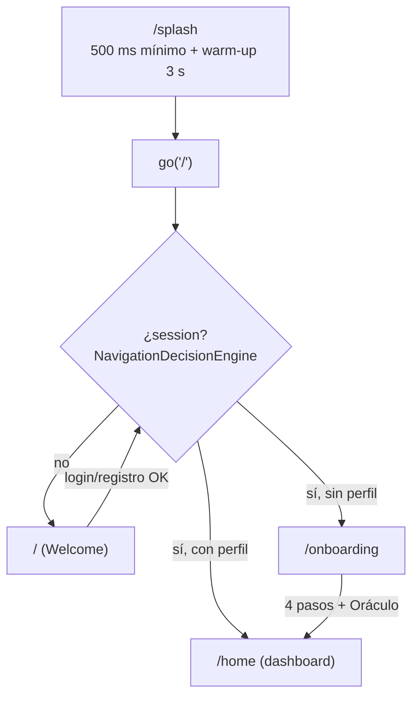
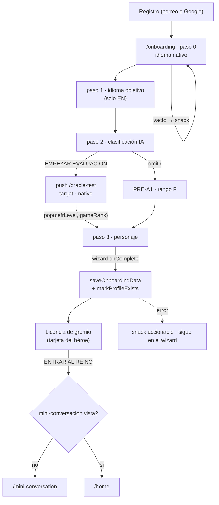
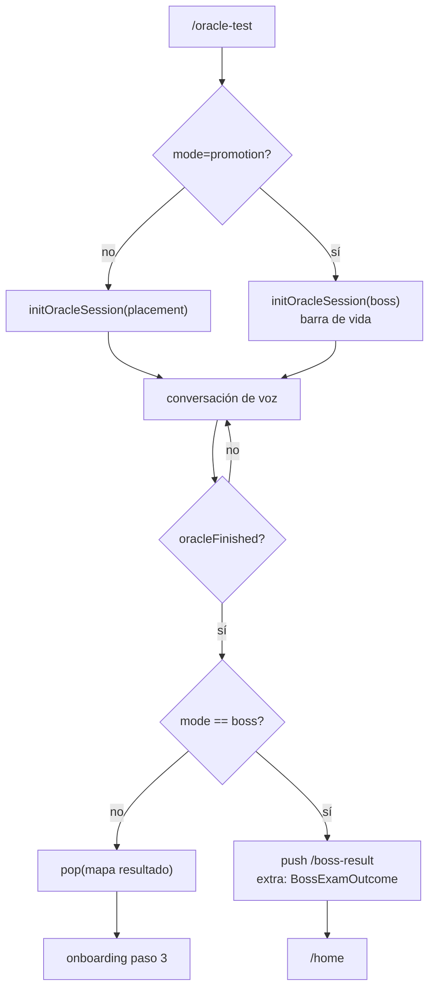
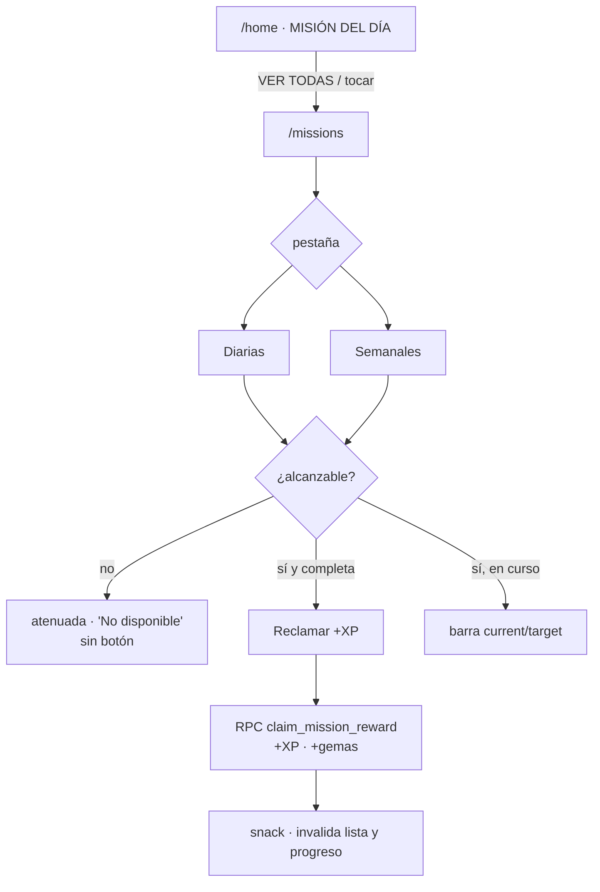
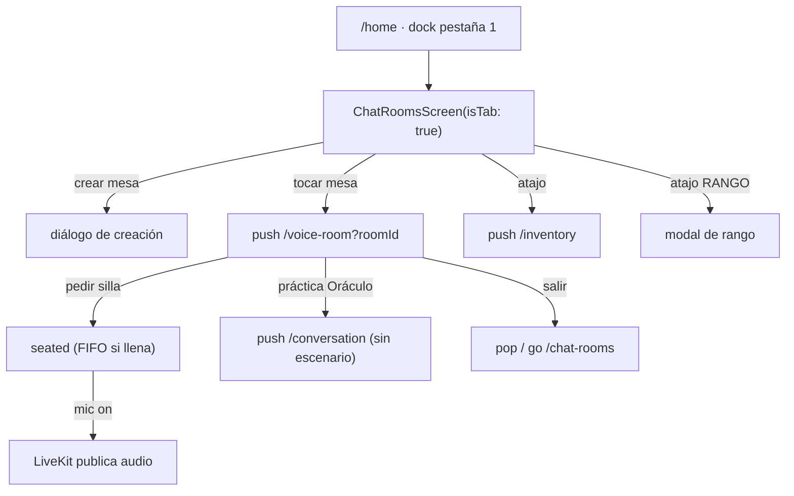
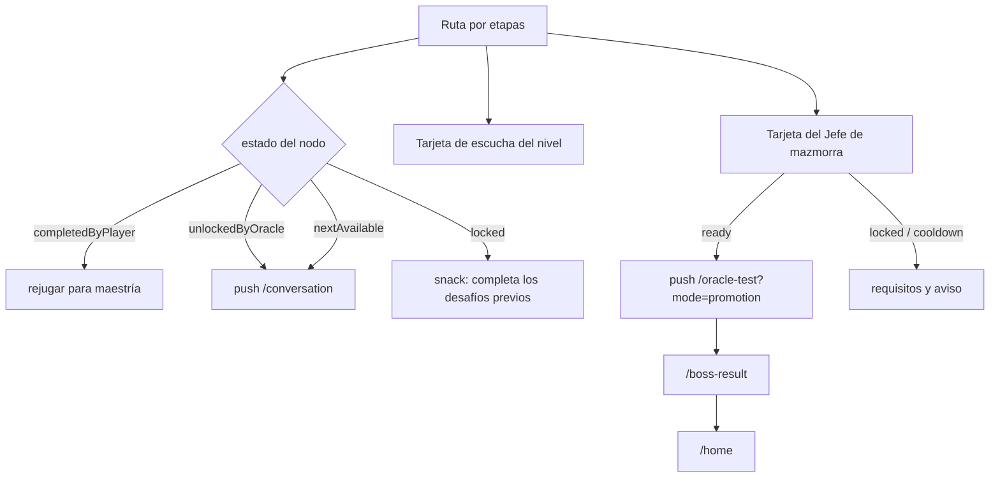
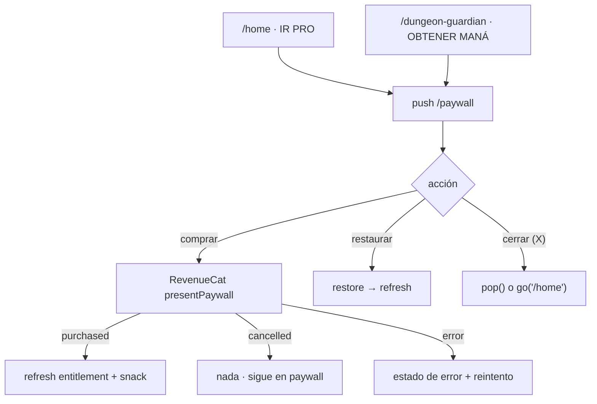
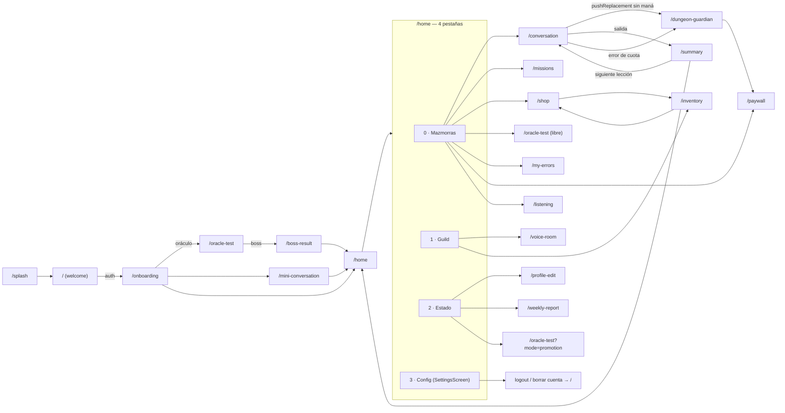

# 05 · Navegación y flujos de usuario

> Medido sobre `origin/master` del worktree `p14-ai-usage` (31-oct-2026).
> Punto de partida: [`_baseline.md`](_baseline.md) (20 pantallas, 20 rutas).
> Solo lectura de código; cifras de BD vía MCP `supabase` (proyecto
> `sipiumfdpvnszthykyog`).
> Documentación existente que **no** se duplica aquí:
> `docs/product-audit/03-PANTALLAS-Y-NAVEGACION.md`,
> `docs/ui-ux-audit/02-screen-inventory.md`,
> `docs/archive/Navigation-Audit/` (histórico: describe el estado anterior al
> `Navigation Decision Engine`).

Leyenda de etiquetas: `[IMPLEMENTADO]` · `[PARCIAL]` · `[CONCEPTUAL]` ·
`[PROPUESTA]` · `[PENDIENTE DE VALIDAR]`.

---

## 1. Inventario real de rutas

`lib/app/router.dart:33-140` declara **20 rutas** `GoRoute` (coincide con la
baseline). No hay `ShellRoute`, ni `StatefulShellRoute`, ni transiciones
personalizadas (`pageBuilder` / `CustomTransitionPage`): **todas** usan el
`builder:` por defecto de `go_router`, es decir transición de plataforma
estándar de Android (fade/slide del `MaterialPage`).

| # | Ruta | Pantalla | Constructor / parámetros | Entrada | Salida |
|---|---|---|---|---|---|
| 1 | `/splash` | `SplashScreen` | `lib/app/splash_screen.dart:15` | `initialLocation` (`router.dart:147`) | `go('/')` (`splash_screen.dart:86`) |
| 2 | `/` | `WelcomeScreen` | `welcome_screen.dart:15` | redirect sin sesión (`navigation_resolver.dart:72-75`) | `go('/onboarding')`, `go(ruta según decisión)` |
| 3 | `/onboarding` | `OnboardingScreen` | `onboarding_screen.dart:27` | redirect con sesión sin perfil | `go('/home')`, `go('/mini-conversation')`, `push('/oracle-test')` |
| 4 | `/mini-conversation` | `MiniConversationScreen` | `mini_conversation_screen.dart:25` | `go` desde onboarding | `go('/home')` |
| 5 | `/oracle-test` | `ConversationScreen(oracleMode: true)` | query `target`, `native`, `mode=promotion`, `level` (`router.dart:46-62`) | `push` (onboarding, checkpoint, tarjeta del jefe) | `pop(resultado)` o `push('/boss-result')` |
| 6 | `/home` | `DashboardScreen` | `dashboard_screen.dart:33` (4 pestañas internas) | redirect con perfil | `push` a casi todo |
| 7 | `/voice-room` | `VoiceRoomScreen` | query `roomId` (`router.dart:65-69`) | `push` desde gremio / banner | `pop()` o `go('/chat-rooms')` |
| 8 | `/conversation` | `ConversationScreen` | query `scenarioId`, `scenarioTitle` | `push` desde dashboard/resumen/roadmap/gremio | `push('/summary')`, `pop`, `pushReplacement('/dungeon-guardian')` |
| 9 | `/summary` | `SessionSummaryScreen` | sin parámetros | `push` desde la conversación | `go('/home')`, `push('/conversation?...')` |
| 10 | `/paywall` | `PaywallScreen` | sin parámetros | `push` desde dashboard y Guardián | `pop()` / `go('/home')` |
| 11 | `/profile-edit` | `ProfileEditScreen` | sin parámetros | `push` desde pestaña Estado | `pop()` / `go('/home')` |
| 12 | `/chat-rooms` | `ChatRoomsScreen(isTab: false)` | sin parámetros | **sin entrada viva en la app** (ver §7.3) | `pop()` |
| 13 | `/shop` | `ShopScreen` | sin parámetros | `push` desde dashboard e inventario | `pop()`, `push('/inventory')` |
| 14 | `/inventory` | `InventoryScreen` | sin parámetros | `push` desde tienda y gremio | `pop()`, `push('/shop')` |
| 15 | `/dungeon-guardian` | `DungeonGuardianScreen` | sin parámetros | `pushReplacement` (sin maná) y `push` MaterialPageRoute (error de cuota) | `go('/home')`, `push('/paywall')` |
| 16 | `/boss-result` | `BossExamResultScreen` | `state.extra` = `BossExamOutcome` | `push` tras el examen de promoción | `go('/home')` |
| 17 | `/my-errors` | `MyErrorsScreen` | sin parámetros | `push` desde acceso rápido del dashboard | `pop()` |
| 18 | `/weekly-report` | `WeeklyReportScreen` | sin parámetros | `push` desde tarjeta del informe | `pop()` |
| 19 | `/listening` | `ListeningQuizScreen` | query `exerciseId` (slug) | `push` desde tarjeta de la ruta | `pop()`, `go('/home')` |
| 20 | `/missions` | `MissionsScreen` | sin parámetros | `push` desde el bloque «misión del día» | `pop()`, `go('/home')` |

**Pantalla sin ruta:** `SettingsScreen` (`settings_screen.dart:24`) no está en
`appRoutes`; se monta como **pestaña 3** del dashboard
(`dashboard_screen.dart:371-378`). Consecuencia: no es enlazable y su
`PopScope`/`go` interno compite con la navegación por pestañas.

---

## 2. Motor de decisión de navegación

`NavigationDecisionEngine.resolve` (`lib/app/navigation_resolver.dart:67-93`)
decide **solo** tres destinos (`NavDestination`, `:9`): `welcome`, `onboarding`,
`home`. No conoce el resto de rutas.

| Regla (en orden) | Condición | Destino | Evidencia |
|---|---|---|---|
| 1 | `user == null` (sin JWT) | `/` | `navigation_resolver.dart:72-75` |
| 2 | sesión y **sin** fila en `user_language_profiles` | `/onboarding` | `:86-89`, sonda `:132-140` |
| 3 | sesión y **con** fila | `/home` | `:91-92` |

Detalles que sí importan para el flujo:

- **Caché por usuario en memoria + `SharedPreferences`** (`_profileCache`,
  `nav_has_profile_<id>`) para no consultar la BD en cada navegación:
  `:27`, `:48-56`, `:113-120`.
- **Timeout de 6 s** en la sonda de perfil (`:32`); si falla, decide con la
  decisión persistida y, sin caché, cae a `false` → onboarding (`:97-110`).
  Un usuario recurrente sin red no se queda en el splash, pero un usuario nuevo
  sin red cae en onboarding como «seguro».
- El `redirect` **no aplica** a `{'/splash', '/onboarding', '/oracle-test'}`
  (`router.dart:152-153`). `/oracle-test` es accesible **sin sesión**; el
  examen fallará después al llamar a `evaluate-placement` (401), pero la ruta
  no se bloquea.
- Con destino `home`, el redirect solo fuerza la salida de `/`; cualquier otra
  ruta se deja pasar (`router.dart:163-168`). Por eso `/paywall`, `/shop`, etc.
  son alcanzables sin comprobaciones propias.
- `refreshListenable` re-evalúa el redirect al cambiar sesión o modo dev
  (`router.dart:144`, `:179-199`).

`markProfileExists` se llama al guardar el onboarding
(`onboarding_screen.dart:291`) para que el redirect no vuelva a consultar la BD
justo después de crearla.

---

## 3. Tipos de transición realmente usados

Conteo sobre `lib/**/*.dart` (búsqueda de `context.go|push|pushReplacement|pop`,
`showModalBottomSheet`, `showDialog`, `MaterialPageRoute`, `GoRouter.of`):

| Mecanismo | Uso real | Dónde |
|---|---|---|
| `context.go` (**reemplaza** la pila) | 12 llamadas | salidas a `/home` y `/`; `conversation_screen.dart:1218`, `1980`; `dashboard_screen.dart:710`; `settings_screen.dart:570`; `boss_exam_result_screen.dart:43,123,135` |
| `context.push` (**apila**) | 24 llamadas | toda entrada a secciones desde el dashboard, resumen, roadmap y gremio |
| `context.pushReplacement` | **1** | `conversation_screen.dart:220` (sin maná → Guardián) |
| `context.pop` | 10 llamadas | cabeceras de pantallas hijas (`inventory_screen.dart:122`, `weekly_report_screen.dart:46`, `my_errors_screen.dart:40`) |
| `Navigator.of(context).push(MaterialPageRoute)` | **1** | `conversation_screen.dart:1105-1108` → Guardián al agotarse el maná **con la conversación debajo** (≠ `pushReplacement` del arranque) |
| `showModalBottomSheet` | 18 llamadas | recompensa diaria, SRS, ajustes del tutor, TTS, cambio de idioma, perfil |
| `showDialog` | 9 llamadas | confirmaciones destructivas (logout, borrar cuenta, compra) y aviso de privacidad |
| `PopScope` con `onPopInvokedWithResult` | 1 (el importante) | `conversation_screen.dart:1161-1171` |

**No hay transiciones de tipo modal-route, ni `Hero`, ni deep links con
`extra` salvo `/boss-result`.** Dos navegaciones distintas conviven para el
Guardián de la Mazmorra (`pushReplacement` en `initState`, `Navigator.push` en
un listener): el usuario llega al mismo sitio con pilas diferentes.

---

## 4. Flujos, uno a uno

Formato: **origen → acción → validación → transición → destino → datos →
estado → consecuencias → alternativas → errores**.

### 4.1 Arranque en frío `[IMPLEMENTADO]`

| Campo | Detalle |
|---|---|
| Origen | Lanzamiento de la app (`initialLocation: '/splash'`) |
| Acción | `SplashScreen` anima 500 ms y lanza un `select id … limit 1` a `user_language_profiles` para despertar Postgres (`splash_screen.dart:54-62`, `:70-88`) |
| Validación | Warm-up con tope de 3 s (`:31`, `:76-79`); nunca lanza |
| Transición | `context.go('/')` tras `max(500 ms, warm-up)` |
| Destino | redirect → `/`, `/onboarding` o `/home` |
| Datos | ninguno; `StartupProbe.markReady` registra ms y timeout (`:81-84`) |
| Estado | ninguna escritura |
| Consecuencias | Si el warm-up expira, se navega igual (marca `timedOut`) |
| Alternativas | — |
| Errores | `catch (_)` silencioso a propósito (`:61`); no hay pantalla de error de arranque |

### 4.2 Autenticación `[IMPLEMENTADO]`

Dos modos en la **misma** pantalla (`_isRegisterMode`, `welcome_screen.dart:24`).

| Campo | Login con correo | Registro con correo | Google |
|---|---|---|---|
| Origen | `/` en modo login | `/` con el enlace de cambio (`:501-510`) | botón «registrarse» (`:272-320`) o «entrar» (`:322-351`) |
| Acción | `signInWithEmail` (`:686`) | `signUpWithEmail` (`:651`) | `signInWithGoogle` (`:290`, `:329`) |
| Validación | email vacío/formato, contraseña vacía, `length < 6` (`:623-646`); mismo regex que el reset (`:600`) | ídem + sesión nula por confirmación de email (`:662-679`) | — |
| Transición | `_completeLogin` → `context.go(destino)` (`:54-74`) | `context.go('/onboarding')` (`:684`) | `go('/onboarding')` (registro) / `_completeLogin` (login) |
| Destino | `/home` o `/onboarding` | `/onboarding` | ídem |
| Datos | usuario de Supabase; `isRegisteringProvider` para Google | — | — |
| Estado | `_isAuthenticating` (spinner), `NavigationDecisionEngine` caché | | |
| Consecuencias | espera hasta 5 s a que el stream propague la sesión antes de navegar (`:60-65`) para evitar el rebote a `/` | si no hay sesión **no navega**: pide confirmar el correo con acción «reenviar» (`:664-679`) | `unawaited(_warmUpBackend())` en paralelo (`:287`, `:326`) |
| Alternativas | «¿Olvidaste tu contraseña?» (`:487-497`) | — | — |
| Errores | `AuthException` → mensaje accionable, incluido «correo no confirmado» (`:697-712`); cualquier otra excepción → mensaje genérico (`:713-719`) | ídem | snack de error (`:300-306`, `:333-339`) | 

Reset de contraseña: diálogo con email (`:516-616`) → `sendPasswordResetEmail` →
snack «enviado»/«error». **No hay pantalla de «define tu nueva contraseña»**: el
enlace llega por correo y sale de la app.

### 4.3 Onboarding `[IMPLEMENTADO, con campos fijados por código]`

Origen: redirect con sesión sin perfil, o `go('/onboarding')` tras registro.

4 pasos en un `PageView` **sin swipe** (`NeverScrollableScrollPhysics`,
`onboarding_screen.dart:518-527`):

| Paso | Índice | Contenido | Validación antes de avanzar |
|---|---|---|---|
| Idioma nativo | 0 | 8 idiomas (`:60-69`); preselección por locale si `followDeviceLanguage` (`:79-100`) | `_selectedNativeLanguageCode` no vacío (`:108-116`) |
| Idioma objetivo | 1 | **solo inglés**, sin selector (`:1085-1132`) | `_selectedLanguageCode` no vacío (`:118-126`) |
| Clasificación IA | 2 | tarjeta explicativa + «empezar evaluación» | `_nextPage` lanza `push('/oracle-test?target&native')` (`:128-131`, `:208-225`) |
| Personaje | 3 | `CharacterCreationWizard` (nombre, clase, avatar) | el wizard llama `onComplete` y avanza (`:938-949`) |

| Campo | Detalle |
|---|---|
| Transición al Oráculo | `context.push<Map<String,dynamic>>` y, al volver, `setState(_currentPage = 3)` + `animateToPage` (`:208-225`) |
| Datos devueltos | `result['cefrLevel']`, `result['gameRank']` (`:215-218`) |
| Alternativa al Oráculo | «omitir» → **PRE-A1 / rango F** sin examen (`:229-240`, enlace en `:1217-1219`) |
| Guardado | `saveOnboardingData` (`:272-286`) + `markProfileExists` (`:291`) + clase/avatar por `update` directo (`:303-318`) + nombre/bio (`:324-334`) |
| Estado tras guardar | `isPremiumProvider.setPremium(false)` (siempre free, UX-02) (`:344`); `_showHeroWelcome = true` (`:361`) |
| Transición final | «ENTRAR AL REINO» → `_enterRealm()` → `go('/home')` o `go('/mini-conversation')` según `SharedPreferences` (`:392-397`, botón `:888-894`) |
| Errores | sin sesión → snack «SESIÓN NO VÁLIDA» y **no** navega (`:252-262`); fallo de guardado → snack accionable, se queda en el wizard (`:371-386`) |

**Hallazgo `[PARCIAL]`:** el formulario recoge `dailyGoalMinutes`,
`interests`, `correctionStyle`, `motivation`, `tutorPersonality`,
`primaryObstacle` y `learningStyle`, pero **ningún control de UI los modifica**
desde la simplificación a 4 pasos. Se guardan los valores por defecto:
`_selectedDailyGoal = 15`, `_selectedInterests = []`,
`_selectedCorrectionStyle = 'balanced'`, `_selectedObstacle = ''`
(`onboarding_screen.dart:48-53`, enviados en `:272-286`). El usuario cree elegir
su personaje y su nivel; su plan pedagógico se decide con constantes.

### 4.4 Prueba de valor de 60 s `[IMPLEMENTADO]`

| Campo | Detalle |
|---|---|
| Origen | `go('/mini-conversation')` (`onboarding_screen.dart:396`) |
| Acción | Escena guiada con «Mira»; texto o voz (`mini_conversation_screen.dart:70-146`) |
| Validación | texto no vacío; permiso de micrófono; transcripción no vacía |
| Transición | `_leave()` → `finish(skipped)` → `go('/home')` (`:148-158`) |
| Datos | turnos en memoria del provider; marca de «visto» por `userId` |
| Estado | `MiniConversationProvider` (start/replyText/replyWithVoice/finish) |
| Consecuencias | no escribe progreso de lección; usa `guild_chat` (acción gratuita) |
| Alternativas | «saltar» y seguir al reino |
| Errores | micrófono denegado → snack; STT vacío → snack «no oímos nada»; error → snack (`:95-109`) |

### 4.5 Oráculo / evaluación `[IMPLEMENTADO]`

Dos modos sobre la **misma pantalla** (`ConversationScreen` con
`oracleMode: true`):

- **Placement** (onboarding): `push('/oracle-test?target=&native=')`.
- **Promoción (jefe)**: `push('/oracle-test?mode=promotion&level=')` — desde la
  tarjeta del jefe (`boss_exam_card.dart:139`) y desde el checkpoint
  (`level_checkpoint_banner.dart:117`).

| Campo | Detalle |
|---|---|
| Acción | chat de voz; el cierre lo decide el servidor (`conversation_providers.dart:1335-1450`) |
| Validación | en modo jefe: evidencia mínima de `BossExamRules`; el servidor re-valida 5 respuestas / 25 palabras |
| Transición | el botón «CONTINUAR» aparece solo con `oracleFinished` (`conversation_screen.dart:1949`); si `mode == 'boss'` → `push('/boss-result', extra: outcome)` (`:1970-1974`), si no → `pop(rawResult)` (`:1978`) |
| Destino | onboarding (paso 3) o `/boss-result` |
| Datos | mapa con `cefr_level`, `game_rank`, `promoted`, `rubric`, `reason_code`, `next_attempt_at`, `scores`, `strengths`, `weaknesses` (`conversation_providers.dart:1429-1449`) |
| Estado | `oracleEvaluating` mientras llama; `_persistSkillScores` en segundo plano (`:1417`) |
| Consecuencias | nivel y rango quedan escritos por `apply_placement_as` con service role |
| Alternativas | cerrar con el botón atrás **sin** resultado (`_handleExit(isOracle: true)` no registra sesión, `:100-101`) |
| Errores | sin maná → `no_mana` (402); cooldown → 429 con `next_attempt_at`; sin evidencia → 400 y el intento no cuenta (`:1359-1377`) |

### 4.6 Lección (conversación) `[IMPLEMENTADO]`

| Campo | Detalle |
|---|---|
| Origen | CTA principal (`dashboard_screen.dart:63-65`), nodo del roadmap (`learning_path_roadmap.dart:719-723`), «continuar» del retorno (`welcome_back_card.dart:150-153`), sub-misión (`:773-775`), refuerzo (`session_summary_screen.dart:905-907`), gremio (`voice_room_screen.dart:1237` — **sin** `scenarioId`) |
| Acción | voz (record AAC) o teclado; TTS del tutor |
| Validación previa | **maná**: si `available < 12` → `pushReplacement('/dungeon-guardian')` (`conversation_screen.dart:208-223`) |
| Transición de entrada | `push` |
| Destino al salir | `push('/summary')` |
| Datos | `scenarioId`, `scenarioTitle` por query string |
| Estado | `conversationStateProvider`, `sessionResultProvider`, `remedialLessonProvider` |
| Consecuencias | `endSession()` idempotente (XP/oro/fragmentos, racha, lección, vocabulario, refuerzo) |
| Alternativas | volver con la flecha (sin resumen) o con el gesto/back del sistema (con resumen) — ver §7.1 |
| Errores | maná agotado a mitad → `Navigator.push(DungeonGuardian)` dejando la conversación debajo (`:1101-1110`); error de IA → snack |

### 4.7 Cierre de sesión y resumen `[IMPLEMENTADO]`

| Campo | Detalle |
|---|---|
| Origen | salida de la conversación (`PopScope` `conversation_screen.dart:1161-1171`) |
| Acción | `_handleExit` → `endSession(practiceMinutes)` → `sessionResultProvider.confirm` → invalida 6 providers → `router.push('/summary')` (`:92-140`) |
| Validación | solo si hubo ≥1 mensaje del alumno (`:104-106`); minutos mínimos 1 (`:109-110`) |
| Transición | `push` (la conversación **sigue en la pila**) |
| Destino | `/summary` |
| Datos | resultado de `apply_session_rewards` + `get_session_learned_summary` |
| Estado | `SessionDropController` lanza el drop una vez (`session_drop_controller.dart:34-64`); `NotificationPermissionPrompt` tras la primera lección (`session_summary_screen.dart:125-127`) |
| Consecuencias | «LISTO» → `goHome()` (invalida progreso y `go('/home')`, `:82-91`); «siguiente lección» → `push('/conversation?...')` (`:767-769`) |
| Alternativas | abrir el SRS con las palabras de la sesión; jugar el refuerzo |
| Errores | recompensa no confirmada → la UI muestra `—` en XP/oro/fragmentos (`session_learned_summary.dart:289-291`); «qué aprendiste» sin datos → mensaje explícito |

### 4.8 Misiones `[PARCIAL]`

| Campo | Detalle |
|---|---|
| Origen | bloque «MISIÓN DEL DÍA» del dashboard (`mission_spotlight_widget.dart:89-107`) |
| Acción | ver diarias/semanales (2 pestañas, `missions_screen.dart:23-72`) y reclamar |
| Validación | `MissionVisibility.isReachableInstance` decide si hay botón (`mission_card.dart:151`, `:323-339`) |
| Transición | `push('/missions')`; el reclamo **no navega**, invalida providers y muestra snack (`:130-144`) |
| Destino | — |
| Datos | `xp`, `gems` del RPC `claim_mission_reward` |
| Estado | `_claiming`, `_justClaimed` (animación), `activeMissionsProvider` |
| Consecuencias | +XP y **+gemas** (no oro): ver [`07-gameplay-and-game-mechanics.md`](07-gameplay-and-game-mechanics.md) §2 |
| Alternativas | atajos del gremio hacia inventario/rango |
| Errores | fallo de red → snack accionable (`:101-112`); ya reclamado → snack (`:114-125`); error de carga → tarjeta «toca para reintentar» (`missions_screen.dart:193-235`) |

### 4.9 Gremio y salas de voz `[PARCIAL]`

| Campo | Detalle |
|---|---|
| Origen | pestaña 1 del dock («GUILD») que monta `ChatRoomsScreen(isTab: true)` (`dashboard_screen.dart:373-374`) |
| Acción | ver mesas, crear mesa (`:641`), entrar, sentarse, pedir silla, hablar |
| Validación | `sitDown` con `canPublish`; petición de silla FIFO si no hay libre (`voice_room_screen.dart:228-240`); micrófono bloqueado si no está sentado (`:146-151`) |
| Transición | `push('/voice-room?roomId=…')` (`chat_rooms_screen.dart:440`, `:768`, `:774`, `:880`) |
| Destino | sala de voz |
| Datos | `roomId` por query; LiveKit token vía `livekit-token` |
| Estado | presencia `seated/standing`, reconexión LiveKit al cambiar de estado (`:126-132`) |
| Consecuencias | `leaveRoom` + `pop()` (`:177-195`); sin recompensa de XP propia |
| Alternativas | «práctica con el Oráculo» dentro de la mesa → `push('/conversation')` **sin escenario** (`:1235-1238`) |
| Errores | `ChatRoomException` → snack con el mensaje del servidor (`:216-220`) |

**Hallazgo:** la ruta `/chat-rooms` (pantalla completa, `isTab: false`) no tiene
ningún `go`/`push` hacia ella en `lib/`; solo el `pop` de la sala de voz la usa
como destino de emergencia (`voice_room_screen.dart:192`). El gremio real vive
**dentro** del dashboard como pestaña. Además, el atajo «RANGO» abre un modal y
«MÚSICA» alterna la taberna, pero no hay acceso a misiones del gremio desde ahí
(el pool `guild_quest_pool` no tiene UI de aceptación con `push`).

### 4.10 Progresión (ruta, checkpoint, jefe) `[IMPLEMENTADO]`

| Campo | Detalle |
|---|---|
| Origen | pestaña 0, sección «Ruta de Aprendizaje» (`dashboard_screen.dart:539-542`) y pestaña 2 «Estado» (`progress_tab_view.dart`) |
| Acción | elegir nivel, entrar a un nodo, ver requisitos del jefe |
| Validación | `LessonUnlockService.classify` → `locked` muestra snack «MAZMORRA BLOQUEADA» sin navegar (`learning_path_roadmap.dart:711-718`) |
| Transición | `push('/conversation?scenarioId=…')`; jefe → `push('/oracle-test?mode=promotion&level=…')` |
| Datos | `scenarioId` (id del catálogo Dart) + título |
| Estado | `completedGoalsProvider`, `recommendedPathProvider`, `bossExamStatusProvider` |
| Consecuencias | nivel anterior al CEFR queda «desbloqueado por el Oráculo» (`lesson_unlock_service.dart:100-103`) |
| Alternativas | repetir lección completada para maestría (100 %) |
| Errores | sin estado del jefe → la tarjeta no se pinta o cae al estado bloqueado |

### 4.11 Membresías (paywall) `[IMPLEMENTADO]`

| Campo | Detalle |
|---|---|
| Origen | chip «IR PRO» del dashboard (`dashboard_screen.dart:416-419`) y CTA del Guardián (`dungeon_guardian_screen.dart:208-214`) |
| Acción | `RevenueCat.presentPaywall` / `purchase` / `restore` (`paywall_screen.dart:150-187`, `:242-252`) |
| Validación | `_isPresenting` bloquea doble toque; `revenueCatReadyProvider` antes de abrir |
| Transición | tras `purchased/restored` **no navega**: refresca estado y muestra snack (`:151-158`) |
| Destino | se queda en el paywall; el usuario cierra con la X |
| Datos | entitlement de RevenueCat → `isPremiumProvider` |
| Estado | `_paywallError` con reintento (`:169`, `:177`) |
| Consecuencias | el plan y el maná se leen de `user_subscriptions`; reconciliación por `sync-entitlement` |
| Alternativas | «restaurar compras», centro de cliente (`:189-205`) |
| Errores | `PaywallResult.error` → mensaje + snack con el error (`:165-171`); excepción → estado de error con reintento (`:172-183`) |

**Hallazgo:** al comprar con éxito el usuario **no** recibe confirmación
navegacional (ni `go('/home')` ni cierre del paywall). En Android, con un
paywall de RevenueCat encima, el cierre definitivo lo decide la UI nativa del
SDK; no hay código que devuelva al usuario al Guardián que lo trajo, así que
puede aterrizar en el dashboard y tener que repetir el camino.

### 4.12 Tienda e inventario `[PARCIAL]`

| Campo | Detalle |
|---|---|
| Origen | acceso rápido «TIENDA» (`dashboard_screen.dart:496-501`), atajo del gremio → inventario (`chat_rooms_screen.dart:598-603`), CTA del inventario → tienda (`inventory_screen.dart:226`) |
| Acción | comprar con oro, gemas o craftear con fragmentos (`shop_screen.dart:146-186`); equipar en inventario (`inventory_screen.dart:60-83`) |
| Validación | diálogo de confirmación con precio (`:51-106`); servidor valida saldo, nivel y plan |
| Transición | `push` entre `/shop` e `/inventory` → genera **ciclos** en la pila (tienda→inventario→tienda…) |
| Destino | se queda en la tienda; snack de éxito/fallo |
| Datos | `ShopOffer` (id, precios, `required_level`, `craft_cost_fragments`, `min_plan`) |
| Estado | `_selectedTab` (oro/gemas/fragmentos), `_isBusy` |
| Consecuencias | `purchase_cosmetic` / `craft_cosmetic` (SECURITY DEFINER); invalida 6 providers (`:42-49`) |
| Alternativas | reclamar recompensas de nivel pendientes desde la tienda |
| Errores | `insufficient`, `level_locked`, `already_owned`, `cap_reached`, `plan_required` → mensaje específico (`:121-135`, `:176-186`) |

### 4.13 Ajustes y cuenta `[IMPLEMENTADO]`

Ajustes es pestaña 3 (`dashboard_screen.dart:377-378`). Acciones destructivas:

| Acción | Confirmación | RPC / efecto | Navegación |
|---|---|---|---|
| Cerrar sesión | diálogo (`settings_screen.dart:535-573`) | `signOut()` | `go('/')` |
| Borrar cuenta | diálogo rojo (`:487-518`) | `delete_my_account` + `signOut` | `go('/')` (`:520-525`) |
| Exportar datos | no | `export_my_data` → **portapapeles** (`:467-484`) | ninguna |
| Cambiar idioma de interfaz / nativo | bottom sheet (`:575`, `:1408`) | preferencias locales | — |
| Nivel de corrección, personalidad del tutor, estilo, meta diaria | bottom sheets (`:795`, `:896`, `:971`, `:1046`) | `user_settings` | — |

El mismo `signOut + go('/')` está duplicado en el icono de logout del dashboard
(`dashboard_screen.dart:665-712`), en Ajustes (§ arriba) y en el perfil; tres
confirmaciones distintas con textos distintos.

### 4.14 Comprensión auditiva, errores e informe `[IMPLEMENTADO]`

| Flujo | Origen | Transición | Notas |
|---|---|---|---|
| Escucha | tarjeta bajo la ruta, solo del nivel activo (`learning_path_roadmap.dart:470-472` → `listening_path_card.dart:44-48`) | `push('/listening?exerciseId=<slug>')` | corrección en servidor (`submit_listening_attempt`); **3 ejercicios** en BD (A1, A2, B1) |
| Mis errores | acceso rápido «ERRORES» (`dashboard_screen.dart:523-529`) | `push('/my-errors')` | lee `corrections` (0 filas en producción) |
| Informe semanal | tarjeta del informe (`weekly_report_card.dart:44`) | `push('/weekly-report')` | semanas limitadas por plan (`weekly_report.dart:115-130`) |

---

## 5. Mapa general

**Profundidad típica de la pila** (`/home` → …): `home → shop → inventory → shop`
(ciclo posible), `home → conversation → summary → conversation` (ciclo posible
con «siguiente lección»), `home → conversation → dungeon-guardian` (por
MaterialPageRoute), `conversation → dungeon-guardian` (por `pushReplacement`,
pila distinta).

---

## 6. Datos que viajan entre pantallas

| Dato | Mecanismo | Riesgo |
|---|---|---|
| `scenarioId`, `scenarioTitle` | query string (+ `Uri.encodeComponent`) | el id es del **catálogo Dart**, no uuid de `scenarios` (`initSession` distingue, `conversation_providers.dart:276-305`) |
| `target`, `native`, `mode`, `level` | query string del Oráculo | `level` se ignora en el cliente; el servidor decide |
| `exerciseId` | slug de `listening_exercises` | si el slug no existe → pantalla sin ejercicio |
| `roomId` | query string | vacío ⇒ sala inválida (`router.dart:67`) |
| `BossExamOutcome` | `state.extra` (objeto) | **no serializable**: un deep link o un «restore» deja `/boss-result` con `outcome == null` y muestra «resultado no disponible» (`boss_exam_result_screen.dart:30-51`) |
| Resultado del Oráculo | valor de retorno de `pop<Map>` | si el usuario sale con el gesto, `null` y el onboarding usa A1 |

---

## 7. Trampas y hallazgos de navegación

### 7.1 Dos salidas distintas de la conversación `[IMPLEMENTADO, inconsistente]`

- Flecha «atrás» de la cabecera → `_handleExit(showSummary: true,
  navigate: false)` y luego `pop()` → **no** se ve el resumen
  (`conversation_screen.dart:1207-1220`).
- Gesto/back del sistema (`PopScope`) → `_handleExit(showSummary: true,
  navigate: true)` → `push('/summary')` (`:1161-1171`).

Misma acción del usuario (salir), dos resultados: uno pierde la pantalla de
recompensa. El código pide `showSummary: true` y luego anula el efecto con
`navigate: false`, señal de que la intención original era mostrarlo.

### 7.2 `/summary` se apila encima de la conversación cerrada

`router.push('/summary')` no sustituye la ruta (`conversation_screen.dart:131`).
Si el usuario pulsa el back del sistema en el resumen, vuelve a la pantalla de
conversación con el estado ya finalizado (`_sessionFinalized = true`), sin TTS
(`stopTts`) y sin poder registrar una sesión nueva. Solo la flecha propia del
resumen (`goHome`, `session_summary_screen.dart:82-91`) evita ese estado.

### 7.3 `/chat-rooms` es una ruta muerta

No hay ninguna llamada `go('/chat-rooms')` ni `push('/chat-rooms')`; solo el
fallback del `pop` de la sala de voz (`voice_room_screen.dart:190-193`). El
gremio se consume como pestaña. La ruta existe, se mantiene y se puede alcanzar
escribiéndola, pero ningún flujo de producto la abre.

### 7.4 `SettingsScreen` no es ruta

`settings_screen.dart` tiene 1 558 líneas y no está en `appRoutes`. Al vivir
como pestaña:
- su `context.go('/home')` (`:116-119`) y su `pop()` inicial reproducen la
  pantalla de dashboard en la pila;
- no se puede enlazar desde una notificación ni desde soporte.

### 7.5 El Guardián de la Mazmorra se abre de dos formas

| Cuándo | Mecanismo | Pila resultante |
|---|---|---|
| Al entrar sin maná | `pushReplacement('/dungeon-guardian')` (`conversation_screen.dart:220`) | la conversación **no** queda debajo |
| Maná agotado a mitad | `Navigator.push(MaterialPageRoute(DungeonGuardianScreen()))` (`:1105-1108`) | la conversación **sí** queda debajo |

El botón «volver» del Guardián hace `if (canPop) pop(); go('/home')`
(`dungeon_guardian_screen.dart:147-152`) — en el segundo caso vuelve a la
conversación sin maná, que volverá a abrir el Guardián.

### 7.6 Redirección incompleta por diseño

El `redirect` solo protege `'/'` cuando el destino es `home`
(`router.dart:163-168`). Un usuario sin perfil que llegue a `/shop` por deep
link **no** es enviado a onboarding; la app confía en que el flujo normal pase
por `/`. No se observó ningún `redirect` por ruta protegida.

### 7.7 Idioma mezclado en la UI

Varias cadenas del dashboard y del resumen están **hardcodeadas en español**
(`'CONTINUAR AVENTURA'`, `'objetivos'` en `dashboard_screen.dart:90-111`;
`'🔒 MAZMORRA BLOQUEADA: Completa los desafíos previos.'` en
`learning_path_roadmap.dart:713-717`), mientras el resto usa `l10n`. Para el
detalle visual, ver `docs/ui-ux-audit/03-ux-ui-audit.md` y el backlog
`UX-01…UX-37` de `docs/ui-ux-audit/06-improvement-backlog.md`.

---

## 8. Cobertura de flujos vs. lo que la narrativa promete

| Flujo pedido | Estado | Evidencia / hueco |
|---|---|---|
| Arranque | `[IMPLEMENTADO]` | splash + engine con caché y timeout |
| Onboarding | `[IMPLEMENTADO]` · `[PARCIAL]` en datos | 4 pasos; meta diaria, intereses y estilo de corrección **no** se preguntan |
| Autenticación | `[IMPLEMENTADO]` | correo, Google, reset por correo; sin pantalla de nueva contraseña |
| Oráculo / evaluación | `[IMPLEMENTADO]` | placement y jefe con reglas de servidor |
| Lección | `[IMPLEMENTADO]` | con gate de maná de 12 |
| Cierre / resumen | `[IMPLEMENTADO]` | dos salidas inconsistentes (§7.1) |
| Misiones | `[PARCIAL]` | solo diarias/semanales; el pool de gremio no tiene UI de aceptación |
| Gremio / salas | `[PARCIAL]` | pestaña; `/chat-rooms` muerta; sin recompensa de XP en salas |
| Progresión | `[IMPLEMENTADO]` | desbloqueo por CEFR + checkpoint de 10 lecciones |
| Membresías | `[IMPLEMENTADO]` | paywall RevenueCat; sin retorno automático al origen |
| Tienda | `[PARCIAL]` | 3 monedas, 0 compras históricas (`player_inventory` = 0 filas; ver §07) |
| Ajustes | `[IMPLEMENTADO]` | sin ruta propia |
