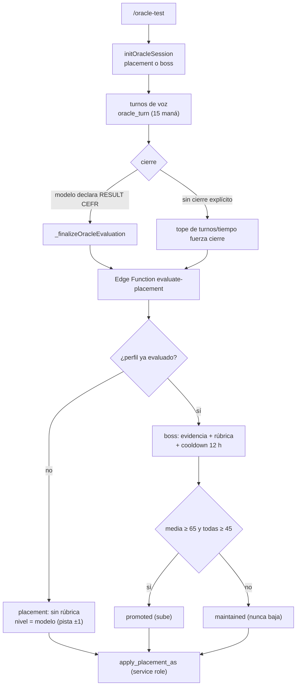
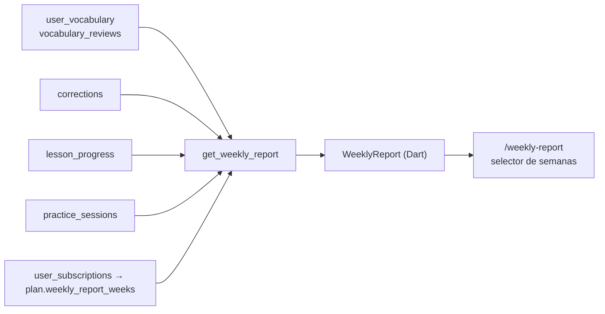

# 06 · Sistema de aprendizaje

> Medido sobre `origin/master` del worktree `p14-ai-usage` (31-oct-2026).
> Consultas de solo lectura al proyecto `sipiumfdpvnszthykyog`.
> No se duplican: `docs/product-audit/05-SISTEMA-PEDAGOGICO.md`,
> `docs/runbooks/GOAL_EVALUATION.md`, `docs/runbooks/CURRICULUM_ALIGNMENT.md`,
> `docs/runbooks/REMEDIAL_LESSON_METRICS.md`.

Etiquetas: `[IMPLEMENTADO]` · `[PARCIAL]` · `[CONCEPTUAL]` · `[PROPUESTA]` ·
`[PENDIENTE DE VALIDAR]`.

---

## 1. Qué se considera “el currículo”

### 1.1 Dos fuentes, una canónica `[IMPLEMENTADO con deuda]`

| Objeto | Contenido | Rol | Evidencia |
|---|---|---|---|
| `LessonCatalog.catalog` (Dart) | **140 lecciones** = 20 × 7 niveles (PRE-A1…C2), solo inglés | **fuente canónica** de identidad, metas y frases | `lib/features/dashboard/data/models/lesson_catalog.dart:95-96`; conteo por `level:` = 20 por nivel |
| `scenarios` (BD) | **500 filas** = 125 títulos × 4 idiomas (`language_id` 1-4); PRE-A1 solo en `language_id = 1` | almacén de contenido; se consulta al abrir una lección | `select difficulty_level, language_id, count(*)` → 20 por combinación (480 + 20) |
| `lesson_catalog_index` (BD) | **140 filas** (`lesson_id`, `level`, `title`, `category`) | índice para ordenar/desambiguar desde el servidor | `select * from lesson_catalog_index` |
| `scenario_goals` | **0 filas** | tablas normalizadas vacías: las metas viven en `scenarios.goals` (JSONB) | conteo directo; `CURRICULUM_ALIGNMENT.md` §1 |
| `scenario_phrases` | **0 filas** | ídem con `useful_phrases` | ídem |
| `scenario_objectives` | 30 filas | reliquia | ídem |

El catálogo Dart tiene 141 ocurrencias de `LessonData(`: la número 141 es el
**fallback en runtime** para escenarios de BD sin entrada en el catálogo
(`lesson_catalog.dart:4155-4200`, `level: 'PRE-A1-C2'`), no una lección.

**Divergencia real:** según `docs/runbooks/CURRICULUM_ALIGNMENT.md:31-42`, los
títulos coinciden en PRE-A1, A1, A2 y B1, y **divergen en B2, C1 y C2** (60 de
140 lecciones). El progreso histórico está guardado con ids Dart
(`lesson_progress.lesson_id` es texto: `prea1_hello_hello`,
`a1_ordering_coffee_at_a_cafe`), así que el servidor **no puede** calcular el
total de metas de una lección sin que el cliente se lo envíe. Consecuencia
directa: `boss_exam_status` y `apply_session_rewards` reciben los totales como
parámetros (`p_total`, `p_objectives`) desde el cliente.

### 1.2 Qué ve el alumno

La ruta por etapas pinta el nivel del perfil y deja elegir otros niveles
(`learning_path_roadmap.dart:387-472`), con estados
`completedByPlayer / unlockedByOracle / nextAvailable / locked`
(`lesson_unlock_service.dart:7-21`). El estado se deriva **solo** de
`user_scenario_goals` + CEFR; no consulta `scenarios` (`:83-127`).

---

## 2. Escala CEFR y PRE-A1 `[IMPLEMENTADO]`

`cefr_levels` en BD tiene **7 filas** (`PRE-A1` con `order_index = 0`, A1=1,
A2=2, B1=3, B2=4, C1=5, C2=6; `PRE-A1` es la fila id 44, creada después).

| Código | Nombre | `order_index` | Rango del juego (Dart) |
|---|---|---|---|
| PRE-A1 | Fundamentos (Pre-A1) | 0 | F |
| A1 | Principiante | 1 | E |
| A2 | Elemental | 2 | D |
| B1 | Intermedio | 3 | C |
| B2 | Intermedio Alto | 4 | B |
| C1 | Avanzado | 5 | A |
| C2 | Maestría | 6 | S |

Fuente: `cefr_levels` (BD) y `CefrRank._cefrToRank`
(`lib/features/onboarding/domain/models/cefr_rank.dart:13-21`);
orden canónico en `CefrRank.cefrOrder` (`:10`). El rango **no** se guarda
derivado: `user_language_profiles.game_rank` es una columna propia que escribe
el servidor (`apply_placement_as`).

`PRE-A1` tiene ruta propia en la app: se puede **omitir el Oráculo** y recibirlo
por defecto (`onboarding_screen.dart:229-240`), y también puede asignarlo el
modelo (`normalizeCefr` acepta `A0/PREA1/PRE_A1/PRE A1` en
`evaluate-placement`).

---

## 3. Placement: el Oráculo `[IMPLEMENTADO]`

### 3.1 Flujo

### 3.2 Reglas verificadas

| Regla | Valor | Evidencia |
|---|---|---|
| Escala cerrada de niveles | PRE-A1…C2 | `evaluate-placement` (`CEFR_SCALE`) |
| Escala cerrada de rangos | F, E, D, C, B, A, S, SS, SSS | `RANK_SCALE` |
| Máximo de respuestas | 40 (2 000 caracteres c/u, 20 000 total) | `MAX_ANSWERS`, `MAX_ANSWER_CHARS`, `MAX_TOTAL_CHARS` |
| Evidencia mínima del jefe | **5 respuestas y 25 palabras** | `MIN_BOSS_ANSWERS`, `MIN_BOSS_WORDS` |
| Rúbrica | 6 dimensiones; **media ≥ 65** y **ninguna < 45** | `rubric`, `RUBRIC_PASS_AVERAGE=65`, `RUBRIC_MIN_DIMENSION=45` |
| Cooldown tras no ascender | **12 h** | `BOSS_COOLDOWN_HOURS`; `boss_exam_attempts.decision = 'maintained'` |
| Pista declarada por el modelo en el chat | se acepta si está a **±1 banda** del CEFR evaluado | `Math.abs(declaredIdx - evaluatedIdx) <= 1` |
| Promoción | solo si el candidato **sube** y (no hay perfil evaluado **o** rúbrica aprobada); nunca baja | bloque `decision` |
| Persistencia | `apply_placement_as` con service role | RPC (acepta cualquier CEFR válido y cualquier rango de la escala) |
| Puntaje por dimensión | 10 dimensiones 0-100 (`listening`, `speaking`, `pronunciation`, `vocabulary`, `grammar`, `sentence_structure`, `confidence`, `fluency`, `response_time`, `naturalness`) | `SCORE_KEYS`; se guardan en `user_language_profiles.placement_scores` |
| Respaldo si el modelo no devuelve JSON | heurística por longitud media de respuesta (≥32 palabras → C1; ≥20 → B2; ≥12 → B1; ≥6 → A2; resto A1) | `heuristicCefr` |

**Dos cosas que la narrativa da por ciertas y el código no garantiza:**

1. `apply_placement_as` **no** implementa “nunca baja de nivel”: es la Edge
   Function la que decide. Cualquier otro llamador (o un cambio futuro) puede
   bajar el nivel. `[PARCIAL]`
2. El rango **SS/SSS** existe en la escala y se acepta en la BD, pero no tiene
   peldaño CEFR (`cefr_rank.dart:13-35` mapea 7 niveles → 7 rangos F…S) ni
   condición de desbloqueo. Solo puede aparecer si el modelo lo declara (o la
   pista declarada queda a ±2 del rango del modelo). `[PARCIAL]`

### 3.3 Qué se guarda

`user_language_profiles`: `cefr_level_id`, `game_rank`, `placement_scores`,
`placement_strengths`, `placement_weaknesses`, `placement_explanation`,
`placement_recommended_focus`, `placement_assessed_at`. El radar de habilidades
se persiste aparte (`_persistSkillScores`, `conversation_providers.dart:1417`).

---

## 4. Tipos de actividad

| Actividad | Estado | Entrada | Coste de IA | Corrección | Evidencia que genera |
|---|---|---|---|---|---|
| **Conversación de lección** | `[IMPLEMENTADO]` | ruta → `/conversation` | `dungeon_turn` = **12 maná** | `goal_eval` (gratis) por turno con ≥5 palabras | `messages`, `user_scenario_goals`, `session_reward_ledger`, `lesson_progress`, `corrections` |
| **Conversación libre** (sin escenario) | `[PARCIAL]` | solo desde el gremio, `push('/conversation')` sin id (`voice_room_screen.dart:1237`) | `free_chat_turn` = **8 maná** | `correction_turn` (gratis) máx. 6/sesión | `messages`, `corrections` |
| **Comprensión auditiva** | `[PARCIAL]` | tarjeta del nivel → `/listening?exerciseId=<slug>` | **0** (audio por TTS del dispositivo) | servidor (`submit_listening_attempt`) | `listening_attempts` |
| **Refuerzo (sub-misión)** | `[IMPLEMENTADO]` | resumen de sesión fallida → `lesson-generator` | `lesson_generation` = **100 maná** (tope 300) | reutiliza el motor de metas | `scenarios` (draft), `vocabulary_curation_runs` n/a |
| **Repaso SRS** | `[IMPLEMENTADO]` | tarjeta «REPASO DEL DÍA» | 0 | servidor (`record_vocabulary_review`, SM-2) | `vocabulary_reviews` |
| **Examen del Oráculo** | `[IMPLEMENTADO]` | onboarding o promoción | `oracle_turn` 15 + `oracle_eval` **30** | servidor (rúbrica) | `boss_exam_attempts`, `user_language_profiles` |

### 4.1 Conversación de lección

- El tutor persigue las metas del catálogo, pero **el presupuesto de metas se
  recorta** si el escenario está por encima del nivel del alumno: `goalBudget`
  = 40 % (hueco ≥ 2 bandas) o 60 % (hueco de 1), mínimo 2
  (`scenario_band.dart:182-198`). La banda efectiva se recorta al nivel del
  alumno (`:143-146`) y baja una banda con dos fallos / sube con tres turnos
  limpios (`TutorDifficultyAdjustment`, `:148-163`).
- El mensaje de apertura se adapta al nivel (`lesson_catalog.dart:4163-4183`).
- `goal_eval` se lanza solo si el último mensaje tiene ≥5 palabras o contiene
  una keyword de una meta pendiente (`goal_evaluation_gate.dart:15-42`); al
  cerrar la sesión se fuerza una última evaluación si había metas sin evaluar
  (`conversation_providers.dart:2390-2418`).
- Lo que el modelo devuelve se **filtra por catálogo**: ids inventados se
  descartan y una meta solo se marca si el modelo la devuelve `true` y el id
  existe (ver `docs/runbooks/GOAL_EVALUATION.md` §“Regla dura”).

### 4.2 Comprensión auditiva `[PARCIAL]`

- Contenido: `listening_exercises` tiene **3 filas** (A1, A2, B1) y **0
  intentos** registrados (`listening_attempts` = 0). B2, C1, C2 y PRE-A1 no
  tienen ejercicios.
- Flujo: máquina de estados pura `answering → submitting → graded|failed`
  (`listening_session.dart:5-102`); un fallo de red conserva las respuestas
  (`retry(keepAnswers: true)`).
- El cliente **no** corrige: envía `{questionId: optionId}` y el servidor
  devuelve el resultado (`listening_repository.dart:19-23`).
- Hay plantillas de misión `listening_items` (5 y 20 ítems) en
  `mission_templates`, pero ninguna instancia puede completarse sin ejercicios:
  el objetivo `listening_items` **no** está en
  `MissionVisibility.autoTrackedObjectives` (`mission_visibility.dart:34-40`),
  así que esas misiones se muestran como «no disponible».

### 4.3 Refuerzo `[IMPLEMENTADO]`

Se dispara al cerrar una lección **no superada** con evidencia (errores
recurrentes o metas falladas): `conversation_providers.dart:2513-2587`.

| Regla | Valor |
|---|---|
| Condición | `evaluated > 0` y `!LessonCompletion.isPassed(...)` (`:2526-2527`) |
| Banda | una banda por debajo del nivel real (`ScenarioBand.remedialLevel`, `scenario_band.dart:103-106`) |
| Sin evidencia | `noEvidence` y **no cobra** (`:2550-2555`) |
| Coste | `ai_action_costs.lesson_generation` = 100, tope duro 300 (`lesson-generator`) |
| Reutilización | si existe una lección equivalente aprobada o un borrador del mismo padre, se reutiliza **sin coste** |
| Fallo tras cobrar | `refund_mana` |
| Resultado | `generated · reused · noEvidence · insufficientMana · failed` (`remedial_lesson.dart`) y tarjeta en el resumen |

### 4.4 Correcciones `[PARCIAL]`

| Aspecto | Implementación |
|---|---|
| Cuándo | `correction_turn` solo en chat libre, con ≥5 palabras y **máx. 6 por sesión** (`correction_turn_policy.dart:36`, `:52-65`). En lecciones con metas, las correcciones llegan dentro de la misma respuesta de `goal_eval` (nunca una segunda llamada) |
| Coste | **gratis** (`FREE_ACTIONS` en `llm-proxy/validation.ts`); la fila `ai_action_costs.correction_turn` (3 maná) está `is_active = false` |
| Nivel `important_only` | no llama al modelo (ahorra la petición) |
| Dónde se guarda | `public.corrections`, upsert idempotente por `(user_id, turn_ref, error_type, original_text)` (`corrections_repository.dart:31-69`) |
| Qué NO se guarda | invitados (`guest_`), sin `turn_ref`, lista vacía (`correction_turn_policy.dart:73-83`) |
| Reutilización | vista `user_recurring_errors` → prompt del tutor y plan de refuerzo (`corrections_repository.dart:107-145`) |
| UI | `/my-errors` agrupa por tipo y recurrencia (`my_errors_screen.dart:90-101`) |
| **Dato real** | `corrections` tiene **0 filas** en producción, con 771 mensajes y 70 conversaciones. La pantalla «Mis errores» está vacía para todos. `[PENDIENTE DE VALIDAR]` la causa (¿nadie llegó al gate de 5 palabras en chat libre? ¿el turno de corrección no se dispara en lecciones?) |

### 4.5 Evaluación de metas y jefe de promoción `[IMPLEMENTADO]`

| Regla | Valor | Evidencia |
|---|---|---|
| Superar lección | 100 % de metas, o ≤4 metas con una fallada, o ≥75 % | `lesson_completion.dart:40-45`; espejo SQL `lesson_completion_passed` |
| Maestría | 100 % | `:49-52` |
| Estrellas | 0 si no supera; 1 si supera; 2 con ≥mitad de frases; 3 con todas | `:63-74` |
| Registro | `lesson_progress` con `passed`/`failed` y `completed_at` | `conversation_providers.dart:2464-2487` |
| Consecuencia en el mundo | `record_scenario_outcome` → `scenario_progress.unlocked_next` | RPC (usa la misma regla que el cliente) |
| Entrada al jefe | `objetivos ≥ 6` **o** `minutos ≥ 30` **o** `racha ≥ 2` | `boss_exam_status` (`v_progress_met`) |
| Aviso de revisión | `lessons_since_last_check ≥ 10` (`check_due`) | `boss_exam_status`; `LevelCheckpoint.interval` |
| Cooldown | 12 h tras `maintained` | `boss_exam_status` / `evaluate-placement` |
| Intentos registrados | `boss_exam_attempts` = **0 filas** | conteo directo |

`lessons_passed` se calcula en el servidor pero **no** condiciona la entrada al
jefe: es informativo. La promesa «cada 10 lecciones se revisa tu nivel» es un
aviso, no un requisito.

---

## 5. SRS y vocabulario

| Pieza | Detalle | Evidencia |
|---|---|---|
| Curaduría | **una vez por sesión**, al cerrar; el modelo propone ≤8 palabras y el RPC valida, deduplica y programa el primer repaso | `conversation_providers.dart:2431-2449`; `curate_session_vocabulary` |
| Coste | `vocabulary_curation` = 2 maná (fila activa) | `ai_action_costs` |
| Almacén | `vocabulary_items` (74 filas) + `user_vocabulary` (79 filas) | conteos |
| Repaso | `dueVocabularyProvider` consulta `next_review_at is null or <= now()` | `dashboard_repository_impl.dart:696-719` |
| Algoritmo | SM-2 en servidor (`record_vocabulary_review(p_vocabulary_id, p_quality, p_card_type)`); solo **producción** cuenta para `mastered` | `:670-693` |
| Ejecuciones | `vocabulary_curation_runs` = 3; `vocabulary_reviews` = **7** | conteos |
| Retención 7 d | ver §6 | `learning_evidence()` |

El alumno solo ve la tarjeta de repaso si hay palabras vencidas
(`srs_review_card.dart:23-24`), y el modal toma 10 (`:100`).

---

## 6. Evidencia de aprendizaje `[IMPLEMENTADO]`

`learning_evidence()` (RPC, sin argumentos) devuelve:

| Campo | Definición real |
|---|---|
| `reviews_90d` | repasos en los últimos 90 días |
| `delayed_attempts` | repasos con `days_since_last >= 7` |
| `delayed_success` | de esos, los que tuvieron `delayed_retrieval = true` |
| `retention_7d` | `delayed_success / delayed_attempts` redondeado a 3 decimales; **`null` si no hay intentos diferidos** |
| `mastered_words` | `user_vocabulary.is_mastered` |
| `missions_completed` / `missions_total` | instancias `completed` / totales |
| `weeks_active` | semanas distintas con `conversations.started_at` |
| `progress_by_type` | por `objective_type`: primeras y últimas semanas con misiones completadas |
| `transfer_types` | tipos de objetivo con ≥2 plantillas distintas completadas (proxy de “transferencia”) |

**Estado real:** `vocabulary_reviews` tiene 7 filas; 6 con ≥7 días y 5 con
`delayed_retrieval = true` → `retention_7d ≈ 0,833` para el conjunto. Es una
muestra de un usuario, no una métrica de producto.

La UI nunca inventa ceros: `LearningEvidenceSummary` expone `hasRetention`,
`hasComparableProgress` (exige ≥4 semanas y datos en ambos extremos) y
`hasTransfer` (`learning_evidence_summary.dart:56-64`), y la tarjeta muestra
«sin datos» o «necesitas 4 semanas» (`learning_evidence_card.dart:55-83`).

---

## 7. Informe semanal `[IMPLEMENTADO]`

`get_weekly_report(p_week_offset, p_tz_offset_minutes, p_language_id)`:

| Campo | Origen SQL |
|---|---|
| `new_words`, `words_reviewed`, `words_mastered` | `user_vocabulary`, `vocabulary_reviews` |
| `corrections` + `top_error_type` | `corrections` |
| `lessons_completed` | `lesson_progress` |
| `minutes`, `sessions`, `practice_days` | **`practice_sessions`** |
| `level`, `level_name`, `level_assessed`, `game_rank` | `user_language_profiles` + `cefr_levels` |
| `previous` | misma consulta, semana anterior |
| `history_weeks` / `locked` | `plan_weekly_report_weeks` ← `subscription_plans.weekly_report_weeks` (1/4/52 según plan) |

**Hueco de datos:** la app escribe los minutos de práctica en **`daily_stats`**
(`dashboard_repository_impl.dart:487-526`) y la racha/minutos en
`user_language_profiles` vía `register_practice`, que **sí** inserta en
`practice_sessions`. En producción: `daily_stats` = 20 filas / 6 usuarios
(media 9,3 min, máx. 39) frente a `practice_sessions` = **2 filas** (1,5 min de
media). El informe semanal se calcula sobre la tabla casi vacía.

---

## 8. Trazabilidad: actividad → evidencia

| Acción del alumno | Tabla/RPC que registra | ¿Se ve en la app? |
|---|---|---|
| Hablar en una lección | `messages` (sender `user`) | sí (chat) |
| Cumplir una meta | `user_scenario_goals` (upsert) | sí (barra de objetivos) |
| Superar/fallar lección | `lesson_progress` + `record_scenario_outcome` | sí (ruta, halo, estrellas) |
| Cerrar sesión | `session_reward_ledger`, `practice_sessions`, `daily_stats` | sí (resumen, racha, meta diaria) |
| Recibir correcciones | `corrections` → `user_recurring_errors` | sí (`/my-errors`), **hoy vacío** |
| Aprender vocabulario | `vocabulary_items`, `user_vocabulary`, `vocabulary_curation_runs` | sí (repaso SRS) |
| Repasar | `vocabulary_reviews` | sí (retención 7 d) |
| Escuchar | `listening_attempts` | sí (tarjeta de nivel), **0 intentos** |
| Retar al jefe | `boss_exam_attempts` | sí (`/boss-result`), **0 intentos** |
| Misiones | `mission_instances` + `reward_history` | sí (`/missions`) |

---

## 9. Huecos del sistema de aprendizaje

| # | Hueco | Etiqueta | Evidencia |
|---|---|---|---|
| 1 | El onboarding no pregunta meta diaria, intereses, estilo de corrección ni obstáculo: se guardan constantes. La personalización prometida no tiene entrada de datos. | `[PARCIAL]` | `onboarding_screen.dart:48-53` vs `:272-286` |
| 2 | El tutor persigue menos metas (40-60 %) cuando el escenario queda por encima del alumno, pero el criterio de superación se calcula sobre el **total del catálogo** → más probabilidad de «failed» y de refuerzo de pago. | `[PENDIENTE DE VALIDAR]` (efecto real) | `scenario_band.dart:182-198` + `lesson_completion.dart:40-45` |
| 3 | `corrections` vacía en producción: el ciclo «error → patrón → refuerzo» no tiene datos que consumir; `get_weekly_report.corrections` y `top_error_type` siempre valen 0/null. | `[PARCIAL]` | conteo 0; `weekly_report.dart:93-99` |
| 4 | Comprensión auditiva con 3 ejercicios (A1-B1) y 0 intentos; 4 niveles sin contenido y misiones `listening_items` incompletables. | `[PARCIAL]` | `listening_exercises` por nivel; `mission_visibility.dart:34-40` |
| 5 | El informe semanal mide minutos en `practice_sessions` (2 filas) mientras la app acumula en `daily_stats` (20 filas). | `[PARCIAL]` | RPC `get_weekly_report`; `dashboard_repository_impl.dart:487-526` |
| 6 | `lessons_passed` no condiciona el examen del jefe: el «jefe de mazmorra» se puede retar con 6 objetivos o 2 días de racha, sin relación con el currículo recorrido. | `[PARCIAL]` | `boss_exam_status` (`v_progress_met`) |
| 7 | El servidor acepta cualquier CEFR/rango en `apply_placement_as`; la invariante «nunca baja» vive solo en la Edge Function. | `[PARCIAL]` | `apply_placement_as` vs `evaluate-placement` |
| 8 | Rangos SS/SSS sin peldaño CEFR ni condición verificable en el cliente. | `[PARCIAL]` | `cefr_rank.dart:13-35` |
| 9 | Total de metas de una lección enviado por el cliente (no calculable en servidor) → un cliente modificado puede inflar el denominador. | `[PARCIAL]` | `CURRICULUM_ALIGNMENT.md:52-56` |
