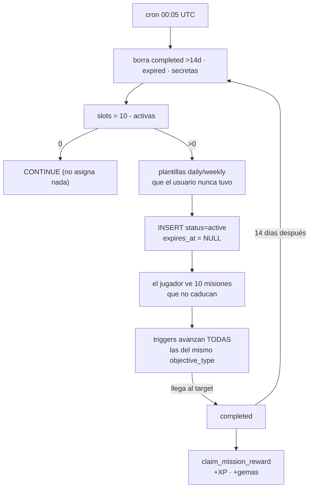
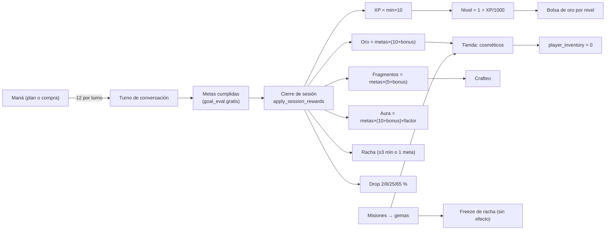

# 07 · Gameplay y mecánicas de juego

> Medido sobre `origin/master` del worktree `p14-ai-usage` (31-oct-2026).
> Todas las cifras de economía, misiones y recompensas se verificaron con
> consultas de **solo lectura** al proyecto `sipiumfdpvnszthykyog`.
> No se duplican: `docs/product-audit/06-GAMEPLAY-Y-GAMIFICACION.md`,
> `docs/runbooks/ECONOMY_SINKS.md` (sumideros y medición),
> `docs/runbooks/MIGRATION_STATUS.md`.

Etiquetas: `[IMPLEMENTADO]` · `[PARCIAL]` · `[CONCEPTUAL]` · `[PROPUESTA]` ·
`[PENDIENTE DE VALIDAR]`.

---

## 1. Capas de juego (y qué las mueve)

| Capa | Dato | Motor | Recompensa que la mueve |
|---|---|---|---|
| Nivel de cazador | `user_language_profiles.xp_points` | `economy_level(xp) = 1 + xp/1000` · `HunterLevel.xpPerLevel = 1000` | XP de sesión, XP de misión, XP de drop, recompensas de nivel |
| Rango del gremio | `user_language_profiles.game_rank` | `apply_placement_as` (servidor) | examen del Oráculo (placement o promoción) |
| Nivel CEFR | `cefr_level_id` | `apply_placement_as` | mismo examen |
| Aura (mérito) | `aura_xp`, `skill_radar` | `add_aura_xp` | cierre de sesión con metas cumplidas |
| Racha | `user_language_profiles.current_streak` | `register_practice` | sesiones de ≥3 min o ≥1 objetivo |
| Oro | `total_gold` | `apply_session_rewards` | sesión + bolsas de nivel |
| Gemas | `total_gems` | `claim_mission_reward`, recompensa diaria | misiones y racha |
| Fragmentos | `fragments` | `apply_session_rewards` | cierre de sesión |
| Maná | `mana_state` (RPC) | `consume_mana` en `llm-proxy` | plan / compra / elixires |
| Cosméticos | `player_inventory` | `purchase_cosmetic` / `craft_cosmetic` | oro, gemas, fragmentos |

Fuente del nivel: `HunterLevel.levelFor` (`lib/features/dashboard/domain/models/hunter_level.dart:16-19`)
y `economy_level` (SQL). Son la misma fórmula, duplicada en dos lenguajes.

---

## 2. Misiones

### 2.1 Plantillas `[IMPLEMENTADO]`

`mission_templates` = **35 filas**, 6 tipos de objetivo y 3 tipos de misión:

| `objective_type` | daily | weekly | secondary | `target_value` | XP | gemas |
|---|---:|---:|---:|---|---|---|
| `speak_minutes` | 10 | 2 | 9 | 1-25 | 20-400 | 2-75 |
| `conversation_turns` | 1 | 1 | 3 | 3-15 | 75-350 | 10-50 |
| `vocab_words` | 1 | 2 | – | 1-20 | 20-250 | 2-40 |
| `sessions` | 1 | 1 | 1 | 1-3 | 20-350 | 2-60 |
| `practice_session` | 1 | – | – | 1 | 60 | 10 |
| `listening_items` | 1 | 1 | – | 3-5 | 45-120 | 5-20 |
| **Total** | **15** | **7** | **13** | | | |

`item_reward` está **vacío en todas** las plantillas: ninguna misión entrega un
objeto, solo XP y gemas.

### 2.2 Qué ve el jugador `[PARCIAL]`

`MissionVisibility` (`lib/features/missions/domain/models/mission_visibility.dart:26-98`)
decide visibilidad y **alcanzabilidad**:

| Regla | Valor |
|---|---|
| Tipos visibles | solo `daily` y `weekly` (`:30`) |
| Objetivos que el servidor puede avanzar | `speak_minutes`, `conversation_turns`, `vocab_words`, `sessions`, `practice_session` (`:34-40`) |
| Techo diario | 10 min · 5 turnos · 5 palabras · 1 sesión (`:43-49`) |
| Techo semanal | 15 min · 15 turnos · 10 palabras · 3 sesiones (`:52-58`) |
| Ocultos | `secondary`, `secret`, `emergency`, `guild`, `collaborative`, `event` (`:61-68`) |

Los techos no son gusto: salen de la distribución real (auditoría del
29-oct-2026 citada en `:14-21`). Por eso las plantillas semanales de 25 min o 20
palabras se muestran como «no disponible» sin botón
(`mission_card.dart:151`, `:323-339`).

### 2.3 Cómo progresa una misión `[IMPLEMENTADO]`

Todo por trigger de servidor → `advance_missions_for_user(user, type, delta)`:

| Trigger | Objetivo que mueve |
|---|---|
| `on_message_advance_missions` (mensajes del alumno) | `conversation_turns` |
| `on_session_reward_advance_missions` | `sessions`, `practice_session`, `speak_minutes` |
| `on_vocabulary_advance_missions` | `vocab_words` |
| `on_vocabulary_review_advance_missions` | `vocab_words` |

`advance_missions_for_user` sube **todas** las instancias activas de ese
`objective_type` a la vez (`least(target_value, current + delta)`, marca
`completed`). No hay una misión “elegida”: si tienes 7 diarias, las 7 avanzan
con el mismo turno.

### 2.4 Rotación: lo que la UI promete y lo que hace el cron `[PARCIAL, discrepancia]`

`missions_screen.dart:122-123` promete «Renovación automática: 00:05 UTC».
El cron real (`rotate-daily-missions`, `5 0 * * *` → `missions-cron` →
`rotate_daily_missions`) hace:

1. Borra instancias `completed` con más de 14 días, `expired` y misiones secretas.
2. Calcula `v_slots := 10 - activas`.
3. Rellena con plantillas `daily`/`weekly` activas **que el usuario no haya
   tenido nunca** (`template_id NOT IN (… where user_id = …)`).
4. Inserta con `status = 'active'` y **sin `expires_at`**.

Consecuencias verificadas contra la BD:

| Hecho | Dato |
|---|---|
| Instancias totales | **637** |
| Instancias activas | **629** (442 diarias + 187 semanales) |
| Instancias completadas | **8** (todas reclamadas) |
| Instancias con `expires_at` | **0 de 637** |
| Instancias por usuario | 7 diarias + 3 semanales = **10** (máximo histórico 12) |

Es decir: **las misiones no se renuevan a diario**; se asignan una vez y
permanecen activas para siempre. Un usuario con 10 activas no recibe ninguna
nueva (`v_slots = 0 → CONTINUE`), y como `expires_at` es `null`, `isExpired`
nunca es `true` (`mission_models.dart:99`). El rótulo «misiones diarias» es una
etiqueta del tipo de plantilla, no un ciclo de reset.

### 2.5 Reclamo `[IMPLEMENTADO]`

`claim_mission_reward(p_instance_id)`:

- exige `status = 'completed'` y `is_reward_claimed = false`;
- multiplica por `reward_multiplier` (mínimo 1) — **columna siempre 1 en
  producción** (`0 de 637` filas con multiplicador ≠ 1);
- suma `xp_reward` a `xp_points` y `gem_reward` a **`total_gems`**;
- escribe `reward_history` con `source_type = 'mission'`.

`reward_history` tiene **8 filas**, todas de misión, con 20/50/100/80/300 XP y
2/5/20/10/50 gemas: las misiones son hoy la única fuente de XP que el jugador ha
reclamado manualmente.

**Inconsistencia de moneda:** la tarjeta dice «+X gemas» con icono de diamante
(`mission_card.dart:418-433`) y el RPC acredita `total_gems`. Pero el resto de
la economía habla de oro y fragmentos; el jugador recibe tres monedas distintas
según la pantalla.

### 2.6 Agujero de integridad `[PENDIENTE DE VALIDAR]`

`advance_my_missions(p_type, p_delta)` es `SECURITY DEFINER` y tiene
`EXECUTE` concedido a `authenticated`. Cualquier cliente autenticado puede
avanzar sus propias misiones con el delta que quiera y luego reclamar. No se
observó uso desde `lib/`, pero el permiso existe. `apply_session_rewards`,
`add_xp` y `add_gems` **no** son ejecutables por `authenticated` (invariante
correcta).

---

## 3. XP, niveles y recompensas de nivel

### 3.1 Fórmulas reales de `apply_session_rewards`

| Salida | Fórmula | Límites |
|---|---|---|
| XP | `minutos × 10` | `minutos` 0-240; `objetivos` 0-12 |
| Oro | `objetivos × (10 + bonus)` | bonus = 0 (PRE-A1/A1), 1 (A2), 2 (B1), 3 (B2), 4 (C1), 5 (C2) |
| Fragmentos | `objetivos × (5 + bonus)` | ídem |
| Idempotencia | `session_reward_ledger.session_id` único; repetir devuelve los importes originales con `duplicated: true` | — |
| Autorización | `auth.uid() = p_user_id`; la app **no** llama a esta RPC (no tiene `EXECUTE` para `authenticated`): entra por `close_session`, que sí está concedida y calcula objetivos/minutos desde la conversación | `has_function_privilege` |

### 3.2 Niveles

- 1 000 XP por nivel, nivel visible desde 1 (`hunter_level.dart:13-18`;
  `economy_level` en SQL).
- `level_rewards`: **6 filas** (niveles 2, 3, 5, 8, 12, 15) con bolsas de
  **100, 150, 250, 400, 600 y 800 de oro**. Se reclaman con
  `claim_level_rewards` (idempotente por `level_reward:<nivel>`).
- El catálogo de cosméticos exige `required_level` entre **1 y 20**.

### 3.3 La curva en la práctica

| Hecho medido | Dato |
|---|---|
| XP máximo por perfil | **3 263** → nivel 4 |
| Media de XP | 57 (65 perfiles) |
| Sesión más larga registrada | **240 minutos** → 2 400 XP (2,4 niveles de golpe) |
| Sesión con 0 objetivos y 240 min | 0 XP, 0 oro, 0 fragmentos (fila real del ledger) |

El tope de `p_minutes` no es un tope de recompensa por sesión razonable: acepta
4 horas y paga 10 XP/min, así que una sola sesión puede valer más que todo el
resto del historial de un jugador (3 263 XP acumulados). `[PARCIAL]`

---

## 4. Rangos F…SSS

Escala completa en `cefr_rank.dart:73` (9 rangos) y en `evaluate-placement`
(`RANK_SCALE`), con descripciones narrativas (`:38-48`: «Leyenda Suprema»,
«Deidad del Idioma»).

| Rango | CEFR que lo produce | Cómo se alcanza |
|---|---|---|
| F | PRE-A1 | placement, omitir el Oráculo |
| E | A1 | placement |
| D | A2 | placement |
| C | B1 | placement |
| B | B2 | placement |
| A | C1 | placement |
| S | C2 | placement |
| SS | — | **solo** si el modelo lo declara (o pista declarada a ±2) |
| SSS | — | ídem |

El mapeo CEFR→rango es de 7 a 7 (`_cefrToRank`, `:13-21`); `SS` y `SSS`
existen en la tabla inversa (`:33-34`) apuntando ambos a C2, sin peldaño propio.
En promoción, el rango del servidor es el que devolvió el modelo
(`rank = normalizeRank(evaluation?.game_rank)`) y solo se conserva el anterior si
el nivel no cambia. `[PARCIAL]`

---

## 5. Jefe de mazmorra (examen de promoción)

| Regla | Valor | Fuente |
|---|---|---|
| Desbloqueo | `objetivos ≥ 6` **o** `minutos ≥ 30` **o** `racha ≥ 2` | `boss_exam_status` |
| Requisito previo | perfil ya evaluado (`placement_assessed_at` no nulo) | `boss_exam_status` |
| Evidencia mínima | 5 respuestas y 25 palabras | `evaluate-placement` |
| Rúbrica | 6 dimensiones; media ≥ 65 y ninguna < 45 | `evaluate-placement` |
| Cooldown tras fallo | 12 h | `boss_exam_status` / Edge Function |
| Resultado | `promoted` · `maintained` · `initial` | `BossExamOutcome` |
| Aviso de revisión | cada 10 lecciones superadas (`check_due`) | `boss_exam_status` |
| Intentos en producción | **0** (`boss_exam_attempts`) | conteo |

El `level` de la query (`?mode=promotion&level=B1`) **no se usa** para decidir
nada en el cliente: es solo contexto visual; el servidor compara contra el
perfil real.

---

## 6. Racha y freezes

| Regla | Valor | Fuente |
|---|---|---|
| Cuenta como práctica | `objetivos ≥ 1` **o** `minutos ≥ 3` | `register_practice` |
| Zona horaria | `p_tz_offset_minutes` del cliente (clamp ±840) | `register_practice` |
| Reinicio | si `last_practice_date < hoy - 1` → racha = 1 | `register_practice` |
| Continuidad | si ayer → racha + 1 | ídem |
| Mismo día | mantiene la racha | ídem |
| Freeze de racha | **30 gemas**, tope **3** | `purchase_streak_freeze` |
| Consumo del freeze | **no existe** | ver abajo |

**Hallazgo grave:** `streak_freezes` solo lo leen `get_economy_wallet` (para
mostrarlo), `guard_player_streak_freezes` (para proteger la escritura) y
`purchase_streak_freeze` (para incrementarlo). **Ninguna función lo consume al
calcular la racha**: `register_practice` compara fechas y reinicia sin mirar los
freezes. Comprar un freeze por 30 gemas no protege nada. `[PARCIAL]`

Estado real: `player_streaks` = 52 filas, racha máxima **2**, freezes
comprados 0; `user_language_profiles.current_streak` máximo **1**.

---

## 7. Drop de sesión

`claim_session_drop(p_session_id, p_completed_goals)` — se dispara al abrir el
resumen, una vez por sesión (`session_drop_controller.dart:34-64`).

| Tirada (`floor(random()*100)`) | Rareza | Multiplicador | XP | Oro |
|---|---|---|---|---|
| 0-1 (2 %) | legendario | ×3,0 | 45 | 30 |
| 2-9 (8 %) | épico | ×2,0 | 30 | 20 |
| 10-34 (25 %) | raro | ×1,5 | 23 | 15 |
| 35-99 (65 %) | común | ×1,0 | 15 | 10 |

- Base: 15 XP y 10 oro. Valor esperado ≈ **18,8 XP y 12,5 oro** por sesión.
- Requisitos: `completed_goals > 0` y `session_id` real; si no, `no_goals` /
  `invalid_session`.
- Idempotente por `(user_id, session_id)`.
- En producción: **1** fila (`común`, 15 XP / 10 oro).

---

## 8. Cosméticos y tienda

| Dato | Valor |
|---|---|
| Catálogo | **40 objetos** en 8 categorías (`frame`, `title`, `aura`, `pet`, `emote`, `table_theme`, `consumable`, `relic`) |
| Precio en oro | 60-1 200 (solo `frame`, `title`, `aura`, `pet`, `emote`, `table_theme`) |
| Precio en gemas | 40-2 800 |
| Nivel requerido | 1-20 |
| Recetas de fragmentos | 3 objetos con 120, 250 y 400 fragmentos |
| Plan mínimo | columna `min_plan` (cosméticos exclusivos; error `plan_required`) |
| Compras históricas | **0** (`player_inventory` = 0 filas) |
| Movimientos de moneda | **0** (`currency_ledger` = 0 filas) |

Saldos reales (65 perfiles): oro medio **103** (máx. 180), gemas medias **3**
(máx. 96), fragmentos máximo **398**. Con esos saldos, el objeto más barato en
oro (60) es alcanzable; casi todo lo demás no. Ver
`docs/runbooks/ECONOMY_SINKS.md` §2-3 para el diagnóstico previo (idéntico).

---

## 9. Aprendizaje ↔ RPG: qué acción produce qué recompensa

Costes de `ai_action_costs` (7 filas, `cost_mana`):

| Acción | Maná | ¿Se cobra de verdad? |
|---|---:|---|
| `lesson_generation` | 100 | sí (tope 300 en `lesson-generator`) |
| `oracle_eval` | 30 | sí |
| `oracle_turn` | 15 | sí |
| `dungeon_turn` | 12 | sí |
| `free_chat_turn` | 8 | sí |
| `correction_turn` | 3 | **no**: `is_active = false` y está en `FREE_ACTIONS` |
| `vocabulary_curation` | 2 | sí, si `MANA_CHARGE_MODE ≠ off` |
| `goal_eval` | — | gratis (`FREE_ACTIONS`) |
| `carisma_eval` | — | gratis (`FREE_ACTIONS`) |
| `guild_chat` | — | gratis (`FREE_ACTIONS`) |
| `stt_transcribe` | — | gratis (`FREE_ACTIONS`) |

Tabla de conversión (cifras reales de las fórmulas, no estimaciones):

| Acción del alumno | Coste | XP | Oro | Fragmentos | Aura | Gemas | Otros |
|---|---:|---:|---:|---:|---:|---:|---|
| Turno de lección (`dungeon_turn`) | 12 | — | — | — | — | — | avanza `conversation_turns` |
| Cerrar sesión de 10 min, 4 metas, B1 | — | **100** | **48** | **28** | **48**¹ | — | racha +1, drop |
| Cerrar sesión de 240 min, 1 meta | — | **2 400** | 10 | 5 | 10 | — | tope de minutos |
| Drop de sesión (esperado) | 0 | 18,8 | 12,5 | — | — | — | 1 vez por sesión |
| Misión diaria típica (`speak_minutes` 5) | 0 | 50-75 | — | — | — | 5-10 | trigger de servidor |
| Misión semanal típica (`sessions` 3) | 0 | 350 | — | — | — | 60 | ídem |
| Recompensa diaria (racha <7) | 0 | — | — | — | — | 5 | +2 «pergaminos» |
| Recompensa diaria (racha ≥30) | 0 | — | — | — | — | 300 | +15 «pergaminos» |
| Subir de nivel 2/3/5/8/12/15 | 0 | — | 100/150/250/400/600/800 | — | — | — | `claim_level_rewards` |
| Repasar vocabulario | 0 | — | — | — | — | — | `vocabulary_reviews`, retención |
| Escuchar (A1-B1) | 0 | — | — | — | — | — | `listening_attempts` |
| Examen del Oráculo (placement) | 15/turno + 30 | — | — | — | — | — | nivel y rango |
| Examen del jefe | 15/turno + 30 | — | — | — | — | — | `boss_exam_attempts` |

¹ `add_aura_xp`: `round(metas × (10 + bonus) × factor)`, con
`factor = clamp(radar_medio / 50, 0,2 … 2,0)`. Con radar medio 50 y B1 (bonus 2):
4 × 12 × 1 = 48.

---

## 10. Los cinco huecos más graves (resumen de este documento)

| # | Promesa de la narrativa | Mecánica real | Evidencia |
|---|---|---|---|
| 1 | «Misiones que se renuevan cada día a las 00:05 UTC» | El cron asigna 10 plantillas **una vez**, sin `expires_at`; no hay reset ni reemplazo mientras sigan activas | `rotate_daily_missions`; 637/637 sin `expires_at`; `missions_screen.dart:122-123` |
| 2 | «Cada mazmorra da su recompensa (nodo con +100 XP / +15 gemas)» | El nodo pinta cifras fijas; el pago real depende de minutos y metas de la sesión, y **no hay gemas por lección** | `learning_path_roadmap.dart:707-708` vs `apply_session_rewards` |
| 3 | «El jefe de mazmorra mide tu progreso en el currículo» | Se desbloquea con 6 objetivos, 30 min o 2 días de racha; `lessons_passed` es informativo; 0 intentos en producción | `boss_exam_status` |
| 4 | «Compra freezes para no perder la racha» | El freeze se cobra (30 gemas) y se guarda, pero **ninguna** función lo consume: la racha se reinicia igual | `purchase_streak_freeze` vs `register_practice`; `streak_freezes` solo en 3 funciones (ninguna de racha) |
| 5 | «Gana gemas y gástalas en la tienda» | Las gemas entran por misiones y recompensa diaria, pero el catálogo exige hasta 2 800 y el saldo máximo real es 96; 0 compras y 0 movimientos de moneda | `reward_history` (8), `player_inventory` (0), `currency_ledger` (0), `cosmetic_catalog` |

Huecos secundarios: XP sin tope práctico (240 min → 2 400 XP); rangos SS/SSS
sin peldaño; `advance_my_missions` ejecutable por el cliente; «pergaminos»
entregados sin consumidor (`docs/runbooks/ECONOMY_SINKS.md:133-135`).

---

## 11. Lo no verificable

| Afirmación | Por qué no se puede comprobar |
|---|---|
| Si el cobro de maná está activo para todas las builds | `MANA_CHARGE_MODE` es un secreto de la Edge Function (`off`/`capability`/`all`); con `capability` solo cobra a quien declare `server_mana` (la app lo declara: `conversation_repository_impl.dart:151`) |
| Número real de misiones “diarias” que un usuario ve completables | Depende de la CEFR de cada perfil y de los techos; el cálculo está en `MissionVisibility` y no se ejecutó para cada usuario |
| Efecto de la banda adaptativa en la tasa de “failed” | Requiere sesiones reales con metas evaluadas; en BD hay 32 filas de `lesson_progress` (muestra pequeña) |
| Si los 0 drops/boss/listening son por falta de uso o por fallo | Los conteos son 0/1; no hay logs de error asociados consultables desde aquí |
| Valor de `prestige_title_code` y su efecto | `compute_prestige_title` existe, pero no se auditó su tabla de títulos |
