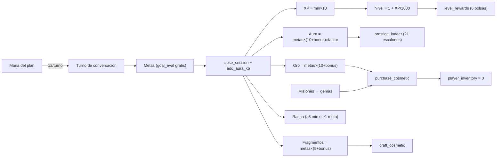
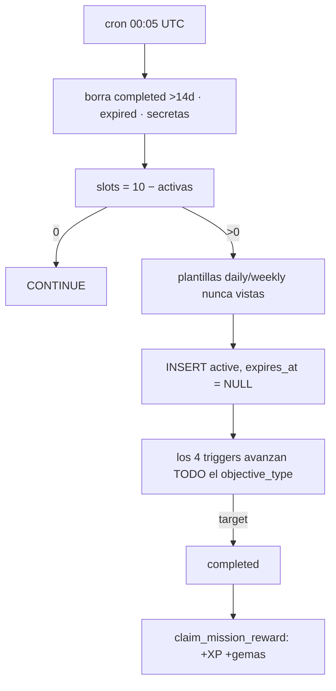

# 07 · Gameplay y mecánicas de juego (A4)

> Medido el **31-oct-2026** sobre `origin/master` del worktree `p14-ai-usage`
> y contra producción `sipiumfdpvnszthykyog` con consultas de **solo lectura**
> (MCP `supabase`). Baseline: [_baseline.md](_baseline.md). Decisiones:
> [_decisions.md](_decisions.md).
>
> No se duplica lo ya auditado: `docs/product-audit/06-GAMEPLAY-Y-GAMIFICACION.md`,
> `docs/runbooks/ECONOMY_SINKS.md` (sumideros), `08-guild-and-social-system.md`
> (gremio social), `10-economy-and-resources.md` (misma materia en clave
> económica) y `22-hardcoded-inventory.md` (dónde vive cada cifra).
>
> Etiquetas: `[HECHO]` (verificado en código o BD) · `[INFERENCIA]` (deducido de
> la evidencia) · `[PROPUESTA]` · `[PENDIENTE DE VALIDAR]`.

---

## 1. Los bucles reales

El producto promete «aprendizaje primero, el juego es el motor» (D-02). Hay
**tres bucles** en el código y solo uno está cerrado de punta a punta.

| Bucle | Entrada | Motor | Salida | ¿Cerrado? |
|---|---|---|---|---|
| **A · Conversación** | maná | `llm-proxy` → turno de IA (`dungeon_turn` 12) | metas evaluadas, correcciones, XP/oro/fragmentos/aura al cerrar | `[HECHO]` sí, con dos defectos (§7, §9) |
| **B · Misión** | triggers de servidor | `advance_missions_for_user` | `claim_mission_reward` → XP + gemas | `[HECHO]` sí, pero sin caducidad ni rotación real (§4) |
| **C · Prestigio** | aura | `add_aura_xp` → `compute_prestige_title` | título de 21 escalones | `[HECHO]` abierto: 60 de 65 perfiles con `prestige_title_code = null` y el máximo de aura es **35** |
| **D · Gasto** | oro / gemas / fragmentos | `purchase_cosmetic`, `craft_cosmetic`, `purchase_streak_freeze` | cosméticos | `[HECHO]` **sin uso**: `player_inventory` = 0 filas |



---

## 2. Recursos: fuentes, sumideros y cifras

Saldos reales de **65** perfiles (`user_language_profiles`):

| Recurso | Vive en | Fuente (con cifra) | Sumidero (con cifra) | Saldo real |
|---|---|---|---|---|
| **Maná** | `user_subscriptions.used_audio_seconds` (+`purchased_mana_balance`) | plan mensual: 3.000 / 17.000 / 20.500 | turnos de IA: 2–100 por acción (`ai_action_costs`) | 3.298 consumidos en ~100 días (13 usuarios) |
| **Oro** | `total_gold` | `close_session` = `metas×(10+bonus)`; `claim_session_drop` = `10×rareza`; `claim_level_rewards` = 100…800 | `purchase_cosmetic` 60–1.200 | media **103**, máx **180** |
| **Gemas** | `total_gems` | `claim_mission_reward` = 2…75; recompensa diaria (rota, §10) | freeze 30; cosméticos 40–2.800 | media **3**, máx **96** |
| **Fragmentos** | `fragments` | `close_session` = `metas×(5+bonus)` | `craft_cosmetic` 120/250/400 | máx **398** |
| **XP** | `xp_points` | `close_session` = `min×10`; drop `15×rareza`; misión 20…400 | no se gasta | media **57**, máx **3.263** |
| **Aura** | `aura_xp` | `add_aura_xp` = `metas×(10+bonus)×factor` | no se gasta | máx **35**; total histórico **63** en 12 sesiones premiadas |
| **Pergaminos** | `player_daily_state.pergaminos_max` | recompensa diaria 2/5/8/15; consumibles | no hay consumidor | **0** filas en `player_pergaminos` |
| **Invocaciones** | `player_daily_state.invocations_max` | 20 base + `(racha/7)×5` | `useInvocation` (nunca se llama) | cuota **muerta** |

`[HECHO]` El único recurso con sumidero real y usado es el **maná**
(222 filas en `mana_transactions`). El oro, las gemas y los fragmentos entran
pero no salen: `player_inventory` = 0 y `currency_ledger` = 0.

`[INFERENCIA]` El jugador no tiene nada que comprar que cambie su experiencia:
40 cosméticos sin efecto mecánico y **23 «consumibles» heredados** (libros,
llaves, modificadores, skins) que ninguna función lee.

---

## 3. Rangos, títulos y aura (tres escalas distintas)

### 3.1 Rango del gremio F…SSS `[HECHO]`

Escala en `lib/features/onboarding/domain/models/cefr_rank.dart:73`
(`['F','E','D','C','B','A','S','SS','SSS']`) y en
`supabase/functions/evaluate-placement/index.ts:33` (`RANK_SCALE`).

| Rango | CEFR que lo produce | Cómo se alcanza | ¿Alcanzable hoy? |
|---|---|---|---|
| F | PRE-A1 | placement u omitir el Oráculo | sí |
| E | A1 | placement | sí |
| D | A2 | placement | sí |
| C | B1 | placement | sí |
| B | B2 | placement | sí |
| A | C1 | placement | sí |
| S | C2 | placement | sí |
| SS / SSS | — | solo si el modelo los declara (`+2` de tolerancia) | `[INFERENCIA]` improbable: el prompt mapea C2→S |

`[HECHO]` Descripciones narrativas por rango en `cefr_rank.dart:38-48`
(«Leyenda Suprema», «Deidad del Idioma»): **no existen en BD**.

### 3.2 Título de prestigio (21 escalones) `[HECHO]`

Tabla `prestige_ladder` (**21 filas**, sembrada en
`supabase/migrations/20260813_mana_aura_redesign.sql:485-508`). Sube con
`aura_xp` **y** `min_radar` **y** techo de clase:

| Tramo | Escalones | Aura necesaria | Radar mín. | Techo por plan |
|---|---|---:|---:|---|
| Común | Aventurero → Leyenda (1-7) | 0 → 12.000 | 0 → 65 | **Plebeyo** |
| Noble | Barón → Gran Duque (8-13) | 16.000 → 53.000 | 70 → 82 | **Noble** |
| Real | Príncipe → Ascendido (14-21) | 66.000 → 260.000 | 84 → 98 | **Realeza** |

Techo aplicado en `compute_prestige_title` (`prestige_ladder.ceiling_class` vs
`subscription_plans.class_name`, `20260813_mana_aura_redesign.sql` §3.6):

```sql
v_class_rank := CASE v_class WHEN 'realeza' THEN 2 WHEN 'noble' THEN 1 ELSE 0 END;
... AND CASE ceiling_class WHEN 'plebeyo' THEN 0 WHEN 'noble' THEN 1 ELSE 2 END <= v_class_rank
```

Estado real: **5** perfiles en `aventurero`, **60** en `null`, ninguno por
encima. Aura máxima **35** contra los **500** del segundo escalón.

### 3.3 Títulos de habilidad (24) `[HECHO, duplicado]`

`lib/features/dashboard/data/models/hunter_skill_titles.dart:91-122` define 24
títulos (6 líneas × 4 tiers) con nombre, descripción y umbral. La tabla
`hunter_titles` de BD contiene **las mismas 24 filas** (mismos códigos, nombres
y umbrales) y **ninguna función la lee**. Los umbrales están **una tercera vez**
en `title_evaluator.dart:13-20`.

| Línea | Umbrales (tier 1→4) | Efecto |
|---|---|---|
| fluidez | 60 / 75 / 88 / 95 | ninguno |
| fonetica | 55 / 70 / 85 / 94 | ninguno |
| lexico | 20 / 80 / 200 / 500 | ninguno |
| precision | 50 / 70 / 85 / 94 | ninguno |
| constancia | 3 / 7 / 30 / 100 (días) | ninguno |
| carisma | 55 / 70 / 85 / 94 | ninguno |

`[INFERENCIA]` Es la señal de prestigio más visible del perfil
(`user_titles` = 12 filas, 5 usuarios) y a la vez la que menos gobierno tiene:
la otorga el **cliente** (`dashboard_repository_impl.dart:936`) calculando los
umbrales en Dart.

### 3.4 Aura: dos mecanismos distintos con el mismo nombre `[HECHO]`

| Mecanismo | Dónde | Qué hace |
|---|---|---|
| `aura_xp` | SQL `add_aura_xp` | mérito acumulable, sin techo; idempotente por sesión; mueve `prestige_title_code` |
| `AuraSystem.computePower` | `lib/features/dashboard/domain/models/aura_system.dart:126-150` | poder 0–1 **solo visual**: 0,25 fluidez + 0,25 vocab + 0,20 fonética + 0,10 gramática + 0,10 metas + 0,05 racha + 0,05 rango |
| `AuraTier` | `:153-159` | 5 tiers por cortes 0,25 / 0,45 / 0,65 / 0,85 (no persistidos) |

Los pesos del «poder» son parámetros de balance en Dart sin equivalente en BD.

---

## 4. Todas las fuentes de misión y quién las produce

`[HECHO]` Hay **siete** fuentes declaradas y **dos** producen filas.

| # | Fuente | Tabla (filas) | Productor | Estado |
|---|---|---|---|---|
| 1 | Plantillas diarias/semanales | `mission_templates` (35) | migraciones (seed) | activo |
| 2 | Rotación diaria | `mission_instances` (637) | cron `rotate-daily-missions` (00:05 UTC) → `missions-cron` → `rotate_daily_missions` | activo, **sin `expires_at`** |
| 3 | Contratos del gremio | `guild_quest_pool` (**199** activas: 29 `daily`, 138 `weekly`, 32 `collaborative`) | seed de migración; **nadie los asigna** | **sin UI**: `getGuildQuestPool` no se usa en ninguna pantalla |
| 4 | Contrato aceptado | `mission_instances` con `quest_id` (**2**) | cliente `acceptGuildQuest` (`mission_repository.dart:506`) | residual |
| 5 | Misión colaborativa / raid | `guild_collaborative_missions` (**0**) | ninguno | vacío |
| 6 | Evento global | `global_events` (**0**), `player_event_progress` (0) | ninguno | vacío |
| 7 | Secretas y de emergencia | `secret_missions` (0), `emergency_missions` (0) | cliente (`mission_repository.dart:307`, `:329`) | vacío |

### 4.1 Contraste con G-01 (tres capas) `[HECHO]`

| Capa de G-01 | Existe en BD | Llega al jugador |
|---|---|---|
| Del día | `mission_templates` daily (15) + weekly (7) | sí, en 2 pestañas (Diarias / Semanales) |
| Contratos del gremio | `guild_quest_pool` 199 | **no**: no hay pantalla ni tablón; solo 2 instancias históricas |
| Evento semanal | `guild_collaborative_missions` + `global_events` | **no**: 0 filas |

`[INFERENCIA]` La institución central de D-01 (el gremio) produce hoy **2 de
las 637 instancias** (0,3 %). Las misiones que el jugador ve son 100 % del cron.

### 4.2 Plantillas `[HECHO]`

| `objective_type` | daily | weekly | secondary | `target_value` | XP | gemas |
|---|---:|---:|---:|---|---|---|
| `speak_minutes` | 10 | 2 | 9 | 1-25 | 20-400 | 2-75 |
| `conversation_turns` | 1 | 1 | 3 | 3-15 | 75-350 | 10-50 |
| `vocab_words` | 1 | 2 | – | 1-20 | 20-250 | 2-40 |
| `sessions` | 1 | 1 | 1 | 1-3 | 20-350 | 2-60 |
| `practice_session` | 1 | – | – | 1 | 60 | 10 |
| `listening_items` | 1 | 1 | – | 3-5 | 45-120 | 5-20 |
| **Total** | **15** | **7** | **13** | | | |

- `item_reward` está **vacío en las 35**: ninguna misión entrega objeto.
- Las 13 `secondary` **no se asignan nunca** (el cron solo inserta
  `daily`/`weekly`).
- `reward_multiplier` es **1 en las 637 instancias**.

### 4.3 Progreso y reclamo `[HECHO]`

Los triggers de servidor llaman `advance_missions_for_user(user, type, delta)`,
que sube **todas** las instancias activas de ese `objective_type` a la vez:

| Trigger | Objetivo |
|---|---|
| `on_message_advance_missions` | `conversation_turns` |
| `on_session_reward_advance_missions` | `sessions`, `practice_session`, `speak_minutes` |
| `on_vocabulary_advance_missions` | `vocab_words` |
| `on_vocabulary_review_advance_missions` | `vocab_words` |

Estado: **629 activas / 8 completadas (1,26 %) / 0 con `expires_at`**. Las 8
completadas están reclamadas (`reward_history` = 8 filas).

### 4.4 Rotación: promesa vs. realidad `[HECHO]`

`missions_screen.dart:122-123` anuncia «Renovación automática: 00:05 UTC». El
cron borra completadas >14 días, calcula `slots = 10 − activas`, rellena con
plantillas que el usuario **no haya tenido nunca** e inserta `status='active'`
**sin `expires_at`**. Con 10 activas, `slots = 0` y no entra nada más: las
«diarias» no se renuevan.



---

## 5. Gremio (mecánica, no sociabilidad)

La capa social está en `08-guild-and-social-system.md`. Aquí, solo lo que
**produce juego**:

| Pieza | Tabla/archivo | Filas | Efecto mecánico |
|---|---|---|---|
| Tablón de contratos | `guild_quest_pool` | 199 | **ninguno** (sin UI; `acceptGuildQuest` sin llamador) |
| Contratos aceptados | `mission_instances.quest_id` | 2 | cuota propia de **3** simultáneas (`mission_repository.dart:15`) |
| Gate de rango del contrato | `CefrRank.canAcceptRank` | — | solo cliente (`mission_repository.dart:522`) |
| Raid colaborativa | `guild_collaborative_missions` | 0 | contador en la sala de gremio |
| Anuncios | `guild_announcements` | 4 | texto |
| Maestre (NPC) | `guild_master_floating_banner.dart:133` | — | prompt/persona fija en Dart |
| Battle pass de gremio | `guild_battle_pass` | 23 | **retirado por D-04**; sigue en BD y en `economy_repository_impl.dart:515-524` |

`[HECHO]` El jugador **no puede** llegar al tablón: la ruta de contratos no
está en `router.dart` ni hay tab en `missions_screen.dart` (solo 2 pestañas).

---

## 6. Qué recibe hoy cada estamento (capacidades **aplicadas**)

`[HECHO]` La única palanca real es `subscription_plans.class_name` + tres
columnas. Todo lo demás que anuncia el paywall es texto.

| Capacidad | Plebeyo | Noble | Realeza | Dónde se aplica de verdad |
|---|---|---|---|---|
| Maná/mes | 3.000 | 17.000 | 20.500 | `subscription_plans.mana_allowance` → `consume_mana` |
| Tope diario | 200 | sin tope | sin tope | `IF v_plan_id = 'plebeyo'` en `consume_mana` (la columna `daily_limit` es 200 también en noble, pero no se evalúa) |
| Turno de gracia | 1/día | — | — | `claim_mana_grace` (solo `service_role`) |
| Semanas de informe | 1 | 4 | 52 | `plan_weekly_report_weeks` dentro de `get_weekly_report` |
| Techo de prestigio | escalón 7 | escalón 13 | escalón 21 | `compute_prestige_title` |
| Cosméticos exclusivos | 0 | 0 | **2** (`title_leyenda_viva`, `aura_sombras`) | `cosmetic_catalog.min_plan` + `has_plan_tier` |
| Trial anunciado | 0 días | 7 días | 0 días | `subscription_plans.trial_days` (solo UI) |
| Misiones extra / slots | — | — | — | **no existe** |
| Mesas de voz / chat | igual | igual | igual | sin gate por plan |
| Ejercicios o modos extra | — | — | — | **no existe** |

`[INFERENCIA]` **NOBLE y REALEZA solo se diferencian en tres cosas medibles**:
+3.500 de maná, informe de 4→52 semanas y +8 escalones de prestigio. Los
«títulos y auras exclusivos de REALEZA» son **2 ítems** (2.800 y 2.300 gemas)
frente a un saldo máximo real de 96 gemas: inalcanzables.

`[HECHO]` Suscripciones en producción: **14 plebeyo + 1 noble, 0 realeza**.

---

## 7. Coste de IA por acción (cifras reales, no estimaciones)

### 7.1 Precio en maná `[HECHO]`

`ai_action_costs` (7 filas):

| Acción | Maná | ¿Cobra? |
|---|---:|---|
| `lesson_generation` | 100 | sí (tope 300 en `lesson-generator`) |
| `oracle_eval` | 30 | sí |
| `oracle_turn` | 15 | sí |
| `dungeon_turn` | 12 | sí |
| `free_chat_turn` | 8 | sí |
| `correction_turn` | 3 | **no** (`is_active=false` + `FREE_ACTIONS`) |
| `vocabulary_curation` | 2 | sí |

Gratis además por `FREE_ACTIONS` (`llm-proxy/validation.ts:23-29`):
`goal_eval`, `carisma_eval`, `guild_chat`, `stt_transcribe`.

### 7.2 Coste real en dólares `[HECHO]`

`ai_usage_logs` = **54 filas**, 9 acciones:

| Acción | Maná | Llamadas | $ medio | $ máx | $ total |
|---|---:|---:|---:|---:|---:|
| `dungeon_turn` | 12 | 13 | 0,000210 | 0,000402 | 0,0025 |
| `oracle_turn` | 15 | 8 | 0,000340 | 0,000394 | 0,0027 |
| `oracle_eval` | 30 | 3 | 0,000812 | 0,000847 | 0,0024 |
| `goal_eval` | **0** | 6 | **0,000707** | 0,000932 | 0,0042 |
| `carisma_eval` | **0** | 3 | 0,000212 | 0,000279 | 0,0006 |
| `vocabulary_curation` | 2 | 3 | 0,000517 | 0,000786 | 0,0016 |
| `free_chat_turn` | 8 | 1 | 0,000022 | 0,000022 | 0,0000 |
| `guild_chat` | **0** | 1 | 0,000166 | 0,000166 | 0,0002 |
| `stt_transcribe` | **0** | 16 | 0,000048 | 0,000150 | 0,0008 |
| `lesson_generation` | 100 | 0 | — | — | — |

Dos lecturas que importan:

1. `[HECHO]` **El 38,7 % del gasto de IA ($0,0058 de $0,0150) se factura a 0
   de maná** (`goal_eval` + `carisma_eval` + `guild_chat` + `stt_transcribe`).
   `goal_eval` es la segunda llamada más cara por turno y es gratis.
2. `[HECHO]` **`vocabulary_curation` es la acción más caras por unidad de
   maná**: 2 de maná por $0,000517 = **$0,00026/maná**, 15× la tarifa del
   `dungeon_turn` ($0,0000175/maná).

`[INFERENCIA]` El maná no mide coste: mide ritmo. Cualquier decisión de
«sostenibilidad» basada en el precio del maná está mirando el eje equivocado.

---

## 8. Tabla de conversión acción → recompensa `[HECHO]`

| Acción del alumno | Coste maná | XP | Oro | Frag. | Aura | Gemas | Otros |
|---|---:|---:|---:|---:|---:|---:|---|
| Turno de lección (`dungeon_turn`) | 12 | — | — | — | — | — | avanza `conversation_turns` |
| Cerrar sesión 10 min / 4 metas / B1 | — | **100** | **48** | **28** | **48** | — | racha +1, drop |
| Cerrar sesión 240 min / 1 meta | — | **2.400** | 10 | 5 | 10 | — | tope de minutos |
| Drop de sesión (esperado) | 0 | 18,8 | 12,5 | — | — | — | 1 por sesión |
| Misión diaria `speak_minutes` 5 | 0 | 50-75 | — | — | — | 5-10 | trigger de servidor |
| Misión semanal `sessions` 3 | 0 | 350 | — | — | — | 60 | idem |
| Recompensa diaria (racha <7) | 0 | — | — | — | — | 5 (no paga) | +2 pergaminos |
| Recompensa diaria (racha ≥30) | 0 | — | — | — | — | 300 (no paga) | +15 pergaminos |
| Nivel 2/3/5/8/12/15 | 0 | — | 100/150/250/400/600/800 | — | — | — | `claim_level_rewards` |
| Repaso SRS | 0 | — | — | — | — | — | sin IA (D-06 ok) |
| Listening | 0 | — | — | — | — | — | TTS del dispositivo |
| Examen del Oráculo | 15/turno + 30 | — | — | — | — | — | nivel y rango |
| Examen del jefe | 15/turno + 30 | — | — | — | — | — | 0 intentos en BD |

`Aura`: `round(metas × (10 + bonus) × factor)`, `factor = clamp(radar_medio/50,
0,2…2,0)`. Con radar 50 y B1: `4 × 12 × 1 = 48`.

---

## 9. Agujeros de integridad del bucle de misión `[HECHO]`

La cadena de custodia de una misión tiene **tres eslabones abiertos**:

| Eslabón | Estado | Evidencia |
|---|---|---|
| Crear instancia | `authenticated` puede `INSERT` en `mission_instances` (política `insert_own_instances`) | `pg_policies` |
| Blindaje del trigger | `guard_mission_instance` fuerza `status='active'`, `current_value=0`, `is_reward_claimed=false`… **pero no toca `xp_reward` ni `gem_reward`** | definición de `guard_mission_instance` |
| Avanzar | `advance_my_missions(p_type, p_delta)` es `SECURITY DEFINER` con `EXECUTE` a `authenticated` y **sin tope superior** del delta | `routine_privileges`; sin `least(p_delta` en el cuerpo |

`[INFERENCIA]` Cadena de abuso: insertar una misión propia con
`xp_reward=99.999` → avanzarla con `advance_my_missions('sessions',1)` →
`claim_mission_reward` la paga (el reclamo escribe saldo con `UPDATE` directo,
saltándose `guard_language_profile`). **No se observó uso en `lib/`**, pero el
permiso existe y no hay límite de recompensa.

`[HECHO]` Permisos relacionados: `increment_pergaminos_max` (authenticated, sin
tope), `spend_currency`/`spend_gems` (PUBLIC), `purchase_streak_freeze`
(PUBLIC/anon), `consume_mana` (anon).

---

## 10. Los siete huecos más graves (resumen)

| # | Promesa | Mecánica real | Evidencia |
|---|---|---|---|
| 1 | «Misiones del gremio en 3 capas» (G-01) | 2 de 637 instancias del gremio; 199 contratos invisibles; raids y eventos en 0 | `guild_quest_pool` 199 / `quest_id` 2 / `guild_collaborative_missions` 0 |
| 2 | «Renovación diaria a las 00:05» | 10 plantillas asignadas una vez, sin `expires_at`; no hay reset | `rotate_daily_missions`; 637/637 sin `expires_at` |
| 3 | «La mazmorra da +100 XP y +15 gemas» | El nodo pinta cifras fijas; no hay gemas por lección | `learning_path_roadmap.dart:707-708` |
| 4 | «Compra freezes para no perder la racha» | Se cobra y se guarda; **ninguna** función lo consume | `purchase_streak_freeze` vs `register_practice` |
| 5 | «Títulos exclusivos de REALEZA» | 2 ítems a 2.300-2.800 gemas con saldo máximo de 96 | `cosmetic_catalog.min_plan`; `total_gems` |
| 6 | «Aura y prestigio» | 21 escalones; el máximo de aura es 35 (escalón 1) | `prestige_ladder`; `max(aura_xp)=35` |
| 7 | «Recompensa diaria por racha» | `add_gems` sin EXECUTE para `authenticated`; falla en silencio | `routine_privileges`; `economy_repository_impl.dart:242` |

Huecos secundarios: XP sin tope práctico (240 min → 2.400 XP); SS/SSS sin
peldaño propio; `advance_my_missions` ejecutable por el cliente; 23
consumibles sin efecto; `DropLoot.roll` y `useInvocation` son código muerto.

---

## 11. No verificable

| Afirmación | Por qué | Qué falta |
|---|---|---|
| Si `MANA_CHARGE_MODE` cobra en todas las builds | Es secreto de la Edge Function (`capability` por defecto) | Valor del secreto en producción |
| Cuántas «diarias» ve completables cada usuario | Depende de CEFR y de los techos de `MissionVisibility` | Ejecutar el cálculo por perfil |
| Si los 0 intentos de jefe / 0 raids son falta de uso o fallo | Los conteos son 0 y no hay logs asociados consultables | Logs de `evaluate-placement` y del cron |
| Efecto del turno de gracia en retención | Se ha usado 1 vez | Más uso real |
| Valor real de los 21 títulos de prestigio | `compute_prestige_title` existe; nadie pasó del escalón 1 | Uso con aura > 500 |
