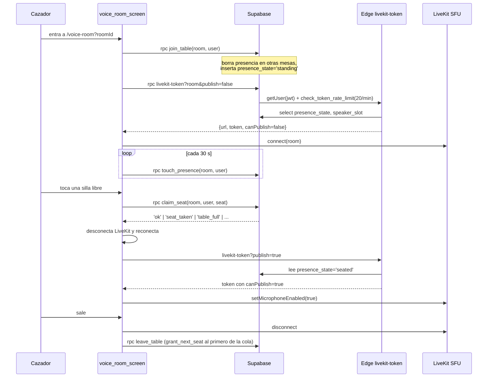

# 08 · Gremio y sistema social

> Medido el 31-oct-2026 sobre `origin/master` del worktree `p14-ai-usage`
> (código) y contra producción `sipiumfdpvnszthykyog` (solo lectura, MCP
> `supabase`). Baseline común: [_baseline.md](_baseline.md).
>
> Decisión de producto ya tomada sobre este módulo: **P-48** en
> [../PROPUESTA-P44-P48.md](../PROPUESTA-P44-P48.md) §P-48 (conservar salas de
> voz, ocultar misiones de gremio, no borrar tablas). Este documento **mide**
> qué hay detrás de esa decisión; no la reabre.

---

## 1. Resumen ejecutivo

El "gremio" no es un sistema social: es **una pantalla de lobby con seis mesas
vacías**, un chat de texto que nunca se ha usado y una sala de voz funcional a
la que nadie ha entrado. Todo lo demás (misiones colaborativas, trofeos, raid
semanal, battle pass de gremio) es **andamiaje con datos semilla** que la UI
pinta como si existiera.

| Pieza | Estado | Evidencia |
|---|---|---|
| Salas de voz LiveKit (audio real, sillas, cola) | `[IMPLEMENTADO]` | `voice_room_screen.dart:92-121`, `20260811_guild_table_states.sql` |
| Lobby de mesas + ocupación en vivo | `[IMPLEMENTADO]` | `chat_rooms_screen.dart:736-900` |
| Chat de texto dentro de la mesa | `[PARCIAL]` — escribe, nunca se ha usado | `chat_room_messages` = **0 filas** |
| Presencia "N conectados" | `[PARCIAL]` — real pero vacía | `chat_room_participants` = **0 filas** |
| Moderación (expulsar de la silla) | `[IMPLEMENTADO]` | `moderator_stand` en `20260811_guild_table_states.sql` |
| Moderación de contenido / reportes / bloqueo | `[CONCEPTUAL]` — no existe | sin tabla `report`, `block`, `ban` |
| "Moderador IA" de la mesa | `[CONCEPTUAL]` — solo una etiqueta | `moderator_type='ai'`, `has_ai_moderator=true`, ningún proceso lo ejecuta |
| Misiones de gremio colaborativas | `[CONCEPTUAL]` | `guild_collaborative_missions` = **0 filas**, sin RPC de reclamo |
| Pool de misiones del gremio (199) | `[CONCEPTUAL]` — código muerto | `getGuildQuestPool` / `acceptGuildQuest` **sin llamadas en la app** |
| Trofeos de gremio | `[CONCEPTUAL]` — siempre bloqueados | umbral ≥1 raid completado; raids = 0 |
| Battle pass de gremio ("prestigio") | `[PARCIAL]` — nunca avanza | 23 filas, todas `level=1`, `xp_progress=0` |
| Coste de maná por minuto en sala | `[CONCEPTUAL]` — `mana_cost_per_min = 0` y nadie lo cobra | `chat_rooms.mana_cost_per_min` |

---

## 2. Qué existe de verdad: mapa

### 2.1 Rutas

| Ruta | Pantalla | Archivo |
|---|---|---|
| `/chat-rooms` | Salón del Gremio (lobby) | `lib/features/chat_rooms/presentation/screens/chat_rooms_screen.dart` |
| `/voice-room?roomId=` | Mesa de voz LiveKit | `lib/features/chat_rooms/presentation/screens/voice_room_screen.dart` |

Registradas en `lib/app/router.dart`. No hay ruta de "perfil de otro jugador",
ni de amigos, ni de reportes: el grafo social no tiene pantalla.

### 2.2 Tablas

| Tabla | Filas en producción | Rol real |
|---|---|---|
| `chat_rooms` | **6** (semilla) | Catálogo de mesas |
| `chat_room_participants` | **0** | Presencia + silla |
| `chat_room_messages` | **0** | Chat de texto |
| `seat_requests` | **0** | Cola FIFO de silla |
| `guild_announcements` | **4** (semilla, texto fijo) | Banner rotativo |
| `guild_collaborative_missions` | **0** | "Raid" colaborativa |
| `guild_quest_pool` | **199** | Pool de misiones (nunca mostrado) |
| `guild_battle_pass` | **23** (todas nivel 1) | Chip de "prestigio" |
| `user_presence` | **1** | Sección actual del usuario (analítica, no social) |

Las 6 mesas tienen `room_type = 'discussion'`
(`select room_type from chat_rooms` → 6/6), valor que **no está entre las
opciones que ofrece el diálogo de creación** (`ai_practice`, `mentorship`,
`event` — `chat_rooms_screen.dart:397-401`). La UI cae en el `else` y las
etiqueta como `IA` (`chat_rooms_screen.dart:815-828`).

---

## 3. ¿Taberna/mesa o chat genérico?

**Veredicto: hoy es un lobby de voz con un chat genérico incrustado.** Lo que
lo separa de un chat cualquiera es únicamente la **geometría de 8 sillas**
(audio restringido al que se sienta) y el **chat de texto como cámara
secundaria**. Nada más.

### 3.1 Lo que sí es "mesa" (y no un chat)

| Mecánica | Dónde | Por qué importa |
|---|---|---|
| 8 sillas + audiencia ilimitada (8 de pie) | `chat_rooms.max_seats=8`, `max_standing=8` (`20260811_guild_table_states.sql:13-15`) | Crea "escenario": solo los sentados publican audio |
| `canPublish` decidido en servidor | `livekit-token/index.ts:71-89` | No se puede hablar sin silla: la restricción es de servidor, no cosmética |
| Cola FIFO de silla | `request_seat` / `grant_next_seat` (`20260811_guild_table_states.sql`) | Turnos ordenados cuando la mesa está llena |
| Una sola mesa activa por sesión | `join_table` borra la participación en otras mesas | Evita presencia fantasma multi-sala |
| Heartbeat + purga de fantasmas | `touch_presence` cada 30 s (`voice_room_screen.dart:83-88`), cron `purge_stale_participants(180)` cada minuto | Sin esto, las sillas quedarían ocupadas por gente que cerró la app |
| Moderador humano puede "poner de pie" | `moderator_stand` | Expulsión suave, no expulsión de la sala |

Concurrencia resuelta con `pg_advisory_xact_lock(hashtext('table:' || room_id))`
en `claim_seat`, `leave_table`, `moderator_stand`: no hay carrera por la misma
silla.

### 3.2 Lo que es chat genérico

- **Chat de texto**: `chat_room_messages` (room_id, user_id, message_text,
  created_at) — sin hilos, sin menciones, sin reacciones, sin edición, sin
  adjuntos, sin moderación de contenido (`20260719000002_create_chat_rooms.sql:25-30`).
- **El chat vive en un `showModalBottomSheet`** que ocupa el 65 % de la altura
  (`voice_room_screen.dart:347-458`): es un añadido a la mesa de voz, no el
  canal principal.
- **No hay mensajes privados, ni "amigos", ni feed.**

### 3.3 Lo que finge ser mesa (y no lo es)

| Elemento | Qué promete | Qué hace |
|---|---|---|
| `moderator_type='ai'` + `has_ai_moderator=true` | Una IA modera la mesa | No hay ningún proceso, función ni suscripción que lea `has_ai_moderator`. El "Maestre de Mesa" es un **banner flotante arrastrable** fuera de la sala (`guild_master_floating_banner.dart:32-40`) que abre un mini-chat y sugiere una mesa; no entra en la sala ni modera |
| `mana_cost_per_min` | La sala consume maná por minuto | Vale 0 en las 6 mesas y **ninguna función lo lee**: la voz es gratis; el maná solo se cobra en el turno de IA (`consume_mana`) |
| `room_type` (`ai_practice` / `mentorship` / `event`) | Tipos de mesa con dinámica propia | Solo cambia el color de una etiqueta (`chat_rooms_screen.dart:815-828`) |
| "N CONECTADOS" con avatares | Roster de cazadores en vivo | Se calcula de `chat_room_participants` con heartbeat < 120 s (`chat_rooms_repository_impl.dart:674-726`). Con 0 filas, siempre dice 0 y no pinta avatares |
| Anuncio rotativo | Noticias del gremio | 4 textos fijos, uno de ellos **falso** (ver §7.3) |

---

## 4. Sala de voz: flujo real de punta a punta

Hallazgos operativos:

- **`canPublish` es server-side y depende de la BD**: si el cliente miente con
  `publish=true`, el servidor lo ignora cuando hay fila de participación
  (`livekit-token/index.ts:80-88`). Cuando *no* hay fila, cae al fallback del
  cliente (comentario explícito en `index.ts:15-16`).
- **Los grants de LiveKit son inmutables por conexión**: sentarse o levantarse
  obliga a **desconectar y reconectar** (`voice_room_screen.dart:123-132`). Es
  correcto pero produce un corte de audio perceptible en cada cambio de silla.
- **Modo "solo lectura" degradado**: si LiveKit falla, la mesa sigue
  funcionando como texto + presencia (`debugPrint('LiveKit connect failed
  (presencia sin audio)')`, `voice_room_screen.dart:119`).
- **Rate limit de tokens**: 20/min por usuario (`check_token_rate_limit`). Si
  la RPC no existe, se ignora (`try/catch` en `index.ts:56-64`).
- **URL por defecto hardcodeada** `wss://93.127.132.53:7443` cuando falta
  `LIVEKIT_URL` (`index.ts:23`) — funcionamiento sobre IP, sin dominio.

### 4.1 Reglas de silla

| Regla | Implementación |
|---|---|
| 8 sillas, slots 1–8 | `CHECK (speaker_slot BETWEEN 1 AND 8)` |
| No sentarse en dos mesas | `claim_seat` devuelve `seated_elsewhere` |
| Silla ocupada | `seat_taken` |
| Mesa llena → cola | `request_seat` devuelve `queued` o `seated` |
| Al liberar silla, entra el primero de la cola | `grant_next_seat` (llamado por `leave_table`, `moderator_stand`, `purge_stale_participants`) |
| Mensajes de error accionables al usuario | `_seatError()` en `chat_rooms_repository_impl.dart:574-589` |

Es la parte **mejor construida** de todo el módulo. El problema no es la
calidad: es que no hay usuarios.

---

## 5. Moderación: lo que hay y lo que no

### 5.1 Lo que hay `[IMPLEMENTADO]`

| Capacidad | Quién | Evidencia |
|---|---|---|
| Poner de pie a un participante (expulsión suave) | Creador de la mesa (`moderator_id`) o `assigned_moderator_id` | `moderator_stand` valida `moderator_id = p_moderator_id OR assigned_moderator_id = p_moderator_id`; UI en long-press sobre el avatar (`voice_room_screen.dart:938`) |
| Liberar la silla al expulsar y dar paso al siguiente | `moderator_stand` → `grant_next_seat` | `20260811_guild_table_states.sql` |
| Abandonar mesa / borrar presencia propia | RLS "Usuarios pueden abandonar" | `leaveRoomAsCurrentUser` |
| Silenciar el micro propio | `_toggleMic` solo si `presence_state='seated'` | `voice_room_screen.dart:146-161` |

### 5.2 Lo que **no** hay

| Capacidad | Estado |
|---|---|
| Reportar mensaje o usuario | `[CONCEPTUAL]` — no existe tabla ni RPC (`information_schema.tables` sin `report*`, `block*`, `ban*`) |
| Bloquear / silenciar a otro jugador | `[CONCEPTUAL]` |
| Moderación de contenido del chat de texto | `[CONCEPTUAL]` — `chat_room_messages` no tiene `is_hidden`, `flags` ni trigger |
| Expulsar de la sala (no solo de la silla) | `[CONCEPTUAL]` — el expulsado queda de pie, sigue escuchando y puede volver a pedir silla |
| Moderador IA | `[CONCEPTUAL]` (ver §3.3) |
| Registro de auditoría de moderación | `[CONCEPTUAL]` — no se guarda quién expulsó a quién ni cuándo |

Se retiró el badge "Moderated by AI" (decisión en `docs/PRODUCT.md` §6), lo
cual es coherente: no había IA moderando. Pero la columna
`has_ai_moderator = true` sigue viva en las 6 mesas.

> **Riesgo abierto**: una sala de voz con desconocidos, sin reporte, sin bloqueo
> y sin moderación de contenido es el único sitio de la app con riesgo de
> contenido generado por el usuario. Antes de promocionar el gremio hace falta
> el mínimo legal (reporte + bloqueo + política), no un "moderador IA".

---

## 6. Misiones del gremio: tres sistemas, ninguno activo

Existen **tres** cosas distintas que se llaman "misión de gremio" y ninguna
llega al jugador:

### 6.1 `guild_collaborative_missions` (raid colaborativa) — `[CONCEPTUAL]`

- Tabla global (sin `user_id`), `current_value` / `target_value`,
  `xp_reward` 500, `gem_reward` 100 por defecto
  (`20260730_mission_engine.sql:103-117`).
- **0 filas.** No hay job, ni RPC, ni panel de admin que la cree. El cron
  `missions-cron` corre a diario pero no la toca.
- **No hay camino de reclamo**: ninguna función ni repositorio marca
  `is_reward_claimed = true`. Las recompensas de 500 XP / 100 gemas son
  inalcanzables por diseño.
- La UI la lee de dos formas: `getActiveGuildMissions` y `getWeeklyRaid`
  (`mission_repository.dart:553-586`) — ambos devuelven lista vacía y el banner
  simplemente no se pinta (`chat_rooms_screen.dart:123-127`).

### 6.2 `guild_quest_pool` (199 misiones "de gremio") — código muerto

- **199 filas** sembradas, con `game_rank`, `xp_reward`, `gem_reward` y un gate
  de rango (`CefrRank.canAcceptRank`, `mission_repository.dart:521-522`).
- `getGuildQuestPool`, `getCompletedGuildQuests`, `getGuildQuestById` y
  `acceptGuildQuest` existen y están completos… **y no los llama ninguna
  pantalla** (búsqueda en `lib/**/*.dart`: cero referencias fuera del
  repositorio y su interfaz).
- `player_daily_state.guild_quests_completed` = 0 en las 79 filas: nunca se
  completó ninguna.
- **No es gremio**: son misiones *individuales* con sabor de gremio. No hay
  progreso compartido.

### 6.3 `mission_instances` con `mission_type='guild'` — 0 filas

- `mission_type` es texto libre; no hay CHECK que lo limite a
  `daily|weekly|secondary`. Instancias `guild` en producción: **0**.
- Además la UI **oculta explícitamente** los tipos de gremio:
  `MissionVisibility.hiddenTypes = {secondary, secret, emergency, guild,
  collaborative, event}` (`mission_visibility.dart:61-68`) — decisión de P-24
  (#109) "hasta que exista un flujo real".

### 6.4 Consecuencia para P-48

P-48 dice "ocultar las misiones de gremio hasta que exista un evento
programado validado". **Ya están ocultas** (a nivel de modelo de visibilidad) y
**nunca estuvieron encendidas**. Lo que falta no es ocultarlas: es **decidir si
se borra el andamiaje** (`guild_quest_pool` con 199 filas, `guild_collaborative_missions`,
`guild_battle_pass`) o se deja como deuda invisible. Recomendación: dejarlas,
documentarlas como `[CONCEPTUAL]` y **no** invertir en reanimarlas hasta tener
usuarios concurrentes (ver §8).

---

## 7. Recompensas del gremio

### 7.1 Trofeos `[CONCEPTUAL]`

`_GuildTrophies` (`chat_rooms_screen.dart:1142-1228`) cuenta las filas de
`guild_collaborative_missions` con `current_value >= target_value`.

| Trofeo | Umbral | Estado real |
|---|---|---|
| PRIMERA RAID | 1 raid completada | bloqueado |
| 5 RAIDS | 5 | bloqueado |
| 10 RAIDS | 10 | bloqueado |

Con 0 raids, los tres están permanentemente bloqueados. No hay recompensa
asociada al trofeo: es decoración.

### 7.2 Battle pass de gremio ("prestigio") `[PARCIAL]`

- Tabla `guild_battle_pass` (`user_id`, `season`, `level`, `xp_progress`,
  `is_premium`, `claimed_rewards`).
- `getBattlePass` crea la fila si no existe, con `level: 1, xp_progress: 0,
  is_premium: false` (`economy_repository_impl.dart`, método `getBattlePass`).
- **23 filas, todas `level = 1`, `xp_progress = 0`, `is_premium = false`.**
  Ninguna función incrementa `xp_progress`: no hay sumidero ni fuente.
- Se pinta en la cabecera del Salón como "Nv.1 · FREE"
  (`chat_rooms_screen.dart:1012-1065`).

### 7.3 Anuncios: prueba social falsa `[IMPLEMENTADO]` (y problemático)

`guild_announcements` tiene 4 filas fijas desde ago-2026:

| Emoji | Texto | ¿Cierto? |
|---|---|---|
| 📜 | "El Gremio caza en equipo: únete a una mesa y practica en voz." | Aspiracional; 0 personas lo han hecho |
| ⚔️ | "Raid de vocabulario esta semana: gana doble XP." | **Falso**: no hay raid (0 filas) y no existe multiplicador x2 |
| 🔮 | "El Oráculo recomienda: 15 min de práctica diaria." | Cierto |
| 🛡️ | "Nuevos cazadores han despertado hoy. ¡Bienvenidos!" | Genérico, no depende de datos |

Un usuario nuevo ve "0 CONECTADOS" y, justo debajo, un anuncio de una raid que
no existe. Es el peor par de señales posibles en la primera visita a la
pantalla social.

---

## 8. Grafo social y presencia

### 8.1 Lo que hay

| Señal | Implementación | Uso |
|---|---|---|
| `chat_room_participants.last_seen_at` | Heartbeat cada 30 s | Roster "N conectados" (heartbeat < 120 s) |
| `user_presence.section` | `report_presence(section)` por ruta, heartbeat 30 s (`presence_providers.dart:26-101`) | Solo analítica interna; **ninguna UI lo lee** |
| `users.display_name`, `avatar_url` + `user_language_profiles.character_class` | `getParticipantProfiles` | Avatares en la mesa |
| `user_language_profiles.guild_role` | `text`, valor único en producción: `member` (65/65) | **No se lee en ningún archivo Dart** |

### 8.2 Lo que no hay

- Sin lista de amigos, sin seguidores, sin invitaciones.
- Sin perfil público de otro jugador (solo el avatar y el nombre dentro de la
  sala).
- Sin historial de a quién has escuchado.
- `guild_role` insinúa jerarquía (líder/oficial/miembro) pero **no hay ni una
  sola fila con otro valor** y nada la lee. La "jerarquía social" del gremio es
  un campo vacío de significado (ver [09-social-hierarchy-and-memberships.md](09-social-hierarchy-and-memberships.md) §3).

---

## 9. Datos reales (31-oct-2026)

| Consulta | Resultado | Lectura |
|---|---|---|
| `select count(*) from chat_rooms` | 6 | Semilla del 19-ago |
| `select count(*) from chat_room_participants` | **0** | Nadie ha entrado a una mesa |
| `select count(*) from chat_room_messages` | **0** | Cero mensajes de texto en 2,5 meses |
| `select count(*) from seat_requests` | **0** | Nadie ha pedido silla |
| `select count(*) from guild_collaborative_missions` | **0** | Cero raids |
| `select count(*) from guild_battle_pass` (todas nivel 1) | 23 | El chip de prestigio nunca sube |
| `select count(*) from user_presence` | 1 | Solo un usuario reporta sección |
| `select plan_id, count(*) from user_subscriptions group by 1` | plebeyo 14, noble 1 | 15 usuarios con suscripción de 68 |
| Usuarios totales (`public.users`) | 68 | — |
| Conversaciones (`public.conversations`) | 70 (35 usuarios) | La práctica ocurre **fuera** del gremio |

**Interpretación**: el 100 % de la actividad conversacional de la app es
individual (conversación con IA). El gremio, que es la única superficie social,
tiene **cero** interacciones humanas registradas. No es un problema de
rendimiento ni de bugs: es un problema de **masa crítica** — con 68 usuarios
registrados y 35 que han hablado alguna vez, la probabilidad de que dos
coincidan en una mesa a la vez es estadísticamente nula.

Cálculo rápido de la fosa: 35 usuarios activos históricos × ~2 sesiones cada
uno (2 filas en `practice_sessions`) repartidas en ~100 días ≈ **0,7 sesiones
de app al día** en total. Para que una mesa de voz tenga 2 personas hay que
concentrar esa actividad en una franja horaria concreta.

---

## 10. Fricciones concretas

| # | Fricción | Evidencia |
|---|---|---|
| F1 | El roster social siempre está vacío al abrir la pestaña | `chat_room_participants` = 0; `_connectedCount` suma ceros (`chat_rooms_screen.dart:66-73`) |
| F2 | El banner anuncia una raid inexistente | §7.3 |
| F3 | "Nv.1 · FREE" para un suscriptor NOBLE de pago | `is_premium` sale de `guild_battle_pass`, no de `user_subscriptions` (`chat_rooms_screen.dart:1015`) |
| F4 | Las 6 mesas se etiquetan "IA" aunque son `discussion` | §2.2 |
| F5 | Crear mesa siempre la crea como `ai_practice` por defecto | `createRoom(roomType: selectedRoomType)` con `selectedRoomType = 'ai_practice'` inicial (`chat_rooms_screen.dart:319`) |
| F6 | El creador de la mesa se auto-sienta en la silla 1 y **nadie más entra** | `createRoom` → `joinRoom(isSpeaker: true, speakerSlot: 1)` (`chat_rooms_repository_impl.dart:128-133`) |
| F7 | Cambiar de silla corta el audio (reconexión obligatoria) | §4 |
| F8 | No se puede reportar a nadie | §5.2 |
| F9 | La "música de taberna" es un toggle manual que se apaga al salir | `TavernMusicService.instance.stop()` en `dispose` (`chat_rooms_screen.dart:170`) |
| F10 | Entrar a una mesa abandona silenciosamente cualquier otra mesa | `join_table` borra filas de otras mesas sin avisar al usuario |

---

## 11. Qué conservar y qué ocultar (alineado con P-48)

| Elemento | Recomendación | Motivo |
|---|---|---|
| Motor de sillas + `livekit-token` + RPCs de mesa | **Conservar** | Es la única pieza con calidad de producción y ya está pagada (P-48) |
| Roster de presencia real | **Conservar** | Es honesto: si hay 0, dice 0 |
| Chat de texto de la mesa | **Conservar** (bajo) | Cero coste, útil cuando haya gente |
| Trofeos de gremio | **Ocultar** hasta que exista una raid real | Prometen progreso imposible |
| Chip de "prestigio" (`guild_battle_pass`) | **Ocultar o arreglar** | Hoy contradice la suscripción (F3) |
| Anuncios con raid falsa | **Corregir ya** (es un cambio de contenido, no de código) | Prueba social falsa |
| Misiones colaborativas / pool de gremio | **Ocultar** (P-48) y no invertir | Tres sistemas sin flujo |
| `mana_cost_per_min` | **Borrar la columna o documentarla como muerta** | Invita a creer que la voz cuesta maná |
| "Moderador IA" (`has_ai_moderator`) | **Borrar la columna** | Metadato que sugiere una garantía de seguridad inexistente |

**Condición de reapertura del gremio** `[PROPUESTA]`: no antes de tener
≥ 50 usuarios con ≥ 1 sesión/semana y una franja horaria declarada ("noche de
gremio"). Antes de eso, cada minuto invertido en el gremio compite con el bucle
individual, que es el único que hoy retiene (ver
[11-engagement-and-progression.md](11-engagement-and-progression.md)).

---

## 12. No verificable

| Dato | Por qué | Qué falta |
|---|---|---|
| Que LiveKit siga respondiendo hoy | Se puede leer el código y la URL por defecto, no el estado del SFU | Ping al SFU o logs de `livekit-token` |
| Coste de LiveKit | No está en Supabase (P-47 lo deja abierto) | Facturación del proveedor |
| Si `LIVEKIT_*` están configurados en el proyecto | Los secretos no se exponen por MCP | Panel de Supabase → Edge Functions |
| Que `purge_stale_participants` corra realmente | El job 3 existe y está `active` en `cron.job`, pero no se consultó `cron.job_run_details` | Historial de ejecuciones |
| Que las 6 mesas hayan estado vacías *siempre* (vs. purgadas) | `purge_stale_participants` borra filas; no hay tabla de histórico | Un `deleted_at`/auditoría de participantes |
