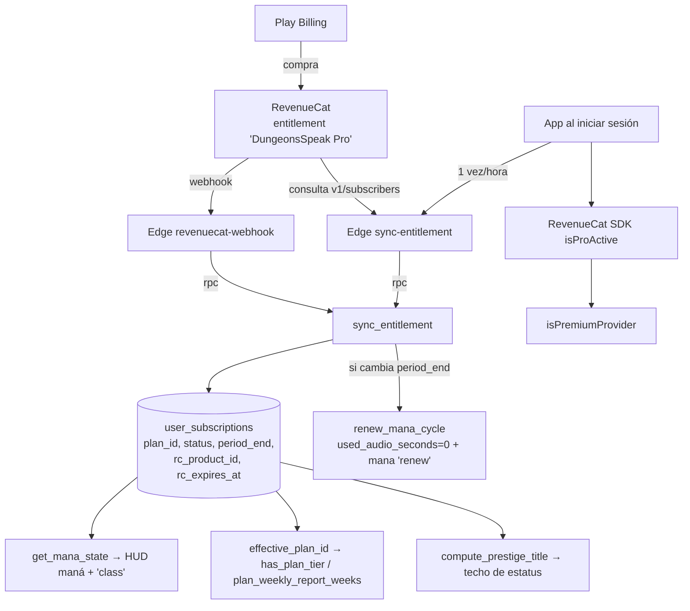

# 09 · Jerarquía social y membresías

> Medido el 31-oct-2026 contra producción `sipiumfdpvnszthykyog` (solo lectura,
> MCP `supabase`) y contra `origin/master` del worktree `p14-ai-usage`.
> Baseline: [_baseline.md](_baseline.md).
>
> Decisiones ya tomadas (no se reabren aquí):
> [../PRODUCT.md](../PRODUCT.md) §2 (planes) y §6 (decisiones),
> [../PROPUESTA-P44-P48.md](../PROPUESTA-P44-P48.md) §P-44 (valor por
> capacidad) y §P-45 (trial). Este documento **audita la coherencia** entre lo
> que esas decisiones prometen y lo que el servidor aplica.

---

## 1. Resumen ejecutivo

Hay **dos** conceptos que se llaman "clase" y se mezclan en la interfaz:

1. **Clase RPG** (personaje): `user_language_profiles.character_class` —
   `warrior`, `necromancer`, `paladin`, `archer`, `assassin`.
2. **"Clase" de plan** (estamento): `subscription_plans.class_name` —
   `plebeyo`, `noble`, `realeza`, `divino`.

La app pinta el **plan** donde el jugador espera su **clase de personaje**
(`hunter_hud_header.dart:156` y `:237` renderizan `manaState['class']` =
`class_name` del plan). Y el **prestigio** — único sistema de estatus — está
**gated por el plan**: 7 de los 21 escalones son gratis, 6 exigen NOBLE y 8
exigen REALEZA (`compute_prestige_title`). Es decir, la nobleza no es solo un
nombre: es un techo duro en el reconocimiento.

Estado real: **15 suscripciones para 68 usuarios** (14 `plebeyo`, 1 `noble`),
**0 filas en `payments`** y **1 evento de RevenueCat**. El sistema de planes
está bien construido y prácticamente no se ha usado.

---

## 2. Catálogo real de planes

`select * from subscription_plans order by order_index` (31-oct-2026):

| id | `class_name` | Precio mes | Precio año | Maná/mes | Min. audio | `weekly_report_weeks` | `trial_days` | `tier` | `is_active` |
|---|---|---|---|---|---|---|---|---|---|
| `plebeyo` | plebeyo | $0.00 | — | 3.000 | 30 | 1 | 0 | 0 | **sí** |
| `noble` | noble | $4.99 | $53.99 | 17.000 | 300 | 4 | **7** | 1 | **sí** |
| `realeza` | realeza | $9.99 | $107.99 | 20.500 | 1.200 | **52** | 0 | 2 | **sí** |
| `divino` | divino | $12.99 | $132.99 | 25.500 | 2.000 | 1 | 0 | 2 | **no** (retirado, P-44) |
| `free` | plebeyo | $0.00 | — | 1.800 | 30 | 1 | 0 | 0 | no (legado) |
| `monthly` | noble | $1.99 | — | 18.000 | 300 | 1 | 0 | 1 | no (legado) |
| `annual` | realeza | $14.99 | — | 72.000 | 1.200 | 1 | 0 | 2 | no (legado) |
| `lifetime` | realeza | $29.99 | — | 72.000 | 1.200 | 1 | 0 | 2 | no (legado) |

Observaciones:

- **La app solo pinta `is_active = true`** (`subscription_plan_repository_impl.dart:28-34`),
  así que DIVINO y los 4 legados no aparecen. Coherente con P-44.
- `free`, `monthly`, `annual` y `lifetime` siguen en la tabla con precios y
  features **incompatibles con la oferta vigente** ($1.99/mes, "Battle Pass
  incluido", "Soporte prioritario", "1200 min/mes de por vida"). No se ven,
  pero cualquier consulta manual o integración futura los leería como válidos.
  `[PENDIENTE DE VALIDAR]` si hay algún `user_subscriptions.plan_id` apuntando a
  ellos — hoy no lo hay (solo `plebeyo` y `noble`).
- El campo `features` (jsonb, texto) **no se usa como fuente de verdad**: el
  paywall compone sus propias líneas con `mana_allowance`,
  `weekly_report_weeks` y el conteo de `min_plan`
  (`paywall_screen.dart:495-515`). Bien: el texto libre no promete nada que no
  se pueda medir. **Excepción**: el `description` de REALEZA promete "avanza
  más rápido, más misiones y mayor techo de prestigio" — dos de esas tres cosas
  no existen (§6).

---

## 3. `class_name`, nobleza y la clase de personaje

### 3.1 Dos "clases" con el mismo nombre

| Campo | Tabla | Valores reales | Dónde se pinta |
|---|---|---|---|
| `character_class` | `user_language_profiles` | `null` 51 · `warrior` 5 · `necromancer` 4 · `paladin` 3 · `archer` 1 · `assassin` 1 | Avatar RPG en mesa/HUD (`chat_rooms_repository_impl.dart:650-665`) |
| `player_class` | `user_language_profiles` | `warrior` 65/65 | — (columna redundante) |
| `class_name` | `subscription_plans` | `plebeyo` / `noble` / `realeza` | **Chip "clase" junto al avatar** (`hunter_hud_header.dart:156`, `:237`) |
| `guild_role` | `user_language_profiles` | `member` 65/65 | No se lee en Dart |

### 3.2 El problema

`get_mana_state` devuelve `'class' = subscription_plans.class_name`
(`get_mana_state`, definición en producción). El HUD lo pinta en mayúsculas
junto al avatar como si fuera la clase del personaje. Resultado:

- Un `warrior` con plan PLEBEYO ve **"PLEBEYO"** en el HUD y **"warrior"** (o
  nada) en el avatar.
- Un jugador con plan REALEZA **nunca** ve "realeza" si su `character_class` es
  `null`… pero sí ve "REALEZA" como etiqueta de clase. Es decir: **el plan
  sustituye visualmente a la clase de personaje**.
- `51 de 65` perfiles tienen `character_class = null`: la clase de personaje
  casi nunca se rellenó, así que en la práctica **la única "clase" visible es
  la del plan**. La app ha convertido el estamento en identidad.

Además `guild_role` (que sugiere jerarquía de gremio: líder/oficial/miembro)
vale `member` en las 65 filas y **no lo lee ni un archivo Dart**: no hay
jerarquía social real dentro del gremio. Ver
[08-guild-and-social-system.md](08-guild-and-social-system.md) §8.

### 3.3 El techo de prestigio sí depende del plan `[IMPLEMENTADO]`

`compute_prestige_title(p_user_id, p_radar)` calcula el escalón por `aura_xp` y
`radar`, y **filtra por `ceiling_class` contra el `class_name` del plan**:

```sql
AND CASE ceiling_class WHEN 'plebeyo' THEN 0 WHEN 'noble' THEN 1 ELSE 2 END
      <= v_class_rank
```

`prestige_ladder` (21 escalones activos):

| Escalones | `ceiling_class` | `aura_xp` requerida | Acceso |
|---|---|---|---|
| 1–7 (`aventurero` … `leyenda`) | plebeyo | 0 → 12.000 | Gratis |
| 8–13 (`barón` … `gran duque`) | noble | 16.000 → 53.000 | **Requiere NOBLE** |
| 14–21 (`príncipe` … `ascendido`) | realeza | 66.000 → 260.000 | **Requiere REALEZA** |

Es un **pay-to-status** explícito y, en mi lectura, coherente con la decisión
"el premium no vende ventajas de aprendizaje evaluado" (`PRODUCT.md:41-42`):
el prestigio es reconocimiento, no capacidad. **Pero** hay que decirlo en el
paywall y hoy no se dice: las líneas del paywall solo mencionan maná, semanas
de historial y cosméticos (`paywall_screen.dart:495-515`). Un usuario gratuito
descubre el techo cuando llega, no antes.

**Dato demoledor**: `max(aura_xp) = 35` en producción (5 perfiles con aura > 0).
El primer escalón "noble" exige 16.000. **Nadie ha salido del escalón 1**, así
que el pay-gate de prestigio es hoy teórico: nadie ha llegado ni a la puerta.

---

## 4. Flujo de entitlement



Puntos delicados:

| # | Comportamiento | Evidencia | Riesgo |
|---|---|---|---|
| E1 | `sync_entitlement` con `is_active=false` **solo degrada** si `rc_expires_at <= now()` | `sync_entitlement`, rama `else` | Un reembolso o una baja antes de la fecha de expiración **no revoca** el plan hasta que caduque |
| E2 | Mapeo producto → plan: `divino`/`divine` → `divino`; `realeza`/`royalty` → `realeza`; **cualquier otro** → `noble` | `sync-entitlement/index.ts:26-31` (mismo mapeo en el webhook según su comentario) | Un SKU nuevo mal nombrado cae en NOBLE silenciosamente |
| E3 | `divino` sigue siendo un `plan_id` aceptado | `index.ts:28` | Tras P-44, un SKU antiguo reactivaría un plan `is_active=false` (no se muestra en paywall, pero sí daría 25.500 de maná: `sync_entitlement` lee `mana_allowance` sin mirar `is_active`) |
| E4 | Reconciliación con TTL de 1 hora en el cliente | `subscription_providers.dart:77-93` | Hasta 1 h de desfase entre compra y estado local si el webhook falla |
| E5 | `effective_plan_id` exige `status in ('active','in_grace')` **y** `period_end > now()` | `20261030005704_plans_capabilities_p44_p45.sql:68-87` | Correcto… pero **no lo usan** ni `get_mana_state` ni `compute_prestige_title` (§5.3) |
| E6 | `renew_mana_cycle` resetea `used_audio_seconds` y **no** toca `plan_id` | `renew_mana_cycle` (Issue #68) | Al renovar, el plan se mantiene: depende de que la fila ya esté en NOBLE |

---

## 5. Capacidades aplicadas **de verdad**

| Capacidad | PLEBEYO | NOBLE | REALEZA | Enforcement real | Evidencia |
|---|---|---|---|---|---|
| Maná mensual | 3.000 | 17.000 | 20.500 | **Sí**, `consume_mana` lee `subscription_plans.mana_allowance` | `20260819_fix_mana_consume.sql:52-58` |
| Tope diario de maná | **200** | sin tope | sin tope | **Sí**, solo si `plan_id='plebeyo'` | `20260819_fix_mana_consume.sql:86-94` |
| Turno de gracia diario | 1/día | 1/día (no aplica) | 1/día | **Sí**, `claim_mana_grage` solo `service_role`, invocado por `llm-proxy` cuando `daily_limit_reached` | `20261029080000_mana_grace_turn.sql:20-45`; `llm-proxy/index.ts:452` |
| Semanas de historial del informe | 1 | 4 | 52 | **Sí**, `get_weekly_report` devuelve `locked=true` fuera del rango | `20261030005704…sql:157-199` |
| Cosméticos exclusivos | 0 | 0 | **2** (`title_leyenda_viva`, `aura_sombras`) | **Sí**, `purchase_cosmetic` / `craft_cosmetic` devuelven `plan_required` | `20261030005704…sql:354-357`, `:438-441` |
| Trial | — | **7 días** | — | **No en la BD**: `trial_days` solo alimenta el texto del paywall; la oferta real vive en Play/RevenueCat | `paywall_screen.dart:593-615`; `PROPUESTA-P44-P48.md` §P-45 |
| "Gestionar suscripción" | — | — | — | **Sí**, vía RevenueCat Customer Center (no abre Play directamente) | `paywall_screen.dart:22-31`, `:352` |
| Restaurar compras | — | — | — | **Sí**, `restore()` real | `paywall_screen.dart:76-107` |

Verificación en producción:

```sql
select min_plan, count(*), string_agg(id, ', ')
  from cosmetic_catalog group by min_plan;
-- (null) 38 · realeza 2 (title_leyenda_viva, aura_sombras)
```

Solo **2 de 40** cosméticos son exclusivos, y ambos son REALEZA. **NOBLE no
tiene ni un cosmético exclusivo**: su única diferencia real frente a PLEBEYO es
maná (17.000 vs 3.000) y 4 semanas de informe en vez de 1.

---

## 6. Capacidades que son **solo texto**

| Promesa | Dónde aparece | Realidad |
|---|---|---|
| "300 min de audio" (NOBLE) / "1.200 min" (REALEZA) | `subscription_plans.monthly_audio_minutes_limit` | **Nadie los cuenta ni los limita.** `used_audio_seconds` **no son segundos de audio: es el maná gastado** (`consume_mana` suma el coste en esa columna). `getPlanManaBonus` —el único lector del campo— **no se llama desde ningún sitio** (`economy_repository_impl.dart:747-775`, sin referencias) |
| "Sin tope diario de maná" | `features` + paywall | Cierto, pero redundante: con 17.000/mes y el consumo real medido (§7) nadie llega al tope de 200 jamás |
| "Avanza más rápido" (REALEZA) | `subscription_plans.description` | **No existe** ningún multiplicador de XP por plan. `close_session` y `claim_mission_reward` son idénticos para todos |
| "Más misiones" (REALEZA) | `description` | **No existe**: las misiones diarias/semanales son las mismas y el tope de activas no depende del plan (`mission_repository.dart:524-532` es un tope fijo de 3 para misiones de pool) |
| "Mayor techo de prestigio" (REALEZA) | `description` | **Cierto** (§3.3) — el único punto del `description` que se cumple |
| "1 examen boss/semana" | Plan legado `free`, `features` | **No existe límite semanal**. `boss_exam_status` aplica cooldown de **12 h** tras fallo y un gate de progreso (6 objetivos / 30 min / racha 2). Sin gate por plan |
| "Battle Pass incluido" | Planes legados | `guild_battle_pass` existe, nunca avanza (§08) |
| "Soporte prioritario" / "Prioridad máxima en servidores" | Planes legados | No hay cola ni SLA |
| "Historial ilimitado" | Plan legado `monthly` | `weekly_report_weeks` máximo real: 52 |

**Conclusión**: de las 4 capacidades que el producto declara (maná, historial
del informe, cosméticos, trial), **3 están implementadas en servidor** y el
trial depende de configuración externa. Todo lo demás es texto heredado de
planes inactivos o de un `description` optimista.

---

## 7. `trial_days` y la prueba gratuita

- `subscription_plans.trial_days`: NOBLE = **7**, resto = 0.
- El paywall muestra «7 días gratis, luego $4.99» **solo si `plan.trialDays > 0`**
  (`paywall_screen.dart:593-615`), y añade el borde dorado al plan con trial
  (`:519`). No promete nada si la base dice 0. Correcto.
- **La base no tiene estado de trial.** `user_subscriptions` no tiene
  `is_trial` ni `trial_end`; `status` es el enum de la BD
  (`active`, `in_grace`, …). Consecuencia: el **recordatorio antes del cobro**
  sigue siendo imposible de distinguir desde la app (`PROPUESTA-P44-P48.md`
  §P-45, última línea). `[PENDIENTE DE VALIDAR]` si Play lo marca en
  `period_end` de alguna forma distinguible.
- Falta la configuración en Play Console/RevenueCat: es acción externa, no
  código. Checklist en
  [../runbooks/TRIAL_NOBLE_P45.md](../runbooks/TRIAL_NOBLE_P45.md).

---

## 8. Auditoría de coherencia: ¿es pay-to-win?

### 8.1 Dónde **no** hay pay-to-win `[IMPLEMENTADO]`

| Área | Por qué es justa |
|---|---|
| Evaluación (CEFR, jefe, rúbrica) | El nivel lo decide el servidor con la misma rúbrica para todos (`boss_exam_rules.dart:36-69`) |
| Contenido | `lesson_catalog` (Dart) es el mismo para todos |
| Corrección | `correction_turn` es **gratuita** desde P-40-c (`ai_action_costs.is_active = false`) |
| Economía cosmética | Oro/gemas/fragmentos solo compran cosméticos; el oro **no** compra maná ni turnos (`shop_screen.dart:20-24`; no hay tab de MANÁ) |
| Maná comprado | `purchased_mana_balance` existe pero **no hay producto consumible**: P-46 decidió no abrirlo |

### 8.2 Dónde **sí** hay ventaja de pago

| Ventaja | Naturaleza | Veredicto |
|---|---|---|
| **Volumen de práctica** (3.000 → 17.000 → 20.500 de maná) | Más minutos de conversación con IA | **Inherente al modelo**. No es "win" porque no hay competición puntuada; es "más práctica" |
| **Historial del informe** (1 → 4 → 52 semanas) | Retención de datos propios | Aceptable, pero es una **retención de datos del propio usuario**: 1 semana de historial gratis es agresivo (§9) |
| **Prestigio** (7 → 13 → 21 escalones) | Estatus visible | **Pay-to-status real**. El escalón 8 se llama "Barón": para tener título nobiliario hay que pagar. Coherente con la ficción, incómodo como diseño |
| **Cosméticos REALEZA** (2) | Cosmético | Inocuo |
| Sin tope diario | Solo afecta a PLEBEYO y solo si juega >15 días/mes | Marginal |

### 8.3 Incoherencias medidas

1. **`get_mana_state` ignora la expiración del plan.**
   Devuelve `remaining = allowance − used` sin mirar `mana_expires_at`
   (`get_mana_state`), mientras `consume_mana` **sí** pone `v_allowance := 0`
   cuando expiró (`20260819_fix_mana_consume.sql:77-80`). Un NOBLE vencido ve
   "17.000 disponibles" y el siguiente turno falla con `insufficient_mana`.

2. **Tres definiciones distintas de "plan vigente".**

   | Consumidor | Regla |
   |---|---|
   | `effective_plan_id` (informe + cosméticos) | `status in ('active','in_grace')` **y** `period_end > now()` |
   | `get_mana_state` (HUD) | `us.plan_id` tal cual, sin mirar `status` ni `period_end` |
   | `compute_prestige_title` (estatus) | `us.plan_id` tal cual |
   | `isPremiumSubscription` (Dart, badge) | `plan_id != 'plebeyo'` **y** `status in (active,in_grace)` **y** `period_end > now()` |

   Resultado: un plan vencido puede mostrar **maná y título de noble** y a la
   vez perder el historial del informe. La UI no puede ser coherente consigo
   misma.

3. **`used_audio_seconds` es maná, no audio.** La columna se llama "segundos de
   audio" y guarda maná gastado (`consume_mana`: `used_audio_seconds +
   v_cost`). Cualquier lectura externa (analítica, soporte) interpretará mal
   la cifra. Ejemplo real: el único NOBLE tiene `used_audio_seconds = 474`,
   que son 474 de maná, no 7,9 minutos.

4. **`payments` está vacío aunque hay una compra real.** El único NOBLE tiene
   `store='play'` y `rc_product_id='dungeonsspeak_noble_monthly'`, y
   `payments` tiene **0 filas**. No hay registro contable de ingresos en la
   base: el ingreso solo existe en RevenueCat/Play. `payments` conserva además
   `stripe_payment_id` (Stripe está retirado, `PRODUCT.md:104`).

5. **El HUD llama "clase" al plan** (§3.2) y el Salón llama "premium" al
   `guild_battle_pass.is_premium` (siempre `false`), no a la suscripción
   (`chat_rooms_screen.dart:1015`). Dos etiquetas de estatus contradictorias
   en la misma app.

---

## 9. Qué debería seguir gratis (propuesta)

| Capacidad | Gratis | Motivo |
|---|---|---|
| Todo el currículo y la evaluación | **Sí** | Es el producto; gatearlo mata la confianza |
| Corrección de errores | **Sí** (ya es gratis) | Sin corrección no hay aprendizaje percibido |
| Maná del plan gratuito | **Sí**, 3.000/mes | Suficiente para el hábito (§10) |
| Historial del informe | **Sí**, ≥ 4 semanas | 1 semana es demasiado poco para *ver* progreso: es el argumento de retención más fuerte y se le está regalando a quien paga. Recomiendo **4 semanas gratis y 52 en REALEZA** |
| Prestigio escalones 1–7 | **Sí** (ya lo es) | El techo debe ser alcanzable con esfuerzo: hoy 12.000 de aura es inalcanzable (§10) |
| Cosméticos de entrada | **Sí** (60–90 de oro) | Ya resuelto en P-32 |
| Freeze de racha con gemas | **Sí** | Es un seguro, no una ventaja |

**Lo que sí puede seguir siendo de pago**: volumen de maná (más práctica),
semanas de historial más allá de 4, cosméticos de estatus y los escalones
nobiliarios del prestigio **si se anuncian**.

---

## 10. Datos reales (31-oct-2026)

| Consulta | Resultado |
|---|---|
| `select count(*) from public.users` | **68** |
| `select plan_id, count(*) from user_subscriptions group by 1` | `plebeyo` **14**, `noble` **1** |
| Usuarios con perfil de idioma (`user_language_profiles`) | **65** |
| `select count(*) from public.payments` | **0** |
| `select count(*) from public.revenuecat_events` | **1** |
| Único NOBLE: `used_audio_seconds` / `daily_limit` | **474** de maná usados de 17.000 (2,8 %), `rc_product_id='dungeonsspeak_noble_monthly'`, `period_end` 18-nov-2026 |
| `max(aura_xp)` | **35** (5 perfiles con aura > 0) |
| Escalón de prestigio alcanzado | **1** (`aventurero`); el siguiente exige 500 y el primer nobiliario 16.000 |
| `max(xp_points)` | **3.263** (nivel de cazador = `1 + xp/1000` = **4**) |
| `select count(*) from player_inventory` | **0** — nadie ha comprado un cosmético |
| `min_plan` no nulo en `cosmetic_catalog` | **2 de 40** (ambos REALEZA) |

**Lectura**: con 1 suscriptor de 68 usuarios (1,5 %) y 0 registros de pago, el
sistema de membresías no está validado por el mercado. Cualquier ajuste de
precio o de capacidades hoy es una hipótesis, no una optimización — el mismo
argumento de P-47 ("la muestra es de 8 llamadas").

---

## 11. No verificable

| Dato | Por qué | Qué falta |
|---|---|---|
| Precios reales por país de Play | Los campos `price`/`price_annual` son texto estático ("$4.99") | Consulta a Play Console o a la API de RevenueCat offerings |
| Offering `default` activo y SKUs publicados | No está en Supabase | RevenueCat MCP / consola |
| Que el trial de 7 días esté configurado en Play/RevenueCat | `trial_days = 7` es solo el texto que la app puede prometer | Play Console + RevenueCat (checklist `TRIAL_NOBLE_P45.md`) |
| Que `REVENUECAT_SECRET_KEY` esté cargado | Los secretos no se exponen por MCP | Panel de Supabase → Edge Functions (`sync-entitlement` responde 503 si falta) |
| Qué pasó con el `revenuecat-webhook` en la compra del único NOBLE | Hay 1 fila en `revenuecat_events`; no se puede saber si la escribió el webhook o `sync_entitlement` | Logs de ambas funciones en la ventana de la compra (18-oct-2026) |
| Si hay usuarios con SKU `divino` histórico | `sync` acepta el plan, pero no hay filas con `plan_id='divino'` | Nada más que consultar; se considera cerrado |
