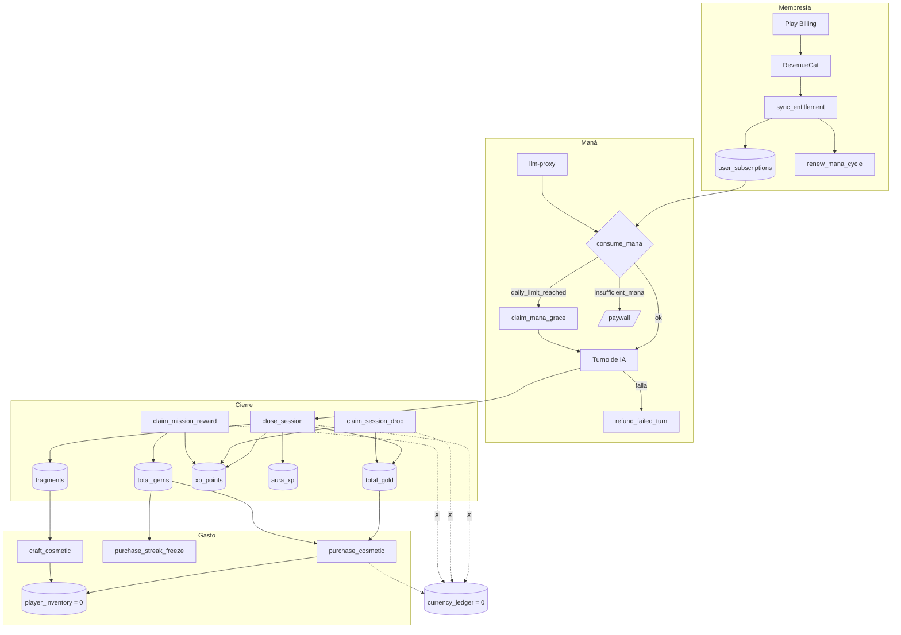

# 10 · Economía y recursos (A4)

> Medido el **31-oct-2026** contra producción `sipiumfdpvnszthykyog` (solo
> lectura, MCP `supabase`) y contra `origin/master` del worktree `p14-ai-usage`.
> Baseline: [_baseline.md](_baseline.md). Decisiones:
> [_decisions.md](_decisions.md).
>
> Misma materia que [07-gameplay-and-game-mechanics.md](07-gameplay-and-game-mechanics.md)
> (bucles, misiones, jerarquía); aquí se lee en clave **económica** y se audita
> el código contra **D-05** y **D-06**. Los sumideros ya están medidos en
> [`../runbooks/ECONOMY_SINKS.md`](../runbooks/ECONOMY_SINKS.md): este documento
> no los repite, los conecta.
>
> Etiquetas: `[HECHO]` · `[INFERENCIA]` · `[PROPUESTA]` · `[PENDIENTE DE VALIDAR]`.

---

## 1. Resumen ejecutivo

1. `[HECHO]` Hay **ocho** recursos declarados y **uno** con sumidero usado (maná).
2. `[HECHO]` El libro contable está vacío (`currency_ledger` = 0) porque **todos
   los ingresos** escriben saldo con `UPDATE` directo y solo los gastos pasan
   por `economy_apply_currency`.
3. `[HECHO]` El maná **no es escaso**: 3.298 consumidos en ~100 días por 13
   usuarios; el tope diario de 200 se alcanzó **1 vez**.
4. `[HECHO]` El 38,7 % del gasto de IA se factura a **0 de maná**.
5. `[HECHO]` **D-06 se cumple en la parte que el jugador ve** (SRS, listening y
   «Mis errores» cuestan $0 de IA) pero se incumple en dos puntos: el turno de
   gracia regala 1 turno/día y hay llamadas caras a coste 0.
6. `[HECHO]` **D-05 no está implementado**: el pergamino no es un reintento, no
   existe consumidor, y los ítems de maná siguen en BD (aunque sin flujo).

---

## 2. Mapa de recursos con cifras

| Recurso | Dónde vive | Entra por | Sale por | Saldo real (65 perfiles) |
|---|---|---|---|---|
| **Maná** | `user_subscriptions.used_audio_seconds` (+`purchased_mana_balance`) | `renew_mana_cycle` (3.000/17.000/20.500 al mes) | `consume_mana` (2–100/acción) | 3.298 gastados · 15 suscripciones |
| **Oro** | `total_gold` | `close_session`, `claim_session_drop`, `claim_level_rewards` | `purchase_cosmetic` (60–1.200) | media 103 · máx 180 |
| **Gemas** | `total_gems` | `claim_mission_reward`, recompensa diaria (rota) | `purchase_streak_freeze` (30), `purchase_cosmetic` (40–2.800) | media 3 · máx 96 |
| **Fragmentos** | `fragments` | `close_session` | `craft_cosmetic` (120/250/400) | máx 398 |
| **XP** | `xp_points` | `close_session`, drop, misión | — | media 57 · máx 3.263 |
| **Aura** | `aura_xp` | `add_aura_xp` | — | máx 35 · total 63 |
| **Pergaminos** | `player_daily_state.pergaminos_max` | recompensa diaria (2/5/8/15), consumibles (+10/+50) | **nadie** | `player_pergaminos` = 0 |
| **Invocaciones** | `player_daily_state.invocations_max` | 20 base + `(racha/7)×5` | `useInvocation` (**sin llamadores**) | cuota muerta |

`[INFERENCIA]` La economía tiene **un recurso de ritmo** (maná), **tres monedas
decorativas** (oro/gemas/fragmentos, sin compras) y **dos contadores muertos**
(pergaminos/invocaciones).

---

## 3. Maná

### 3.1 Precio por acción `[HECHO]`

`ai_action_costs` (7 filas): `lesson_generation` 100 · `oracle_eval` 30 ·
`oracle_turn` 15 · `dungeon_turn` 12 · `free_chat_turn` 8 ·
`vocabulary_curation` 2 · `correction_turn` 3 (**inactiva**).

Gratis por `FREE_ACTIONS` (`llm-proxy/validation.ts:23-29`): `goal_eval`,
`carisma_eval`, `guild_chat`, `stt_transcribe`, `correction_turn`.

### 3.2 Orden de descuento (`consume_mana`) `[HECHO]`

```
1. auth.uid() = p_user_id
2. acción existe y está activa
3. garantiza fila en user_subscriptions
4. reset diario lazy
5. mana_expires_at < now() → allowance = 0
6. IF v_plan_id = 'plebeyo' AND daily_used + coste > daily_limit → daily_limit_reached
7. descuenta del saldo del plan (used_audio_seconds += coste)
8. si no alcanza → ítem equipado (mana_items)
9. si no hay ítem → insufficient_mana
```

Evidencia: `supabase/migrations/20260819_fix_mana_consume.sql:32-152`.
`[HECHO]` El tope diario se decide por **string de plan** (`= 'plebeyo'`), no por
`subscription_plans.tier`: un plan gratuito nuevo con otro `id` no tendría tope.

### 3.3 El tope de 200 casi nunca muerde `[HECHO]`

| Dato | Valor |
|---|---|
| Maná PLEBEYO/mes | 3.000 |
| Tope diario | 200 |
| 3.000 ÷ 30 | **100/día de media** |
| Días que aguanta a 200/día | **15** |
| Veces alcanzado en producción | **1** (`max(daily_used)=200` en 1 de 15 filas) |

### 3.4 Turno de gracia `[HECHO]`

`claim_mana_grace` es idempotente por día (`mana_grace_date`), **solo
`service_role`**, y `llm-proxy` la invoca únicamente cuando `consume_mana`
devuelve `daily_limit_reached` (`llm-proxy/index.ts:452`). No aplica con el
saldo mensual agotado.

### 3.5 Maná comprado `[HECHO]`

| Pieza | Estado |
|---|---|
| `purchased_mana_balance` | 0 en las **15** suscripciones |
| `mana_items` | 0 filas |
| `mana_potions` | **7 filas** (25/50/100 de maná a $0,29/$0,49/$0,99) — ninguna función las lee |
| `mana_gems` | **8 filas** (40–1.200 de maná a $0,99–$14,99) — ídem |
| Tienda | sin tab de MANÁ (`shop_screen.dart:37`) |

`[INFERENCIA]` El maná comprado está **retirado del flujo pero no de la BD**:
cualquier consulta futura encontrará dos catálogos de precios en dólares que no
usa nadie y que contradicen el precio del plan.

---

## 4. Oro, gemas y fragmentos

### 4.1 El libro contable está vacío `[HECHO]`

`currency_ledger` = **0 filas**; `v_economy_flow` = **0 filas**. El
`sink_ratio` que propone `ECONOMY_SINKS.md` §4 es **incalculable**.

| Función | Escribe | ¿Pasa por `economy_apply_currency`? |
|---|---|---|
| `purchase_cosmetic` | oro/gemas | sí |
| `craft_cosmetic` | fragmentos | sí |
| `purchase_streak_freeze` | gemas | sí |
| `spend_currency` | cualquiera | sí |
| `claim_level_rewards` | oro | sí |
| **`close_session`** | XP, oro, fragmentos | **no** |
| **`claim_session_drop`** | XP, oro | **no** |
| **`claim_mission_reward`** | XP, gemas | **no** |

`[INFERENCIA]` Todos los **ingresos** evitan el libro y todos los **gastos** lo
usan: por eso hay saldos > 0 con libro vacío.

### 4.2 Catálogo (40 ítems) `[HECHO]`

| Categoría | Nº | Oro | Gemas | Nivel | Nota |
|---|---:|---|---|---|---|
| `aura` | 3 | 300–1.100 | 750–2.300 | 3–18 | 1 exclusivo REALEZA |
| `title` | 6 | 0–800 | 0–1.800 | 1–10 | 2 con precio 0 |
| `frame` | 4 | 90–900 | 0–2.000 | 1–12 | — |
| `pet` | 2 | 600–1.000 | 1.400–2.300 | 6–15 | — |
| `table_theme` | 2 | 700–1.200 | 1.800–2.800 | 8–20 | — |
| `emote` | 2 | 60–120 | 0–350 | 1 | — |
| `relic` | 3 | 0 | 0 | 1 | precio 0 y sin receta |
| `consumable` | **18** | 0 | 40–1.600 | 1 | **sin efecto mecánico** |

Precios de los consumibles (todos en gemas, ninguno en oro):
`+5 invocaciones` 40 · `10 pergaminos` 80 · `Piedra de Facilidad` 90 · `Libro de
Phrasal Verbs` 100 · `Manual de Pronunciación` 120 · `Pergamino x2` 120 · `+20
invocaciones` 150 · `Llave Mazmorra Oculta` 150 · `Piedra de Desafío` 150 ·
`Grimorio` 180 · `Llave Ruta Secreta` 200 · `Llave Archivo` 250 · `50
pergaminos` 300 · `Estandarte` 600 · `Skin Cazador` 800 · `Fondo Abismo` 900 ·
`Skin Arcano` 1.600.

`[INFERENCIA]` Con saldo máximo de **96 gemas**, el único ítem alcanzable es el
de 40: que compra **invocaciones**, una cuota que ningún flujo consume.

### 4.3 Recetas de fragmentos `[HECHO]`

Solo **3** ítems tienen receta: 120 (`title_cazador_sombras`), 250
(`frame_escudo`), 400 (`aura_fuego`). Los otros 37 tienen `craft_cost_fragments
= 0`.

### 4.4 Nivel de cazador y bolsas `[HECHO]`

- `economy_level(xp) = 1 + xp/1000`; espejo en `hunter_level.dart:13-18`.
- `level_rewards` (**6 filas**): niveles 2/3/5/8/12/15 → 100/150/250/400/600/800
  de oro (total **2.300**; exige **14.000 XP**).
- El jugador top (3.263 XP) puede reclamar 2 y 3 → **250 de oro**.

---

## 5. XP y aura: dos progresos desacoplados `[HECHO]`

| Moneda | Fuente | Escala | Desbloquea |
|---|---|---|---|
| `xp_points` | `close_session` (min×10), drop (15×rareza), misión (20–400) | nivel `1+xp/1000` | bolsas, `required_level` de cosméticos |
| `aura_xp` | `add_aura_xp` (metas × (10+bonus) × factor radar) | 0 → 260.000 | `prestige_ladder` (21 escalones, techo por plan) |

El diseño (XP mide «cuánto», aura mide «qué tan bien») es sano; el
apalancamiento no: **una sesión de 240 min da 2.400 XP**, más que el historial
completo del 99 % de los jugadores (media 57).

---

## 6. Recompensas: quién paga y cuánto

| RPC | Fórmula | Estado real |
|---|---|---|
| `close_session` | `xp = min×10` (0 si metas=0) · `gold = metas×(10+bonus)` · `frag = metas×(5+bonus)` · bonus A2=1…C2=5 | **4** filas en `session_reward_ledger`: 7 metas, 491 min, **2.510 XP**, **70 oro**, **35 frag** |
| `claim_session_drop` | `roll<2` legendario ×3 · `<10` épico ×2 · `<35` raro ×1,5 · resto común ×1; `xp=15×mult`, `gold=10×mult` | **1** fila |
| `claim_mission_reward` | `xp×mult`, `gem×mult` (mult=1 en 637/637) | **8** filas (100 % de las completadas) |
| `claim_level_rewards` | bolsa de `level_rewards` | 2 reclamables hoy |
| Recompensa diaria | 5/50/100/300 gemas + 2/5/8/15 pergaminos **en Dart** | **rota** (§8.5) |
| `refund_failed_turn` / `refund_mana` | devuelve el coste | 4 reembolsos de `lesson_generation` (400 de 400) |

`[HECHO]` Defecto de `close_session`: `conversations.ended_at` **nunca se
escribe** (0 de 70), así que `minutes = now() − started_at` con tope 240. Una
conversación abierta 5 h vale 240 min → 2.400 XP. El jugador top tiene 3.263 XP,
de los cuales **2.400 (73,5 %) vienen de una sesión con 1 meta**.

---

## 7. Ciclo completo



---

## 8. Auditoría contra **D-06** (no se regala maná)

> D-06: «No se regala maná. Sin maná, la alternativa gratuita son actividades
> **sin coste de IA**: repaso SRS, listening, Mis errores.»

| Punto de D-06 | ¿Se cumple? | Evidencia |
|---|---|---|
| No se regala **saldo** de maná | `[HECHO]` sí | `purchased_mana_balance` = 0 en 15/15; `mana_items` 0; sin tab de compra |
| No se regala **ningún** turno | `[HECHO]` **no** | `claim_mana_grace` concede **1 turno/día** al agotar el tope (P-26) |
| Alternativa gratuita SRS | `[HECHO]` sí | `srs_flashcard_modal` + `vocabulary_reviews`: sin IA |
| Alternativa gratuita listening | `[HECHO]` sí | `ListeningTts` usa `flutter_tts` del dispositivo («coste 0», `listening_tts.dart:8-11`) |
| Alternativa gratuita «Mis errores» | `[HECHO]` sí | lee `user_recurring_errors`; sin llamada a modelo |
| Ninguna actividad del jugador con IA gratis | `[HECHO]` **no** | 38,7 % del gasto IA se cobra a 0 de maná (§8.1) |

### 8.1 El regalo estructural que no aparece en el maná `[HECHO]`

| Acción | Maná | Coste IA medio | Naturaleza |
|---|---:|---:|---|
| `goal_eval` | 0 | $0,000707 × 6 | evaluación de metas por turno |
| `carisma_eval` | 0 | $0,000212 × 3 | cierre de sesión |
| `stt_transcribe` | 0 | $0,000048 × 16 | toda entrada de voz |
| `guild_chat` | 0 | $0,000166 × 1 | chat de gremio |
| `correction_turn` | 0 | sin logs | correcciones |

Total medido: **$0,0058 de $0,0150** (54 llamadas). `[INFERENCIA]` Con 181
turnos reales, `goal_eval` es el gasto que más crece y el único que no tiene
precio: si D-06 se interpreta como «toda IA se paga», el modelo actual lo
incumple en el eje del coste, no en el del saldo.

### 8.2 Dónde sí hay una fuga de maná `[HECHO]`

`mana_potions` (7) y `mana_gems` (8) siguen en la BD con precios en dólares
($0,29–$14,99). Ninguna función ni pantalla las lee, pero **son dos catálogos de
venta de maná vigentes a nivel de datos**: una consulta, un panel o un futuro
script las convertiría en una tienda paralela sin pasar por Play Billing.

---

## 9. Auditoría contra **D-05** (pergamino = reintento)

> D-05: «El pergamino pasa a ser **reintento de lección** (el maná sigue
> cobrándose); se **retiran los ítems de maná**.»

| Elemento de D-05 | Estado | Evidencia |
|---|---|---|
| Pergamino = reintento de lección | **no implementado** | `player_pergaminos` = 0 filas; `generateDailyPergaminos` inserta **5 diálogos de relleno** con frases fijas en inglés (`economy_repository_impl.dart:484-498`) |
| El maná se cobra en el reintento | n/a | no existe flujo de reintento; cada turno se cobra siempre |
| Consumidor de pergaminos | **no existe** | `pergaminos_max` solo se incrementa; ninguna pantalla lo descuenta |
| Ítems de maná retirados del flujo | sí | sin tab de maná; `dungeon_guardian` manda a `/paywall` |
| Ítems de maná retirados de BD | **no** | `mana_potions` 7 + `mana_gems` 8 filas |
| En su lugar | **otros consumibles** | `consumible_invocacion5` 40 gemas, `+20` 150, `pergamino10` 80, `pergamino50` 300 |

`[INFERENCIA]` D-05 quedó sustituido de facto por «compra intentos con gemas»,
que es justo el patrón que la decisión quería evitar: el jugador paga por
**volver a intentar**, no por aprender.

### 9.1 Riesgo añadido de D-05 `[HECHO]`

`increment_pergaminos_max(p_user_id, p_amount)` es `SECURITY DEFINER` con
`EXECUTE` para `authenticated`, valida identidad y **no tiene tope ni coste**.
Cualquier cliente puede ponerse `pergaminos_max` arbitrario; y la política
`update_own_daily` permite además escribir `player_daily_state` directamente
(`invocations_max`, `pergaminos_max`, `daily_reward_claimed`).

---

## 10. Equilibrio gratis vs. pago

### 10.1 Turnos que compra cada plan `[HECHO]`

| Plan | Maná/mes | Mazmorra (12) | Chat (8) | Oráculo (15) | Eval. (30) | Lección (100) |
|---|---:|---:|---:|---:|---:|---:|
| PLEBEYO | 3.000 | **250** | 375 | 200 | 100 | 30 |
| NOBLE | 17.000 | **1.416** | 2.125 | 1.133 | 566 | 170 |
| REALEZA | 20.500 | **1.708** | 2.562 | 1.366 | 683 | 205 |

### 10.2 Precio por unidad `[HECHO]`

| Plan | $/mes | $ por 1.000 de maná | Marginal |
|---|---:|---:|---|
| PLEBEYO | 0,00 | — | — |
| NOBLE | 4,99 | **0,294** | — |
| REALEZA | 9,99 | **0,487** | +$5,00 por +3.500 → **$1,429/1.000 (4,9× peor)** |

### 10.3 Coste real del maná `[INFERENCIA, muestra pequeña]`

Coste medio por llamada (`ai_usage_logs`, n por acción) × llamadas reales
(`mana_transactions`):

| Acción | Llamadas reales | $/llamada | Coste estimado |
|---|---:|---:|---:|
| `dungeon_turn` | 181 | 0,000210 | $0,0380 |
| `oracle_eval` | 20 | 0,000812 | $0,0162 |
| `oracle_turn` | 8 | 0,000340 | $0,0027 |
| `vocabulary_curation` | 3 | 0,000517 | $0,0016 |
| `lesson_generation` | 4 | (falló antes del modelo) | $0,0000 |
| **Total** | **216** | — | **≈ $0,0585** |

3.298 de maná por $0,0585 → **$0,0000177/maná** (**$0,0177 por 1.000**).
Frente a $0,294 (NOBLE) y $0,487 (REALEZA): el jugador paga **16,6× y 27,5×**
el coste marginal de IA; en el tramo marginal de REALEZA, **80×**.

`[INFERENCIA]` Margen bruto: NOBLE con todo mazmorra = 1.416 × $0,000210 =
**$0,30** de IA; peor caso (todo `oracle_eval`) = 566 × $0,000812 = **$0,46**.
Sobre $4,99 y con 15 % de Play, el margen queda entre **76 % y 85 %**.

### 10.4 El equilibrio no se puede calibrar: nadie llega a los límites `[HECHO]`

| Dato | Valor |
|---|---|
| Usuarios con consumo de IA | **13** de 68 |
| Maná consumido en ~100 días | **3.298** |
| Media por usuario que usa IA | **253** |
| Tope diario vs. consumo medio | **200 vs ≈2,5/día (80×)** |
| Plan gratuito al ritmo medio | ≈**3,2 años** de maná |
| Veces alcanzado el tope diario | **1** |
| Compras de cosméticos | **0** |
| Movimientos en el libro | **0** |

### 10.5 La incoherencia más cara `[HECHO + INFERENCIA]`

Meta diaria por defecto **15 min** (`user_settings.daily_goal_minutes`: 15 en
**67 de 68** filas, 30 en 1). Un turno ≈ 20–30 s → 15 min ≈ **36 turnos** ≈
**432 de maná/día** ≈ **13.000/mes**, es decir **4,3× el plan gratuito** y por
encima incluso del de pago (20.500). `[INFERENCIA]` **La meta por defecto no es
alcanzable con ningún plan sin gastar más de lo asignado**; PLEBEYO da
2,8–4,2 min/día de habla y NOBLE 16–24 min/día.

---

## 11. Desequilibrios medidos

| # | Desequilibrio | Cifra |
|---|---|---|
| E1 | XP derivado de `now() − started_at` con `ended_at` nulo | 0 de 70 conversaciones; 2.400 XP (73,5 % del top) de 1 meta |
| E2 | El libro contable está vacío porque los ingresos lo evitan | `currency_ledger` 0; 70 oro y 35 frag sin traza |
| E3 | REALEZA 4,9× más caro por unidad de maná | $0,294 vs $0,487/1.000 |
| E4 | La meta diaria por defecto (15 min) es inalcanzable | ≈13.000 maná/mes vs 3.000 (PLEBEYO) |
| E5 | Recompensa diaria no paga y falla en silencio | `add_gems` sin EXECUTE; `economy_repository_impl.dart:242` `catch (_) → {}` |
| E6 | Las misiones nunca caducan | 629 activas con `expires_at = NULL`; 8/637 completadas |
| E7 | El tope diario no es el factor limitante | 100/día de media; 1 sola vez alcanzado |
| E8 | 23 consumibles sin efecto a 40–1.600 gemas | `cosmetic_catalog`; saldo máximo 96 |
| E9 | 38,7 % del gasto de IA se factura a 0 | $0,0058 de $0,0150 |
| E10 | `vocabulary_curation` cuesta 15× más por maná que un turno | $0,00026/maná vs $0,0000175 |
| E11 | Pergaminos e invocaciones son contadores muertos y auto-otorgables | `increment_pergaminos_max` sin tope; `player_pergaminos` 0 |
| E12 | Solo 1 suscripción de pago y 0 compras internas | 14 plebeyo + 1 noble; `player_inventory` 0 |

---

## 12. Propuestas económicas (no vinculantes)

`[PROPUESTA]` Ordenadas por coste de implementación:

1. **Cerrar el libro**: que `close_session`, `claim_session_drop` y
   `claim_mission_reward` llamen a `economy_apply_currency`. Sin esto no se
   puede decidir nada con datos (§4.1).
2. **Precio sombra del maná**: derivar de `ai_action_costs` la tabla
   maná↔dólar y publicar el margen real (§10.3). Hoy el precio se fija a ojo.
3. **Cobrar o eliminar las acciones gratis caras**: `goal_eval` es la 2.ª más
   cara y no tiene precio (§8.1).
4. **Retirar de BD** `mana_potions`, `mana_gems` y los 23 consumibles sin
   efecto, o darles mecánica. Mantenerlos es deuda de seguridad económica.
5. **Implementar D-05** como decisión de producto: si el pergamino no va a ser
   reintento, decidir qué es y borrar el placeholder de §9.
6. **Recalibrar la meta diaria** a lo que el plan regala (10 min) o subir el
   plan gratuito: hoy el producto pide más de lo que entrega (§10.5).

---

## 13. No verificable

| Dato | Por qué | Qué falta |
|---|---|---|
| Coste real por acción | Muestra de 54 llamadas; extrapolado por media | ≥2 semanas de `ai_usage_logs` |
| Ingreso del único NOBLE | `payments` 0, `revenuecat_events` 1 | Logs de `revenuecat-webhook` |
| Origen del oro de los perfiles (máx 180) | Sin traza contable | Reparar el libro |
| Si `lesson_generation` falla por modelo o por BD | 4 reembolsos sin causa | Logs de `lesson-generator` |
| Precio real de los consumibles en Play | No hay consumibles publicados | Play Console |
| Efecto del turno de gracia | Usado 1 vez | Más uso |
| Si `MANA_CHARGE_MODE` cobra en todas las builds | Secreto de la Edge Function | Valor del secreto |
