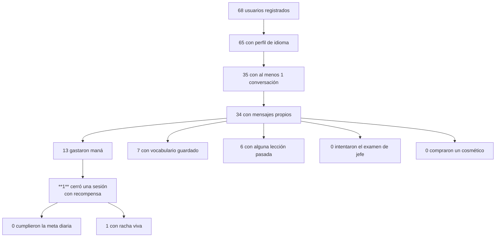
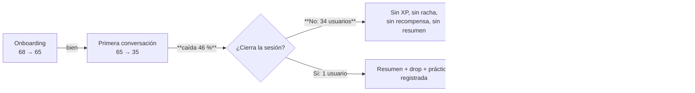

# 11 · Engagement y progresión

> Medido el 31-oct-2026 contra producción `sipiumfdpvnszthykyog` (solo lectura,
> MCP `supabase`) y contra `origin/master` del worktree `p14-ai-usage`.
> Baseline: [_baseline.md](_baseline.md).
>
> Sistemas ya documentados en otro sitio y **no repetidos aquí**: economía y
> recompensas ([10-economy-and-resources.md](10-economy-and-resources.md)),
> gremio ([08-guild-and-social-system.md](08-guild-and-social-system.md)).
> Este documento mide **qué hace volver al jugador** y **dónde se cae**.

---

## 1. Resumen ejecutivo

El producto tiene **once** mecanismos de retorno y **uno** funciona. Y el que
funciona (el hábito de conversación) no deja rastro: de **35 usuarios** que han
mantenido una conversación, **solo 1** ha cerrado una sesión y ha recibido
recompensa (`session_reward_ledger` → `count(distinct user_id) = 1`).

Consecuencia en cadena: sin cierre no hay XP, sin XP no hay nivel, sin nivel no
hay logros, sin sesión registrada no hay racha (`practice_sessions` = 2 filas)
y sin minutos no hay meta diaria cumplida (`daily_goal_celebrations` = 0 filas).

**El bucle de progresión no está roto por falta de funciones: está roto porque
el punto de entrada (`close_session`) casi nunca se ejecuta.**

| Mecanismo | Estado | Señal en producción |
|---|---|---|
| Conversación con IA (el hábito) | `[IMPLEMENTADO]` | 70 conversaciones, 771 mensajes, 35 usuarios |
| Cierre de sesión con recompensa | `[PARCIAL]` — **1 usuario** | `session_reward_ledger` = 4 filas de 1 `user_id` |
| Racha | `[PARCIAL]` — máx. histórico **3** | `player_streaks` 52 filas; 59/65 perfiles con racha 0 |
| Meta diaria | `[IMPLEMENTADO]` pero nunca cumplida | 68 metas configuradas, **0 celebraciones** |
| Misiones diarias/semanales | `[PARCIAL]` — 1,26 % completadas | 637 instancias, 8 completadas, 629 activas sin caducidad |
| Logros | `[PARCIAL]` — 2 desbloqueos | `achievements` 6 filas, `user_achievements` **2** |
| Evidencia de aprendizaje | `[PARCIAL]` — datos insuficientes | `vocabulary_reviews` 7 filas, `mastered_words` 0 |
| Informe semanal | `[IMPLEMENTADO]` (P-43/P-44) | `corrections` = **0 filas** → la métrica de errores siempre es 0 |
| Recordatorios locales | `[IMPLEMENTADO]` — activados por defecto | 67/68 con `notifications_enabled = true`; solo 1 cambió la hora |
| Reactivación por email | `[CONCEPTUAL]` — **cron no programado** | 0 emails enviados; 68/68 con `reactivation_emails = true` |
| Examen de jefe | `[IMPLEMENTADO]` — **0 intentos** | `boss_exam_attempts` = 0 |
| Ranking | `[IMPLEMENTADO]` — sin competencia | Top 3.263 XP vs. 2.º 255 XP; el resto por debajo de 150 |

---

## 2. Embudo real de uso

| Etapa | Usuarios | Retención respecto al paso anterior |
|---|---|---|
| Registro | **68** | — |
| Perfil de idioma | 65 | 95,6 % |
| Conversación iniciada | **35** | **53,8 %** |
| Mensaje propio enviado | 34 | 97,1 % |
| Maná gastado (turno de IA cobrado) | 13 | **38,2 %** |
| **Sesión cerrada con recompensa** | **1** | **7,7 %** |
| Vocabulario guardado | 7 | — |
| Lección aprobada | 6 | — |
| Racha viva hoy | 1 | — |
| Meta diaria cumplida (alguna vez) | **0** | **0 %** |
| Examen de jefe | **0** | **0 %** |
| Cosmético comprado | **0** | **0 %** |

**La caída más caras está entre "mandé un mensaje" (34) y "cerré la sesión"
(1)**: 33 usuarios han hablado con la IA y **nunca han visto la pantalla de
recompensa**. Todo lo que la app promete después (XP, nivel, racha, misión,
logro, informe) vive detrás de ese paso.

---

## 3. Racha

### 3.1 Cómo funciona `[IMPLEMENTADO]`

`register_practice(p_session_id, minutes, objectives, tz_offset)`:

- Cuenta como práctica del día si `objectives >= 1` **o** `minutes >= 3`
  (espejo en Dart: `streak_rules.dart:9-11`).
- Idempotente por `(user_id, session_id)`.
- `+1` si `last_practice_date = hoy − 1`; reinicia a 1 si el hueco es mayor;
  mantiene si es el mismo día.
- Actualiza `user_language_profiles.current_streak/longest_streak/total_minutes`
  y hace `upsert` en `daily_stats`.

### 3.2 Estado real

| Consulta | Resultado |
|---|---|
| `max(longest_streak)` | **3** |
| Perfiles con `current_streak = 0` | **59 de 65** |
| Perfiles con `current_streak = 1` | 6 |
| `player_streaks` (tabla paralela) | 52 filas, máx. `current_streak = 2` |

- **Dos fuentes de racha** conviven: `user_language_profiles.current_streak`
  (la que pinta la app) y `player_streaks.current_streak` (la que usa
  `purchase_streak_freeze`). No se sincronizan.
- La racha máxima histórica de la app es **3 días**. Con esa racha, el escalón
  de 7 días de la recompensa diaria (50 gemas) **nunca se ha activado**.
- `streak_freezes`: 0 en todas las filas. La tienda vende freezes a 30 gemas
  (`purchase_streak_freeze`) pero **no hay ninguna compra**: nadie ha protegido
  una racha porque nadie tiene una racha que proteger.
- Aviso "racha en riesgo" (`StreakRules.shouldRemind`, < 6 h para medianoche):
  `[IMPLEMENTADO]` en el modelo; se apoya en `last_practice_date`, que solo se
  actualiza si `register_practice` corre — y casi nunca corre (§1).

---

## 4. Meta diaria

- `user_settings.daily_goal_minutes`: **68 de 68** filas, media **15,2**
  (mín. 15, máx. 30). Es un dato universal: todo el mundo tiene meta.
- `get_daily_goal_progress(tz)` suma `practice_sessions.minutes` del día local y
  compara con la meta; devuelve `goal_completed`, `streak`, `celebrated`.
- `claim_daily_goal_celebration(tz)` marca la celebración una vez por día
  (`daily_goal_celebrations`).

**Estado**: `daily_goal_celebrations` = **0 filas**. Y `daily_stats` acumula
**186 minutos** en 20 filas para 68 usuarios desde jul-2026 — es decir,
**2,7 minutos por usuario registrado en total**, contra una meta de 15 min
**al día**.

La causa no es la meta: es que `practice_sessions` solo tiene **2 filas**
(§1). La meta diaria mide una señal que casi nunca se escribe.

> Nota de coherencia: con el plan gratuito (3.000 de maná/mes = 250 turnos),
> cumplir 15 min/día exigiría ~432 de maná/día ≈ 13.000/mes
> ([10-economy-and-resources.md](10-economy-and-resources.md) §8.5). **La meta
> por defecto es inalcanzable con el plan por defecto.**

---

## 5. Misiones

### 5.1 Lo que ve el jugador `[IMPLEMENTADO]`

Dos pestañas, **Diarias** y **Semanales**
(`mission_visibility.dart:30`). El resto de tipos está oculto
(`hiddenTypes`: `secondary`, `secret`, `emergency`, `guild`, `collaborative`,
`event`).

Reglas de alcanzabilidad (P-24 / #109), con techos medidos:

| Objetivo | Techo diario | Techo semanal |
|---|---|---|
| `speak_minutes` | 10 | 15 |
| `conversation_turns` | 5 | 15 |
| `vocab_words` | 5 | 10 |
| `sessions` | 1 | 3 |
| `practice_session` | 1 | 3 |

Una misión con `target_value` por encima del techo se muestra como
**"no disponible"** en vez de dejar una barra eterna en 0 %
(`mission_visibility.dart:100-122`). Es una buena decisión: reconoce que el
motor no llega.

### 5.2 Catálogo

| Tipo | Plantillas | Activas | Instancias en producción | Completadas |
|---|---|---|---|---|
| `daily` | 15 | 15 | **448** | **6** (1,3 %) |
| `weekly` | 7 | 7 | **189** | **2** (1,1 %) |
| `secondary` | 13 | 13 | **0** | 0 |
| `guild` | — | — | **0** | 0 |

- Total: **637 instancias, 8 completadas (1,26 %), 8 reclamadas**.
- Las 13 plantillas `secondary` **nunca se asignan** (coincide con P-48: "13
  plantillas `secondary` nunca se asignan").
- **629 instancias `active` tienen `expires_at = NULL`**: las misiones nunca
  caducan. La UI filtra `!m.isExpired`, pero `isExpired` compara contra
  `expiresAt == null` → nunca expira. Se acumulan misiones diarias
  indefinidamente (448 de tipo `daily` para 68 usuarios ≈ 6,6 por usuario).
- El progreso lo escribe **solo el servidor** por triggers
  (`on_message_advance_missions`, `on_session_reward_advance_missions`,
  `on_vocabulary_advance_missions`). Un objetivo sin trigger se marca no
  alcanzable. `[IMPLEMENTADO]` y correcto.
- `rotate_daily_missions` corre a las 00:05 UTC vía `missions-cron`
  (`cron.job` jobid 1, `active`).

### 5.3 Por qué se completan tan pocas

Dependencia directa de §1: la misión más común es `speak_minutes` /
`conversation_turns`, que necesita `session_reward_ledger` o `messages`. Los
mensajes existen (771), así que las misiones de turnos **sí** podrían avanzar;
las de minutos, no (requieren cierre de sesión). Y el techo diario de 10 min
frente a una práctica media de 5,5 min (`mission_visibility.dart:15`) deja
muchas plantillas fuera de alcance **por diseño**.

---

## 6. Logros

- `achievements`: **6 filas** (Primeros Pasos, Charlatán, Constancia Diaria,
  Políglota, Maestro del Vocabulario, Elocuencia Dorada).
- `user_achievements`: **2 filas** en toda la base.
- La UI **no lee la tabla** `achievements`: `getUserAchievements` consume
  `get_dashboard_state(...)['achievements']` (`dashboard_repository_impl.dart:314-333`).
  Hay por tanto dos definiciones de logro (tabla y RPC) que pueden divergir.
- `[PENDIENTE DE VALIDAR]` si `get_dashboard_state` evalúa las 6 condiciones o
  devuelve una lista distinta: no se ha inspeccionado el bloque de logros de la
  función completa.
- Con 6 filas, el catálogo de logros es **decorativo**: no hay logros de
  conversación, ni de racha larga, ni de misión semanal, ni de nivel.

---

## 7. Evidencia de aprendizaje e informe semanal

### 7.1 `learning_evidence()` `[PARCIAL]`

Devuelve `reviews_90d`, `delayed_attempts`, `delayed_success`,
`retention_7d`, `mastered_words`, `missions_completed/total`, `weeks_active`,
`progress_by_type`, `transfer_types`.

Depende de `vocabulary_reviews`:

| Consulta | Resultado |
|---|---|
| `vocabulary_reviews` | **7** |
| `user_vocabulary` | 79 |
| `is_mastered = true` | **0** |
| `vocabulary_items` (catálogo) | 74 |

Con 7 revisiones, `retention_7d` es una cifra sobre una muestra de 1–2
usuarios. `mastered_words = 0` significa que la tarjeta de evidencia **nunca
puede mostrar progreso de dominio**. La UI degrada bien (no inventa), pero el
mensaje al usuario es "aún no hay evidencia" de forma permanente.

### 7.2 Informe semanal `[IMPLEMENTADO]`

- Calculado en servidor (`get_weekly_report`, P-43) con datos reales de
  `user_vocabulary`, `corrections`, `lesson_progress` y `practice_sessions`.
- Historial limitado por plan: 1 / 4 / 52 semanas (`locked = true` fuera)
  ([09-social-hierarchy-and-memberships.md](09-social-hierarchy-and-memberships.md) §5).
- `has_data` es falso si todo está a cero: no pinta ceros como progreso.
  `[IMPLEMENTADO]` y honesto.
- **Pero**: `corrections` tiene **0 filas**. El bloque "errores corregidos" y
  `top_error_type` siempre serán 0/null. La pantalla `my-errors`
  (`/my-errors`) muestra un historial de errores que **nunca** tiene contenido.
- `weekly_stats` (tabla) tiene **0 filas** y no la lee nadie: legado.

---

## 8. Recordatorios locales `[IMPLEMENTADO]`

| Pieza | Archivo |
|---|---|
| Scheduler (Android, alarmas inexactas) | `lib/features/notifications/data/local_notifications_scheduler.dart` |
| Plan/saneado de ruta | `domain/services/reminder_schedule.dart` |
| Ajustes (hora + días) | `presentation/widgets/reminder_settings_card.dart` (en `/settings`) |
| Prompt de permiso tras cerrar sesión | `presentation/widgets/notification_permission_prompt.dart` (en `/summary`) |
| Persistencia | `user_settings.notifications_enabled`, `notification_time`, `notification_days` |

Decisión correcta: **no usa alarmas exactas** (`inexactAllowWhileIdle`), así que
no necesita el permiso `SCHEDULE_EXACT_ALARM` que Play revisa.

Estado:

| Consulta | Resultado |
|---|---|
| `notifications_enabled = true` | **67 de 68** |
| `notification_time` | `09:00` en 67; `20:00` en 1 |
| `notification_days` | `{1..7}` por defecto |

Dos lecturas:

1. Los recordatorios están **activos por defecto** para todo el mundo sin que
   nadie los haya pedido explícitamente: el prompt se muestra *después* de la
   primera sesión (`/summary`), pero el valor por defecto ya es `true`.
2. Solo **1 de 68** usuarios ha cambiado la hora. O el ajuste no se descubre, o
   el recordatorio no importa. Con `last_practice_date` casi siempre nulo (§1),
   el recordatorio no puede personalizarse ("te faltan X minutos") y dispara a
   ciegas.

---

## 9. Reactivación por email `[CONCEPTUAL]`

Documentado en [../runbooks/REACTIVATION_EMAIL.md](../runbooks/REACTIVATION_EMAIL.md).

| Pieza | Estado real |
|---|---|
| Edge `reactivation-email` | Existe y compila (dry-run por defecto) |
| RPC `reactivation_candidates` | Existe |
| Tabla `reactivation_emails` | Existe, **0 filas** |
| Opt-in (`user_settings.reactivation_emails`) | `true` en **68/68** |
| **Cron** | **NO programado**: `cron.job` solo tiene 3 jobs (`missions-cron` 00:05, `clean_old_logs` 03:15, `purge_stale_participants` cada minuto) |
| `RESEND_API_KEY` | No verificable por MCP |

El runbook §5 dice explícitamente: *"El job se deja escrito pero inactivo hasta
que exista `RESEND_API_KEY` y el dominio esté verificado"*. Es decir: **el canal
de reactivación existe en código y no ha enviado un solo email**. No es un fallo
técnico; es una decisión pendiente de operaciones.

Impacto: con 33 usuarios que hablaron una vez y desaparecieron, este es el
único canal que podría recuperarlos sin coste de IA. Está apagado.

---

## 10. Jefe (examen de promoción) y ranking

### 10.1 Jefe `[IMPLEMENTADO]` con 0 intentos

- Ruta `/oracle-test?mode=promotion` → capa de jefe con barra de vida y
  pantalla de resultado.
- Reglas: **8 turnos máximo**, **5 respuestas mínimas** de evidencia,
  **12 minutos** de límite (`boss_exam_rules.dart:13-19`).
- Gate de acceso (`boss_exam_status`): `assessed` **y** (≥ 6 objetivos **o**
  ≥ 30 min **o** racha ≥ 2). Cooldown de **12 h** tras un fallo.
- Ascenso: exige nivel superior **y** rúbrica aprobada; **nunca baja de nivel**.
- **`boss_exam_attempts` = 0 filas.** Nadie ha hecho el examen. Y de 65
  perfiles, solo **4** tienen `placement_assessed_at` (es decir, 61 usuarios ni
  siquiera han hecho el test de nivel inicial).

El jefe no está "sin usar": está **inaccesible en la práctica**, porque su gate
depende de objetivos/minutos/racha, que dependen de `close_session` (§1). Es el
mismo cuello de botella disfrazado de función nueva.

### 10.2 Ranking `[IMPLEMENTADO]` sin competencia

`get_leaderboard(10)` devuelve 10 filas:

| Puesto | XP |
|---|---|
| 1 | **3.263** |
| 2 | 255 |
| 3 | 150 |
| 4 | 30 |
| 5 | 10 |

- El líder tiene **12,8×** el XP del segundo, y el 73,5 % de su XP viene de una
  sola sesión mal calculada
  ([10-economy-and-resources.md](10-economy-and-resources.md) §6.1).
- `LeagueLeaderboardWidget` cae en **datos de demostración inventados** cuando
  `entries` está vacío (`league_leaderboard_widget.dart:34-42`: "Elena Rostova",
  "Marco Silva"…). Hoy no se dispara (hay 10 filas reales), pero es una bomba
  de relojería: un fallo de red pinta competidores falsos y el usuario los cree.
- El runbook de economía deja claro que **no hay ligas, cohortes ni premios**
  ([ECONOMY_SINKS.md](../runbooks/ECONOMY_SINKS.md) §6). El "ranking" es una
  lista de XP sin ascenso ni descenso.

---

## 11. Fricciones medidas

| # | Fricción | Evidencia |
|---|---|---|
| E1 | **33 de 34 usuarios que hablaron nunca vieron una recompensa** | `session_reward_ledger` distinct users = **1** |
| E2 | La pantalla de resumen existe pero casi nadie llega | `practice_sessions` = 2 filas vs. 70 conversaciones |
| E3 | `corrections` vacío → "errores corregidos" siempre 0 y `/my-errors` siempre vacío | `select count(*) from corrections` → **0** |
| E4 | Las misiones no caducan y se acumulan | 629 `active` con `expires_at = NULL` |
| E5 | La meta diaria nunca se cumple y no se puede cumplir con el plan gratis | 0 celebraciones; meta 15 min vs. 2,8–4,2 min/día de habla en PLEBEYO |
| E6 | La racha máxima histórica es 3 → los escalones de 7/14/30 de la recompensa diaria son inalcanzables | `max(longest_streak) = 3` |
| E7 | El aviso "racha en riesgo" depende de un dato que casi nunca se escribe | `last_practice_date` |
| E8 | Recordatorios activos por defecto sin opt-in explícito | 67/68 `notifications_enabled = true` |
| E9 | El canal de reactivación está apagado | 0 emails, cron ausente |
| E10 | El examen de jefe es inaccesible porque su gate depende del cierre de sesión | 0 intentos; 61/65 sin test de nivel |
| E11 | `mastered_words = 0` → la tarjeta de evidencia nunca muestra dominio | `user_vocabulary.is_mastered` = 0 filas |
| E12 | El ranking puede pintar competidores inventados | fallback en `league_leaderboard_widget.dart:34-42` |
| E13 | Doble fuente de racha (`user_language_profiles` vs `player_streaks`) | `streak_rules.dart:3` lo dice; ambas tablas tienen datos distintos |

---

## 12. Dónde se abandona (hipótesis ordenadas por evidencia)

1. **No cerrar la sesión** (evidencia más fuerte). Dos hipótesis no excluyentes,
   ambas `[PENDIENTE DE VALIDAR]`:
   - el usuario mata la app en vez de usar atrás/popping, y el cierre solo se
     dispara en el `pop` (`conversation_screen.dart:98-114`);
   - la conversación se inicia sin `scenarioId`, en cuyo caso `_conversationId`
     queda `null` y el bloque de recompensas se salta entero
     (`conversation_providers.dart:2596-2601`).
2. **El plan gratuito no sostiene el hábito**: 250 turnos/mes ≈ 4 min de habla
   al día frente a una meta declarada de 15.
3. **La recompensa visible no paga**: la recompensa diaria falla en silencio
   ([10](10-economy-and-resources.md) §6.5) y el drop es de 15 XP / 10 de oro.
4. **No hay competencia ni cita social**: el gremio está vacío
   ([08](08-guild-and-social-system.md) §9) y el ranking no tiene ligas.
5. **No hay rescate**: el email de reactivación no se envía y el recordatorio
   local dispara a ciegas.

---

## 13. Qué arreglaría más con menos

`[PROPUESTA]` — ordenada por impacto medido, no por esfuerzo:

| Prioridad | Acción | Por qué |
|---|---|---|
| 1 | **Cerrar la sesión siempre**: cerrar también en `dispose`/`AppLifecycleState.paused` y no depender de `scenarioId` | Desbloquea de golpe XP, racha, meta, misión, jefe, informe y drop para 33 usuarios que hoy no reciben nada |
| 2 | **Escribir `conversations.ended_at`** al cerrar | Arregla el XP inflado y hace que "minutos" signifique minutos ([10](10-economy-and-resources.md) §6.1) |
| 3 | **Bajar la meta por defecto a lo que el plan gratis permite** (p. ej. 5 min) o subir el maná gratuito | La meta actual es matemáticamente inalcanzable |
| 4 | **Arreglar la recompensa diaria** en servidor (RPC propia; `add_gems` no es ejecutable por el cliente) | Hoy es un botón muerto con `catch` vacío |
| 5 | **Caducidad de misiones** (`expires_at` en el `INSERT` de instancias) | 629 instancias zombis |
| 6 | **Activar el cron de reactivación** cuando haya proveedor | 33 usuarios recuperables sin coste de IA |

---

## 14. No verificable

| Dato | Por qué | Qué falta |
|---|---|---|
| Por qué 34 de 35 usuarios no cerraron sesión | Se puede medir el hecho, no la causa | Telemetría de `session_start`/`session_end` por usuario, o logs de Edge |
| Si la app envía `close_session` y falla | No hay tabla de errores de cliente | Crashlytics / logs de `postgres_logs` en la ventana |
| Retención real D1/D7/D30 | `last_active_at` existe pero no hay cohortes calculadas | Consulta de cohortes o analítica (la app usa `RetentionAnalytics`, no verificable desde la BD) |
| Si `RESEND_API_KEY` está cargado | Los secretos no se exponen por MCP | Panel de Supabase → Edge Functions |
| Si el permiso de notificaciones se concede | `notifications_enabled` es la preferencia, no el permiso del sistema operativo | Play Console / datos del dispositivo |
| Contenido de `get_dashboard_state.achievements` | No se inspeccionó el bloque completo de la función | `pg_get_functiondef` completo (3 KB+) |
| Si `rotate_daily_missions` corre a diario | El job está `active`; no se consultó `cron.job_run_details` | Historial de ejecuciones |
