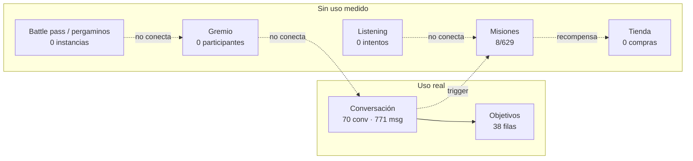

# 12 — Estado actual y brechas

> Foto del 31-oct-2026 sobre `origin/master` (worktree `p14-ai-usage`).
> Método: lectura de código (solo lectura), consultas SQL **de solo lectura** al
> proyecto `sipiumfdpvnszthykyog`, y issues de GitHub. **No** se ejecutó la app,
> **no** hubo revisión visual (sin visión de imágenes y móvil desconectado) y
> **no** se probaron compras. Todo lo visual queda `[PENDIENTE DE VALIDAR]`.
>
> Cifras base: [`_baseline.md`](_baseline.md). Inventario de pantallas detallado:
> [`../ui-ux-audit/02-screen-inventory.md`](../ui-ux-audit/02-screen-inventory.md).
> Catálogo de funcionalidades previo (25-oct): [`../product-audit/13-CATALOGO-DE-FUNCIONALIDADES.md`](../product-audit/13-CATALOGO-DE-FUNCIONALIDADES.md);
> varias filas de ese documento ya están desfasadas y se corrigen aquí.

---

## 1. Resumen ejecutivo en una tabla

| Dimensión | Lo que hay | Estado | Brecha dominante |
|---|---|---|---|
| Práctica oral | Pipeline voz → STT → LLM → TTS + evaluación de metas | `[IMPLEMENTADO]` | Sin pruebas de dispositivo; coste/latencia no medidos |
| Evaluación de nivel | Test del Oráculo (CEFR + rango) | `[IMPLEMENTADO]` | El rango es un sinónimo del CEFR, no una progresión |
| Currículo | 500 escenarios en BD; 140 lecciones en Dart | `[PARCIAL]` | Dos currículos y dos criterios de "completada" (#202, #203) |
| Gamificación | XP, oro, fragmentos, gemas, maná, aura, prestigio, títulos | `[PARCIAL]` | La mitad de los sistemas no tiene efecto o no tiene datos |
| Misiones | 7 tipos en modelo; UI solo diarias y semanales | `[PARCIAL]` | 8 completadas de 629 instancias; 13 plantillas `secondary` invisibles |
| Social | Gremio, mesas, voz, anuncios, misiones colaborativas | `[CONCEPTUAL]` | 0 participantes en mesas; sin bucle asíncrono |
| Monetización | Play Billing + RevenueCat, 2 planes activos | `[PARCIAL]` | 0 pagos registrados; paywall no verificado en dispositivo |
| Retención | Recordatorios locales, racha, recompensa diaria | `[PARCIAL]` | Racha duplicada; freeze de racha no se consume |
| Analítica | `analytics_events` (511 filas), `ai_usage_logs` (54) | `[PARCIAL]` | Sin embudo por pantalla; la tabla que cita la doc no existe |
| Accesibilidad/UX | 39 hallazgos con evidencia | `[PARCIAL]` | 4 críticos y 14 altos abiertos (#240–#261) |

---

## 2. Las 20 pantallas: estado real

Leyenda: `[IMPLEMENTADO]` · `[PARCIAL]` · `[CONCEPTUAL]` · `[PROPUESTA]` · `[PENDIENTE DE VALIDAR]`.

| # | Pantalla | Ruta | Estado | Evidencia | Brecha concreta |
|---|---|---|---|---|---|
| 1 | Splash | `/splash` | `[IMPLEMENTADO]` | `lib/app/splash_screen.dart:52-120` | Sin superficie de error si el warm-up falla (UX-36) |
| 2 | Welcome | `/` | `[IMPLEMENTADO]` | `lib/features/onboarding/presentation/screens/welcome_screen.dart:296,684` | 30 `SnackBar` crudos sin migrar (UX-10) |
| 3 | Onboarding | `/onboarding` | `[PARCIAL]` | `onboarding_screen.dart:394-396` | 4 pasos + Oráculo + mini-charla antes de la primera lección; visual NV |
| 4 | Mini conversación | `/mini-conversation` | `[IMPLEMENTADO]` | `mini_conversation_screen.dart:155-157` | Se salta si ya se vio (flag local) |
| 5 | Dashboard | `/home` | `[PARCIAL]` | `dashboard_screen.dart:371-378` (4 tabs), `:195-231` | Copy de error deshonesto (UX-17); sin estado de carga |
| 6 | Conversación | `/conversation`, `/oracle-test` | `[PARCIAL]` | `conversation_screen.dart` (2 362 líneas) | 0 widget tests (UX-15); god file |
| 7 | Resumen de sesión | `/summary` | `[IMPLEMENTADO]` | `session_summary_screen.dart:614-665` | Recompensas reales con estados; botones 24×24 (UX-03) |
| 8 | Paywall | `/paywall` | `[PARCIAL]` | `paywall_screen.dart:314,509-520` | Planes desde `subscription_plans`; compra no verificable |
| 9 | Editar perfil | `/profile-edit` | `[IMPLEMENTADO]` | `profile_edit_screen.dart:119-126` | RLS de `avatars` no verificada |
| 10 | Guild / Chat rooms | `/chat-rooms` + tab 1 | `[PARCIAL]` | `chat_rooms_screen.dart:993-1003,1012-1063` | Rango propio (HIERRO/PLATA/ORO) y battle pass solo decorativo |
| 11 | Sala de voz | `/voice-room?roomId` | `[PARCIAL]` | `voice_room_screen.dart:184,1223` | LiveKit no verificable; 0 participantes en BD |
| 12 | Tienda | `/shop` | `[PARCIAL]` | `shop_screen.dart:677,751-830` | Error de red pintado como tienda vacía (UX-16) |
| 13 | Inventario | `/inventory` | `[PARCIAL]` | `inventory_screen.dart:226` | 0 objetos comprados en producción |
| 14 | Santuario de Maná | `/dungeon-guardian` | `[IMPLEMENTADO]` | `dungeon_guardian_screen.dart:208-214` | "Obtener maná" abre el paywall (no hay venta de maná) |
| 15 | Resultado de jefe | `/boss-result` | `[IMPLEMENTADO]` | `boss_exam_result_screen.dart` | Rúbrica y cooldown; sin validación visual |
| 16 | Mis errores | `/my-errors` | `[IMPLEMENTADO]` | `my_errors_screen.dart:40` | `pop()` sin `canPop()` (UX-26) |
| 17 | Informe semanal | `/weekly-report` | `[IMPLEMENTADO]` | `weekly_report_screen.dart:46`; entrada en `weekly_report_card.dart:44` | `pop()` sin `canPop()`; envío por email no existe (#216) |
| 18 | Listening quiz | `/listening?exerciseId` | `[PARCIAL]` | `learning_path_roadmap.dart:472`; `listening_exercises` = 3 filas | Contenido casi inexistente; 0 intentos |
| 19 | Misiones | `/missions` | `[PARCIAL]` | `missions_screen.dart:13-15`; entrada en `mission_spotlight_widget.dart:90` | Solo diarias/semanales; embudo roto (ver §5) |
| 20 | Ajustes | **sin ruta** (tab 3) | `[IMPLEMENTADO]` | `dashboard_screen.dart:378`; `settings_screen.dart:456,508` | Sin deep-link (UX-28 parcial); borrar/exportar ya tiene UI |

**Nota de alcance:** las 20 pantallas existen y todas las rutas tienen al menos
una entrada desde la UI (comprobado con grep de `context.push/go`). La única
pantalla sin ruta es Ajustes, embebida como pestaña.

---

## 3. Capacidades por dominio

### 3.1 Aprendizaje

| Capacidad | Estado | Evidencia | Nota |
|---|---|---|---|
| Conversación por voz (record → STT → LLM → TTS) | `[IMPLEMENTADO]` | `conversation_repository_impl.dart`; `docs/ARCHITECTURE.md:92-111` | Pipeline intacto (regla del repo) |
| Evaluación de objetivos por turno | `[IMPLEMENTADO]` | `conversation_providers.dart` (`evaluateGoals`) | Evaluación LLM, no acústica |
| Test del Oráculo + placement CEFR | `[IMPLEMENTADO]` | `router.dart:47-62`; `core/ai/placement_ai.dart:11` | 10 dimensiones declaradas |
| Ruta de lecciones por etapas | `[IMPLEMENTADO]` | `lesson_unlock_service.dart`; `learning_path_roadmap.dart:384-439` | Secuencial por nivel |
| Repaso espaciado (SM-2) | `[PARCIAL]` | `srs_review_card.dart:23-24,100` | Solo aparece si hay palabras vencidas; 7 reviews en BD |
| Comprensión auditiva | `[PARCIAL]` | `listening_quiz_screen.dart`; 3 ejercicios en BD | Funciona, pero es un módulo casi vacío |
| Correcciones agrupadas | `[IMPLEMENTADO]` | `my_errors_screen.dart` | Sin acción de práctica desde el error |
| Informe semanal de servidor | `[IMPLEMENTADO]` | `get_weekly_report`; `weekly_report_screen.dart` | Email pendiente (#216) |
| Resumen de sesión con recompensa real | `[IMPLEMENTADO]` | `session_summary_screen.dart:23,614-665` | Corrige la trampa documentada de "cifras fijas" |
| Lección de refuerzo por IA | `[PENDIENTE DE VALIDAR]` | `docs/product-audit/13` LRN-16 la da por rota | No se pudo probar el flujo en runtime |
| Lectura y escritura evaluadas | `[CONCEPTUAL]` | `docs/PRODUCT.md:9-13` (issue #43) | No existe |

### 3.2 Juego y economía

| Capacidad | Estado | Evidencia | Nota |
|---|---|---|---|
| Maná con coste por acción | `[IMPLEMENTADO]` | `ai_action_costs` (7 filas); `consume_mana`; `claim_mana_grace` | 15/12/8/30/2/100 |
| XP/oro/fragmentos por sesión | `[IMPLEMENTADO]` | RPC `apply_session_rewards` | XP = minutos×10; oro = objetivos×(10+bonus) |
| Nivel de cazador (XP/1000) | `[IMPLEMENTADO]` | `docs/PRODUCT.md:56-61`; `shop_screen.dart:26-27` | Desbloquea cosméticos y bolsas de oro |
| Aura (5 tiers) | `[PARCIAL]` | `aura_hud.dart:58-69`; `aura_system.dart` | Solo color/etiqueta; se despierta con CEFR ≥ B1 |
| Prestigio y títulos | `[PARCIAL]` | `prestige_ladder` (21 filas), `user_titles` (12) | Sin efecto mecánico; el copy heredado anuncia "63 títulos" (`paywall_feature_titles`, clave sin uso en UI) |
| Misiones diarias/semanales | `[PARCIAL]` | `missions_screen.dart:13-15` | 629 instancias, 8 completadas |
| Misiones secretas/emergencia/gremio/evento/secondary | `[CONCEPTUAL]` | `mission_visibility.dart:29-30,62-67` | 13 plantillas `secondary` activas nunca visibles |
| Recompensa diaria | `[IMPLEMENTADO]` | `daily_reward_modal.dart:58-146` | Gemas + pergaminos; racha real inconsistente |
| Tienda de cosméticos (oro/gemas/fragmentos) | `[PARCIAL]` | `shop_screen.dart:37,677-683` | 40 cosméticos, **0 compras** |
| Crafteo de cosméticos | `[IMPLEMENTADO]` | `craft_cosmetic`; pestaña fragmentos | Sin demanda medida |
| Freeze de racha (sumidero de gemas) | `[CONCEPTUAL]` | `purchase_streak_freeze`; `register_practice` no lo consume | Se compra y no protege nada |
| Battle Pass | `[CONCEPTUAL]` | `guild_battle_pass`: 23 filas, todas nivel 1; **0 funciones** lo modifican | Se pinta "PRESTIGIO {level}" en el gremio |
| Pergaminos | `[CONCEPTUAL]` | `player_pergaminos` = 0; `generateDailyPergaminos` sin llamadores | Se anuncian en la recompensa diaria |
| Ítems de maná | `[CONCEPTUAL]` | `mana_items` = 0; UI en `mana_item_inventory.dart` | Inventario vacío de origen |
| Misiones de gremio | `[CONCEPTUAL]` | `guild_quest_pool` = 199; `player_completed_quests` = 0 | Pool sembrado, nadie lo juega |
| Eventos globales | `[CONCEPTUAL]` | `global_events` = 0 | Sin contenido |
| Racha | `[PARCIAL]` | `register_practice` escribe `user_language_profiles`; `player_streaks` es otra copia | 4 de 52 usuarios con valores divergentes |
| Leaderboard | `[PARCIAL]` | `get_leaderboard`; `league_leaderboard_widget.dart` | Sin premio asociado |

### 3.3 Social, retención y monetización

| Capacidad | Estado | Evidencia | Nota |
|---|---|---|---|
| Gremio: mesas, asientos, moderador | `[PARCIAL]` | `chat_rooms_repository_impl.dart` (`join_table`, `claim_seat`, `moderator_stand`) | `chat_room_participants` = 0 |
| Salas de voz (LiveKit) | `[PARCIAL]` | `voice_room_screen.dart` | No verificable sin dispositivo |
| Anuncios del gremio | `[CONCEPTUAL]` | `guild_announcements` = 4; rotación por `Timer` | Contenido estático |
| Trofeos de gremio | `[CONCEPTUAL]` | `chat_rooms_screen.dart:1145-1149` (4 trofeos hardcodeados) | Umbrales fijos en cliente |
| Recordatorios locales | `[PARCIAL]` | `reminder_settings_card.dart`; `local_notifications_scheduler.dart` | Push real no verificable |
| Widget de pantalla de inicio | `[CONCEPTUAL]` | `home_widget_bridge.dart`; **sin consumidores** | Código construido, nunca invocado |
| Email de reactivación | `[PENDIENTE DE VALIDAR]` | EF `reactivation-email` + `reactivation_candidates`; sin job en `cron.job` | No hay disparador visible |
| Planes y entitlement | `[PARCIAL]` | `subscription_plans` (3 activos), RevenueCat `DungeonsSpeak Pro` | `payments` = 0 |
| Trial NOBLE 7 días | `[PENDIENTE DE VALIDAR]` | `subscription_plans.trial_days = 7` | Depende de Play/RevenueCat |
| Webhook + reconciliación | `[IMPLEMENTADO]` | EF `revenuecat-webhook`, `sync-entitlement` | No probado con compras reales |
| Exportar/borrar cuenta | `[IMPLEMENTADO]` | `settings_screen.dart:456,508` | Corrige AUTH-08/09 del catálogo previo |

### 3.4 Instrumentación

| Capacidad | Estado | Evidencia |
|---|---|---|
| Eventos de producto | `[PARCIAL]` | `analytics_events` 511 filas; `core/analytics/analytics_taxonomy.dart` |
| Coste de IA | `[PARCIAL]` | `ai_usage_logs` 54 filas (P-14) |
| Embudo por pantalla | `[CONCEPTUAL]` | UX-39; no hay `screen_view` |
| Tabla de retención citada en docs | **No existe** | `retention_events` no existe en BD; `retention_analytics.dart` escribe en `analytics_events` |

---

## 4. Backlog UX/UI (39 hallazgos → issues #240–#261)

El épico [#239](https://github.com/hiulett/TutorSaas/issues/239) agrupa el plan.
Estado comprobado en código de los casos que se pueden verificar sin ojos:

| Issue | Entrada | Estado en código | Evidencia |
|---|---|---|---|
| #240 | UX-01 botón primario AA | `[PENDIENTE DE VALIDAR]` (visual) | `runic_button.dart` |
| #242 | UX-03 objetivos táctiles | Abierto | `session_summary_screen.dart:524-550` (24×24) |
| #243 | UX-04 reduce-motion | `[PENDIENTE DE VALIDAR]` | 12 `repeat()` según `../ui-ux-audit/06` |
| #255 | UX-16 tienda miente en error | **Abierto** | `shop_screen.dart` sin rama `hasError` |
| #256 | UX-17 dashboard miente en error | **Abierto** | `dashboard_screen.dart:195-231` |
| #259 | UX-22…28 | `[PARCIAL]` | Ajustes ya es pestaña; sigue sin ruta |
| #252 | UX-13 micrófono sin acción | `[PARCIAL]` | Issue marcada `estado/parcial` |
| Resto (#241, #244–#254, #257–#261) | — | `[PENDIENTE DE VALIDAR]` | Requieren revisión visual o medición repetida |

**No repetir el análisis:** los 39 hallazgos, con archivo:línea, complejidad y
orden de ejecución, están en [`../ui-ux-audit/06-improvement-backlog.md`](../ui-ux-audit/06-improvement-backlog.md).
Aquí solo se registra qué sigue vivo.

---

## 5. Brechas medidas en producción (snapshot)

Consultas de solo lectura, 31-oct-2026. **No** son métricas de retención: la
mayoría de cuentas son de prueba.

| Hecho | Valor | Lectura |
|---|---|---|
| Usuarios / conversaciones / mensajes | 68 / 70 / 771 | El bucle de conversación es lo único con uso real |
| `scenario_progress` | 3 filas | La ruta de lecciones apenas se registra |
| `user_scenario_goals` | 38 | Objetivos sí se persisten |
| `mission_instances` | 442 diarias + 187 semanales activas; 8 completadas | El embudo de misión no cierra |
| `mission_templates` | 15 diarias + 7 semanales + **13 secondary** | 13 plantillas activas invisibles |
| `listening_exercises` / `listening_attempts` | 3 / 0 | Módulo sin contenido ni uso |
| `chat_room_participants` | 0 | Gremio sin masa crítica |
| `guild_quest_pool` / `player_completed_quests` | 199 / 0 | Contenido social sembrado sin jugadores |
| `global_events` / `secret_missions` / `emergency_missions` | 0 / 0 / 0 | Tipos de misión sin datos |
| `cosmetic_catalog` / `player_inventory` | 40 / 0 | Tienda sin una sola compra |
| `payments` | 0 | Monetización no validada en producción |
| `guild_battle_pass` | 23 filas, todas nivel 1 | Sistema congelado |
| `player_pergaminos` / `mana_items` | 0 / 0 | Recursos anunciados sin instancia |
| `player_streaks` vs `user_language_profiles.current_streak` | 4 de 52 divergentes | Dos fuentes de verdad para la racha |
| `ai_usage_logs` | 54 | Hay base para costear la IA |
| `analytics_events` | 511 | Instrumentación existe, sin embudo |
| `user_vocabulary` / `vocabulary_reviews` | 79 / 7 | SRS con muy poco uso |

---

## 6. Seguimientos abiertos citados

| Issue | Tema | Estado | Qué falta |
|---|---|---|---|
| [#216](https://github.com/hiulett/TutorSaas/issues/216) | Enviar informe semanal por email | Abierto, bloqueado | Proveedor de email |
| [#197](https://github.com/hiulett/TutorSaas/issues/197) | Traducción bajo demanda de la burbuja | Abierto | Coste de IA y UI |
| [#199](https://github.com/hiulett/TutorSaas/issues/199) | Maná reducido en "Necesito ayuda" | Abierto | Diseño de economía |
| [#202](https://github.com/hiulett/TutorSaas/issues/202) | Mapear `scenarios.lesson_key` al catálogo | Abierto | Migración de datos |
| [#203](https://github.com/hiulett/TutorSaas/issues/203) | Runtime sobre `scenarios`, caché offline | Abierto | Depende de #202 |
| [#220](https://github.com/hiulett/TutorSaas/issues/220) | Ruta recomendada sin productor | **Cerrado** | — |
| [#221](https://github.com/hiulett/TutorSaas/issues/221) | Banda CEFR del escenario | **Cerrado** | — |
| [#222](https://github.com/hiulett/TutorSaas/issues/222) | Errores recurrentes dependían de maná | **Cerrado** | `correction_turn` desactivado en `ai_action_costs` |

---

## 7. Lo que **no** se puede afirmar desde aquí

1. **Nada visual**: contraste real, overflow en dispositivo, sensación de juego,
   calidad del TTS, latencia percibida. Sin capturas ni móvil, todo eso es
   `[PENDIENTE DE VALIDAR]`.
2. **Nada de compras**: `payments` = 0 y no se probó el flujo de Play/RevenueCat.
3. **Nada de retención**: 68 usuarios, en su mayoría de prueba; cualquier
   conclusión de cohortes sería inventada.
4. **Nada de RLS efectiva**: las políticas existen (130), pero no se probaron
   con sesiones reales de distintos roles.
5. **Nada de rendimiento**: no se midió tiempo de arranque, memoria ni coste por
   turno más allá de los contadores de `ai_usage_logs`.
