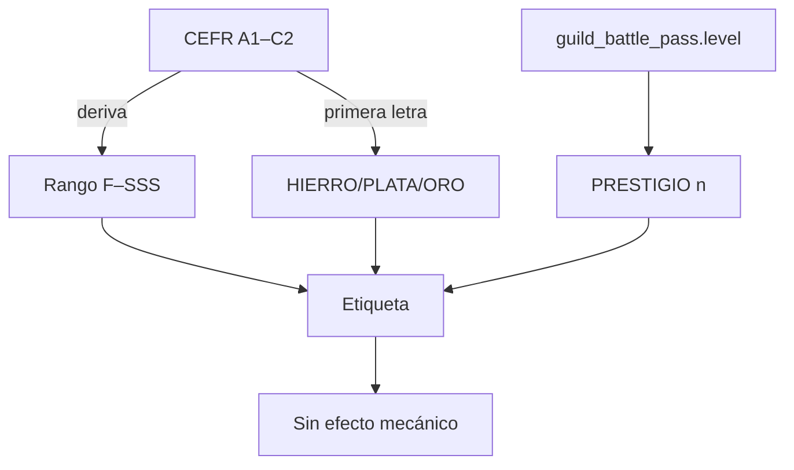
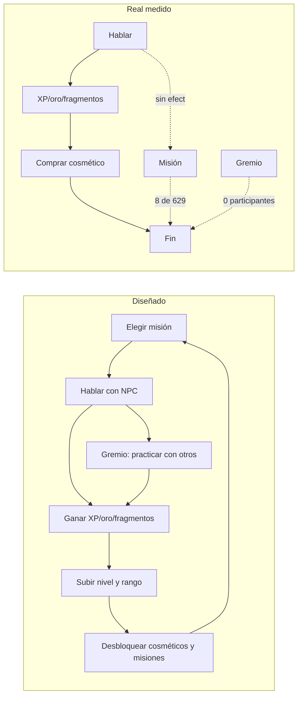

# 14 — Auditoría de game design y coherencia narrativa

> **Principio rector:** cada funcionalidad debe tener una razón de existir en el
> universo y aportar a **aprendizaje, progresión, sociedad o economía**. Si no
> aporta a ninguno, o aporta a dos sin conectarlos, es decorado.
>
> Base: código de `origin/master` (31-oct-2026) y consultas de solo lectura a
> producción. Sin revisión visual ni ejecución en dispositivo: lo sensorial es
> `[PENDIENTE DE VALIDAR]`. Ver estado técnico en
> [`12-current-state-and-gaps.md`](12-current-state-and-gaps.md).

---

## 1. El universo que cuenta la app (y el que no)

La app mezcla **tres metáforas** sin declarar cuál manda:

| Metáfora | Vocabulario | Evidencia |
|---|---|---|
| Cazador de mazmorras (System / Solo Leveling) | "Hunter", mazmorras, puertas, aura, "Usuario del Aura" | `dashboard_screen.dart:332`; `aura_system.dart:5-19`; `l10n` `aura_awakening_banner_desc` |
| Estamento feudal | PLEBEYO / NOBLE / REALEZA / DIVINO, "estamento", prestigio, títulos | `subscription_plans` (BD); `paywall_upgrade_subtitle` |
| Gremio de taberna (D&D) | Gremio, mesas, asientos, Maestre de Mesa, taberna | `chat_rooms_screen.dart:993-1063`; `guild_master_floating_banner.dart:70` |

El jugador recibe cuatro nombres distintos (Hunter, aventurero, cazador,
Usuario del Aura) y el "rango" tiene **tres escalas incompatibles**: F–SSS
(`CefrRank`), HIERRO/PLATA/ORO (gremio) y el "PRESTIGIO {n}" del battle pass.
Ninguna se explica contra las otras.

---

## 2. Bucle diseñado vs bucle real

El bucle real tiene **un solo tramo con evidencia de uso**: conversación →
recompensa. Todo lo que debería devolver al jugador al inicio (misión cumplida,
rango, gremio, temporada) está roto, vacío o decorativo.

---

## 3. Hallazgos

### G-01 · Siete fuentes de misión y solo dos visibles

| | |
|---|---|
| **Problema** | El modelo soporta `daily`, `weekly`, `secondary`, `secret`, `emergency`, `guild` y `event`. La UI muestra solo diarias y semanales; el resto queda oculto "hasta que exista un flujo". Hay 13 plantillas `secondary` activas que ningún jugador puede ver. |
| **Evidencia** | `mission_visibility.dart:29-30` (visibles) y `:62-67` (ocultas); `mission_templates`: 15 daily + 7 weekly + **13 secondary**; `secret/emergency/global_events` con 0 filas; `missions_screen.dart:13-15`. |
| **Impacto** | El jugador ve una lista corta y repetitiva; el equipo mantiene siete motores para dos. El contenido de gremio y evento no existe, así que la promesa "el mundo te propone cosas" se queda en dos pestañas. |
| **Alternativa conceptual** | **Una sola fuente de misión con tres capas**: una misión principal del día (narrativa, del tutor), dos contratos de gremio (sociales, asíncronos) y un evento semanal de mundo. Eliminar del modelo lo que no tenga productor y una fecha. Regla: *si no se puede completar hoy con una acción existente, no se muestra*. |

### G-02 · Se paga por tiempo, no por aprendizaje

| | |
|---|---|
| **Problema** | La recompensa depende de minutos y número de objetivos, no de calidad. Diez minutos de silencio con un turno cuentan igual que una sesión densa; el CEFR solo añade un bonus fijo. El dinero del juego premia *estar*, no *mejorar*. |
| **Evidencia** | RPC `apply_session_rewards`: `xp = p_minutes * 10`; `gold = p_objectives * (10 + bonus)`; `fragments = p_objectives * (5 + bonus)`; bonus CEFR 0–5. |
| **Impacto** | El progreso deja de ser señal de aprendizaje (y deja de ser defendible ante un padre o un adulto que paga). Además es farmeable: una sesión larga y vacía paga más que una corta y buena. |
| **Alternativa conceptual** | **Recompensa en dos monedas**: *Esfuerzo* (minutos, como hoy) y *Maestría* (objetivos nuevos, precisión, palabras retenidas a 7 días). Solo la Maestría sube rango y desbloquea contenido; el Esfuerzo compra cosméticos. Así el oro sigue siendo tiempo y el rango vuelve a ser logro. |

### G-03 · El rango no gobierna nada

| | |
|---|---|
| **Problema** | El rango F–SSS es una función del CEFR: no abre ni cierra puertas. Las misiones se filtran por `min_cefr_level`, no por rango; los cosméticos por nivel de XP. Un jugador "S" no puede hacer nada que un "D" no pueda, salvo presumir. |
| **Evidencia** | `aura_system.dart:83-86` (`expectedRank` = `CefrRank.gameRankFromCefr`); `mission_repository.dart:109-120` (gate por CEFR); `cosmetic_catalog.required_level` (gate por nivel). |
| **Impacto** | El rango es una etiqueta duplicada del CEFR. La fantasía de ascenso (la razón por la que existe el RPG) no tiene escalones que se sientan. |
| **Alternativa conceptual** | **El rango como llave social y de contenido**: exámenes de rango con jefe (ya existe `boss_exam`) que desbloquean mazmorras temáticas, mesas del gremio y títulos. El CEFR mide lengua; el rango mide *lo que el jugador se atreve a hacer con ella*. |

### G-04 · Cinco recursos, tres sin función demostrable

| | |
|---|---|
| **Problema** | Maná, oro y fragmentos tienen sumidero. **Gemas** solo tienen un sumidero real (cosméticos premium) porque el freeze no protege nada. **Pergaminos** se anuncian en la recompensa diaria pero no existen en datos ni tienen consumidor. Los **ítems de maná** tienen pantalla pero 0 filas. |
| **Evidencia** | `player_pergaminos` = 0; `generateDailyPergaminos` sin llamadores (`economy_repository_impl.dart:469`); `mana_items` = 0; `daily_reward_modal.dart:145-146` muestra "+N PERGAMINOS"; `_buildStreakFreezeCard` (`shop_screen.dart:746-830`). |
| **Impacto** | La economía enseña monedas que no sirven; el jugador aprende a ignorar la recompensa diaria. Cada recurso muerto resta credibilidad a los vivos. |
| **Alternativa conceptual** | **Tres recursos con una frase cada uno**: Maná = *puedo practicar*; Oro = *me visto*; Gemas = *me salto una espera* (y que la espera exista). Retirar pergaminos e ítems de maná de la UI hasta que tengan consumidor, o convertirlos en la misma cosa (pergamino = reintento de una lección fallida). |

### G-05 · La racha tiene dos verdades y el freeze no protege

| | |
|---|---|
| **Problema** | La racha que se muestra sale de `user_language_profiles.current_streak`, que actualiza `register_practice`. El freeze de racha se compra y se guarda en `player_streaks.streak_freezes`, que **ninguna función consume**: si faltas un día, la racha vuelve a 1 aunque tengas 3 freezes. Además las dos tablas ya divergen en 4 de 52 usuarios. |
| **Evidencia** | `register_practice` (actualiza `user_language_profiles`, no lee freezes); `purchase_streak_freeze` (escribe `player_streaks`); `guard_player_streak_freezes` solo impide que el cliente suba el contador; consulta de divergencia: 4/52. |
| **Impacto** | Se vende (con gemas) una protección que no existe. Es el peor tipo de defecto de game design: el jugador paga y no recibe la fantasía. |
| **Alternativa conceptual** | **Una sola racha, un solo dueño**: mover la racha a `player_streaks` (o eliminar esa tabla), y que el cálculo de días consuma un freeze automáticamente al detectar un hueco de un día. Mostrar "freeze consumido" como evento, no como inventario muerto. |

### G-06 · Battle pass y prestigio: dos progresiones que se contradicen

| | |
|---|---|
| **Problema** | El gremio pinta "PRESTIGIO {level}" leyendo `guild_battle_pass.level`, pero el prestigio real vive en `prestige_ladder`/`user_titles`. No hay ninguna función que suba el nivel del battle pass: las 23 filas están en nivel 1. |
| **Evidencia** | `chat_rooms_screen.dart:1012-1015,1061-1063`; `guild_battle_pass` (23 filas, todas `level = 1`); búsqueda en `pg_proc` de funciones que toquen `guild_battle_pass`: 0; `prestige_ladder` (21 filas) y `user_titles` (12). |
| **Impacto** | Dos números llamados "prestigio" que no se mueven. El jugador ve una barra de temporada que nunca avanza y deja de mirarla. |
| **Alternativa conceptual** | **Elegir una**: (a) temporada real con 30 niveles, XP de temporada desde sesiones y misiones, recompensa cosmética al final; o (b) retirar el battle pass y dejar el prestigio de títulos como único eje. Mantener ambos sin conexión es la peor opción. |

### G-07 · La membresía disfrazada de tienda

| | |
|---|---|
| **Problema** | Hay dos superficies comerciales con tres nombres: la **tienda** (oro/gemas/fragmentos), el **paywall** (planes) y el **Santuario de Maná**, cuyo botón "Obtener maná" abre el paywall. No se vende maná suelto; se vende una suscripción. El jugador que quiere "recargar" aterriza en un comparador de planes. |
| **Evidencia** | `dungeon_guardian_screen.dart:208-214`; `paywall_screen.dart:314,509-520`; `docs/PRODUCT.md:60-61` ("la venta directa de maná sigue retirada"). |
| **Impacto** | Rompe la promesa de la fantasía (un Guardián no te vende una suscripción) y añade fricción en el momento de máxima intención. Además mezcla dos economías: tiempo (maná) y dinero (planes). |
| **Alternativa conceptual** | **Separar los dos contratos**: la tienda vende *objetos* (oro/gemas); la **membresía del gremio** (nobleza/plebeyo) se presenta en su propia pantalla, con nombre de contrato, no de compra. En el Santuario, el CTA honesto es "Ampliar el pacto" y una alternativa gratuita clara de **coste cero** (repaso SRS, listening, Mis errores — D-06). |

### G-08 · Módulos que parecen islas

| | |
|---|---|
| **Problema** | Listening, gremio, informe semanal, "Mis errores" y el repaso SRS existen, pero no se alimentan entre sí ni devuelven al jugador a la práctica. Listening tiene 3 ejercicios y 0 intentos; el gremio tiene 199 quests y 0 participantes; el informe es solo lectura. |
| **Evidencia** | `listening_exercises` = 3 / `listening_attempts` = 0; `chat_room_participants` = 0; `guild_quest_pool` = 199 / `player_completed_quests` = 0; `learning_path_roadmap.dart:472` (entrada a listening); `weekly_report_card.dart:44`; `my_errors_screen.dart` sin CTA de práctica. |
| **Impacto** | Cada módulo pide atención y no devuelve nada al bucle. El jugador los visita una vez y no vuelve: son coste de mantenimiento sin retención. |
| **Alternativa conceptual** | **Un solo "hoy" que enrute a todos**: la tarjeta de "Mis errores" propone la lección que cubre el error más frecuente; el informe semanal propone la siguiente acción; listening se desbloquea como *variante* de la lección que estás haciendo, no como pestaña aparte. Regla: *ningún módulo es un destino, todos son una parada*. |

### G-09 · La clase y los intereses: decisiones sin consecuencia

| | |
|---|---|
| **Problema** | Elegir clase (guerrero, mago, etc.) solo cambia el avatar; elegir intereses solo matiza el prompt y el orden de lecciones. La meta diaria es un anillo informativo. Ninguna decisión de personaje altera el juego. |
| **Evidencia** | `core/utils/player_identity.dart:6` (`playerClassOf`) usado solo por `RpgAvatar` (`rpg_avatar.dart:43`) y `profile_edit_screen.dart`; `hunter_classes` en onboarding; `daily_goal_ring_card.dart:15` (solo lectura de `daily_goal_minutes`). |
| **Impacto** | El onboarding pide decisiones que el juego luego ignora. Enseña al jugador que elegir no importa, justo antes de pedirle que elija un plan. |
| **Alternativa conceptual** | **Clase = estilo de práctica**: el Mago recibe misiones de vocabulario y descripción; el Guerrero, de conversación directa y negociación; el Explorador, de listening y acentos. Intereses = *tema del mundo* (taberna, mercado, torre) que cambia escenarios, no solo el prompt. Meta diaria = contrato que paga un bonus al cumplirse. |

### G-10 · El gremio es una sala de espera

| | |
|---|---|
| **Problema** | El gremio exige coincidencia en tiempo real (mesas y voz) sin ninguna actividad asíncrona que dé valor a estar solo. Se etiqueta a sí mismo como "DEMO" en la sala de voz y muestra un roster de presencia real que hoy está vacío. |
| **Evidencia** | `chat_room_participants` = 0; `voice_room_screen.dart:703` ("AUDIO DEL GREMIO: DEMO"); `guild_announcements` = 4 fijos; `guild_quest_pool` = 199 sin completar; `chat_rooms_screen.dart:65` (conteo "REAL" de conectados). |
| **Impacto** | Un módulo social vacío es peor que no tenerlo: comunica que el juego está muerto. Y "DEMO" en la propia UI lo confirma. |
| **Alternativa conceptual** | **Gremio asíncrono primero**: tablón de contratos (quest pool), reputación por aportar palabras/frases al gremio, y "mesa" como evento programado, no como sala permanente. Si no hay 20 jugadores activos, el gremio debe ser un NPC colectivo (el Maestre) que da misiones y no un chat vacío. |

### G-11 · El cierre de sesión no demuestra aprendizaje

| | |
|---|---|
| **Problema** | El resumen entrega XP/oro/fragmentos y palabras, pero no responde "¿qué sabes hacer ahora que no sabías antes?". Las métricas que sí lo harían (retención a 7 días, radar de habilidades, fluidez diaria) viven en otra pestaña y en otro momento. |
| **Evidencia** | `session_summary_screen.dart:23,614-665`; `srs_review_card.dart:27-30` (retención 7d y palabras dominadas); `learning_evidence_card.dart`; `daily_fluency_stats` (16 filas). |
| **Impacto** | El jugador no percibe progreso de aprendizaje, solo de moneda. La app compite con un juego, no con un tutor, y pierde en ambas categorías. |
| **Alternativa conceptual** | **Resumen con una frase de evidencia**: "usaste 4 estructuras nuevas; 2 palabras pasan a repaso largo; tu fluidez subió 3 puntos en 2 semanas". La recompensa económica va debajo, no encima. |

---

## 4. Checklist del principio aplicado

| Funcionalidad | Razón de existir declarada | Aporta a | Veredicto |
|---|---|---|---|
| Conversación con NPC | Practicar habla | Aprendizaje | ✅ Núcleo real |
| Evaluación de objetivos | Medir logro | Aprendizaje + progresión | ✅ |
| Maná | Limitar coste de IA | Economía | ✅ (pero ver G-07) |
| CEFR | Situar nivel | Aprendizaje | ✅ |
| Rango F–SSS | Fantasía de ascenso | Progresión | ⚠️ Sin efecto (G-03) |
| Aura | Estatus visual | Progresión | ⚠️ Solo color |
| Prestigio/títulos | Estatus | Sociedad | ⚠️ Sin escaparate social |
| Misiones diarias | Ritmo | Progresión | ⚠️ Embudo roto (G-01) |
| Misiones secondary/secret/event | Variedad | Progresión | ❌ Sin productor ni UI |
| Oro / fragmentos | Cosmética | Economía | ✅ |
| Gemas | Atajo | Economía | ⚠️ Un solo sumidero real |
| Pergaminos | Repaso | Aprendizaje | ❌ 0 instancias |
| Ítems de maná | Build | Economía | ❌ 0 instancias |
| Freeze de racha | Proteger hábito | Retención | ❌ No protege (G-05) |
| Battle pass | Temporada | Progresión | ❌ Congelado (G-06) |
| Gremio | Sociedad | Sociedad | ⚠️ Vacío (G-10) |
| Listening | Variedad | Aprendizaje | ⚠️ 3 ejercicios |
| SRS | Retención léxica | Aprendizaje | ✅ (poco uso) |
| Informe semanal | Evidencia | Aprendizaje | ✅ (solo lectura) |
| Clase/intereses/meta | Identidad | Sociedad | ⚠️ Sin consecuencia (G-09) |

**Resultado:** de 20 funcionalidades, **7 son núcleo sólido**, **8 son parciales o
decorativas** y **5 no deberían estar en la UI** en su estado actual.

---

## 5. Conclusión

El problema no es que falte juego: es que **hay demasiado juego sin
consecuencias**. La app tiene un tutor que funciona y un RPG que no decide nada.
Cada sistema añadido sin conexión resta credibilidad al conjunto, y el jugador lo
aprende rápido: 0 compras, 0 gremio, 8 misiones completadas.

Tres decisiones cambian la naturaleza del producto:

1. **El rango vuelve a ser una llave** (G-03 + G-06): exige, desbloquea, se
   exhibe. Sin esto, el RPG es un skin.
2. **La maestría paga distinto que el tiempo** (G-02 + G-11): el resumen
   demuestra aprendizaje y el rango depende de él.
3. **Se retira todo lo que no tenga productor** (G-01, G-04, G-06, G-10):
   menos superficie, más densidad. Un juego con tres bucles vivos retiene más que
   uno con diez bucles muertos.

Las propuestas concretas, separadas del comportamiento actual, están en
[`15-improvement-proposals.md`](15-improvement-proposals.md). Las decisiones que
requieren al dueño, en [`18-open-questions-and-decisions.md`](18-open-questions-and-decisions.md).
