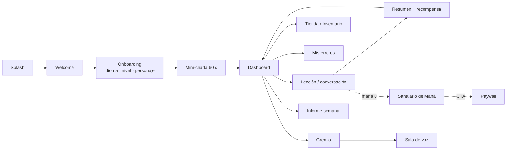

# product-discovery — índice de entrada

> Carpeta de **ingeniería inversa del producto** `hiulett/TutorSaas`
> ("Dungeon of English"): Flutter + Supabase, inglés conversacional con una capa
> RPG. Este README está pensado para que **otra IA** (o una persona nueva)
> entienda qué es la app, en qué orden leer y dónde está la verdad de cada cosa
> sin recorrer el repo entero.
>
> Medición base: **31-oct-2026**, `origin/master`, worktree `p14-ai-usage`.
> Antes de leer nada más: [`_baseline.md`](_baseline.md).

---

## 1. Qué es la app (en 8 líneas)

App **Android** (sin iOS, por decisión) para practicar **inglés oral** con NPCs
de IA. El pipeline es `record` (AAC) → Edge Function `llm-proxy` (Groq Whisper
STT + DeepSeek SSE) → `flutter_tts`. Encima hay una capa RPG: maná que se gasta
al hablar, XP/oro/fragmentos/gemas, niveles, aura, rango F–SSS, prestigio,
títulos, misiones diarias/semanales, gremio con salas de voz y una tienda de
cosméticos. Monetización: Play Billing + RevenueCat (planes `plebeyo`, `noble`,
`realeza`).

- **Versión:** `1.0.21+22` · **Backend:** Supabase `sipiumfdpvnszthykyog`
- **Escala:** 20 pantallas · 20 rutas · 16 features · 84 tablas · 82 funciones ·
  130 políticas RLS · 741 pruebas · 8 Edge Functions
- **Idiomas:** UI en es/en/pt; aprendizaje solo inglés

---

## 2. Cómo leer esta carpeta

Etiquetas usadas en todos los documentos:

| Etiqueta | Significa |
|---|---|
| `[IMPLEMENTADO]` | Existe y se puede rastrear en código o datos |
| `[PARCIAL]` | Existe, pero con una brecha declarada |
| `[CONCEPTUAL]` | Diseñado, sin flujo real (código muerto, tabla vacía, UI sin productor) |
| `[PROPUESTA]` | No existe; es una idea de mejora (solo en `15`) |
| `[PENDIENTE DE VALIDAR]` | No verificable desde este entorno |

**Regla de evidencia:** cada afirmación lleva `archivo:línea`, nombre de RPC,
consulta SQL o issue. Si no hay evidencia, se marca `[PENDIENTE DE VALIDAR]` y se
dice qué falta. El repositorio **no** reproduce el esquema: los datos se
verifican contra producción (solo lectura).

**Límites de esta investigación (importante):**

- **No hubo revisión visual.** Sin visión de imágenes y con el móvil
  desconectado. Todo lo estético, el contraste percibido, el overflow real, el
  TTS y la sensación de juego quedan `[PENDIENTE DE VALIDAR]`.
- **No se ejecutó la app ni se probaron compras** (`payments` = 0 en producción).
- **No hay conclusiones de retención**: 68 usuarios, en su mayoría de prueba.
- Los conteos son un snapshot; pueden incluir cuentas de prueba.

---

## 3. Orden de lectura recomendado

| Paso | Documento | Para qué | Tiempo |
|---|---|---|---|
| 0 | [`_baseline.md`](_baseline.md) | Cifras y tokens medidos; si algo contradice, manda el código | 3 min |
| 1 | **Este README** | Mapa general y límites | 5 min |
| 2 | [`12-current-state-and-gaps.md`](12-current-state-and-gaps.md) | Qué está implementado, parcial, muerto o no verificable, con evidencia | 15 min |
| 3 | [`14-game-design-audit.md`](14-game-design-audit.md) | Por qué el RPG no "juega": hallazgos G-01…G-11 con alternativa conceptual | 15 min |
| 4 | [`18-open-questions-and-decisions.md`](18-open-questions-and-decisions.md) | Qué necesita aprobación del dueño antes de tocar nada | 10 min |
| 5 | [`15-improvement-proposals.md`](15-improvement-proposals.md) | Propuestas separadas del estado actual, priorizadas | 20 min |
| 6 | [`../PRODUCT.md`](../PRODUCT.md) | Reglas de negocio vigentes (planes, monedas, maná, decisiones) | 8 min |
| 7 | [`../ARCHITECTURE.md`](../ARCHITECTURE.md) | Capas, rutas, pipeline de voz, tema | 8 min |
| 8 | [`../DATA_MODEL.md`](../DATA_MODEL.md) | Tablas, RLS, RPC (producción manda) | referencia |
| 9 | [`../ui-ux-audit/06-improvement-backlog.md`](../ui-ux-audit/06-improvement-backlog.md) | Los 39 hallazgos UX con archivo:línea | referencia |
| 10 | [`../product-audit/00-INDICE.md`](../product-audit/00-INDICE.md) | Auditoría integral previa (25-oct); algunas cifras ya están desfasadas | referencia |

Los documentos `00`–`11`, `13`, `16` y `17` de esta carpeta los escriben otros
agentes en paralelo; este README no los resume para no duplicar ni contradecir.
Los cuatro documentos propios de esta entrega son **12, 14, 15 y 18**.

---

## 4. Dónde vive cada cosa

| Si buscas… | Ve a |
|---|---|
| Reglas de negocio (planes, maná, monedas, premium) | [`../PRODUCT.md`](../PRODUCT.md) |
| Decisiones históricas y qué ya no es cierto | [`../HISTORY.md`](../HISTORY.md) |
| Rutas y pantallas | `lib/app/router.dart` · [`../ui-ux-audit/02-screen-inventory.md`](../ui-ux-audit/02-screen-inventory.md) |
| Pipeline de voz y capas | [`../ARCHITECTURE.md`](../ARCHITECTURE.md) · `lib/features/conversation/` |
| Tablas, RLS, RPC | [`../DATA_MODEL.md`](../DATA_MODEL.md) (verificar contra BD) |
| Entornos, secretos, cron, Edge Functions | [`../OPERATIONS.md`](../OPERATIONS.md) |
| Build y publicación | [`../RELEASE.md`](../RELEASE.md) |
| Estado de migraciones | [`../runbooks/MIGRATION_STATUS.md`](../runbooks/MIGRATION_STATUS.md) |
| Identidad visual (tokens reales) | [`_baseline.md`](_baseline.md) §tokens · `lib/core/theme/` |
| Qué está roto y por qué | [`12`](12-current-state-and-gaps.md) |
| Qué cambiar y en qué orden | [`15`](15-improvement-proposals.md) |
| Qué decidir antes de cambiar | [`18`](18-open-questions-and-decisions.md) |

---

## 5. Mecánicas actuales (resumen operativo)

| Sistema | Regla real | Fuente |
|---|---|---|
| **Maná** | Cada acción de IA cuesta maná: Oráculo 15, mazmorra 12, chat libre 8, evaluación 30, curaduría de vocabulario 2, lección generada 100 | `ai_action_costs` (BD) |
| **Tope gratuito** | 200/día en plan `plebeyo`; el turno de gracia diario lo concede el servidor (`claim_mana_grace`) | `docs/PRODUCT.md:123-137` |
| **Recompensa de sesión** | XP = minutos×10; oro = objetivos×(10+bonus CEFR); fragmentos = objetivos×(5+bonus) | RPC `apply_session_rewards` |
| **Nivel** | `1 + XP/1000`; desbloquea cosméticos y paga bolsas de oro | `docs/PRODUCT.md:56-61` |
| **Rango** | F–SSS derivado del CEFR; **sin efecto mecánico** hoy | `lib/features/dashboard/domain/models/aura_system.dart:83-86` |
| **Aura** | 5 tiers; se despierta con CEFR ≥ B1 o superando la etapa básica | `aura_system.dart` |
| **Misiones** | Solo diarias y semanales visibles; el progreso lo avanza el servidor por triggers | `mission_visibility.dart:29-30` |
| **Racha** | `user_language_profiles.current_streak` vía `register_practice`; `player_streaks` es una copia no consumida | RPC `register_practice` |
| **Planes** | `plebeyo` $0 (3.000 maná/mes), `noble` $4.99 (17.000 + trial 7d), `realeza` $9.99 (20.500) | `subscription_plans` (3 activos) |
| **Premium** | No vende ventajas de aprendizaje evaluado; sí maná, historial de informe y cosméticos | `docs/PRODUCT.md:30-42` |

---

## 6. Identidad visual (resumen)

- **Solo tema oscuro.** `voidBg #05070E`, superficies `#11131B`–`#272A32`.
- **Acentos:** `manaCyan #00E5FF`, `runeViolet #9D4EDD`, `royalGold`,
  `emeraldGreen`, `crimsonRed`.
- **Radios:** 4 / 8 / 12 / 999 (`AppRadius`). **Espaciado:** 4–48 (`AppSpacing`).
- **Tipografía empaquetada** en `assets/google_fonts/`: Space Grotesk (títulos),
  Inter (cuerpo), JetBrains Mono (datos). No se descarga en runtime.
- **Deuda medida:** 419 `EdgeInsets` literales frente a 4 usos de `AppSpacing`;
  95 colores hardcodeados; 384 `GoogleFonts.*` frente a 114 `AppTypography.*`;
  4 estilos del `TextTheme` caen en Roboto no empaquetado.
- **Trampa:** `GlassCard` gana la arena de gestos; el tap va en su `onTap:`, no
  en un `GestureDetector` externo.

---

## 7. Flujos principales

Flujo comercial: `Play Billing → RevenueCat → webhook → Supabase → app`, con
`sync-entitlement` al abrir sesión. Detalle en [`../PRODUCT.md`](../PRODUCT.md) §7.

---

## 8. Decisiones pendientes (top 5)

Antes de implementar cualquier propuesta, el dueño debe resolver (detalle y coste
en [`18`](18-open-questions-and-decisions.md)):

1. **D-01** Metáfora dominante del universo (hoy conviven tres).
2. **D-02** ¿Norte aprendizaje o juego? Define la métrica primaria.
3. **D-07** ¿El rango abre contenido o queda como etiqueta?
4. **D-03/D-04** Racha, freeze y battle pass: ¿se conectan o se retiran?
5. **D-13** ¿Quién firma la validación visual y con qué dispositivo?

---

## 9. Cómo mantener esta carpeta

1. Si cambia el código o el esquema, **manda el código**: actualizar
   [`_baseline.md`](_baseline.md) y el documento afectado en el mismo cambio.
2. No duplicar lo que ya está en `../product-audit/` o `../ui-ux-audit/`: citar y
   corregir la deriva.
3. Toda propuesta nueva va a `15`, no a `12` (que es estado, no idea).
4. Toda decisión aprobada se registra en `18` §4 y, si contradice
   `../PRODUCT.md`, se actualiza ese documento.
5. Si aparece una revisión visual real (capturas + dispositivo), sustituir los
   `[PENDIENTE DE VALIDAR]` visuales por evidencia y anotar la fecha.
